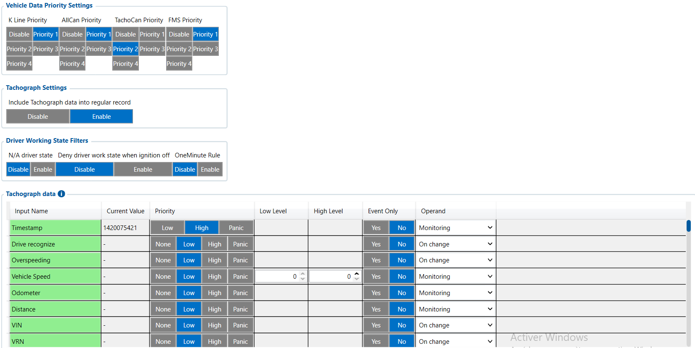

# Tachograph Data — Configurator notes (EN)

> **Note:** Supplementary notes extracted from the French Configurator tab PDF
> `tachograph-data-tab.pdf`, generated on
> **2026-11-05T08:37:58Z** — newer than the wiki snapshot kept in
> this folder. The text was translated into English; it supplements the
> reference page [`lvcan-fms-tachograph-data-elements.md`](../lvcan-fms-tachograph-data-elements.md).
> PDF-extraction quirks: section titles sometimes appear
> after the text they introduce, figures reuse page-1
> filenames, and some wide tables are restituted row by row because the PDF
> text layer does not always preserve columns. Unarchived `docs.tinolyx.com`
> image links were removed; unique figures are grouped under `## Figures` at
> the end of the file.

<!-- PDF p. 2 -->

1. Manage source priority: Choose which bus ( K-Line , TachoCan , FMS , AllCan ) prevails if several interfaces provide the same information (e.g. speed or mileage).

2. Standardize social telemetry: Retrieve all European/international legal variables (driver 1 and 2 activities, card numbers, 9-hour driving excess infringements, remaining driving autonomy).

3. Enrich GPS tracking: Merge conventional geolocation packets with the driver's actual work context ( Include Tachograph data into regular record = Enable ).

## Tachograph Data

The Tachograph Data tab acts as the integration manager for the truck's social and
regulatory data. It manages the gateway between the tachograph (DTCO), the vehicle
bus and the tracking platform (Wialon). It is mainly used to:

### 1. Vehicle Data Priority Settings (Vehicle Data Priority Settings)

<!-- PDF p. 3 -->

Hierarchization of the FMC650 acquisition channels when the same variable (e.g. Speed) is
broadcast by several vehicle networks.

**K-Line Priority**

Meaning: Priority assigned to the K-Line diagnostic interface.
Current value: Priority 1 .
Role: Places the K-Line channel at the highest priority level for telemetry
capture if this line is wired.

**AllCan Priority**

Meaning: Priority assigned to the vehicle's generic CAN network.
Current value: Priority 1 .
Role: Processes data read on the global CAN bus with the highest priority.

**TachoCan Priority**

Meaning: Priority assigned to the digital tachograph's dedicated CAN port
(Tachograph socket C/D).
Current value: Priority 1 (or Priority 2 depending on profile).
Role: Dedicated channel for extracting regulatory legal data (DTCO 1381, Stoneridge, etc.).

**FMS Priority**

Meaning: Priority assigned to the standardized FMS interface (SAE J1939).
Current value: Priority 1 .
Role: Defines the factory FMS interface as the main source of operational
data.
Parameters governing the integration of legal variables into geolocation frames and the
management of driver events.

### 2. Processing & Driver Rules (Record Integration & Rules)

<!-- PDF p. 4 -->

**Include Tachograph Data into Regular Record**

Meaning: Inclusion of tachograph telemetry in the periodic GPS AVL
packets.
Current value: Enable .
Role: Injects driving states, card numbers and remaining times
directly into the frames sent to the server (Wialon).

**N/A Driver State & Deny Driver Work State When Ignition Off**

Meaning: Management of unavailable driver states and locking of work
with the ignition off.
Current values: Disable / Disable .
Role: Keeps the raw states reported by the tachograph without forcing automatic
filters or corrections during engine shutdowns.
Key telematics elements monitored within the data matrix.

**Vehicle Speed & Odometer (Mileage)**

Configuration: Priority = Low , Operand = Monitoring , Event Only = No .
Role: Continuous reporting of the tachograph's actual calibrated speed (more accurate than GPS) and the chassis legal odometer.

**VIN & VRN (Chassis Number & Registration)**

Configuration: Priority = Low , Operand = On change .
Role: Single transmission upon modification to validate the pairing of the
FMC650 unit with the correct vehicle.

**Driver 1 / 2 Working State & Identification Number**

Configuration: Priority = Low , Operand = On change .

### 3. Legal Variables & Tachograph Metrics (I/O Array)

<!-- PDF p. 5 -->

Role: Precise timestamping of activity changes (Driving, Work, Availability, Rest) and capture of the inserted identifier/card.

**Drive / Rest / Continuous / Cumulative Driving Times**

Configuration: Operand = Monitoring or On change depending on the indicator.
Role: Real-time telemetry of the regulatory counters (continuous driving time, daily rest, remaining time before a mandatory break).
Tab
Main role
Nature of the data
Primary business use
FMS I/O
Engine & chassis data
Technical (RPM, fuel, AdBlue)
Maintenance, fuel
management
Manual CAN
Custom decoding
Raw / Proprietary (hexadecimal IDs)
Specific non-FMS
captures
Manual CAN Requests
ECU polling
Request/Response
Diagnostics, specific PIDs
Manual CAN Commands
Network actuation
Orders / Commands
Control of third-party
equipment
Tachograph Data
Regulatory & social
data
Legal / Driver (Cards, driving times)
Compliance, payroll, time
tracking
Comparative summary of FMC650 data collection modes
Tachograph & Telematics integration architecture
```
 ┌──────────────────────────────────────────────────────────────────────────┐
 │                         VEHICLE / TACHO SOURCES                          │
 └──────┬─────────────────┬───────────────────┬───────────────────┬─────────┘
        │                 │                   │                   │
   (K-Line)          (AllCan)            (TachoCan)             (FMS)
   Priority 1        Priority 1          Priority 1           Priority 1
        │                 │                   │                   │
        └─────────────────┴─────────┬─────────┴───────────────────┘
                                    ▼
                     ┌──────────────────────────────┐
                     │   TACHOGRAPH DATA ENGINE     │
                     │  (Arbitration and assembly)  │
                     └──────────────┬───────────────┘
                                    │
```

| Tab | Main role | Nature of the data | Primary business use |
| --- | --- | --- | --- |
| FMS I/O | Engine & chassis data | Technical (RPM, fuel, AdBlue) | Maintenance, fuel management |
| Manual CAN | Custom decoding | Raw / Proprietary (hexadecimal IDs) | Specific non-FMS captures |
| Manual CAN Requests | ECU polling | Request/Response | Diagnostics, specific PIDs |
| Manual CAN Commands | Network actuation | Orders / Commands | Control of third-party equipment |
| Tachograph Data | Regulatory & social data | Legal / Driver (Cards, driving times) | Compliance, payroll, time tracking |

<!-- PDF p. 6 -->

```
▼  (Include into Regular Record = Enable)
                     ┌──────────────────────────────┐
                     │   COMPLETE AVL FRAME (GPS)   │
                     ├──────────────────────────────┤
                     │ Position + Speed + Odometer  │
                     │ + Driver Card + Time         │
                     └──────────────┬───────────────┘
                                    │
                                    ▼
                     ┌──────────────────────────────┐
                     │   WEBFLEET / WIALON SERVER   │
                     └──────────────────────────────┘
```

## Figures

Unique figures extracted from the PDF. The extraction reuses the same
filenames for all pages; each image is therefore referenced only once here.



