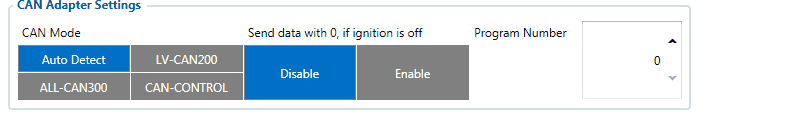
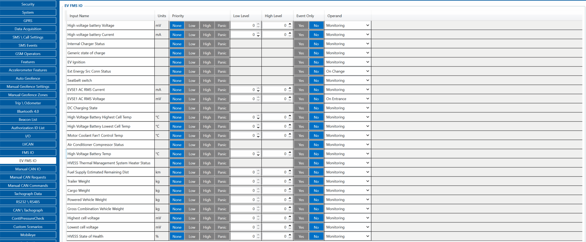
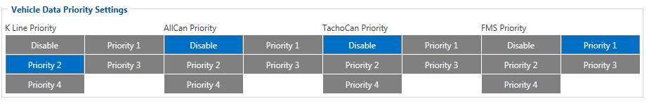
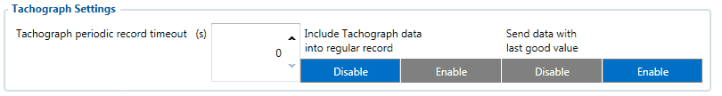
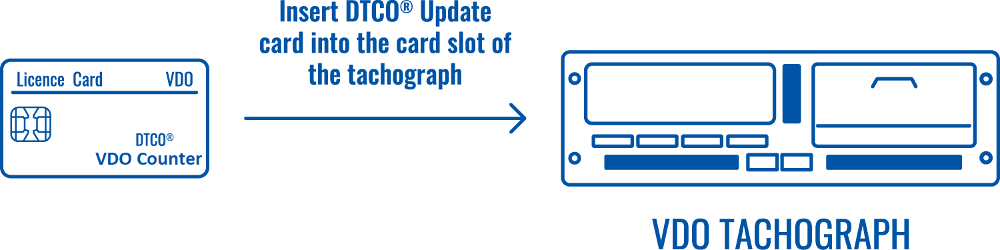

# FMC650 LVCAN I/O,FMS IO and Tachograph data elements

*LVCAN*, *FMS IO* and *Tachograph data* sections shows I/O elements that can be obtained accordingly from external devices connected to FMC640 device. All I/O configuration is as described I/O elements}

# LVCAN

LVCAN elements can be configured in same way like with normal I/O elements. LVCAN IO elements can also be configured remotely via SMS command.

# FMS

FMS, or Fleet Management Systems Interface, is a sector to configure and manage events based on vehicle data of commercial vehicles. Vehicle data comes through CAN lines. Event configuring isn’t different from those in LVCAN and I/O sectors. The only difference is IDs.

# EV FMS

Heavy duty logistics vehicle manufacturers are swiftly moving towards a more sustainable logistic supply chain by providing electric heavy duty trucks.
Most of the main manufacturers are already offering electric versions of their most successful traditional truck lineup.

This change opens up new possibilities and new challenges for telematics companies.

Fortunately, the market remains in agreement for standardized telematics communication protocol – [FMS Standard](https://wiki.teltonika-gps.com/view/FMC650_LVCAN_I/O,FMS_IO_and_Tachograph_data_elements#FMS).

This standard implies same communication protocol and same [connection practices](https://teltonika-gps.com/products/accessories/data-cables/fms-cable).

Relative information about AVL IDs can be found in this [link](https://wiki.teltonika-gps.com/view/FMB641_Teltonika_Data_Sending_Parameters_ID).

The protocol is expanded to support electric vehicle information which can be read with FMC650/FMM650:
Battery voltage/temperature, coolant information and many new electric FMS related information can be found in new tab “EV FMS IO”:

# Tachograph Data

Tachograph data can be taken from Tachograph via K-Line, ALLCAN, Tacho CAN or FMS. Data here is constantly refreshed. As the other elements’ windows, this one also has all the options to configure event generating.

By defaulf, FMC640 sends Tachograph data included into regular record, but device can be configured to send Tachograph data as separate AVL packet

If Tachograph data included into regular record is Disabled, Tachograph periodic record timeout will define how often Tachograph Data will be sent to the server as separate AVL packet.

*Send data with last good value*
Added a feature which allows to choose to generate Tachograph data record or not depending on remembered last good value. If parameter is enabled and if there were good data values received but now no new data is receiving, when record will be generated it will be filled with last good data values.
In base version as well as in this special firmware there is a 30 seconds timeout during which Kline values are still being stored in RAM.
If last good value parameter is disabled and good data stopped streaming, data will still be available for 30 seconds.

## Tachograph Counter related elements

Newly added IO elements (AVL ID 10504-10517 from 01.02.12 firmware version) include data reading from Tachograph Counter functionality – displaying daily/weekly remaining driving and rest times on tachograph menu.
Note that these parameters can be optional on your tachograph - meaning that by default not all the tachographs have this feature enabled/supported from the factory.
For example – VDO DTCO tachographs support the Counter functionality from version 2.0, however in OEM tachograph versions – non universal tachograph – meant specifically for truck manufacturer i.e. Mercedes/DAF – Counter functionality can be disabled from the factory.
**In order to properly read these IO elements with FMX640 – Counter functionality has to be enabled.**
VDO DTCO 2.1 tachograph can be updated via “DTCO VDO Counter Update Card” – **P/N A2C5951660366**

Newer DTCO versions can have the Counter functionality enabled by entering the license key provided by the manufacturer.
To see if new IO elements will be read from your tachograph, we recommend contacting your local workshop, specifying the tachograph part number and following the workshop instructions if any are required.
Tachograph data parameters which support different communications:

---

| Parameter | K-Line | K-Line (Front Panel) | ALLCAN | TachoCAN | FMS | — | — |
| --- | --- | --- | --- | --- | --- | --- | --- |
| **Parameter** | **K-Line** | **K-Line (Front Panel)** | **ALLCAN** | **TachoCAN** | **FMS** | — | — |
| Timestamp | + | + | - | + | - | — | — |
| Driver recognize | + | + | - | + | + | — | — |
| Overspeeding | + | + | - | + | + | — | — |
| Vehicle speed | + | + | + | + | + | — | — |
| Odometer | + | + | + | + | + | — | — |
| Distance | + | + | + | + | + | — | — |
| VIN | + | + | - | + | + | — | — |
| VRN | + | + | - | + | - | — | — |
| Driver 1 working state | + | + | + | + | + | — | — |
| Driver 2 working state | + | + | + | + | + | — | — |
| Driver 1 card | + | + | + | + | + | — | — |
| Driver 2 card | + | + | + | + | + | — | — |
| Driver 1 time related state | + | + | - | + | + | — | — |
| Driver 2 time related state | + | + | - | + | + | — | — |
| Driver 1 ID number | + | + | + | + | + | — | — |
| Driver 2 ID number | + | + | + | + | + | — | — |
| Card 1 issuing state | + | + | - | + | - | — | — |
| Card 2 issuing state | + | + | - | + | - | — | — |
| Driver 1 Continuous drive time | - | + | + | + | - | — | — |
| Driver 2 Continuous drive time | - | + | + | + | - | — | — |
| Driver 1 cumulative break time | - | + | + | + | - | — | — |
| Driver 2 cumulative break time | - | + | + | + | - | — | — |
| Driver 1 selected activity duration | - | + | + | + | - | — | — |
| Driver 2 selected activity duration | - | + | + | + | - | — | — |
| Driver 1 cumulative driving time | - | + | + | + | - | — | — |
| Driver 2 cumulative driving time | - | + | + | + | - | — | — |
| Data Source | + | + | + | + | + | — | — |
| **From Firmware 01.02.12:** | — | — | — | — | — | — | — |
| Drivers hours rules pre warning time delay | - | + | - | + | - | — | — |
| Out of scope condition | - | + | - | + | - | — | — |
| Next calibration date | - | + | - | + | - | — | — |
| Driver1 end of last daily rest period | - | + | - | + | - | — | — |
| Driver2 end of last daily rest period | - | + | - | + | - | — | — |
| Driver1 end of last weekly rest period | - | + | - | + | - | — | — |
| Driver2 end of last weekly rest period | - | + | - | + | - | — | — |
| Driver1 end of second last weekly rest period | - | + | - | + | - | — | — |
| Driver2 end of second last weekly rest period | - | + | - | + | - | — | — |
| Driver1 current daily driving time | - | + | - | + | - | — | — |
| Driver2 current daily driving time | - | + | - | + | - | — | — |
| Driver1 current weekly driving time | - | + | - | + | - | — | — |
| Driver2 current weekly driving time | - | + | - | + | - | — | — |
| Driver1 time left until new daily rest period | - | + | - | + | - | — | — |
| Driver2 time left until new daily rest period | - | + | - | + | - | — | — |
| Driver1 number of times 9h daily driving times exceeded | - | + | - | + | - | — | — |
| Driver2 number of times 9h daily driving times exceeded | - | + | - | + | - | — | — |
| Driver1 Name | - | + | - | + | - | — | — |
| Driver1 SurName | - | + | - | + | - | — | — |
| Driver2 Name | - | + | - | + | - | — | — |
| Driver2 SurName | - | + | - | + | - | — | — |
| Driver 1 Time Left Until New Weekly Rest Period | - | + | - | + | - | — | — |
| Driver 2 Time Left Until New Weekly Rest Period | - | + | - | + | - | — | — |
| Driver 1 Minimum Daily Rest | - | + | - | + | - | — | — |
| Driver 2 Minimum Daily Rest | - | + | - | + | - | — | — |
| Driver 1 Minimum Weekly Rest | - | + | - | + | - | — | — |
| Driver 2 Minimum Weekly Rest | - | + | - | + | - | — | — |
| Driver 1 Duration Of Next Break Rest | - | + | - | + | - | — | — |
| Driver 2 Duration Of Next Break Rest | - | + | - | + | - | — | — |
| Driver 1 Remaining Time Until Next Break Or Rest | - | + | - | + | - | — | — |
| Driver 2 Remaining Time Until Next Break Or Rest | - | + | - | + | - | — | — |
| **From Firmware 03.01.00.Rev.00** | — | — | — | — | — | — | — |
| Driver 1 Remaining Current Driving Time | - | + | - | + | - | — | — |
| Driver 1 Remaining Driving Time On Current Shift | - | + | - | + | - | — | — |
| Driver 1 Remaining Driving Time Of Current Week | - | + | - | + | - | — | — |
| Driver 1 Open Compensation In The Last Week | - | + | - | + | - | — | — |
| Driver 1 Open Compensation In Week Before Last | - | + | - | + | - | — | — |
| Driver 1 Open Compensation In 2nd Week Before Last | - | + | - | + | - | — | — |
| Driver 1 Additional Information | - | + | - | + | - | — | — |
| Driver 1 Remaining Time Of Current Break Rest | - | + | - | + | - | — | — |
| Driver 1 Time Left Until Next Driving Period | - | + | - | + | - | — | — |
| Driver 1 Duration Of Next Driving Period | - | + | - | + | - | — | — |

Driver Working State Filters

# Configuration

**N/A driver state** – If parameter is disabled, the device will not save data about current minute, if driver information are not available. System bypassed to report incorrect or incomplete data.
(*Parameter ID: 253*)

**Deny driver working state when ignition off** will not allow any value above 0 to be written into driver state IOs if ignition is off when enabled. If disabled values can be written even when ignition is off. In case of both “NA Driver states” and “Deny driver work state when ignition off” being enabled at the same time, “Deny driver work state when ignition off” takes priority, meaning NA driver state won’t be written into IOs if ignition is off.
(*Parameter ID: 254*)

**OneMinute Rule** - if parameter is disabled, device will continue analyzing driver data but results will not be saved and records with data will not be generated (enables or disables rule 038).
(*Parameter ID: 252*)

# SMS/GPRS Commands

- **tacho_dbg:x**, where x = 0,1

This command allows to enable or disable basic debug information.Response for the command: Set tacho data monitor dbg:0- **getparam x**, where x = configurator parameter (252,253,254)

This command allows to check the value of configured parameters.Response for the command: Param ID:252 Value:1- **setparam x:y**, where x = configurator parameter (252,253,254), y = value to write

Command allows to set value to Configurator parameter. Available value 0,1.Response for that command:Config same for 252: 1 – information that parameter was configured before with the same value.Failed to update parameters – there was an error during setting parameter. Value of the range.New value 252:0 – parameter configured successfully. Received information what value has been set to specific parameter.

# One Minute Rule

The **One Minute Rule** is for situations when a driver is on a rest period but needs to move the vehicle briefly, for example, to clear a passage for another vehicle. Under normal circumstances, starting to move the vehicle would **reset the rest period**, potentially affecting the driver’s working time calculation. The One Minute Rule allows such short actions **without interrupting the rest period**, under certain conditions.

**How it works:**

- The tachograph analyzes the **entire minute** and determines which activity occupied the longest duration.
- If the driver moves the vehicle for **less than 30 seconds within a minute**, the device considers the **dominant activity** as rest, not driving.
- As a result, the full minute is counted as part of the **rest period**, and the driver does not need to restart the break.

**Benefits:**

- Ensures a realistic recording of the driver’s working and rest times.
- Allows brief vehicle maneuvers during a rest period without formally interrupting it.
- Simplifies activity reporting and prevents unintended violations of driving time regulations.

# Tachograph Functional Rules

## Rule 038 – One Minute Rule

Rule 038 defines how tachographs record the driver’s activity in **1-minute intervals**. Instead of storing activity changes second-by-second, the tachograph processes all activity signals within the current minute and determines which activity was dominant.

**Logic:**

1. The tachograph counts the number of seconds spent in each activity within the minute:
 - Driving
 - Other Work
 - Availability
 - Rest/Break
2. At the end of the minute, the device selects the activity with the longest duration.
3. The entire minute is recorded as that dominant activity.

**Example:**

- 22 seconds of driving
- 38 seconds of rest

The stored minute will be recorded as **Rest**.

This mechanism allows short movements during breaks without resetting the rest period.

## Rule 040 – Priority of Driver Activities

Rule 040 defines the priority hierarchy of activities when multiple activity inputs or triggers occur at the same time.
It determines which activity should be applied immediately when conflicting signals are detected.
Activity Priority (highest to lowest):

- Driving
- Other Work
- Availability
- Rest/Break

What this means:

- If the tachograph detects vehicle movement, it must switch to Driving, regardless of what the driver selected manually.
- Manual selections can be overridden by activities with a higher priority level.
- This ensures consistent and legally compliant detection of driving activity.

**Example:**
The driver sets **Rest** manually.
If the vehicle moves for a few seconds, the tachograph will then switch to **Driving** (highest priority).

## Rule 041 – Handling Activity Changes Within the Minute

Rule 041 describes how tachographs monitor, count and buffer all activity transitions occurring within the current minute.
It provides the detailed second-level data needed by Rule 038 to decide the dominant activity.

**Logic:**

1. The tachograph keeps an internal second-based counter of each activity during the minute.
2. It records all transitions, even if they last only a few seconds (e.g., short manoeuvres).
3. At the end of the minute, these counters are passed to Rule 038 for dominant-activity evaluation.

**Example:**
Within one minute:

- 5 s driving
- 7 s rest
- 3 s driving
- 45 s rest

Internal counters (Rule 041) determines:

- Driving = 8 s
- Rest = 52 s

Rule 038 records the minute as **Rest**.

## Rule 042 – Special Activity Handling

Rule 042 defines additional logic for handling special or exceptional driver activities within the tachograph system.

**Purpose:**

- Handle specific activity scenarios requiring immediate or exceptional processing.
- Override or modify activity states in special cases, such as emergency maneuvers or system-triggered events.
- Ensure accurate reporting in situations not fully covered by standard activity rules.

**Logic:**

1. The tachograph monitors the current driver state and system inputs.
2. If a special condition occurs, Rule 042 may:

- Override the dominant activity determined by other rules.
- Force a predefined activity to be recorded for the minute or sub-minute interval.

**Example:**

- The driver is on a rest period, but an emergency maneuver is detected.
- Rule 042 may temporarily record the activity as “Driving” for safety or legal compliance, even if Rule 038 would normally store “Rest” for that minute.

**Benefits:**

- Ensures critical or exceptional activities are accurately recorded.
- Enhances compliance with regulatory requirements in non-standard situations.
- Provides flexibility for system designers to handle edge cases without impacting the normal minute-by-minute recording logic.

## Summary

| Rule | Purpose |
| --- | --- |
| 038 | Selects the dominant activity for the whole minute |
| 040 | Defines activity priority when signals conflict (Driving > Work > Availability > Rest) |
| 041 | Counts second-level activity changes inside the minute to support Rule 038 |
| 042 | Handles special or exceptional driver activities, overriding normal rules when necessary |

> **Note:** the screenshot `Driver_Working_State_Filters_Configurator.png` is served by the archived snapshot from an unprefixed `web.archive.org/images/...` path that has no Wayback capture; it could not be preserved. All other figures are in `assets/`.

<!-- configurator-companions -->

## Configurator notes (EN)

English notes translated from the Configurator tab PDFs, generated **2026-11-05**:

- [`configurator/lvcan.md`](configurator/lvcan.md) — LVCAN: LVCAN/ALL-CAN adapters and light-vehicle decoding.
- [`configurator/fms-io.md`](configurator/fms-io.md) — FMS I/O: SAE J1939 decoding and heavy-vehicle data.
- [`configurator/ev-fms-io.md`](configurator/ev-fms-io.md) — EV FMS I/O: FMS data for electric vehicles.
- [`configurator/tachograph-data.md`](configurator/tachograph-data.md) — Tachograph Data: tachograph data read via CAN/K-Line.

