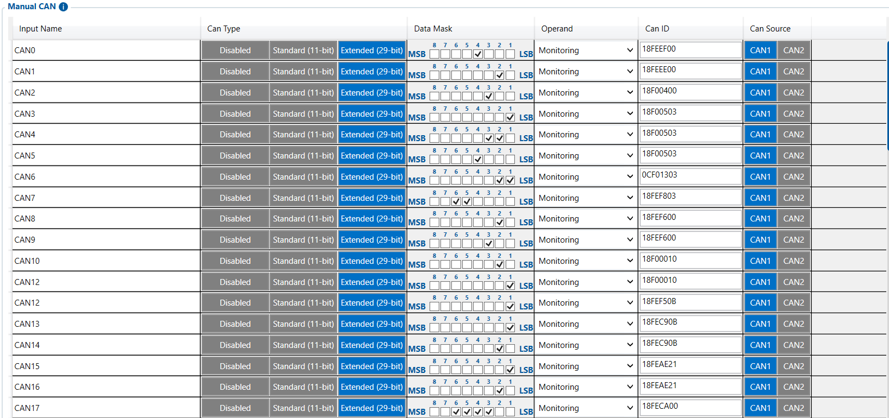

# Manual CAN — Configurator notes (EN)

> **Note:** Supplementary notes extracted from the French Configurator tab PDF
> `manual-can-tab.pdf`, generated on
> **2026-11-05T08:37:58Z** — newer than the wiki snapshot kept in
> this folder. The text was translated into English; it supplements the
> reference page [`manual-can-io.md`](../manual-can-io.md).
> PDF-extraction quirks: section titles sometimes appear
> after the text they introduce, figures reuse page-1
> filenames, and some wide tables are restituted row by row because the PDF
> text layer does not always preserve columns. Unarchived `docs.tinolyx.com`
> image links were removed; unique figures are grouped under `## Figures` at
> the end of the file.

<!-- PDF p. 2 -->

1. Go beyond the standards: Retrieve specific or proprietary information not covered by factory profiles (e.g. a specific weight sensor, the status of a bodywork equipment item).

2. Sniff and capture the CAN Bus: Point directly at a 29-bit extended J1939 PGN (e.g. 18FECA00 for DTC error codes) and extract the raw value.

3. Rely on reverse engineering: Give integrators the freedom to configure 70 custom frames by defining the ID ( CAN ID ), the data mask ( Data Mask ) and the target port ( CAN1 / CAN2 ).

Fundamental parameters allowing the frame to be physically identified on the vehicle
network.

## Manual CAN

The Manual CAN tab is the FMC650's low-level analysis and custom decoding tool. It is used
as a last resort when the preconfigured profiles (FMS I/O or LVCAN)
do not allow a specific data item to be read. It is mainly used to:

### 1. Frame Definition Structure (CAN Entry Definition)

<!-- PDF p. 3 -->

**Input Name (CAN0 to CAN69)**

Meaning: Indexing number of the custom CAN entry.
Role: Internal logical identifier (up to 70 programmable rules) so that the
FMC650 associates a raw frame with an I/O identifier transmitted to the server.

**CAN Type & CAN Source**

Meaning: CAN addressing format ( Disabled , Standard 11-bit , Extended 29- bit ) and physical bus used ( CAN1 or CAN2 ).
Current values: Extended (29-bit) enabled on CAN1 for entries CAN0 to
CAN23 ( CAN24 to CAN69 disabled on Disabled ).

Role: Tells the FMC650 microcontroller the frame encoding format and the
physical bus line (e.g. CAN1) on which to listen.

**CAN ID**

Meaning: Raw hexadecimal address (PGN/ID) of the target frame.
Configured examples: 18FEEF00 (Engine Fluid Level/Pressure), 18FEEE00 (Engine Temperature), 18F00400 (Electronic Engine Controller 1 / RPM), etc.
Role: Precisely targets the manufacturer frame carried on the bus without going through
a proprietary decoding grid.
Bit isolation parameters and processing rules for the captured data.

**Data Mask**

Meaning: Binary/hexadecimal mask applied to the 8 bytes of the CAN
frame.
Role: Isolates the bytes or bits of interest within the frame (e.g. extract only bytes 3 and 4 for speed, ignoring the rest of the frame data).

**Operand**

Meaning: Frame acquisition mode ( Monitoring or On change ).

### 2. Data Filtering & Masking (Data Mask & Extraction)

<!-- PDF p. 4 -->

Current value: Monitoring .
Role: Defines whether the extracted value is read continuously for the dashboard or whether
it must trigger the immediate sending of a network frame.
1. FMS I/O: Automatic, clean decoding according to the SAE J1939 heavy-truck standard.
2. LVCAN: Assisted decoding via the LVCAN/ALL-CAN adapter box and its Program
Number.
3. Manual CAN: Manual "surgical" decoding by direct binary masking on the
hexadecimal frame, essential when no compatible FMS/LVCAN profile is available.
Comparative summary of CAN decoding in the FMC650
```
┌─────────────────────────────────────────────────────────────────────────────┐
│                           VEHICLE CAN BUS                                   │
└──────┬──────────────────────────────┬──────────────────────────────┬────────┘
       │                              │                              │
       ▼                              ▼                              ▼
┌──────────────┐              ┌──────────────┐              ┌─────────────────┐
│  FMS I/O     │              │    LVCAN     │              │   MANUAL CAN    │
├──────────────┤              ├──────────────┤              ├─────────────────┤
│ Decoding     │              │ Decoding via │              │ RAW Decoding    │
│ Standardised │              │ Adapter      │              │ Manual by       │
│ J1939        │              │ Teltonika    │              │ ID & Mask       │
└──────┬───────┘              └──────┬───────┘              └────────┬────────┘
       │                              │                              │
       └──────────────────────┬───────┴──────────────────────────────┘
                              ▼
               ┌──────────────────────────────┐
               │   I/O variables to Wialon    │
               └──────────────────────────────┘
```

## Figures

Unique figures extracted from the PDF. The extraction reuses the same
filenames for all pages; each image is therefore referenced only once here.


