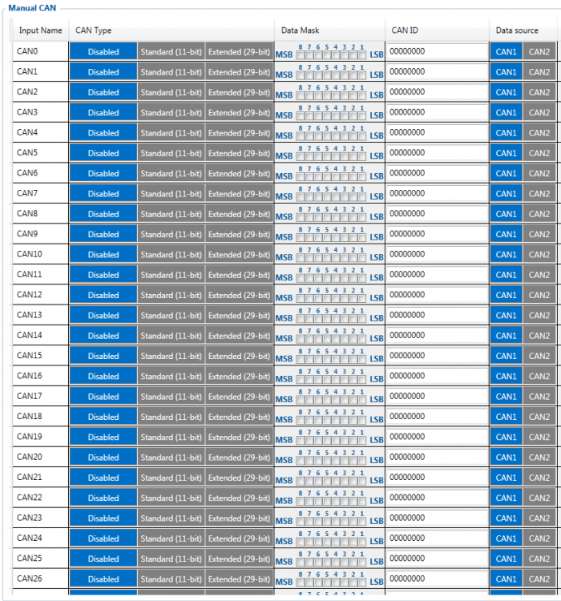
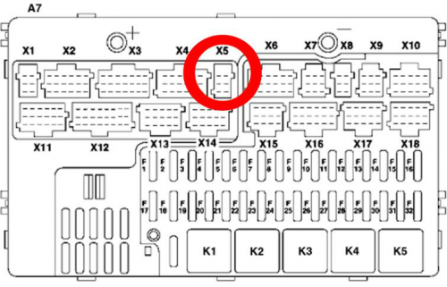
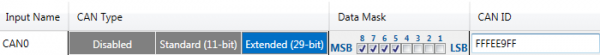

# FMC650 Manual CAN IO

# Introduction

Controller Area Network (CAN or CAN-bus) is a computer network protocol and bus standard designed to allow microcontrollers and devices to communicate with each other and without a host computer. It was designed specifically for automotive applications but is now also used in other areas.

SAE J1939 and J1708* are the vehicle bus standard used for communication and diagnostics among vehicle components. Based on the same architecture FMS protocol dedicated to telematics systems is available. It has certain standardized parameters available, such as fuel consumption, engine work-hours, etc. Please visit [http://www.fms-standard.com/](http://www.fms-standard.com/) for more information and message structure.

The FMS interface is an optional interface for different truck manufacturers. Supported information is dependent upon vehicle equipment. For the full information set, additional Electronic Control Units (ECU) may be required. Please contact the manufacturer or your dealer for more details.

Vehicle brands supported:
• Mercedes Benz
• Volvo
• MAN
• DAF
• Iveco
• Scania
• Renault

Available parameters:
• Total Fuel
• Total Distance
• Status of brake pedal *
• Engine Torque *
• Actual fuel
• Accelerator pedal position *
• Status engine brake
• Speed *
• RPM
• Engine hours
• Vehicle Weight *
• Fuel level
• Tachograph data *

*Availability of parameter depends on vehicle’s model and configuration of FMS interface of the truck.*
*J1708 is an additional FMS protocol used by some vehicle manufacturers. If your vehicle supports J1939 and J1708 both protocols then you must disable J1708 in configuration to receive fuel data.*

# General description

- Uses six different speeds: 50 kbps, 100 kbps, 125 kbps, 250 kbps, 500 kbps, 1000kbps;
- Auto Baud rate detection;
- Filtering messages (StId, ExtId) according to configuration;
- Using the mask, filters required bytes;
- Different CAN configurations.

# Configuration

FMC650 has 70 configurable Manual CAN elements. Manual CAN data can be configured using “Manual CAN” in the CAN tab.

CAN message ID type: Message ID type has two types according to SAEJ1939 standard: Standard ID (value: 0 to 0x7FFh) and Extended ID (value: 0 to 0x1FFFFFFFh).

The message ID value is entered in HEX format. This parameter is used to configure the hardware message filter. All messages contain 8 bytes of data, to select particular data/bytes “Output Data Mask” is used, it’s done by ticking the required bytes, and only selected bytes are sent to the server.

# Example

A sample CAN message has the following structure: X18FEE9018FFFFFFFF23840300, where essential parts are ‘FEE9’ – identifier and ‘FFFFFFFF23840300’ – data bytes.
CAN messages are configured like any other I/O parameters. They consist of 4 identifier bytes and 8 data bytes. Below you will find a sample configuration for the fuel consumption parameter:
ID type – is always 29 bits.
Output data mask – defines which data bytes are sent to the server (sometimes not all data bytes are necessary).
CAN ID – this is a 4-byte identifier. Messages use 4 bytes, but the first and last bytes may differ in different vehicle models while the middle four bytes are the same for all vehicles. The first and last bytes may have any value. Because of this reason, it is recommended to write FF in the first byte and the same in the last byte.

This information is provided only as an example and Teltonika
takes no responsibility for information accuracy or damage that may be done to the vehicle or FMC650 module while integrating it.

Example:
All Mercedes Benz Actros 2 models with Vehicle Identification Number (VIN) starting with WDB93 have a possibility to connect FMC650 module to CAN bus. This can be done by connecting to a special PSM module (which may or may not be included in the truck) or ground module of the vehicle. For the CAN signal to be available, parameter 520 must be enabled in “kommunikationsschnittstelle” in the vehicle with Mercedes Stardiagnose.
CAN wires can be found on the X5 connector located in the fuse box:
Pin 5: CAN Low signal (yellow wire)
Pin 2: CAN High signal (blue wire)

In the example FMC650 will filter all CAN messages with the identifier FFFEE9FF (fuel consumption).

CAN parameter configuration example

Note: Averaging constant cannot be used with CAN data because this information comes in digital format. So in order to prevent data loss, set the Averaging constant parameter to 1.

Most parameters have a certain resolution. The FEE9 parameter has 0.5L/bit gain, so the value that is sent to the server has to be multiplied by 0.5.
Data parsing is preceded by selecting the correct message from all available on the CAN bus. FMS standard interface description indicates that fuel consumption is a parameter with ID FEE9:

| **00FEE9** | PGN HEX | — | — | — | — | — | — | — |
| --- | --- | --- | --- | --- | --- | --- | --- | --- |
| **65,257** | **PGN** | — | — | — | — | — | — | — |
| **1000 ms** | **Rep. Rate** | — | — | — | — | — | — | — |
| **Data Byte 1** | **Data Byte 2** | **Data Byte 3** | **Data Byte 4** | **Data Byte 5** | **Data Byte 6** | **Data Byte 7** | **Data Byte 8** | **Byte No.** |
| **Not used for / FMS- / Standard** | **Not used for / FMS- / Standard** | **Not used for / FMS- / Standard** | **Not used for / FMS- / Standard** | **Total fuel used / 0,5 L/Bit gain / 0 L offset / 5.2.5.66 / SPN 250** | **Total fuel used / 0,5 L/Bit gain / 0 L offset / 5.2.5.66 / SPN 250** | **Total fuel used / 0,5 L/Bit gain / 0 L offset / 5.2.5.66 / SPN 250** | **Total fuel used / 0,5 L/Bit gain / 0 L offset / 5.2.5.66 / SPN 250** | **Name / Values / Values / Values / SAE ref / SPN** |

<!-- configurator-companions -->

## Configurator notes (EN)

English notes translated from the Configurator tab PDFs, generated **2026-11-05**:

- [`configurator/manual-can.md`](configurator/manual-can.md) — Manual CAN: raw CAN frame definitions, data mask and custom decoding.

