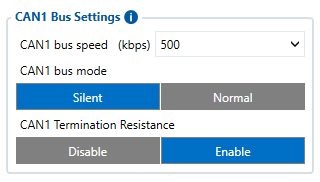
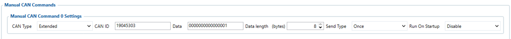
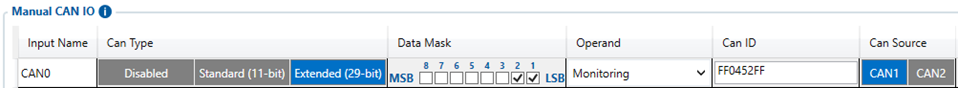

# FMC650Manual CAN Commands

To use **Manual CAN commands functionality** user should select ***Manual CAN Commands* tab** in **Configurator**. Afterwards, user will be able to configure CAN parameters in Manual CAN commands settings tab.

# Manual CAN Commands

The main benefit of using **Manual CAN command functionality** is that the user is able to send data via CAN BUS without requiring additional CAN protocol development from the device's firmware side if vehicle should take an action with equipment connected via CAN line. To send command via CAN line with this functionality, the user must have:

- **FMC650** device

| 03.01.00.Rev.00 or newer firmware for (FMB641/FMC650/FMM650) |
| --- |

- Transport or equipment with CAN interface which works via *J1939 protocol*

- Transport or equipment CAN communication protocol (with information about *frames*, *parameters*, *ID‘s*, *Baudrate*)

# Manual CAN Command I/O settings

User can configure up to 10 Manual CAN I/O commands by setting CAN Type, Data mask, CAN ID, Request Period, Request Data Length parameters. Each CAN I/O has its own parameter and can be configured independently.

| (!) Functionality will work only when Ignition is ON |
| --- |

Baudrates are configurable in *CAN \ Tachograph* tab settings for connected CAN line which could be CAN1 or CAN2

- **Manual CAN Type parameter** - defines which CAN ID type will be received and requested (**Standard** - 11bit, **Extended** - 29bit).
- **CAN ID/PGN** - depends on CAN Type parameter and defines which CAN ID will be received by device
- **Data Mask** - defines which data mask will be applied to received CAN data. CAN Data mask parameter is 8byte hex value. Displayed data value will be Received Data Value AND Data Mask. In other words - Data Mask parameter defines which data will be taken from the specific frame.
- **Request data length** - defines data length of requested ID.
- **Send type** – Could be selected with three different choices:
 - **Once** – it defines request will be sent once if Run On Startup is enabled
 - **Periodic** – it defines the request via CAN will be sent by set period in ms, for configured send count.
 - **Response** – it defines to which MANUAL CAN value will be sent.
- **Run On Startup** – Enable/disable defines if on Ignition startup will be needed to send a command.

# Configuration of Manual CAN commands

### Example

In the Tachograph/CAN section the user has to select suitable baudrate. Manual CAN baudrate should be visible in the CAN protocol. If it is not known, the user can try to choose different baudrates to indicate which one works.

*Protocol example*:

| Frame ID | Name | Period [ms] | Byte orientation | Bit | Description | Scale factor | Source addresses | Priority |
| --- | --- | --- | --- | --- | --- | --- | --- | --- |
| 0x620 | Range Estimation | 1000 | 1 | 7:0 | Estimated range km | 1 km | 17 | 1 |
| 0x300 | Battery status | On request | 0 / 1 / 3:2 / 5:4 / 7:6 | 7:0 / 7:0 / 7:0 / 7:0 / 7:0 | Average of the two batteries SoC % / SoC second battery % / Battery Current (A) / Battery Temperature (C) / Battery Voltage (V) | 1 % / 1 % / 0,0625 A / 0,1 C / 0,046 V | 18 | 2 |
| 0x451 | Battery fast charging enable/disable | — | 0:3 / 4:7 / | 7:0 / 7:0 / | Battery charge enable / Battery charge disable / | ON/OFF | 19 | 3 |
| 0x301 | Battery Status message request | — | 0:1 | 5:0 | 00001 - request SOC 1st | — | 18 | 2 |
| 0x301 | Battery Status message request | — | 0:1 | 5:0 | 00010 - request SOC 2nd | — | 18 | 2 |
| 0x301 | Battery Status message request | — | 0:1 | 5:0 | 00100 - request Current | — | 18 | 2 |
| 0x301 | Battery Status message request | — | 0:1 | 5:0 | 01000 - request temperature | — | 18 | 2 |
| 0x301 | Battery Status message request | — | 0:1 | 5:0 | 10000 - request voltage | — | 18 | 2 |
| **0x452 | Battery Fast charging mode switch status | — | 0:1 | 2:0 | 01 - Charge enable / 10 - Charge disabled | — | 19 | 3 |
| *0x453 | Battery Fast charging mode switch | — | 0:1 | 2:0 | 01 - Charge enable | — | 19 | 3 |
| *0x453 | Battery Fast charging mode switch | — | 0:1 | 2:0 | 10 - Charge disable | — | 19 | 3 |

****** - *CAN ID to send CAN COMMAND*
***** - *CAN ID to receive value in Manual CAN of CAN COMMAND*

1. Select CAN Type. Normally every CAN protocol documentation should mention which CAN type to use. If it doesn't, select **Extended**.

2. Fill in the correct Data mask in Manual CAN command 0 setting. This field determines which IO elements of the frame the user will send via CAN line. As an example, the part of the CAN protocol was taken. First, the user has to locate the data frame he wants to send, for this situation, data frame **„Battery Fast charging mode switch“** was taken into account. It holds two states - **enable** or **disable**. If we would like to send data of frame, in the configurator the user has to configure **0000000000000000 – to disable** or **0000000000000001 - to enable**.

3. For Manual CAN command 0 settings, **CAN ID** it must be written with **Source addresses**, **Frame ID** and **Priority** – **19045303,** as you can see in Protocol example.

4. Request **data length** configured as **8** bytes.

5. Send type **Once.**

6. To receive data if the command were permitted correctly in Manual CAN0 we will configure CAN Type Extended.

7. Data mask will have selected first two bytes **(right to left)** from LSB side.

8. **CAN ID** will be **FF0452FF** as we are only interested to receive information about the command status execution, for that reason, we ignore **Source addresses** and **Priority ID's** with **FF**.

| — |
| --- |

**NOTE:** Regarding "in Request" parameters shown in protocol, more information about CAN request functionality can be found [**here**](https://wiki.teltonika-gps.com/view/Manual_CAN_Requests).
