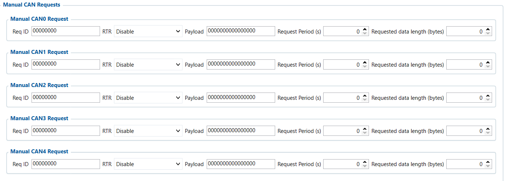

# Manual CAN Requests — Configurator notes (EN)

> **Note:** Supplementary notes extracted from the French Configurator tab PDF
> `manual-can-requests-tab.pdf`, generated on
> **2026-11-05T08:37:58Z** — newer than the wiki snapshot kept in
> this folder. The text was translated into English; it supplements the
> reference page [`manual-can-requests.md`](../manual-can-requests.md).
> PDF-extraction quirks: section titles sometimes appear
> after the text they introduce, figures reuse page-1
> filenames, and some wide tables are restituted row by row because the PDF
> text layer does not always preserve columns. Unarchived `docs.tinolyx.com`
> image links were removed; unique figures are grouped under `## Figures` at
> the end of the file.

<!-- PDF p. 2 -->

1. Force the sending of non-spontaneous data: Retrieve parameters that the vehicle's ECU does not transmit continuously over the network (e.g. certain diagnostic PIDs, specific OBD-II requests).

2. Poll specific equipment: Send command frames to specialized sensors or third-party ECUs (on-board weighing, alarm units, hydraulic equipment) that require an explicit request.

3. Implement custom protocols: Configure up to 9 periodic requests by defining the target address ( Req ID ), the command ( Payload ), the sending frequency ( Request Period ) and the expected response length ( Requested Data Length ).

Fields defining the structure of the outgoing frame generated by the FMC650 to the vehicle
ECU.

## Manual CAN Requests

The Manual CAN Requests tab is the active polling tool for the CAN Bus.
While most telematics operate in passive listening mode, this module allows the
FMC650 to act as a diagnostic tool or scanner by itself initiating the
dialogue with the ECUs. It is mainly used to:

### 1. Request Emission Settings (Request Emission Settings)

<!-- PDF p. 3 -->

**Req ID (Request ID)**

Meaning: Hexadecimal identifier (CAN ID) assigned to the outgoing request.
Current value: 00000000 .
Role: Targets the destination ECU address on the bus ( 00000000 = default value / no active request).

**RTR (Remote Transmission Request)**

Meaning: Remote transmission request flag ( Disable / Enable ).
Current value: Disable .
Role: Indicates whether this is a frame without payload asking the ECU to transmit its
value ( Enable ), or a conventional frame containing command bytes ( Disable ).

**Payload**

Meaning: Payload of the outgoing frame (8 hexadecimal bytes).
Current value: 0000000000000000 (64 bits set to zero).
Role: Transmits the specific command/PID code expected by the ECU to
trigger the sending of a response.
Timing rules for polling and control of the returned data.

**Request Period (s)**

Meaning: Repetition interval for sending the request in seconds.
Current value: 0 s .
Role: Sets the rate of automatic ECU polling ( 0 = no recurring sending).

**Requested Data Length (bytes)**

Meaning: Bytes expected in return in the response frame.

### 2. Frequency & Response Format (Timing & Response Formatting)

<!-- PDF p. 4 -->

Current value: 0 bytes .
Role: Defines the exact size of the data packet that the FMC650 must receive and
validate following transmission.

**Polling Slots (Manual CAN0 Request to CAN8 Request)**

Meaning: Configuration slots for active requests (9 channels available).
Current status: All 9 channels ( CAN0 to CAN8 ) are blank / inactive with default
values ( 0 ).
Feature
Manual CAN (Passive listening)
Manual CAN Requests
(Active polling)
Flow direction
Bus CAN -> FMC650
FMC650-> Bus CAN -> FMC650
Behaviour
Passive: Listens to frames broadcast
spontaneously by the vehicle
Active: Sends a request frame
then waits for the ECU response
Key parameter
CAN ID + Data Mask (Binary extraction)
Req ID + Payload + Request Period
Usage type
Capture of standard FMS / SAE J1939
frames
Polling of proprietary ECUs
or OBD / PID requests
Status in your FMC650
Partially configured (24 extended IDs configured)
Inactive / Default (All fields at zero)
Comparative summary: Manual CAN vs. Manual CAN
Requests
Global CAN acquisition architecture of the FMC650
```
┌─────────────────────────────────────────────────────────────────────────────┐
│                           VEHICLE CAN BUS                                   │
└──────▲───────────────────────▲──────────────────────────────▲────────────────┘
       │                       │                              │
       │ (Transmission)        │                              │
       ├───────────────────────┼──────────────────────────────┤
       │                       │ (Listening)                  │ (Listening)
┌──────┴───────────────┐       │                              │
│ MANUAL CAN REQUESTS  │       │                              │
│ (Polling)            │       │                              │
└──────┬───────────────┘       │                              │
```

| Feature | Manual CAN (Passive listening) |  |  | Manual CAN Requests |  |  |
| --- | --- | --- | --- | --- | --- | --- |
|  |  |  |  | (Active polling) |  |  |
| Flow direction | Bus CAN-> FMC650 |  |  | FMC650-> Bus CAN-> FMC650 |  |  |
| Behaviour | Passive: Listens to frames broadcast spontaneously by the |  | vehicle | Active: Sends a request frame then waits for the ECU response |  |  |
| Key parameter | binary) | CAN ID + Data Mask | (Extraction |  | Req ID + Payload + Request Period |  |
| Usage type | Capture of FMS / SAE J1939 standard frames |  |  | Polling of proprietary ECUs or OBD / PID requests |  |  |
| Status in your FMC650 | Partially configured (24 extended IDs configured) |  |  | Inactive / Default (All fields at zero) |  |  |

<!-- PDF p. 5 -->

```
│                       │                              │
       │ (ECU Response)        │                              │
       ▼                       ▼                              ▼
┌──────────────┐       ┌──────────────┐               ┌──────────────┐
│  MANUAL CAN  │       │   FMS I/O    │               │    LVCAN     │
│ (Raw Mask    │       │ (J1939 Auto  │               │ (Adapter     │ │  Decoding)   │       │  Decoding)   │               │  Decoding)   │
└──────┬───────┘       └──────┬───────┘               └──────┬───────┘
       │                      │                              │
       └──────────────────────┼──────────────────────────────┘
                              ▼
               ┌──────────────────────────────┐
               │     FMSED / FMS ECO tabs     │
               │  (Eco-Driving accumulators)  │
               └──────────────┬───────────────┘
                              ▼
               ┌──────────────────────────────┐
               │      BUSINESS AVL FRAME      │
               │        WIALON LOCAL          │
               └──────────────────────────────┘
```

## Figures

Unique figures extracted from the PDF. The extraction reuses the same
filenames for all pages; each image is therefore referenced only once here.



