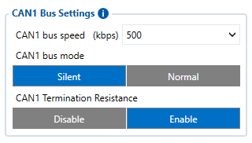
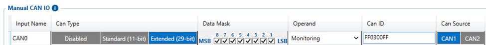
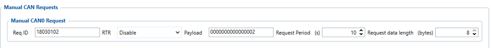
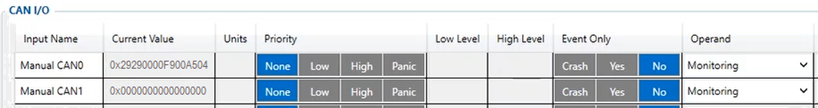
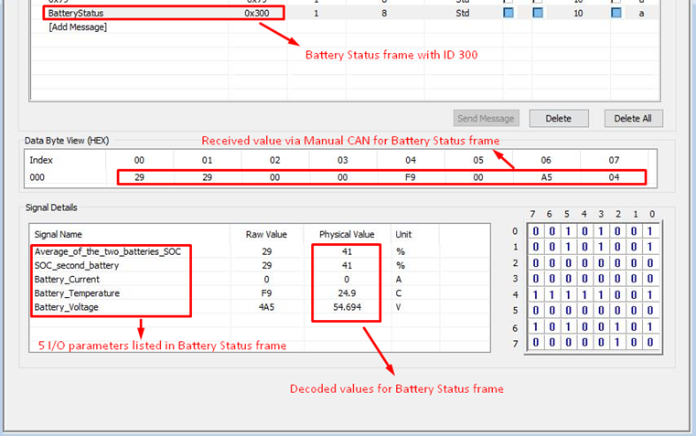

# FMC650Manual CAN Requests

To use **Manual CAN request functionality** user should select ***Manual CAN Requests* tab** in configurator. Afterwards, user will be able to configure CAN parameters in Manual CAN Request settings tab.

# Manual CAN Requests

The main benefit of using **Manual CAN requests functionality** is that the user is able to read data via CAN BUS without requiring additional CAN protocol development from the device's firmware side, if parameters needed to be requested more frequently or vice versa. To read data with this functionality, the user must have:

- **FMC650** device
- **03.01.00.Rev.00** or newer firmware (for **FMB641/FMC650/FMM650**)
- Transport or equipment with CAN interface which works via *J1939 protocol*
- Transport or equipment CAN communication protocol (with information about *frames*, *parameters*, *ID‘s*, *Baudrate*)

# Manual CAN requests I/O settings

User can configure up to 70 Manual CAN Request elements by setting **CAN ID/Request ID**, **Request Period**, **Request Data Length**, **RTR parameters**. Additionally, in ***Manual CAN I/O* tab**, user needs to choose by configured Manual Request input name – **CAN type**, **Data mask Data Source**, **CAN ID**. Each CAN I/O has its own parameters and can be configured independently. Configured CAN request will be shown by **Manual CAN IO AVL ID**.

| (!) Functionality will work only when Ignition is ON |
| --- |

Baudrates are configurable in *CAN \ Tachograph* tab settings for connected CAN line which could be CAN1 or CAN2.

For **Manual CAN request** functionality, CAN is selected in *Manual CAN IO tab*. In *Manual CAN IO,* the input which should receive value must be **enabled**.

- **Request ID/PGN** - depends on CAN Type parameter and defines which CAN ID will be requested by device.
- **Payload** - defines data bytes, which are send if **RTR** (Remote Transmission Request) is disabled.
- **Request Period** - defines how often the request will be send. If 0 is selected - ID will not be requested.
- **Request Data Length** - defines data length of requested ID.
- **RTR -** Remote Transmission Request, is the choice if data frame needs to be send **(if disabled)** and if data frame needs to be requested **(if enabled)**.

If the data must be requested to receive CAN information from a heavy duty vehicle - **RTR must be enabled**. If data can be received without requesting it from a heavy duty vehicle - **RTR can be disabled**.

### Example

In the Tachograph/CAN section the user has to select suitable baudrate. Manual CAN baudrate should be visible in the CAN protocol. If it is not known, the user can try to choose different baudrates to indicate which one works.

1. Select **CAN Type**. Normally, every CAN protocol documentation should mention which CAN type to use. If not, select **Extended**.
2. Fill in the correct **Data mask**. This field determines which IO elements of the frame the user will receive. As an example, the part of the CAN protocol was taken. Firstly, the user has to locate the data frame, which he wants to read, for this situation, data frame **„Battery status“** was taken into account. It holds five I/O parameters of the battery. If we would like to receive all data of the frame, in the configurator the user has to leave the default value in the *Data mask field* **(Selected ALL)** - which is used in this example.

If the user would like to get everything except, for example, the **Battery Temperature** value, some modifications have to be done to the Data mask field. In this case, if the user does not want to get the **Battery Temperature** value, he should find where this information stands in the data frame **(byte orientation)**. For this example, **Battery Temperature** parameter can be found between **4th** and **5th** byte of the frame. It is explained in the table below how the 8 byte CAN frame breaks down and which part of the frame has to be changed according to this example.

### Protocol example

| Frame ID | Name | Period [ms] | Byte orientation | Bit | Description | Scale factor | Source addresses | Priority |
| --- | --- | --- | --- | --- | --- | --- | --- | --- |
| 0x620 | Range Estimation | 1000 | 1 | 7:0 | Estimated range km | 1 km | 17 | 1 |
| 0x300 | Battery status | On request | 0 / 1 / 3:2 / 5:4 / 7:6 | 7:0 / 7:0 / 7:0 / 7:0 / 7:0 | Average of the two batteries SoC % / SoC second battery % / Battery Current (A) / Battery Temperature (C) / Battery Voltage (V) | 1 % / 1 % / 0,0625 A / 0,1 C / 0,046 V | 18 | 2 |
| 0x451 | Battery fast charging enable/disable | — | 0:3 / 4:7 / | 7:0 / 7:0 / | Battery charge enable / Battery charge disable / | ON/OFF | 19 | 3 |
| 0x301 | Battery Status message request | — | 0:1 | 5:0 | 00001 - request SOC 1st | — | 18 | 2 |
| 0x301 | Battery Status message request | — | 0:1 | 5:0 | 00010 - request SOC 2nd | — | 18 | 2 |
| 0x301 | Battery Status message request | — | 0:1 | 5:0 | 00100 - request Current | — | 18 | 2 |
| 0x301 | Battery Status message request | — | 0:1 | 5:0 | 01000 - request temperature | — | 18 | 2 |
| 0x301 | Battery Status message request | — | 0:1 | 5:0 | 10000 - request voltage | — | 18 | 2 |
| **0x452 | Battery Fast charging mode switch status | — | 0:1 | 2:0 | 01 - Charge enable / 10 - Charge disabled | — | 19 | 3 |
| *0x453 | Battery Fast charging mode switch | — | 0:1 | 2:0 | 01 - Charge enable | — | 19 | 3 |
| *0x453 | Battery Fast charging mode switch | — | 0:1 | 2:0 | 10 - Charge disable | — | 19 | 3 |

****** - *CAN ID to send CAN COMMAND*
***** - *CAN ID to receive value in Manual CAN of CAN COMMAND*

1. Enter correct **CAN ID** in *Manual CAN tab*. In this case, the **Frame ID** in needed to be entered. Here, CAN ID is 0x300, so in the configurator the user will need to enter 300 instead of last three F values *(FF0300FF)*. This means that it will take the data **only** from the **ID 300**.

2. For *Manual CAN Requests tab* configuration. In **Manual CAN0 Request** will be configured Battery Status message request by the provided documentation. For proper configuration by the protocol, **Request ID** should be entered with **Source addresses**, **Frame ID** and **Priority** – 18030102, and the payload *0000000000000002* to receive all needed information.

3. Additionally, it can also have request period configured. **As an example**, to receive data each **10 seconds**, request period must be set to **10**.

4. Request data length configured as 8 bytes

5. Received I/O values are RAW and the user has to decode it. The image below is an example of how it can be decoded using additional software (we have used ***Busmaster*** for this):

# Important note

Enabling all commands could drastically **increase** delay - sending could take up to **1.5 s** (all commands configured with 100 ms period).

We strongly advise:

1. If all commands are necessary with certain period - keep all commands with same sending period.
2. Do not leave any enabled CAN reading parameters if CAN reading is not used.
3. Keep Data Acquisition settings with higher than 15 seconds.

| NOTE! | Send Period details / Records could drastically increase CAN command sending period as records could be generated every second by configured Features records, Data Acquisition settings or IO element operands. Each particular case has different affect for CAN Command delay, that depends on configuration and in case of issue should be investigated individually. |
| --- | --- |

<!-- configurator-companions -->

## Configurator notes (EN)

English notes translated from the Configurator tab PDFs, generated **2026-11-05**:

- [`configurator/manual-can-requests.md`](configurator/manual-can-requests.md) — Manual CAN Requests: periodic CAN requests, Req ID, payload and period.

