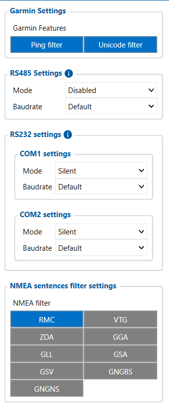

# RS-232 / RS-485 — Configurator notes (EN)

> **Note:** Supplementary notes extracted from the French Configurator tab PDF
> `rs232rs485-tab.pdf`, generated on
> **2026-11-05T08:37:58Z** — newer than the wiki snapshot kept in
> this folder. The text was translated into English; it supplements the
> reference page [`rs-232-and-rs-485.md`](../rs-232-and-rs-485.md).
> PDF-extraction quirks: section titles sometimes appear
> after the text they introduce, figures reuse page-1
> filenames, and some wide tables are restituted row by row because the PDF
> text layer does not always preserve columns. Unarchived `docs.tinolyx.com`
> image links were removed; unique figures are grouped under `## Figures` at
> the end of the file.

<!-- PDF p. 2 -->

1. Connect third-party hardware: Configure the RS232 and RS485 buses to communicate with digital fuel gauges, eco-driving cameras, ID badge readers, or on-board printers.

2. Manage the Garmin ecosystem: Allow destinations and text messages to be sent to the driver while filtering network noise (Ping/Unicode).

3. Optimize GNSS/NMEA bandwidth: Avoid overloading the FMC650 memory and the GSM data volume by keeping only the essential NMEA sentence ( RMC ).

## RS232/RS485

The RS232 / RS485 tab acts as an interfacing hub for external wired
peripherals and as a GPS flow regulator. Its target functions are:

<!-- PDF p. 3 -->

Configuration of application-level communication filters when interfacing with an
external Garmin navigation terminal or guidance screen.

**Ping Filter**

### 1. Garmin Parameters (Garmin Settings)

<!-- PDF p. 4 -->

Meaning: Filtering of the self-diagnostic ("Ping") frames exchanged continuously
between the device and the terminal.
Current value: Enable .
Role: Prevents overloading the FMC650 processor and unnecessarily recording
presence messages that are irrelevant for telematics.

**Unicode Filter**

Meaning: Filtering and validation of the encoding of the Unicode characters
transmitted.
Current value: Enable .
Role: Guarantees the compatibility of text messages (e.g. mission instructions)
sent to the driver's screen by eliminating corrupted characters.
Management of the multipoint differential serial bus allowing the connection of industrial
peripherals or third-party probes.

**Mode**

Meaning: Operating mode of the RS485 hardware interface.
Current value: Disabled .
Role: Disables software processing of the RS485 port. No RS485 probe (e.g.
fuel level gauges, industrial temperature sensors) is read.

**Baudrate**

Meaning: Data transmission rate on the RS485 bus (in bits per second).
Current value: Default .
Role: Defines the protocol's standard rate; inactive as long as the mode remains
set to Disabled .

### 2. RS485 Serial Interface (RS485 Settings)

### 3. RS232 Serial Interfaces (RS232 Settings: COM1 & COM2)

<!-- PDF p. 5 -->

Management of the two point-to-point serial ports dedicated to connecting external peripherals
(cameras, RFID readers, printers, tachographs or Garmin terminals).

**COM1 — Mode & Baudrate**

Meaning: Definition of the functional assignment and speed of the first
serial port.
Current values: Mode = Silent , Baudrate = Default .
Role: Silent mode listens to or ignores traffic without allowing active/interactive
transmission. No active RS232 equipment is driven on the COM1 port.

**COM2 — Mode & Baudrate**

Meaning: Definition of the functional assignment and speed of the second
serial port.
Current values: Mode = Silent , Baudrate = Default .
Role: The COM2 port is also placed in passive standby, blocking bidirectional
application communication flows.
Selector for the NMEA 0183 positioning and navigation sentences intended to be processed,
forwarded or injected into the data stream.

**RMC (Recommended Minimum Specific GNSS Data)**

Status: Selected / Enabled (✓) .
Role: Retention of the fundamental GNSS sentence containing UTC time,
latitude, longitude, speed over ground (SOG), true course (COG) and fix validity.

**VTG (Course Over Ground and Ground Speed)**

Status: Not selected / Disabled (✗) .
Role: Exclusion of data dedicated exclusively to the motion vector
(heading and speed).
**ZDA (Time & Date)**

### 4. GNSS NMEA Sentence Filter (NMEA Sentences Filter Settings)

<!-- PDF p. 6 -->

Status: Not selected / Disabled (✗) .
Role: Exclusion of independent atomic timestamps (already extracted via the RMC sentence).

**GGA (Global Positioning System Fix Data)**

Status: Not selected / Disabled (✗) .
Role: Ignoring advanced triangulation details (altitude, number of satellites, HDOP factor).

**GLL (Geographic Position - Latitude/Longitude)**

Status: Not selected / Disabled (✗) .
Role: Filtering of isolated raw geographic coordinates.

**GSA (GNSS DOP and Active Satellites) & GSV (GNSS Satellites in View)**

Status: Not selected / Disabled (✗) .
Role: Ignoring constellation metrics (S/N, elevation, azimuth and identifiers of satellites in view).

**GNGBS (GNSS Satellite Fault Detection) & GNGNS (GNSS Fix Data)**

Status: Not selected / Disabled (✗) .
Role: Neutralization of RAIM integrity sentences and complex multi-constellation
summaries.
Tab
Main role
Nature of the data
Primary business use
FMS I/O
Engine & chassis data
Technical (RPM, fuel, AdBlue)
Maintenance, fuel
management
Manual CAN
Custom decoding
Raw / Proprietary (hexadecimal IDs)
Specific non-FMS
captures
Manual CAN Requests
ECU polling
Request/Response
Diagnostics, specific PIDs
Manual CAN Commands
Network actuation
Orders / Commands
Control of third-party
equipment
Tachograph Data
Regulatory & social
data
Legal / Driver (Cards, driving times)
Compliance, payroll, time
tracking
Comparative summary of the FMC650 tabs

| Tab | Main role | Nature of the data | Primary business use |
| --- | --- | --- | --- |
| FMS I/O | Engine & chassis data | Technical (RPM, fuel, AdBlue) | Maintenance, fuel management |
| Manual CAN | Custom decoding | Raw / Proprietary (hexadecimal IDs) | Specific non-FMS captures |
| Manual CAN Requests | ECU polling | Request/Response | Diagnostics, specific PIDs |
| Manual CAN Commands | Network actuation | Orders / Commands | Control of third-party equipment |
| Tachograph Data | Regulatory & social data | Legal / Driver (Cards, driving times) | Compliance, payroll, time tracking |

<!-- PDF p. 7 -->

**Tab**

Main role
Nature of the data
Primary business use
RS232 / RS485
Serial interfacing & NMEA filtering
Peripheral communication / raw GNSS
External sensors, Garmin, GPS flow
Serial communication architecture & GNSS filtering
```
 ┌──────────────────────────────────────────────────────────────────────────┐
 │                       EXTERNAL PERIPHERALS & GNSS                        │
 └──────┬─────────────────┬───────────────────┬───────────────────┬─────────┘
        │                 │                   │                   │
    (RS485)          (RS232 COM1)        (RS232 COM2)       (NMEA GNSS flow)
    Mode:             Mode:               Mode:               │
   Disabled            Silent              Silent             ▼
        │                 │                   │         ┌──────────────────┐
        │                 │                   │         │  NMEA FILTER     │
        │                 │                   │         ├──────────────────┤
        │                 │                   │         │  RMC  ──► [✓]    │
        │                 │                   │         │  VTG  ──► [✗]    │
        │                 │                   │         │  GGA  ──► [✗]    │
        │                 │                   │         │  Other──► [✗]    │
        └─────────────────┼───────────────────┘         └─────────┬────────┘
                          │                                       │
                          ▼                                       ▼
           ┌──────────────────────────────┐     ┌──────────────────────────┐
           │     SERIAL LINK INACTIVE     │     │  RMC SENTENCE RETAINED   │
           │    (No active peripheral)    │     │ (Pos, Speed, Date/Time)  │
           └──────────────────────────────┘     └─────────┬────────────────┘
                                                        │
                                                        ▼
                                          ┌──────────────────────────┐
                                          │   AVL FRAME GENERATION   │
                                          │    (Server / Wialon)     │
                                          └──────────────────────────┘
```

| Tab | Main role | Nature of the data | Primary business use |
| --- | --- | --- | --- |
| RS232/RS485 | Serial interfacing & NMEA filtering | Peripheral communication / raw GNSS | External sensors, Garmin, GPS flow |

## Figures

Unique figures extracted from the PDF. The extraction reuses the same
filenames for all pages; each image is therefore referenced only once here.



