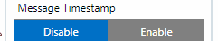
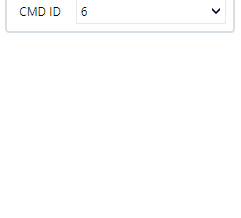
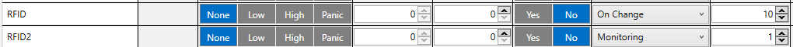
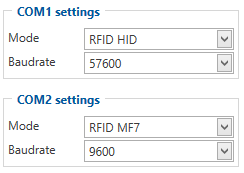
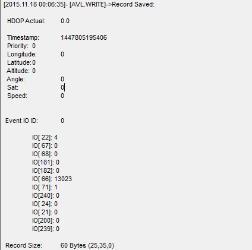
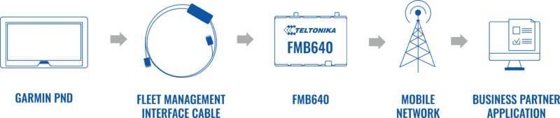
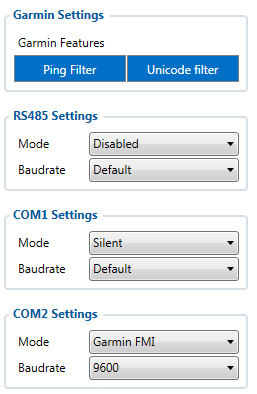
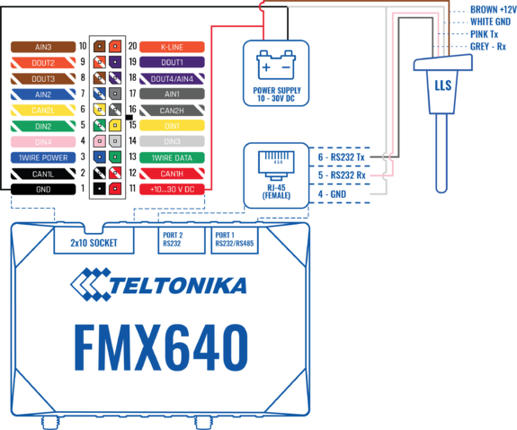
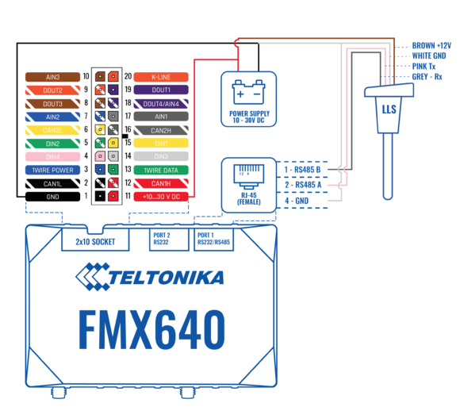
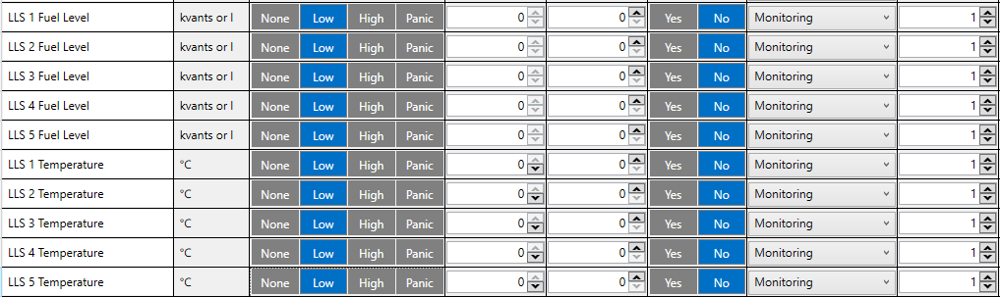

# FMC650 RS-232 and RS-485

# RS-232 / RS-485 interface

RS-232 supports only full-duplex communication, which means the data can be sent and also received at the same time.
**Note:** In RS-232 LLS mode can be connected only one LLS fuel level sensor.

RS-485 supports only half-duplex communication, which means data is transferred only one way at a time.
**Note No. 1:** In RS-485 LLS mode can be connected up to 5 LLS fuel level sensors.
**Note No. 2:** when activated RS-485 driver chip draws a constant 30 mA current when entering Sleep or Deep sleep RS-485 will be powered off.

# RS-232 / RS-485 modes

Available modes for RS-232 and RS-485 interfaces:

| Interface | **Mode** | — | — | — | — | — | — | — | — | — | — | — | — | — | — |
| --- | --- | --- | --- | --- | --- | --- | --- | --- | --- | --- | --- | --- | --- | --- | --- |
| Interface | Log Mode | NMEA | LLS | LCD | RFID HID | RFID MF7 | Garmin FMI | TCP/UDP Ascii | TCP/UDP Binary | TCP/UDP Ascii Buffered | TCP/UDP Binary Buffered | UL202 Fuel Sensor | REC to LCD | ATOL Tachograph | Backup Sattelite |
| RS-232 | ✔ | ✔ | ✔ | ✔ | ✔ | ✔ | ✔ | ✔ | ✔ | ✔ | ✔ | ✔ | ✔ | ✔ | ✔ |
| RS-485 | ✔ | ✔ | ✔ | — | — | — | — | ✔ | ✔ | ✔ | ✔ | — | — | — | — |

|  | Do not under any circumstances connect RS485 A and B lines (or RS232 Tx and Rx) to power source. |
| --- | --- |

 Swapping RS485 A and B lines (or RS232 Tx and Rx) of the external device and also not connecting common ground first - May cause irreparable damage.

### Log mode

In this mode via RS-232 or RS-485 interface prints the FMC650 device log and does not respond to commands.

### GNSS NMEA mode

In NMEA mode via RS-232 or RS-485 interface FMC650 prints GNSS NMEA log and does not respond to commands.

### LLS mode

In LLS mode RS-232 supports one and RS-485 supports up to five LLS sensors - each of which has a receiver ID.

### TCP (ASCII/Binary) modes

In *TCP Ascii/Binary* mode all data received from the external device is sent directly to the server. Data is encapsulated in Codec 12 format. *TCP Binary* Mode has a delay of 30 ms, if no data is received for 30 ms, data is sent to the server. *TCP Ascii* mode waits for the End of Line (EOL) character (0x0D0A, \r\n, <CR><LF>) to pack data and send it to the server.

*TCP Ascii Buffered* and *TCP Binary Buffered* modes are used to collect data from RS232 and save it in the buffer if there is no link with the server and data cannot be sent immediately. When the link is established and there is data to transmit, then RS232 data from the buffer is transmitted after all records are sent.

| — | TCP Binary/TCP ASCII mode | TCP Binary/TCP ASCII Buffered mode |
| --- | --- | --- |
| Data is saved in buffer | No | Yes |
| Data sending protocol | Codec 12 | Codec 13* |
| Timestamp | Not using | Is using* |
| To which server is sent | Main | Main and backup |

**If the Timestamp parameter is enabled, then Codec 13 is used for data sending. Otherwise, Codec 12 is used.*

#### Message Timestamp

Message Timestamp parameter is used to determine if it is necessary to include a timestamp in the RS-232 TCP packet when sending to the server. If the parameter is Enabled, then Codec 13 is used for data sending. Otherwise, Codec 12 is used.

#### RS-232 / RS-485 CMD ID

This parameter is used when FMC650 is sending RS232/RS485 packet to a server, it overrides command type value in Codec12/Codec13 with user-defined CMD ID value (1 - 14). FMC650 behavior when it receives different CMD ID (Type) values in GPRS packet from server.

# RS-232 modes

Below you will find descriptions of available modes only for RS-232 interface:

### RS-232 LCD mode

In this mode, the user is able to communicate with the server through the terminal. A link between the FMC650 device and the server has to be established for this mode to function properly.

To communicate from terminal to server - in terminal send command "WT^W your text here"
To communicate with the server to the terminal - send "#DO DAT=you text here" packet in [Codec12 protocol](https://wiki.teltonika-gps.com/view/Teltonika_Data_Sending_Protocols#Codec_12)

### RS-232 RFID HID/RFID MF7 mode

Radio-frequency identification (RFID) is the use of a wireless non-contact system that uses radio-frequency electromagnetic fields to transfer data from a tag attached to an object, for the purposes of automatic identification and tracking. [FMC650](https://wiki.teltonika-gps.com/view/FMC650) can be configured in a way to use with an RFID reader. When an RFID of some sort (typically a plastic card with a magnetic line) is used with an RFID reader that is connected to [FMC650](https://wiki.teltonika-gps.com/view/FMC650), the device creates a record with the data that the RFID reader has read and can be sent to a server with all other information. RFID ID is activated like an I/O parameter:

To set up [FMC650](https://wiki.teltonika-gps.com/view/FMC650) so it can be connected to an RFID reader, some parameters have to be set up. Go to RS232 \ RS485 and set up COM1 or COM2 settings to RFID Mode or RFID MF7 Mode (the used mode depends on the mode that the RFID reader works). See Figure 922. The Baudrates for each mode are:

- ***RFID Mode*** – 57600
- ***RFID MF7 Mode*** – 9600

The difference between RFID HID Mode and RFID MF7 Mode is that in RFID MF7 Mode [FMC650](https://wiki.teltonika-gps.com/view/FMC650) understands RFID messages that are in hexadecimal text format and RFID HID Mode interprets messages that are in binary format. The type of RFID message sent to [FMC650](https://wiki.teltonika-gps.com/view/FMC650) depends on the RFID reader. For example, the RFID MF7 mode message looks like $aa$02$03$04$17$89$00$01 while the HID mode message is of the following format: "1213141519".
The selected mode has to correspond to the RFID reader's mode.
Please contact your local sales representative for more information about RFID IDs and devices.

### REC to LCD mode

In this mode, records are sent via ports.
This is an example view that is displayed in Terminal:

### ATOL Tachograph mode

This mode is used to connect the ATOL tachograph.

### UL202-2 Fuel Sensor

Select this mode to make [Ultrasonic Fuel Sensors](https://wiki.teltonika-gps.com/view/UL202_Ultrasonic_Fuel_Sensor) work on the COM port.

### Satellite Backup mode

Since 00.02.05 firmware version device supports [Iridium devices](https://wiki.teltonika-gps.com/view/TSM232) which can send short burst data (SBD) to the server. This means that some data can be sent from the FM device to the server through satellites.
In order to get those records, you have to connect the device to [FMC650](https://wiki.teltonika-gps.com/view/FMC650) COM1 or COM2 port. Select COM1 or COM2 mode Satellite backup mode. Those settings could be found in RS232/RS485 tab in the configurator. Baudrate for satellite devices is 19200 bps. Furthermore, [TSM232](https://wiki.teltonika-gps.com/view/TSM232) functionality should be enabled. These settings can be found in the Features tab in Short burst data settings. So, with this mode, some data can be sent from the FM device to the server through satellites using [Iridium devices](https://wiki.teltonika-gps.com/view/TSM232).

### RS-232 Garmin mode

Garmin provides a Fleet Management Interface Tool Kit, once [FMC650](https://wiki.teltonika-gps.com/view/FMC650) is connected to the navigator it enables the driver to have a "screen" in their vehicle for real-time navigation and messaging and offers job dispatch capabilities to help them be more efficient.[FMC650](https://wiki.teltonika-gps.com/view/FMC650) and Garmin operational diagram is shown in the figure below:

Garmin configuration is shown in the figure below:

# LLS Sensor

LLS sensor series liquid level sensors are solid-state capacitive devices with no moving parts. The sensors use capacitive technology to produce accurate liquid level measurements of standard factory-grade DIESEL OIL and PURE GASOLINE (BENZINE) carbon fuels. The LLS sensor liquid level sensors are strictly prohibited to use in any liquids which are not factory-grade carbon fuels or contain: BIOFUEL, METHANOL, ETHANOL, UREA, and similar aggressive components in pure form or as additives for factory-grade carbon fuels for use in INTERNAL COMBUSTION ENGINES. Operating media – Diesel fuel (oil), pure gasoline (benzene).
In order to use the LLS fuel counter, the newest firmware version is needed which can be obtained from Teltonika or a representative. Firmware is updated over GPRS or using a cable update method.

### Specifications

| Parameter | Value |
| --- | --- |
| Supply voltage | +10..+50 V |
| Current consumption, mA (for 12/24 V) | 25 mA / 50 mA |
| Working temperature | -40..+85 ºC |
| Working mode | Continuous |
| Weight | < 2.0 kg |
| Working pressure | Atmospheric |

### Wiring And Configuration

First of all, the LLS fuel sensor must be connected to the [FMC650](https://wiki.teltonika-gps.com/view/FMC650) device. Please find examples below:

| Using RS232 socket | Using RS485 socket |
| --- | --- |
|  |  |
| — | — |

Then [FMC650](https://wiki.teltonika-gps.com/view/FMC650) must be configured. Both fuel level and fuel temperature has to be set up by the configurator’s I/O menu:

# Garmin protocols

The following is a list of protocols supported and the corresponding list of features/benefits. [FMC650](https://wiki.teltonika-gps.com/view/FMC650) can fully support Fleet Management Interface (FMI) versions up to 2.1. Other or higher versions may be supported, but Teltonika is not responsible for the changes made by Garmin, which may affect the function of [FMC650](https://wiki.teltonika-gps.com/view/FMC650) and Garmin products. For more information about Garmin products and FMI versions, please refer to [https://www.garmin.com/en-US/fleet-ready-navigators/](https://www.garmin.com/en-US/fleet-ready-navigators/). Notice that some Garmin products use different connection cables than others.

### Standard protocols

Text Message Protocol:

- Allows text messages sent to the device to be displayed in "inbox" on the navigation unit;
- Garmin can provide a confirmation that the message was read;
- Garmin can also provide a yes/no box below the text of the message to enable a quicker response;
- Messages can be up to 199 characters long;
- Messages can also be generated from the device and sent to dispatcher/office;
- Messages received will be notified to the driver through a pop-up alert on the Garmin screen;
- Garmin provides a "virtual keyboard" for text communication.

Stop (Destination) Protocol:

- Garmin can display a list of Stops/Jobs reported to the device in a separate category called "My Stops";
- Driver has the ability to navigate directly to Stop from the list;
- Garmin can provide the status of a current Stop in progress;
- Garmin can indicate whether the driver has stopped at the location;
- Garmin can inform how far the driver has progressed through the list of Stops;
- Garmin can provide confirmation that the driver has received a particular Stop, familiarized himself/herself with its details, or removed it from the list;
- Can provide confirmation that a Stop has been reached.

Estimated Time of Arrival Protocol:

- Dispatcher/office can request the ETA of the current Stop/job in progress;
- Garmin can notify about the actual time of arrival as well as the distance remaining to a Stop.

Auto-Arrival at Stop Protocol:

- This feature is used to tell Garmin PND to automatically detect that it has arrived at a Stop and then to prompt the driver if he/she would like to mark the Stop as done and begin navigating to the Next Stop on the list;
- Auto-arrival can be determined by how long the unit is stopped close to the destination (in the case driver has to park and walk) or by how close the unit needs to be to the destination before the Auto-arrival feature is activated.

Data Deletion Protocol:

- Dispatcher/office has the ability to wipe clean the data on Garmin PND;
- It allows to clean messages in the inbox and remove stops.

### Enhanced protocols

Canned Responses/Messages:

- Fleet managers can communicate by sending up to 200 "canned" responses from the server to be stored directly on Garmin devices;
- Up to 50 of these canned responses can be utilized for any given scenario;
- Drivers can store up to 120 canned messages, eliminating the need to type while driving.

Status Protocol:

- Up-to-the-minute communications that allow drivers to automatically send status updates;
- Driver's units can store up to 16 status indicators such as start/stop shift, on/off the break, etc.

### Supported features on TAVL client application

TAVL client application lets the user use the following features of Garmin FMI:

- Text messaging;
- Destination message;
- ETA request.

### Text messaging

The text messaging feature lets users communicate with the driver (the user that operates the Garmin device) by sending text messages via GPRS.

### Destination message

A destination message is used to inform the driver of a new destination. When the Garmin device receives a destination message from the server it displays it as a Stop to the driver and also gives the driver the ability to start navigating to the Stop location. A new destination in the TAVL client is represented as a Geozone so a new Geozone (as destination) has to be created first.

### ETA request message

*Estimated Time of Arrival* request message is used when the user wants to know an expected arrival time to the currently active destination and the distance (in meters) from the current object location to the destination.

<!-- configurator-companions -->

## Configurator notes (EN)

English notes translated from the Configurator tab PDFs, generated **2026-11-05**:

- [`configurator/rs232-rs485.md`](configurator/rs232-rs485.md) — RS-232 / RS-485: serial ports, protocols, NMEA and filtering.

