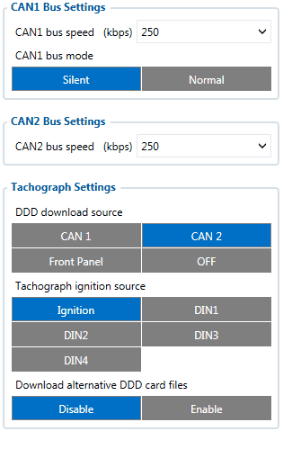
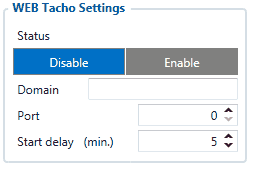
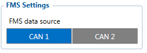
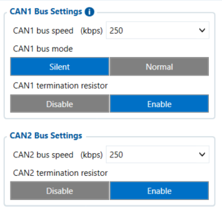
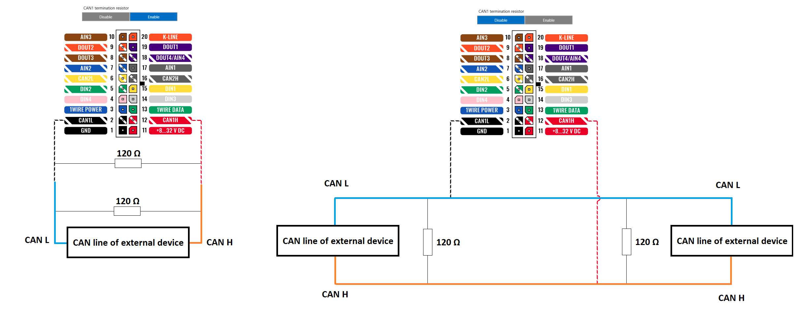

# FMC650 CAN \ Tachograph

# CAN \ Tachograph

**CAN \ Tachograph** are used to configure device when connection of CAN1 and CAN2 BUS lines are performed.

Teltonika recommendations:

- FMC650 CAN1 connected to vehicle's FMS(J1939) BUS line
- FMC650 CAN2 connected to vehicle's Tachograph - Instructions can be found on [FMC650 and Tachograph Solution](https://wiki.teltonika-gps.com/view/FMC650_and_Tachograph_Solution) wiki page;

# Tachograph Settings

**In FMC650 configurator “CAN/Tachograph” section tachograph settings should be set in order to download files.**

DDD download source – to which CAN line tachograph is connected;

Tachograph ignition source – which DIN is connected to vehicle ignition ("Ignition" parameter - tachograph ignition source will be the same as configured in "System" -> "Ignition Source");

FMC650 can be wired to Tachograph using instructions provided in [FMC650 and Tachograph Solution](https://wiki.teltonika-gps.com/view/FMC650_and_Tachograph_Solution) wiki page.

# WEB Tacho Settings

**WEB Tacho Settings** are used to configure Tacho WEB server to which device periodically connects.

WEB Tacho Settings:

**Status** - functionality enabling;
**Domain** – server domain where files will be send;
**Port** – server port where files will be send;
**Start delay** – delay after turning on ignition to start procedure of file sending.

# FMS settings

FMS settings is used to configure FMS source.
If you have FMS wired to FMC650 CAN1, FMS source should be selected as CAN1.
If you have FMS wired to FMC650 CAN2, FMS source should be selected as CAN2.

# CAN Termination resistor

FMC650 has electronically controllable CAN termination resistor on CAN1 and CAN2 lines.
This means that CAN line 120Ω resistance can be switched ON or OFF.

In most cases - devices in CAN communication lines have 120Ω between CAN LOW and CAN HIGH lines. When connecting two CAN devices in parallel - overall resistance becomes 60Ω which is suitable for correct CAN communication.
By default FMC650CAN Termination resistor is enabled - therefore when connecting to only one external CAN device - overall resistance will be 60Ω.
If FMC650 has to be connected to CAN line where there already are 2 main devices with 120Ω resistance - **CAN termination resistor has to be turned off**. Then overall resistance of CAN line is left unchanged at 60Ω - therefore CAN communication is uninterrupted.

<!-- configurator-companions -->

## Configurator notes (EN)

English notes translated from the Configurator tab PDFs, generated **2026-11-05**:

- [`configurator/can-tachograph.md`](configurator/can-tachograph.md) — CAN \ Tachograph: CAN bus routing and tachograph DDD stream.

