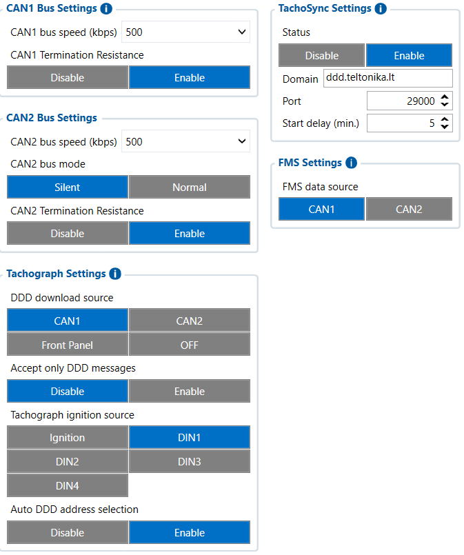

# CAN \ Tachograph — Configurator notes (EN)

> **Note:** Supplementary notes extracted from the French Configurator tab PDF
> `cantachograph-tab.pdf`, generated on
> **2026-11-05T08:37:58Z** — newer than the wiki snapshot kept in
> this folder. The text was translated into English; it supplements the
> reference page [`can-tachograph.md`](../can-tachograph.md).
> PDF-extraction quirks: section titles sometimes appear
> after the text they introduce, figures reuse page-1
> filenames, and some wide tables are restituted row by row because the PDF
> text layer does not always preserve columns. Unarchived `docs.tinolyx.com`
> image links were removed; unique figures are grouped under `## Figures` at
> the end of the file.

<!-- PDF p. 2 -->

1. Configure the physical CAN channels: Adjust the electrical (termination resistors) and software (bit rates, Silent passive listening mode) settings of the CAN1 and CAN2 buses.

2. Map the information sources: Designate the CAN1 channel as the single source for FMS extraction and tachograph file download.

3. Automate the regulatory tachograph download (TachoSync): Enable the secure gateway to ddd.teltonika.lt:29000 for automatic remote retrieval of driver cards and the tachograph mass memory without human intervention.

## CAN/Tachograph

The CAN \ Tachograph tab acts as the vehicle data routing matrix
and the control center for legal DDD data download. It allows you to:

<!-- PDF p. 3 -->

The FMC650's primary physical CAN bus interface is configured as follows:

**CAN1 Bus Speed**

Value: 500 kbps (500,000 bits/s).

### 1. CAN1 Bus Configuration (CAN1 Bus Settings)

<!-- PDF p. 4 -->

Role: Defines the hardware transmission rate of the CAN1 controller. It must be
strictly identical to the vehicle CAN bus speed (FMS or CAN Tacho) to
allow correct frame sampling.

**CAN1 Termination Resistance**

Value: Enable .
Role: Activates the FMC650's internal 120 Ω termination resistor on the
CAN1 line to physically close the line and prevent reflection of electrical
signals on the bus.
The secondary CAN bus interface dedicated to diagnostics or to a second vehicle network:

**CAN2 Bus Speed**

Value: 500 kbps .
Role: Aligns the second controller's rate with the usual standard for heavy-truck
CAN networks.

**CAN2 Bus Mode**

Value: Silent (Passive listening).
Role: The FMC650 device listens to and decodes frames on CAN2 without sending an
acknowledgement bit (ACK) or interacting with the bus. It eliminates any risk of disturbing the
vehicle's computer network.

**CAN2 Termination Resistance**

Value: Enable .
Role: Connects the CAN2 controller's internal 120 Ω resistor.
Set of rules governing direct hardware communication with the digital tachograph
(tachograph socket C/D).

### 2. CAN2 Bus Configuration (CAN2 Bus Settings)

### 3. Tachograph Settings & DDD Download (Tachograph Settings)

<!-- PDF p. 5 -->

**DDD Download Source**

Value: CAN1 .
Role: Specifies to the FMC650 that requests for and transmission of legal
.DDD files (mass memory and driver cards) must go through the CAN1 bus.

**Accept Only DDD Messages**

Value: Disable .
Role: When disabled, the FMC650 accepts standard FMS and
telematics frames on the CAN1 bus in addition to DDD file extraction requests.

**Tachograph Ignition Source**

Value: DIN1 .
Role: The device relies on the physical signal connected to digital input 1 ( DIN1 ) to determine whether the vehicle ignition is on, a condition required to
trigger certain tachograph routines.

**Auto DDD Address Selection**

Value: Enable .
Role: Automatically searches for and selects the digital tachograph's CAN address
(equipment identifiers), facilitating pairing without manual
identifier configuration.
Mechanism ensuring the automatic remote reporting of regulatory data to the
processing servers.

**Status**

Value: Enable .
Role: Activates the global remote download function for DDD data
(Remote Data Download).
**Domain**

### 4. Remote Server Synchronization (TachoSync Settings)

<!-- PDF p. 6 -->

Value: ddd.teltonika.lt .
Role: Web server address (FQDN) of the Teltonika TachoSync platform
responsible for relaying legal download sessions with the company card.

**Port**

Value: 29000 .
Role: Destination TCP port configured on the server to receive TachoSync
streams.

**Start Delay**

Value: 5 min .
Role: Delay imposed at device startup (or ignition on) before initializing a
TachoSync session, to let the GSM module and the tachograph stabilize.

**FMS Data Source**

Value: CAN1 .
Role: Directs the recording of FMS operational telematics variables (e.g.
consumption, mileage, fuel level) to the CAN1 bus reading.
Tab
Main role
Nature of the data
Primary business use
FMS I/O
Engine & chassis data
Technical (RPM, fuel, AdBlue)
Maintenance, fuel
management
Manual CAN
Custom decoding
Raw / Proprietary (hexadecimal IDs)
Specific non-FMS
captures
Manual CAN Requests
ECU polling
Request/Response
Diagnostics, specific PIDs
Manual CAN Commands
Network actuation
Orders / Commands
Control of third-party
equipment
Tachograph Data
Regulatory & social
data
Legal / Driver (Cards, driving times)
Compliance, payroll, time
tracking
RS232 / RS485
Serial interfacing & NMEA
filtering
Peripheral communication / raw
GNSS
External sensors, Garmin,
GPS flow

### 5. FMS Data Source (FMS Settings)

Comparative summary of the FMC650 tabs

| Tab | Main role | Nature of the data | Primary business use |
| --- | --- | --- | --- |
| FMS I/O | Engine & chassis data | Technical (RPM, fuel, AdBlue) | Maintenance, fuel management |
| Manual CAN | Custom decoding | Raw / Proprietary (hexadecimal IDs) | Specific non-FMS captures |
| Manual CAN Requests | ECU polling | Request/Response | Diagnostics, specific PIDs |
| Manual CAN Commands | Network actuation | Orders / Commands | Control of third-party equipment |
| Tachograph Data | Regulatory & social data | Legal / Driver (Cards, driving times) | Compliance, payroll, time tracking |
| RS232/RS485 | Serial interfacing & NMEA filtering | Peripheral communication / raw GNSS | External sensors, Garmin, GPS flow |

<!-- PDF p. 7 -->

**Tab**

Main role
Nature of the data
Primary business use
CAN \ Tachograph
CAN bus routing & DDD flow
Hardware configuration & server
routing
Legal DDD unloading, CAN
speeds
CAN communication & TachoSync architecture
```
 ┌──────────────────────────────────────────────────────────────────────────┐
 │                        VEHICLE NETWORKS & LINES                          │
 └──────┬─────────────────┬───────────────────┬───────────────────┬─────────┘
        │                 │                   │                   │
     (CAN1)            (CAN2)              (DIN1)         (Ignition Signal)
   500 kbps           500 kbps             Ignition                │
   Term: Enable       Term: Enable            │                   ▼
   Mode: Normal       Mode: Silent            └──────────► [Ignition Source]
        │                 │                                       │
        ├── FMS           │                                       │
        │   Source        │                                       │
        └── DDD           │                                       │
            Source        │                                       │
        │                 │                                       │
        └─────────────────┼───────────────────────────────────────┘
                          │
                          ▼
             ┌─────────────────────────┐
             │      FMC650 ENGINE      │
             └────────────┬────────────┘
                          │
                          ▼ (Start Delay = 5 min)
             ┌─────────────────────────┐
             │   TachoSync (Enabled)   │
             └────────────┬────────────┘
                          │
                          ▼ (GSM / GPRS Network)
             ┌─────────────────────────┐
             │    ddd.teltonika.lt     │
             │       Port: 29000       │
             └─────────────────────────┘
```

| Tab | Main role | Nature of the data | Primary business use |
| --- | --- | --- | --- |
| CAN\Tachograph | CAN bus routing & DDD flow | Hardware configuration & server routing | Legal DDD unloading, CAN speeds |

## Figures

Unique figures extracted from the PDF. The extraction reuses the same
filenames for all pages; each image is therefore referenced only once here.



