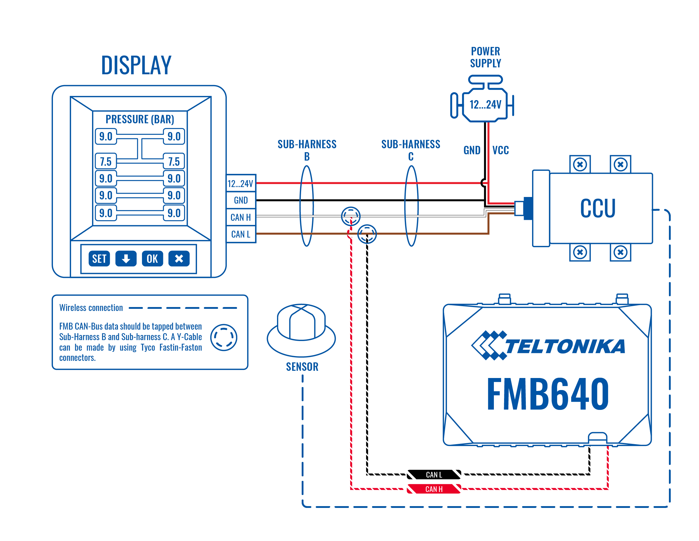
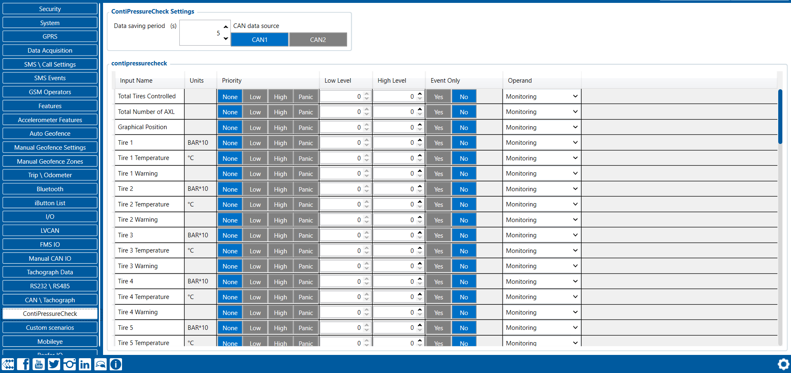
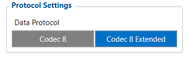
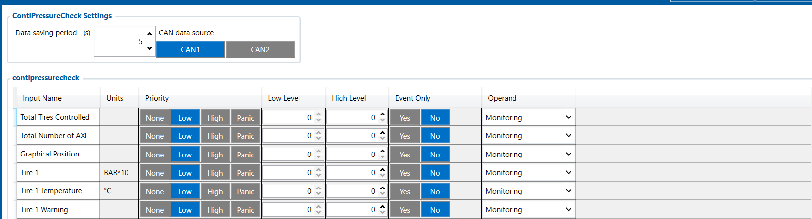
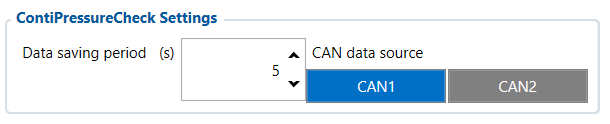
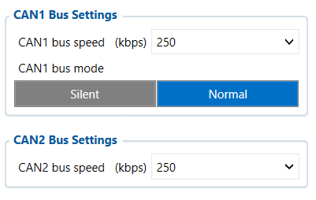

# FMC650 ContiPressureCheck

# Description

[FMC650](https://wiki.teltonika-gps.com/view/FMC650) device is able to read data from the Continental “ContiPressureCheck” tire pressure monitoring system. This solution provides you with live data about the state of the tires in your fleet, therefore helping you to make decisions that will lead to better fuel economy, reduced tire-related breakdowns, and extended tire lifespan.
**The pressure sensors are mounted inside the Continental tire ensuring accurate information that is sent to the Central Control Unit. [FMC650](https://wiki.teltonika-gps.com/view/FMC650) connects to this unit via the CAN line and can read data about the total number of tires controlled, the total number of axles, graphical position, and information regarding about every tire pressure, temperature and faults.**

Different fleets have different information priorities. “ContiPressureCheck” data is saved as a separate record. You are able to set how often the device saves this information by configuring the data reading period. This ensures that you will save data traffic costs and get the information that you need as often as you need it.

The data is gathered from CAN interface: a total number of tires controlled, the total number of axles, graphical position, and information regarding every tire. TPMS period affects only record saving.

# Configuration

To get data from TPMS sensors, in [System settings](https://wiki.teltonika-gps.com/view/FMC650_System_settings) choose [Codec 8](https://wiki.teltonika-gps.com/view/Teltonika_Data_Sending_Protocols#Codec_8) Extended as [Data protocol](https://wiki.teltonika-gps.com/view/FMC650_System_settings#Protocol_Settings).

To get current [TPMS IO elements](https://wiki.teltonika-gps.com/view/FMC650_Teltonika_Data_Sending_Parameters_ID#ContiPressureCheck_TPMS), they should be enabled in *ContiPressureCheck*. Also, after that, you will need to set [Data saving period](https://wiki.teltonika-gps.com/view/FMC650_Data_acquisition_settings) which means how often the device should save values from sensors.

Continental TPMS data is read from the FMS CAN bus lines. Please choose one option (CAN1 or CAN2) which will be used in *ContiPressureCheck*.

If you have [FMC650](https://wiki.teltonika-gps.com/view/FMC650) CAN1 bus lines connected to FMS, in [CAN / Tachograph settings](https://wiki.teltonika-gps.com/view/FMC650_CAN_%5C_Tachograph) CAN1 bus mode must be set to NORMAL and Baud rate - 250kbps. If you have [FMC650](https://wiki.teltonika-gps.com/view/FMC650) CAN2 bus lines connected to FMS, the CAN2 Baud rate must be set to 250kbps.

# External Links

[https://www.continental-tires.com/transport/products/overview-product-lines/contipressurecheck/about](https://www.continental-tires.com/transport/products/overview-product-lines/contipressurecheck/about)
