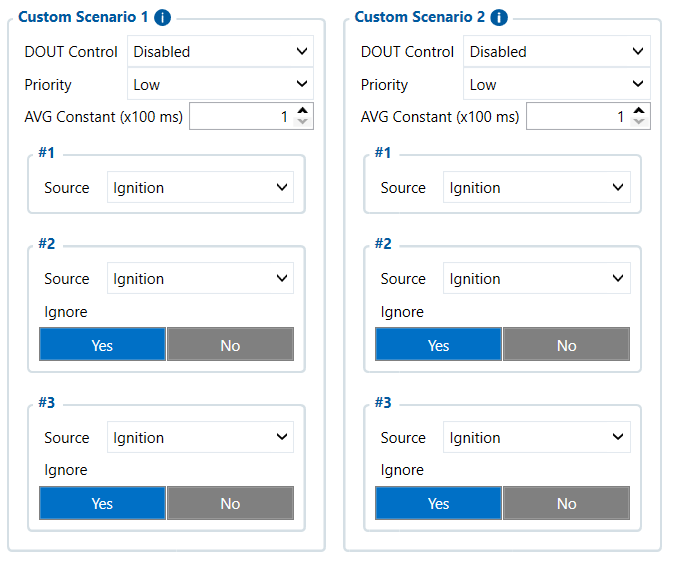

# Custom Scenarios — Configurator notes (EN)

> **Note:** Supplementary notes extracted from the French Configurator tab PDF
> `custom-scenarios-tab.pdf`, generated on
> **2026-11-05T08:37:58Z** — newer than the wiki snapshot kept in
> this folder. The text was translated into English; it supplements the
> reference page [`custom-scenario.md`](../custom-scenario.md).
> PDF-extraction quirks: section titles sometimes appear
> after the text they introduce, figures reuse page-1
> filenames, and some wide tables are restituted row by row because the PDF
> text layer does not always preserve columns. Unarchived `docs.tinolyx.com`
> image links were removed; unique figures are grouped under `## Figures` at
> the end of the file.

<!-- PDF p. 2 -->

1. Create multi-criteria logical combinations: Combine up to 3 variables (e.g. Ignition ON + DIN1 active + Speed > 80 km/h ) to detect specific complex situations.

2. Trigger local hardware actions: Actuate a physical output ( DOUT Control ) to cut the engine, activate a siren or turn on a warning light directly at the truck.

3. Generate targeted telematics alerts: Send a unique event code to the central server (Wialon) as soon as the combination of conditions is met.

## Custom Scenarios

The Custom Scenarios tab acts as a boolean rule engine and
embedded automation engine (Edge Computing). It processes business logic
directly in the FMC650 device before sending it to the tracking platform (Wialon). Its
target functions are:

<!-- PDF p. 3 -->

The FMC650 includes 4 independent programmable logic rule engines (Custom Scenario 1, 2, 3, 4). In your current profile, the 4 scenarios share an identical structure.

**Source #1 (Primary Condition)**

Current value: Ignition (Vehicle ignition).
Role: Defines the engine ignition/contact state as the primary logical input
signal for evaluating the rule.
Source #2 & Source #3 (Secondary Conditions & Filters)
Current values: Source #2 = Ignition , Source #3 = Ignition .

### 1. Custom Scenario Architecture (Custom Scenarios 1 to 4)

<!-- PDF p. 4 -->

Associative parameter: Ignore = Yes for both sources.
Role: Although a parameter is selected by default in the interface, the
Ignore = Yes flag logically neutralizes these two inputs. They do not take part
in resolving the scenario condition.

**Ignore (#2 & #3)**

Current value: Yes .
Role: Excludes inputs #2 and #3 from the overall logical equation ( Source 1 AND Source 2 AND Source 3 ). Only Source #1 is actively analyzed.
Parameters governing the time filtering of the input and the prioritization of the generated AVL packets.

**Priority (Event Priority Level)**

Current value: Low .
Role: Classifies the event generated by the scenario as low priority in the
FMC650 queue. The event is transmitted to the server (Wialon) during the next
periodic sending without forcing an immediate GSM connection (unlike the High or Panic priorities).

**AVG Constant (x100 ms)**

Current value: 1 (i.e. 1 × 100 ms = 100 ms).
Role: Sampling/time-filtering constant applied to the source. Imposes
a minimum stability of the input signal for 100 milliseconds before validating
the state change, thus eliminating electrical bounces or brief
ignition interruptions.

**DOUT Control**

Current value: Disabled .

### 2. Event Processing & Timing (Priority & AVG Constant)

### 3. Digital Output Control (DOUT Control)

<!-- PDF p. 5 -->

Role: Assigns or disables the automatic control of a physical tracker
output (e.g. DOUT1 or DOUT2 ) when the scenario is triggered. Disabled
mode ensures that no external relay, alert buzzer or starter cut-off will be
physically actuated by this scenario.
Tab
Main role
Nature of the data
Primary business use
FMS I/O
Engine & chassis data
Technical (RPM, fuel, AdBlue)
Maintenance, fuel
management
Manual CAN
Custom decoding
Raw / Proprietary (hexadecimal IDs)
Specific non-FMS
captures
Manual CAN Requests
ECU polling
Request/Response
Diagnostics, specific PIDs
Manual CAN Commands
Network actuation
Orders / Commands
Control of third-party
equipment
Tachograph Data
Regulatory & social
data
Legal / Driver (Cards, driving times)
Compliance, payroll, time
tracking
RS232 / RS485
Serial interfacing & NMEA
filtering
Peripheral communication / raw
GNSS
External sensors, Garmin,
GPS flow
CAN \ Tachograph
CAN bus routing & DDD flow
Hardware configuration & server
routing
Legal DDD unloading, CAN
speeds
Custom Scenarios
Rule engine & local
automation
Embedded boolean
logic
Local alerts, engine
cut-off, automation
Comparative summary of the FMC650 tabs
Custom Scenario logic architecture
```
 ┌──────────────────────────────────────────────────────────────────────────┐
 │                              INPUT SOURCES                               │
 └──────┬─────────────────────────┬─────────────────────────┬───────────────┘
        │                         │                         │
   (Source #1)               (Source #2)               (Source #3)
    Ignition                  Ignition                  Ignition
        │                         │                         │
        │                    Ignore = Yes              Ignore = Yes
        │                         │                         │
        │                         ▼                         ▼
        │                    [ IGNORED ]               [ IGNORED ]
        │
        ▼
 ┌──────────────────────────────────────────────────────────────────────────┐
```

| Tab | Main role | Nature of the data | Primary business use |
| --- | --- | --- | --- |
| FMS I/O | Engine & chassis data | Technical (RPM, fuel, AdBlue) | Maintenance, fuel management |
| Manual CAN | Custom decoding | Raw / Proprietary (hexadecimal IDs) | Specific non-FMS captures |
| Manual CAN Requests | ECU polling | Request/Response | Diagnostics, specific PIDs |
| Manual CAN Commands | Network actuation | Orders / Commands | Control of third-party equipment |
| Tachograph Data | Regulatory & social data | Legal / Driver (Cards, driving times) | Compliance, payroll, time tracking |
| RS232/RS485 | Serial interfacing & NMEA filtering | Peripheral communication / raw GNSS | External sensors, Garmin, GPS flow |
| CAN\Tachograph | CAN bus routing & DDD flow | Hardware configuration & server routing | Legal DDD unloading, CAN speeds |
| CustomScenarios | Rule engine & local automation | Embedded boolean logic | Local alerts, engine cut-off, automation |

<!-- PDF p. 6 -->

```
│                        FILTERING & STABILIZATION                         │
 ├──────────────────────────────────────────────────────────────────────────┤
 │  AVG Constant = 1 (100 ms) ──► Signal stability validation               │
 └──────┬───────────────────────────────────────────────────────────────────┘
        │
        ▼
 ┌──────────────────────────────────────────────────────────────────────────┐
 │                          SCENARIO LOGIC ENGINE                           │
 └──────┬───────────────────────────────────────────────────┬───────────────┘
        │                                                   │
        ▼                                                   ▼
┌───────────────────────────────┐               ┌───────────────────────────┐
│      AVL EVENT GENERATED      │               │   DOUT HARDWARE CONTROL   │
├───────────────────────────────┤               ├───────────────────────────┤
│ Priority = Low                │               │ DOUT Control = Disabled   │
│ Transmission to Wialon        │               │ (No physical action)      │
└───────────────────────────────┘               └───────────────────────────┘
```

## Figures

Unique figures extracted from the PDF. The extraction reuses the same
filenames for all pages; each image is therefore referenced only once here.



