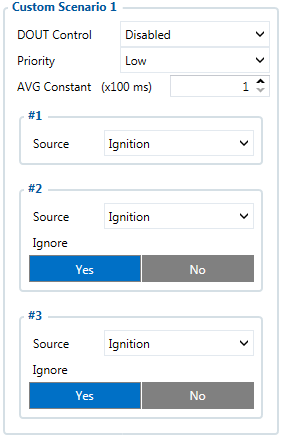
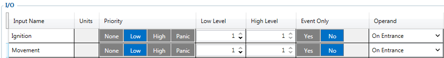

# FMC650 Custom scenario

FMC650 devices has „Custom scenarios“ functionality, which is designed to create four different instances for DOUT control. Scenario has three different possible sources, which logic is taken from „I/O“ element section and if triggered will create an event or / and activate the selected DOUT.

Each of the four scenarios can be selected to control:

- DOUT1
- DOUT2
- DOUT3
- [DOUT4 (Mode must be selected)](https://wiki.teltonika-gps.com/view/FMB640_System_settings#AIN4.2FDOUT4_Mode)

The event will be generated according to the "I/O" element's logic, but the priority of "Custom scenario" event does not depend on the "I/O" element settings and can be selected in the scenario section.

<!-- configurator-companions -->

## Configurator notes (EN)

English notes translated from the Configurator tab PDFs, generated **2026-11-05**:

- [`configurator/custom-scenarios.md`](configurator/custom-scenarios.md) — Custom Scenarios: rules engine and local automation.

