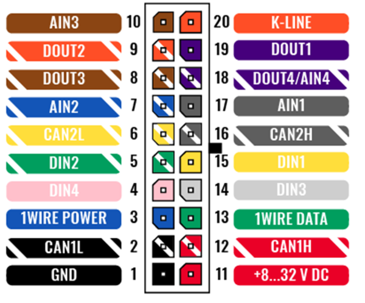
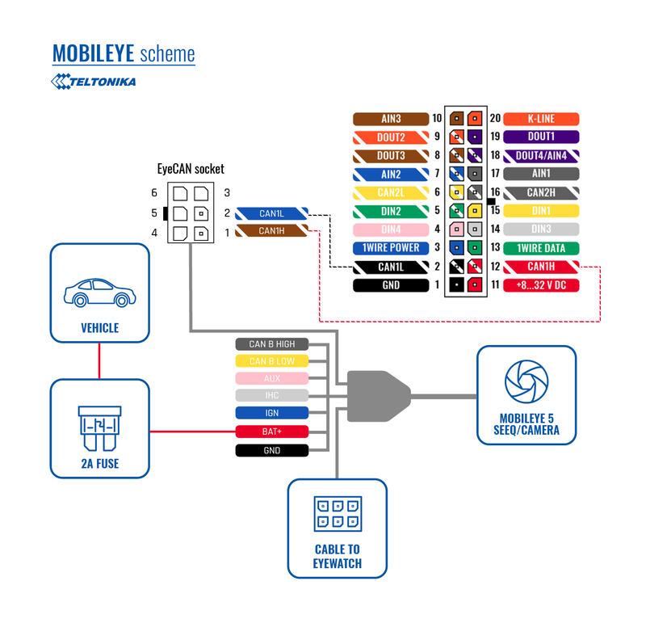
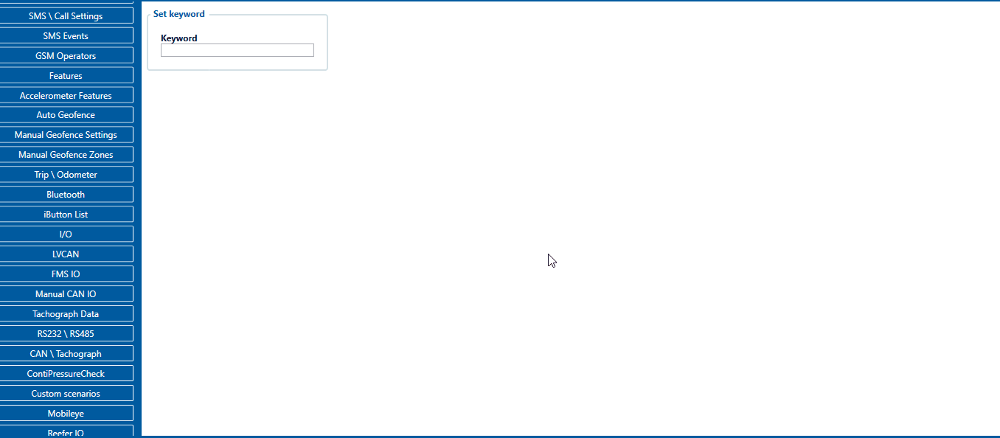
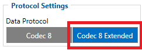
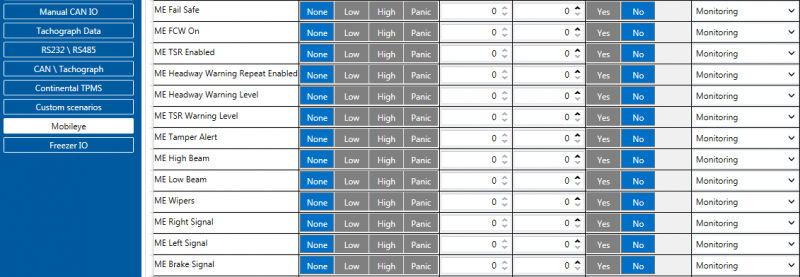

# FMC650 Mobileye

# Introduction

The Mobileye is a vision sensor that helps keep drivers and other traffic participants safe. To communicate between sensors and drivers is using the Advanced Driver Assistance System (ADAS). The sensor can view the road ahead and indicate objects like vehicles, pedestrians, cyclists, lane markings, and speed limit signs. Consistently gathering of all this information is continuously calculated for potentially imminent danger. By this, the system determines the driver if there is a potential danger on the road ahead.
FMC650 devices support Mobileye data. This data could be sent to the server as other AVL elements. In order to do that, you need to connect and set the configuration for FMC650 correctly. This document describes how to connect FMC650 device to the Mobileye unit and how to configure it in Teltonika Configurator.
**Note:** There are few different Mobileye module modifications and it might not be described in this document. For more detailed information ask for Mobileye support.

# Physical connection to Mobileye 5 CAN-A port

The Mobileye 5 CAN interface (CAN Bus) is located in the Main unit (SeeQ/camera). The Typical SeeQ CAN Channel dedicated to FMS Integrations and similar communication is the CAN-A channel. FMC650 devices use CAN1 by default configuration for Mobileye and FM communications.

You need to connect this CAN bus interface to Mobileye CAN-A channel dedicated CAN bus interface for FMC650. In Mobileye 5 the CAN-A Channel is accessible for physical connection using the CAN-AM Male connector, (6 Pins connector labeled “EyeCAN”) in the Mobileye 5 main harness.

FMC650 device CAN1 H signal must be connected to “EyeCAN” PIN1 and CAN1 L to PIN2. Please take a note that connectors for FMS devices (in this case FMC650) are not supplied. This connection cable should be provided for FMC650 CAN1 connection with Mobileye 5 “EyeCAN” port.
**Note:** CAN-A Male connector also can be connected with FMC650 CAN2 H and CAN2 L.

# FMC650 device configuration

Mobileye and FMC650 devices communicate through the CAN bus. FMC650 CAN1 bus is dedicated to Mobileye to FM communication. As described in Mobileye documentation, the default baud rate is 500 Kbps. Using the configurator, in [CAN\Tachograph tab](https://wiki.teltonika-gps.com/view/FMC650_CAN_%5C_Tachograph), CAN1 Bus Settings, select 500 kbps CAN1 bus speed (kbps). Also, in CAN1 bus mode please select the "Normal" option.

Users must select [Codec8 Extended](https://wiki.teltonika-gps.com/view/Codec#Codec_8_Extended) data type in order to get Mobileye data packets to the server because [Mobileye I/O AVL ID](https://wiki.teltonika-gps.com/view/FMC650_Teltonika_Data_Sending_Parameters_ID#Mobileye_elements)’s are over than 255. This is because of [Codec8 Extended](https://wiki.teltonika-gps.com/view/Codec#Codec_8_Extended) can sent 2 bytes data of AVL ID while [Codec8](https://wiki.teltonika-gps.com/view/Codec#Codec_8) – 1 byte. This parameter is located in configurator [System tab](https://wiki.teltonika-gps.com/view/FMC650_System_settings), Protocol Settings.
When [Codec8 Extended](https://wiki.teltonika-gps.com/view/Codec#Codec_8_Extended) type is selected [Mobileye I/O](https://wiki.teltonika-gps.com/index.php?title=FMC650_AVL_ID) elements could be selected.

**Note:** Mobileye data will be sent together with periodical AVL records.
**Note:** ME TSR IO elements are not parsed in FMC650 device, they must be parsed according to Mobileye documentation, because FMC650 will send 8 bytes size RAW data of those parameters. All other elements are already parsed and showing correct values. Simply select elements that you want to get and generation type as other [FMC650 I/O](https://wiki.teltonika-gps.com/view/FMC650_Teltonika_Data_Sending_Parameters_ID#Permanent_I.2FO_elements) elements.

