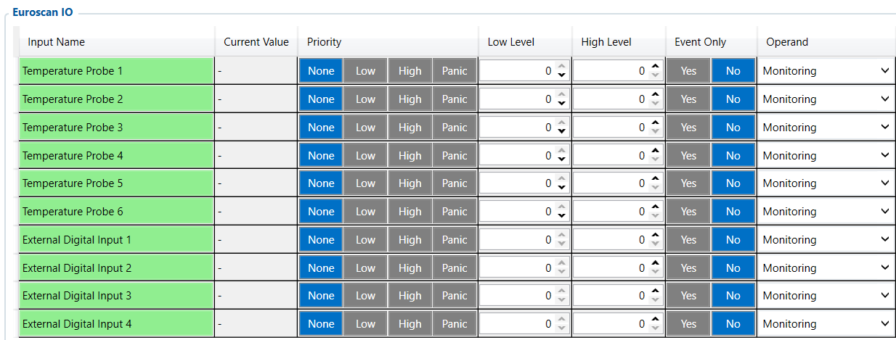

# Euroscan IO — Configurator notes (EN)

> **Note:** Supplementary notes extracted from the French PDF of the
> Configurator tab `euroscan-io-tab.pdf`, generated on
> **2026-11-05T08:37:58Z** — newer than the wiki snapshot kept in
> this folder. The text has been translated into English; it supplements the
> reference page [`reefer-io.md`](../reefer-io.md).
> PDF extraction quirks: section titles sometimes appear
> after the text they introduce, figures reuse page-1
> filenames, and some wide tables are restituted
> row by row because the PDF text layer does not always preserve the
> columns. Unarchived `docs.tinolyx.com` image links have been
> removed; unique figures are grouped under `## Figures`.

<!-- PDF p. 2 -->

1. Ensure cold chain traceability: Report up to 6 certified temperature probes from the Euroscan recorder.

2. Monitor loading events: Retrieve the state of 4 logic contacts (e.g. door openings) connected to the Euroscan.

3. Harmonize refrigeration data: Expose legitimate Euroscan recorder variables directly as standardized I/Os (Inputs/Outputs) for telematics.

The Euroscan IO tab is dedicated to interfacing between the FMC650 device and the
temperature recorders/dataloggers of the Euroscan brand (e.g. Euroscan TX2, RX2, eScan).
It allows retrieval of a targeted set of 10 input data channels (6 temperature probes and 4 external digital inputs) dedicated to thermal traceability and logistics
checks on the trailer.

## Euroscan IO

The Euroscan IO tab serves as an acquisition gateway for Euroscan dataloggers.
Its target functions are:

### 1. General Role of the Euroscan IO Tab

<!-- PDF p. 3 -->

The module includes 6 channels dedicated to temperature probes connected to the Euroscan datalogger.
Variables: Temperature Probe 1 , Temperature Probe 2 , Temperature Probe 3 , Temperature
Probe 4 , Temperature Probe 5 , Temperature Probe 6 .
Function: Transmit the thermal value measured by each of the 6 probes of the
Euroscan system to the FMC650.
Physical mapping: The assignment of each probe (e.g. front, center, rear of the compartment, or ambient temperature) depends on the physical installation performed on
the Euroscan recorder and cannot be assumed.
The module handles 4 logic/binary channels transmitted by the Euroscan system.
Variables: External Digital Input 1 , External Digital Input 2 , External Digital Input
3 , External Digital Input 4 .
Function: Report discrete logic states (states 0 / OFF or 1 / ON) of trailer
accessories connected to the Euroscan recorder.
Typical use cases:
Door open/close contacts (rear, side).
Removable partition presence detectors.
Emergency buttons or defrost signals.
For all 10 variables ( Temperature Probe 1–6 and External Digital Input 1–4 ), the
sampling configuration of your profile is uniform:
Priority: None (No dedicated event priority assigned to generate an emergency GSM transmission).

### 2. Temperature Probes (Temperature Probe 1 to 6)

### 3. External Digital Inputs (External Digital Input 1 to 4)

### 4. System Configuration of the 10 Euroscan IO Parameters

<!-- PDF p. 4 -->

Low Level / High Level: 0 / 0 (No minimum or maximum crossing threshold is configured in this section).
Event Only: No (The variables are processed as a continuous monitoring stream and not only on a state change).
Operand: Monitoring (Passive processing of monitoring data).
Characteristic
Reefer IO
TK Transcan IO
Transcan Advance
Euroscan IO
Hardware target
Complete unit
(Carrier, Thermo King...)
Thermo King Transcan
datalogger
Advanced Transcan
datalogger
Euroscan
recorder
Probes
Temperature
3 Zones + 6 Probes
4 Temperatures
8 Temperatures
6 Probes ( Probe 1–6 )
Special Measurements
Engine, Setpoint,
Fuel, RPM
-
Humidity ( Humidity )
4 Digital Inputs
( Input 1–4 )
Statuses / Alarms
Alarms, Error
Codes
4 Statuses / 4 Alarms
8 Statuses / 8 Alarms
Integrated via digital
inputs
Request
Period
Depends on the link
Configurable ( 0 s )
Configurable ( 0 s )
N/A (Internal management)
Tab
Main role
Nature of the data
Priority business use
FMS I/O
Engine & chassis data
Technical (RPM, fuel, AdBlue)
Maintenance, truck fuel
management
Manual CAN
Custom decoding
Raw / Proprietary (hexadecimal IDs)
Specific non-FMS
captures
Manual CAN Requests
ECU polling
Request/Response
Diagnostics, specific PIDs
Manual CAN Commands
Network actuation
Orders / Commands
Control of third-party
equipment
Tachograph Data
Regulatory &
social data
Legal / Driver (Cards, driving time)
Compliance, payroll, time
tracking
RS232 / RS485
Serial interfacing & NMEA
filtering
Peripheral
communication / raw GNSS
External sensors, Garmin,
GPS streams
Complete Comparison of FMC650 Refrigeration Interfaces
Updated global comparative
summary (with Euroscan IO)

| Tab | Mainrole | Natureofthedata | Prioritybusinessuse |
| --- | --- | --- | --- |
| FMSI/O | Enginedata&chassis | Technical(RPM, fuel AdBlue), | Maintenance managementof, truckfuel |
| ManualCAN | Customdecoding | Raw/Proprietary(hexadecimalIDs) | Specificcapturesnon FMS |
| ManualCANRequests | ECU polling | Request/Response | SpecificPIDsdiagnostics, |
| ManualCANCommands | Networkactuation | Orders/Commands | Third-partyequipmentcontrol |
| TachographData | Regulatory& socialdata | Legal/Driver(Cards, drivingtime) | Compliance payroll, timetracking |
| RS232/RS485 | Serialinterfacing&NMEAfiltering | Peripheralcommunication/rawGNSS | Externalsensors Garmin, GPSstreams |

<!-- PDF p. 5 -->

**Tab**

Main role
Nature of the data
Priority business use
CAN \ Tachograph
CAN bus & DDD stream
routing
Hardware configuration &
server routing
Legal DDD download,
CAN speeds
Custom Scenarios
Rule engine &
local automation
Embedded Boolean
logic
Local alerts, engine
cut-off, automations
Reefer IO
Cold chain telematics
Thermal, compressor &
unit alarms
Refrigeration traceability,
complete unit
TK Transcan IO
Thermo King
Transcan interface
Recorder probes &
standard statuses
Legal traceability
standard recorder
Transcan Advance
Advanced Datalogger
Gateway
8 Temperatures, Humidity,
8 Statuses/Alarms
Multi-zone datalogger &
hygrometry
Euroscan IO
Euroscan Datalogger
Interface
6 Temperature probes &
4 Digital inputs
Certified traceability
Euroscan recorder
Euroscan IO Logical Architecture
```
 ┌──────────────────────────────────────────────────────────────────────────┐
 │                      EUROSCAN SYSTEM / DATALOGGER                        │
 └───────────────────────────────────┬──────────────────────────────────────┘
                                     │
                          Serial link / RS232 / CAN
                                     │
                                     ▼
 ┌──────────────────────────────────────────────────────────────────────────┐
 │                         FMC650 (EUROSCAN IO)                             │
 ├──────────────────────────────────────────────────────────────────────────┤
 │ Active structure: 10 input variables                                     │
 └──────┬────────────────────────────────────────────────────┬──────────────┘
        │                                                    │
        ▼                                                    ▼
  Temperature Probe 1–6                               External Digital Input 1–4
  Operand: Monitoring                                 Operand: Monitoring
  Priority: None                                      Priority: None
  Limits: 0 / 0                                       Limits: 0 / 0
        │                                                    │
        └────────────────────────────┬───────────────────────┘
                                     │
                                     ▼
                       ┌───────────────────────────┐
                       │    Wialon / AVL server    │
                       │ (AVL frame transmission)  │
                       └───────────────────────────┘
```

| Tab | Mainrole | Natureofthedata | Prioritybusinessuse |
| --- | --- | --- | --- |
| CAN\Tachograph | CANbus&DDDstreamrouting | Hardwareconfiguration& serverrouting | LegalDDDdownload, CANspeeds |
| CustomScenarios | Ruleengine& localautomation | EmbeddedBoolean logic | Localalerts enginecut-off, automations, |
| ReeferIO | Coldchaintelematics | Thermal compressor&, unitalarms | Refrigerationtraceability, completeunit |
| TKTranscanIO | ThermoKing Transcaninterface | Recorderprobes& standardstatuses | Legaltraceability standardrecorder |
| TranscanAdvance | AdvancedDatalogger Gateway | 8Temperatures Humidity, 8Statuses/Alarms | Multi-zone datalogger & hygrometry |
| EuroscanIO | EuroscanDatalogger Interface | 6Temperatureprobes& 4Digitalinputs | Certifiedtraceability Euroscanrecorder |

<!-- PDF p. 6 -->

```
└───────────────────────────┘
```

## Figures

Unique figures extracted from the PDF. The extraction reuses the same
filenames for all pages; each image is therefore referenced only once here.



