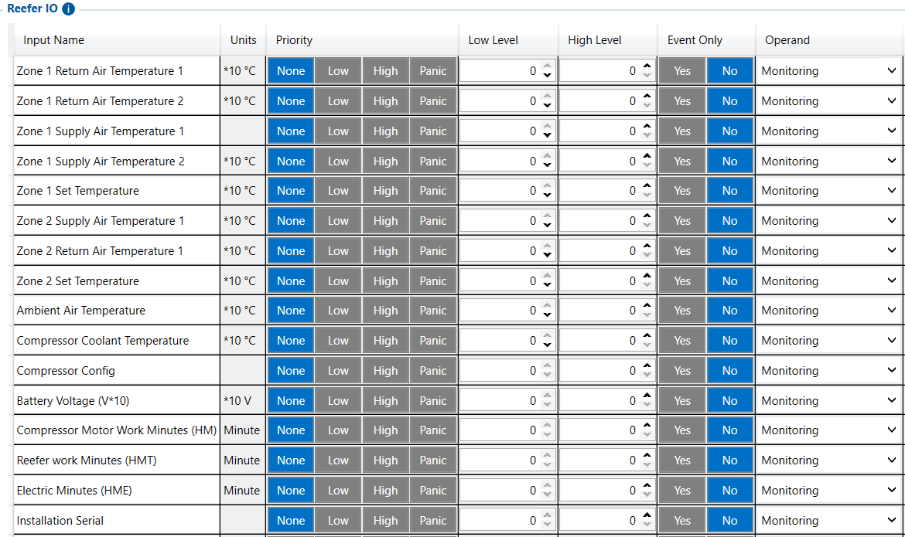

# Reefer IO — Configurator notes (EN)

> **Note:** Supplementary notes extracted from the French PDF of the
> Configurator tab `reefer-io-tab.pdf`, generated on
> **2026-11-05T08:37:58Z** — newer than the wiki snapshot kept in
> this folder. The text has been translated into English; it supplements the
> reference page [`reefer-io.md`](../reefer-io.md).
> PDF extraction quirks: section titles sometimes appear
> after the text they introduce, figures reuse page-1
> filenames, and some wide tables are restituted
> row by row because the PDF text layer does not always preserve the
> columns. Unarchived `docs.tinolyx.com` image links have been
> removed; unique figures are grouped under `## Figures`.

<!-- PDF p. 2 -->

1. Guarantee cold chain traceability: Validate the difference between the set temperature ( Set Temperature ) and the actual temperature ( Return Air ).

2. Monitor autonomy and unit operation: Track the hour meters ( HMT , HM , HME ), the dedicated battery voltage and the level of the autonomous diesel tank.

3. Prevent cargo damage: Report fault codes ( Error Codes ) and alarms in real time to Wialon to warn the operator before products deteriorate.

The FMC650 Reefer IO rule engine is dedicated to processing data from
refrigeration units (e.g. Carrier Transicold, Thermo King) installed on rigid trucks or trailers.

## Reefer IO

The Reefer IO tab turns the FMC650 into a refrigeration telematics gateway
(Cold Chain Monitoring). Its target functions are:

### 1. Overall Architecture and Role of Reefer IO

<!-- PDF p. 3 -->

It fully isolates the cold chain monitoring logic from the truck engine control units
(FMS/CAN).
The FMC650 supports thermal management of 1 to 3 independent cargo compartments.
Zone 1 Return Air Temperature: Return air temperature (air circulating from the refrigeration zone to the evaporator). Measures the actual overall temperature of the cold
chamber.
Zone 1 Supply Air Temperature: Supply air temperature (cold air expelled directly by the unit into the zone).
Zone 1 Set Temperature: Setpoint temperature programmed by the
driver or operator in zone 1.
Zone 2 Return Air Temperature 1 & 2: Return air temperatures (primary and secondary sensors) for compartment 2.
Zone 2 Supply Air Temperature 1 & 2: Supply air temperatures (primary and secondary sensors) to compartment 2.
Zone 2 Set Temperature: Setpoint temperature of compartment 2.
Zone 2 Compartment State: Activity state of compartment 2 (e.g. Cooling, Defrost, Off).
Zone 3 Return/Supply Air Temperature 1 & 2: Return air and supply air
measurements (channels 1 and 2) for compartment 3.
Zone 3 Setpoint: Setpoint temperature programmed for compartment 3.

### 2. Temperatures of the Refrigerated Zones (Multi-Zones 1, 2 & 3)

Zone 1
Zone 2
Zone 3

<!-- PDF p. 4 -->

Zone 3 Compartment State: Operating state of compartment 3.
Zone 1 / 2 / 3 Evaporator Coil Temperature: Direct temperature at the
evaporator coils of zones 1, 2 and 3. Makes it possible to monitor the icing condition and
the evaporation cycles.
Ambient Air Temperature: Temperature of the outside air surrounding the refrigeration
unit. Makes it possible to assess the thermal load imposed on the unit.
Compressor Coolant Temperature: Temperature of the coolant/liquid associated
with the engine or the compressor block of the unit.
Compressor Config: Hardware/software descriptor identifying the profile and type of
compressor connected.
Compressor RPM: Rotational speed (in rpm) of the refrigeration unit compressor
(distinct from the truck's Engine RPM).
Compressor Motor Work Minutes (HM): Cumulative meter of the compressor
motor operating time (in minutes).
Reefer Work Minutes (HMT): Overall meter of the total running hours/minutes
of the refrigeration unit.
Electric Minutes (HME): Meter of the time the unit is used on mains
power (standby/dock mode).
Battery Voltage (V × 10): Voltage of the battery dedicated to the refrigeration unit.
Expressed with a scale factor of 10 (e.g. raw value 240 = 24.0 V).
Battery State Flags: Bit register (binary flags) describing the battery status
(charge, undervoltage, alternator fault).

### 3. Evaporator & Ambient Temperatures (Evaporator & Ambient)

### 4. Refrigeration Engine & Compressor Parameters

### 5. Power, Fuel & Electrical Diagnostics

<!-- PDF p. 5 -->

Fuel Level: Fuel level present in the autonomous tank of the refrigerated
trailer (expressed in % or in Litres).
Fuel State Flags: Bit register describing the status of the unit's fuel circuit
(reserve reached, presence of water, pump fault).
Error Count: Total number of fault codes recorded in memory by the refrigeration
unit.
Error Codes: List of active hexadecimal or numeric error codes issued by the
unit.
Alarm 1 / Alarm 2 / Alarm 3: Hierarchical alarm registers transmitting the critical
system alerts (e.g. extended door open, injection failure, starting failure).
Maintenance 1 to 5 Hours: 5 separate maintenance due meters
(expressed in operating hours) assignable to filters, oil changes, coils and
overall overhauls.
Digital Sensor 1 to 4: 4 digital logic inputs dedicated to unit accessories
(e.g. door contacts, presence detectors).
Analog Sensor 1 to 3: 3 analog inputs (voltage range 0 mV - 5000 mV) for generic pressure or level sensors.
Temperature Probe 1 to 6: 6 additional wired temperature measurement channels
(Dallas/1-Wire or Pt100/Pt1000 probes) installed in the dead spots of the load
volume.
Installation Serial: Serial number of the refrigeration unit extracted by the FMC650.
Manufacturer.ID: Binary identifier of the unit manufacturer (Carrier, Thermo King, Euroscan, etc.).

### 6. Alerts, Errors & Maintenance Management

### 7. Additional Sensors & External Probes

### 8. Unit Identifiers & Operating Modes

<!-- PDF p. 6 -->

Power Mode: Active power supply mode (e.g. diesel combustion engine, 380V/220V mains, Hybrid).
Speed Mode: Unit operating regime (e.g. Low speed / High speed / Silence).
Run Mode: Selected thermal regulation mode (e.g. Continuous, Automatic Start/Stop).
Each variable in the Reefer IO table is governed by the following sampling logic in
your configuration:
Priority: None (No dedicated event priority assigned by default at input bus level).
Low Level / High Level: 0 (No crossing threshold is set locally in this section).
Event Only: No (The data is collected continuously and not exclusively on state change).
Operand: Monitoring (The FMC650 processes all 55 variables as a passive monitoring stream).
Tab
Main role
Nature of the data
Priority business use
FMS I/O
Engine & chassis data
Technical (RPM, fuel, AdBlue)
Maintenance, truck fuel
management
Manual CAN
Custom decoding
Raw / Proprietary (hexadecimal IDs)
Specific non-FMS
captures
Manual CAN Requests
ECU polling
Request/Response
Diagnostics, specific PIDs
Manual CAN Commands
Network actuation
Orders / Commands
Control of third-party
equipment
Tachograph Data
Regulatory &
social data
Legal / Driver (Cards, driving time)
Compliance, payroll, time
tracking
RS232 / RS485
Serial interfacing & NMEA
filtering
Peripheral
communication / raw GNSS
External sensors, Garmin,
GPS streams

### 9. System Configuration of Parameters (Priority, Limits & Operand)

Updated global comparative summary (with Reefer IO)

| Tab | Mainrole | Natureofthedata | Prioritybusinessuse |
| --- | --- | --- | --- |
| FMSI/O | Enginedata&chassis | Technical(RPM, fuel AdBlue), | Maintenance managementof, truckfuel |
| ManualCAN | Customdecoding | Raw/Proprietary(hexadecimalIDs) | Specificcapturesnon FMS |
| ManualCANRequests | ECU polling | Request/Response | SpecificPIDsdiagnostics, |
| ManualCANCommands | Networkactuation | Orders/Commands | Third-partyequipmentcontrol |
| TachographData | Regulatory& socialdata | Legal/Driver(Cards, drivingtime) | Compliance payroll, timetracking |
| RS232/RS485 | Serialinterfacing&NMEAfiltering | Peripheralcommunication/rawGNSS | Externalsensors Garmin, GPSstreams |

<!-- PDF p. 7 -->

**Tab**

Main role
Nature of the data
Priority business use
CAN \ Tachograph
CAN bus & DDD stream
routing
Hardware configuration &
server routing
Legal DDD download,
CAN speeds
Custom Scenarios
Rule engine &
local automation
Embedded Boolean
logic
Local alerts, engine
cut-off, automations
Reefer IO
Cold chain telematics
Thermal, compressor &
unit alarms
Refrigeration traceability,
cold chain alerts

| Tab | Mainrole | Natureofthedata | Prioritybusinessuse |
| --- | --- | --- | --- |
| CAN\Tachograph | CANbus&DDDstreamrouting | Hardwareconfiguration& serverrouting | LegalDDDdownload, CANspeeds |
| CustomScenarios | Ruleengine& localautomation | EmbeddedBoolean logic | Localalerts enginecut-off, automations, |
| ReeferIO | Coldchaintelematics | Thermal compressor&, unitalarms | Refrigerationtraceability, coldchainalerts |

## Figures

Unique figures extracted from the PDF. The extraction reuses the same
filenames for all pages; each image is therefore referenced only once here.

