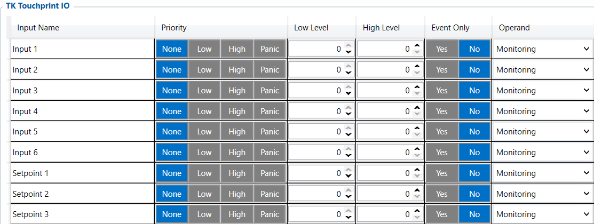

# TK Touchprint IO — Configurator notes (EN)

> **Note:** Supplementary notes extracted from the French PDF of the
> Configurator tab `tk-touchprint-io-tab.pdf`, generated on
> **2026-11-05T08:37:58Z** — newer than the wiki snapshot kept in
> this folder. The text has been translated into English; it supplements the
> reference page [`reefer-io.md`](../reefer-io.md).
> PDF extraction quirks: section titles sometimes appear
> after the text they introduce, figures reuse page-1
> filenames, and some wide tables are restituted
> row by row because the PDF text layer does not always preserve the
> columns. Unarchived `docs.tinolyx.com` image links have been
> removed; unique figures are grouped under `## Figures`.

<!-- PDF p. 2 -->

1. Verify compliance with setpoints: Report the temperature setpoints ( Setpoint 1-3 ) set by the driver on the printer.

2. Centralize print data: Collect Touchprint events ( Input 1-6 ) to send them to the telematics server (Wialon).

3. Prove transport compliance: Associate the data printed on the physical ticket with the telematics data sent in real time.

The TK Touchprint IO tab is the interface dedicated to interfacing the FMC650 with
the Thermo King Touchprint on-board printer/datalogger.
This equipment is frequently used on refrigerated trailers to issue printed temperature
tickets to drivers and customers. The FMC650 uses this link to extract
9 information channels (6 status/data inputs and 3 temperature setpoints).

## TK Touchprint IO

The TK Touchprint IO tab acts as an acquisition gateway for the Thermo King
Touchprint recorder-printer. Its target functions are:

### 1. General Role of the TK Touchprint IO Tab

<!-- PDF p. 3 -->

The module includes 6 information input acquisition channels transmitted by the Touchprint
panel.
Variables: Input 1 , Input 2 , Input 3 , Input 4 , Input 5 , Input 6 .
Function: Retrieve binary or operating status data from the Touchprint
(e.g. printing status, states of sensors connected to the printer, printing alerts).
Physical mapping: The exact function of each channel ( Input 1-6 ) depends on the
Touchprint datalogger configuration and the physical wiring on the vehicle; no
assignment can be deduced without a wiring diagram.
The module handles 3 channels dedicated to the temperature setpoints (Setpoints) configured on the
Touchprint.
Variables: Setpoint 1 , Setpoint 2 , Setpoint 3 .
Function: Transmit to the FMC650 the target temperatures programmed for up to 3
independent refrigeration zones or compartments.
Business value: Makes it possible to compare in real time the temperature measured in the
truck with the target temperature ( Setpoint ) ordered by the carrier, in order to
detect any setpoint deviation.
For the 9 variables of this tab ( Input 1–6 and Setpoint 1–3 ), the sampling configuration
of your profile is uniform:
Priority: None (No dedicated event priority is assigned to generate an emergency GSM transmission).
Low Level / High Level: 0 / 0 (No minimum or maximum crossing threshold is configured).

### 2. Information Inputs (Input 1 to 6)

### 3. Temperature Setpoints (Setpoint 1 to 3)

### 4. System Configuration of the 9 TK Parameters

Touchprint IO

<!-- PDF p. 4 -->

Event Only: No (The variables are processed as a continuous monitoring stream and not only on event).
Operand: Monitoring (Passive processing of monitoring data).
Your analysis reveals the entire spectrum of refrigeration management embedded in the
FMC650. Here is the complete comparison table for choosing the right module according to the hardware
actually installed on the trailer:
Module
Refrigeration
Hardware Target
Capacity
Temperatures /
Setpoints
Special Data
/ Diagnostics
Observed State
Reefer IO
Complete refrigeration
units (Carrier, Thermo King...)
3 Zones
(Supply/Return) +
Setpoints + 6
Probes
Compressor (RPM, Hours), Fuel,
Battery, Fault
Codes, Maintenance
Not used ( Current Value = - )
TK Transcan IO
Thermo King Transcan
Standard
Datalogger
4 Temperatures
4 Statuses, 4 Alarms
(Polling disabled:
0 s )
Not used ( Current Value = - )
Transcan Advance
Transcan Datalogger
Advanced / Multi-zone
8 Temperatures
1 Humidity Channel ( Humidity ), 8 Statuses,
8 Alarms
Not used ( Current Value = - )
Euroscan IO
Euroscan Recorders /
Dataloggers
6 Temperature
probes ( Probe 1–6 )
4 External Digital
Inputs ( Input 1–4 )
Not used
(passive structure)
TK Touchprint IO
Printer /
Thermo King
Touchprint datalogger
3 Temperature
setpoints ( Setpoint 1–3 )
6 Information/status
inputs ( Input 1–6 )
Not used
(passive structure)
Tab
Main role
Nature of the data
Priority business use
FMS I/O
Engine & chassis data
Technical (RPM, fuel, AdBlue)
Maintenance, truck fuel
management
Manual CAN
Custom decoding
Raw / Proprietary (hexadecimal IDs)
Specific non-FMS
captures
Manual CAN Requests
ECU polling
Request/Response
Diagnostics, specific PIDs
Manual CAN Commands
Network actuation
Orders / Commands
Control of third-party
equipment
REFRIGERATION WEEK: Global Summary of the 5
FMC650 Refrigeration Modules
Updated global comparative summary (with all refrigeration modules)

| Tab | Mainrole | Natureofthedata | Prioritybusinessuse |
| --- | --- | --- | --- |
| FMSI/O | Enginedata&chassis | Technical(RPM, fuel AdBlue), | Maintenance managementof, truckfuel |
| ManualCAN | Customdecoding | Raw/Proprietary(hexadecimalIDs) | Specificcapturesnon FMS |
| ManualCANRequests | ECU polling | Request/Response | SpecificPIDsdiagnostics, |
| ManualCANCommands | Networkactuation | Orders/Commands | Third-partyequipmentcontrol |

<!-- PDF p. 5 -->

**Tab**

Main role
Nature of the data
Priority business use
Tachograph Data
Regulatory &
social data
Legal / Driver (Cards, driving time)
Compliance, payroll, time
tracking
RS232 / RS485
Serial interfacing & NMEA
filtering
Peripheral
communication / raw GNSS
External sensors, Garmin,
GPS streams
CAN \ Tachograph
CAN bus & DDD stream
routing
Hardware configuration &
server routing
Legal DDD download,
CAN speeds
Custom Scenarios
Rule engine &
local automation
Embedded Boolean
logic
Local alerts, engine
cut-off, automations
Reefer IO
Global cold chain
telematics
Thermal, compressor &
unit alarms
Refrigeration traceability,
complete unit
TK Transcan IO
Thermo King
Transcan Standard interface
Recorder probes &
standard statuses
Legal traceability
standard recorder
Transcan Advance
Advanced Datalogger
Gateway
8 Temperatures, Humidity,
8 Statuses/Alarms
Multi-zone datalogger &
hygrometry
Euroscan IO
Euroscan Datalogger
Interface
6 Temperature probes &
4 Digital inputs
Certified traceability
Euroscan recorder
TK Touchprint IO
Thermo King
Touchprint interface
3 Setpoints & 6
Inputs
Setpoint traceability &
on-board printer
TK Touchprint IO Logical Architecture
```
 ┌──────────────────────────────────────────────────────────────────────────┐
 │                    THERMO KING TOUCHPRINT PANEL                          │
 └───────────────────────────────────┬──────────────────────────────────────┘
                                     │
                          Serial / RS232 link
                                     │
                                     ▼
 ┌──────────────────────────────────────────────────────────────────────────┐
 │                       FMC650 (TK TOUCHPRINT IO)                          │
 ├──────────────────────────────────────────────────────────────────────────┤
 │ Active structure: 9 input variables                                      │
 └──────┬────────────────────────────────────────────────────┬──────────────┘
        │                                                    │
        ▼                                                    ▼
    Input 1–6                                            Setpoint 1–3
  Operand: Monitoring                                 Operand: Monitoring
  Priority: None                                      Priority: None
  Limits: 0 / 0                                       Limits: 0 / 0
        │                                                    │
```

| Tab | Mainrole | Natureofthedata | Prioritybusinessuse |
| --- | --- | --- | --- |
| TachographData | Regulatory& socialdata | Legal/Driver(Cards, drivingtime) | Compliance payroll, timetracking |
| RS232/RS485 | Serialinterfacing&NMEAfiltering | Peripheralcommunication/rawGNSS | Externalsensors Garmin, GPSstreams |
| CAN\Tachograph | CANbus&DDDstreamrouting | Hardwareconfiguration& serverrouting | LegalDDDdownload, CANspeeds |
| CustomScenarios | Ruleengine& localautomation | EmbeddedBoolean logic | Localalerts enginecut-off, automations, |
| ReeferIO | Globalcoldchaintelematics | Thermal compressor&, unitalarms | Refrigerationtraceability, completeunit |
| TKTranscanIO | ThermoKing TranscanStandardinterface | Recorderprobes& standardstatuses | Legaltraceability standardrecorder |
| TranscanAdvance | AdvancedDatalogger Gateway | 8Temperatures Humidity, 8Statuses/Alarms | Multi-zone datalogger & hygrometry |
| EuroscanIO | EuroscanDatalogger Interface | 6Temperatureprobes& 4Digitalinputs | Certifiedtraceability Euroscanrecorder |
| TKTouchprintIO | ThermoKing Touchprintinterface | 3Setpoints(Setpoints)&6 Inputs | Setpointtraceability& on-boardprinter |

<!-- PDF p. 6 -->

```
└────────────────────────────┬───────────────────────┘
                                     │
                                     ▼
                       ┌───────────────────────────┐
                       │    Wialon / AVL server    │
                       │ (AVL frame transmission)  │
                       └───────────────────────────┘
```

## Figures

Unique figures extracted from the PDF. The extraction reuses the same
filenames for all pages; each image is therefore referenced only once here.



