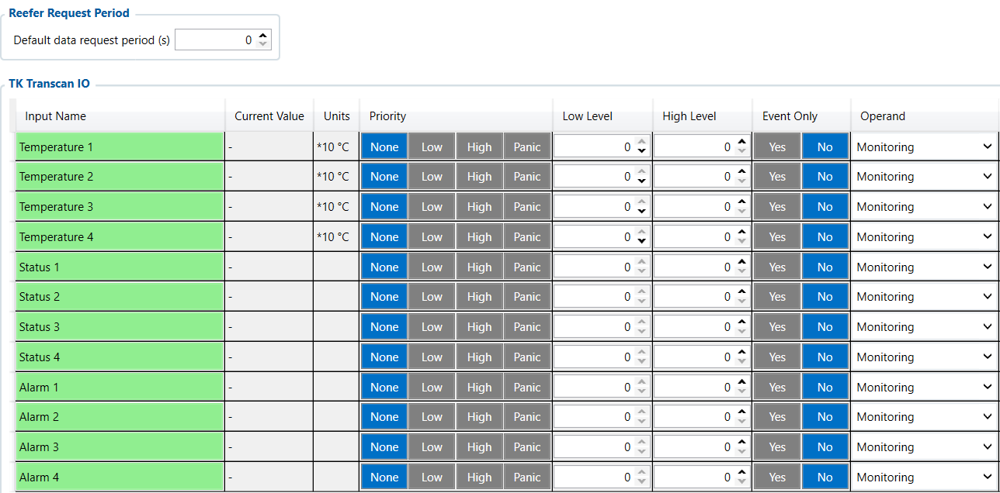

# TK Transcan IO — Configurator notes (EN)

> **Note:** Supplementary notes extracted from the French PDF of the
> Configurator tab `tk-transcan-io-tab.pdf`, generated on
> **2026-11-05T08:37:58Z** — newer than the wiki snapshot kept in
> this folder. The text has been translated into English; it supplements the
> reference page [`reefer-io.md`](../reefer-io.md).
> PDF extraction quirks: section titles sometimes appear
> after the text they introduce, figures reuse page-1
> filenames, and some wide tables are restituted
> row by row because the PDF text layer does not always preserve the
> columns. Unarchived `docs.tinolyx.com` image links have been
> removed; unique figures are grouped under `## Figures`.

<!-- PDF p. 2 -->

1. Ensure EN 12830 compliance: Extract the official temperatures recorded by the trailer's legal Transcan datalogger.

2. Simplify Thermo King monitoring: Report a standardized set (4 Temperatures, 4 Statuses, 4 Alarms) to the telematics server (Wialon).

3. Monitor datalogger status: Track alarms and statuses without having to decode the generic CAN bus frames.

The TK Transcan IO tab serves as a dedicated and specialized communication interface between the
FMC650 device and Thermo King refrigeration units equipped with the proprietary Transcan protocol
(datalogger / temperature recorder).

## TK Transcan IO

The TK Transcan IO tab serves as a specialized gateway for Thermo King temperature
recorders. Its target functions are:

### 1. General Role of TK Transcan IO

<!-- PDF p. 3 -->

Unlike the general Reefer IO tab, this section focuses on a reduced and
precise set of 12 parameters (4 Temperatures, 4 Statuses, 4 Alarms) transmitted by the data bus of the
Transcan system.

**Default Data Request Period (s)**

Current value: 0 s .
Role: Specifies the delay in seconds between each data extraction request
sent by the FMC650 to the Thermo King Transcan recorder.
Analysis of the value ( 0 s ): The FMC650 does not send any periodic polling request
on the communication bus. The automatic polling function is
fully passive/disabled.
The Transcan protocol reports up to 4 wired or ambient temperature channels from the
Thermo King datalogger.
Variables: Temperature 1 , Temperature 2 , Temperature 3 , Temperature 4 .
Hardware unit: × 10 °C (scale factor of 10).
Calculation example: A raw value transmitted of 125 corresponds to
125/10 = 12.5 °C. A value of -35 corresponds to - 3.5 °C.
Physical mapping: The exact assignment (e.g. supply air, return air or compartment probes) depends on the wiring performed on the Thermo King datalogger and must not
be assigned arbitrarily.
Variables: Status 1 , Status 2 , Status 3 , Status 4 .
Unit: Unit = - (Status registers with no physical unit).

### 2. Polling Frequency (Reefer Request Period)

### 3. Temperature Measurements (Temperature 1 to 4)

### 4. Operational Statuses (Status 1 to 4)

<!-- PDF p. 4 -->

Role: Transmit the operating states of the Thermo King Transcan unit (e.g.
operating mode, defrost, mains/diesel power). The exact meaning depends
on the Transcan register mapping of the connected model.
Variables: Alarm 1 , Alarm 2 , Alarm 3 , Alarm 4 .
Unit: Unit = - .
Role: Retrieve the fault codes or flags reported by the Transcan recorder
to the telematics unit.
For all 12 variables ( Temperature 1-4 , Status 1-4 , Alarm 1-4 ), the sampling
configuration of your profile is as follows:
Priority: None (No particular priority is assigned for generating immediate events).
Low Level / High Level: 0 / 0 (No minimum or maximum crossing threshold is set).
Event Only: No (The variables are processed as a continuous monitoring stream and not only on event).
Operand: Monitoring (Passive processing of values, unlike the On Change mode which reacts to the slightest modification).
Characteristic
Reefer IO
TK Transcan IO
Scope
Generic & Multi-brand (Carrier, Thermo King, etc.)
Specific to the Thermo King
Transcan protocol
Number of parameters
More than 55 variables
12 targeted variables
Data detail
Setpoints, fuel, compressor
hours, evaporators
4 Temperatures, 4 Statuses, 4 Alarms
Priority use
Complete management of the refrigeration
unit
Reading of the legal recorder
probes

### 5. System Alarms (Alarm 1 to 4)

### 6. Logic Configuration of the 12 Transcan Parameters

### Difference between Reefer IO and TK Transcan IO

| Characteristic | ReeferIO | TKTranscanIO |
| --- | --- | --- |
| Scope | Generic & Multi-brand (Carrier, ThermoKing etc), . | Specific to the ThermoKing Transcanprotocol |
| Numberofparameters | Morethan55variables | 12targetedvariables |
| Datadetail | Setpoints fuel compressor, hours evaporators, | 4Temperatures 4Statuses 4Alarms, |
| Priorityuse | Completerefrigerationunitmanagement | Readingofthelegal recorderprobes |

<!-- PDF p. 5 -->

**Tab**

Main role
Nature of the data
Priority business use
FMS I/O
Engine & chassis data
Technical (RPM, fuel, AdBlue)
Maintenance, truck fuel
management
Manual CAN
Custom decoding
Raw / Proprietary (hexadecimal IDs)
Specific non-FMS
captures
Manual CAN Requests
ECU polling
Request/Response
Diagnostics, specific PIDs
Manual CAN Commands
Network actuation
Orders / Commands
Control of third-party
equipment
Tachograph Data
Regulatory &
social data
Legal / Driver (Cards, driving time)
Compliance, payroll, time
tracking
RS232 / RS485
Serial interfacing & NMEA
filtering
Peripheral
communication / raw GNSS
External sensors, Garmin,
GPS streams
CAN \ Tachograph
CAN bus & DDD stream
routing
Hardware configuration &
server routing
Legal DDD download,
CAN speeds
Custom Scenarios
Rule engine &
local automation
Embedded Boolean
logic
Local alerts, engine
cut-off, automations
Reefer IO
Cold chain telematics
Thermal, compressor &
unit alarms
Refrigeration traceability,
complete unit alarms
TK Transcan IO
Thermo King
Transcan interface
Recorder probes &
Thermo King statuses
Legal traceability
Transcan recorder
Updated global comparative summary (with TK Transcan IO)
TK Transcan IO Logical Architecture
```
 ┌──────────────────────────────────────────────────────────────────────────┐
 │                     THERMO KING TRANSCAN DATALOGGER                      │
 └───────────────────────────────────┬──────────────────────────────────────┘
                                     │
                          Serial / CAN link
                                     │
                                     ▼
 ┌──────────────────────────────────────────────────────────────────────────┐
 │                        FMC650 (TK TRANSCAN IO)                           │
 ├──────────────────────────────────────────────────────────────────────────┤
 │ Request Period = 0 s ────────► [ Requests blocked / No Polling ]        │
 └──────┬────────────────────────────┬────────────────────────────┬─────────┘
        │                            │                            │
        ▼                            ▼                            ▼
```

| Tab | Mainrole | Natureofthedata | Prioritybusinessuse |
| --- | --- | --- | --- |
| FMSI/O | Enginedata&chassis | Technical(RPM, fuel AdBlue), | Maintenance managementof, truckfuel |
| ManualCAN | Customdecoding | Raw/Proprietary(hexadecimalIDs) | Specificcapturesnon FMS |
| ManualCANRequests | ECU polling | Request/Response | SpecificPIDsdiagnostics, |
| ManualCANCommands | Networkactuation | Orders/Commands | Third-partyequipmentcontrol |
| TachographData | Regulatory& socialdata | Legal/Driver(Cards, drivingtime) | Compliance payroll, timetracking |
| RS232/RS485 | Serialinterfacing&NMEAfiltering | Peripheralcommunication/rawGNSS | Externalsensors Garmin, GPSstreams |
| CAN\Tachograph | CANbus&DDDstreamrouting | Hardwareconfiguration& serverrouting | LegalDDDdownload, CANspeeds |
| CustomScenarios | Ruleengine& localautomation | EmbeddedBoolean logic | Localalerts enginecut-off, automations, |
| ReeferIO | Coldchaintelematics | Thermal compressor&, unitalarms | Refrigerationtraceability, completeunitalarms |
| TKTranscanIO | ThermoKing Transcaninterface | Recorderprobes& ThermoKingstatuses | Legaltraceability Transcanrecorder |

<!-- PDF p. 6 -->

**Temperature 1-4               Status 1-4                   Alarm 1-4**

Current: "-"                 Current: "-"                 Current: "-"
Operand: Monitoring          Operand: Monitoring          Operand: Monitoring
```
        │                            │                            │
        └────────────────────────────┼────────────────────────────┘
                                     │
                                     ▼
                       ┌───────────────────────────┐
                       │    Wialon / AVL server    │
                       │        (No data)          │
                       └───────────────────────────┘
```

## Figures

Unique figures extracted from the PDF. The extraction reuses the same
filenames for all pages; each image is therefore referenced only once here.



