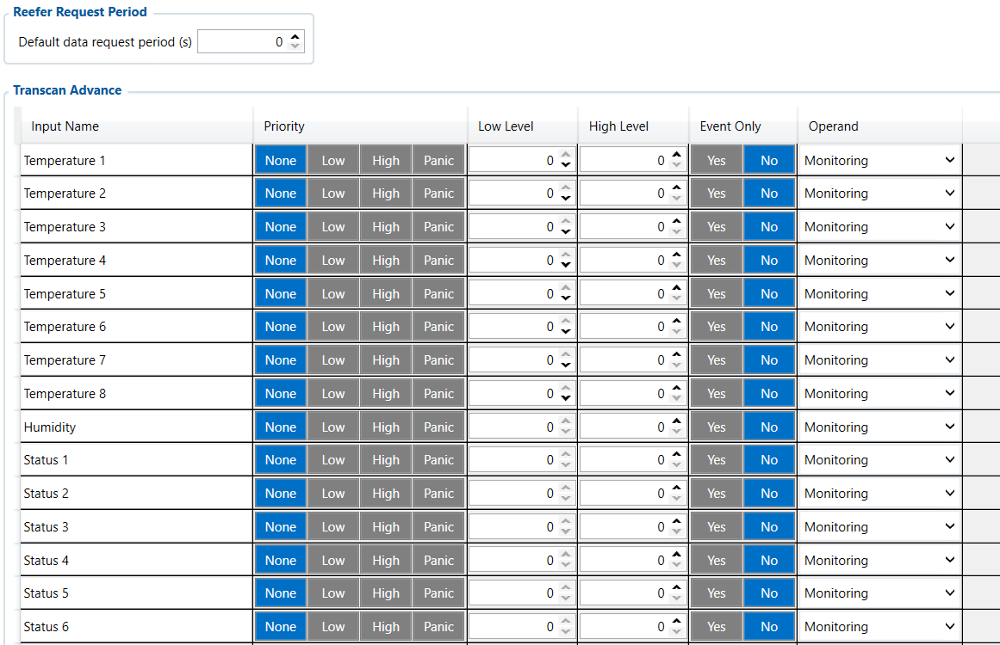

# Transcan Advance — Configurator notes (EN)

> **Note:** Supplementary notes extracted from the French PDF of the
> Configurator tab `transcan-advance-tab.pdf`, generated on
> **2026-11-05T08:37:58Z** — newer than the wiki snapshot kept in
> this folder. The text has been translated into English; it supplements the
> reference page [`reefer-io.md`](../reefer-io.md).
> PDF extraction quirks: section titles sometimes appear
> after the text they introduce, figures reuse page-1
> filenames, and some wide tables are restituted
> row by row because the PDF text layer does not always preserve the
> columns. Unarchived `docs.tinolyx.com` image links have been
> removed; unique figures are grouped under `## Figures`.

<!-- PDF p. 2 -->

1. Manage multi-compartment traceability: Track up to 8 temperature probes simultaneously in multi-zone trailers.

2. Monitor hygrometry: Check the humidity level ( Humidity ) for sensitive loads.

3. Multiply control points: Report an extended spectrum of alarms (8) and statuses (8) to Wialon without having to go through complex CAN decoding.

The Transcan Advance tab is an advanced extension of the Transcan interface dedicated to
extended processing of temperature recorders and refrigeration dataloggers (e.g. Transcan Advance equipment The Transcan Advance tab acts as a high-density gateway for complex temperature recorders. Its target functions are:

### 1. General Role of Transcan Advance

<!-- PDF p. 3 -->

next-generation Thermo King / Transcan).
It offers a significantly denser supervision capacity than the TK Transcan IO tab, allowing
the handling of 25 data channels in total (8 Temperatures, 1 Humidity, 8 Statuses, 8 Alarms).

**Default Data Request Period (s)**

Current value: 0 s .
Role: Time interval (in seconds) defining the frequency at which the
FMC650 sends data extraction requests to the Transcan
Advance system.
Analysis of the value ( 0 s ): The period is zero, which means that no
periodic polling request is transmitted on the bus. The Transcan Advance
acquisition engine is inactive / not configured.
The module offers 8 separate temperature acquisition channels to cover multi-
temperature trailers or large cold chambers.
Variables: Temperature 1 , Temperature 2 , Temperature 3 , Temperature 4 , Temperature 5 ,
Temperature 6 , Temperature 7 , Temperature 8 .
Role: Retrieve the thermal measurement transmitted by each datalogger
probe

## Transcan Advance.

Physical mapping: The precise assignment of each probe number (e.g. return air zone 1, supply air zone 3) depends exclusively on the hardware wiring performed on
the recorder and cannot be guessed without the wiring diagram.
Variable: Humidity .
Role: Retrieve the relative humidity level transmitted by the Transcan Advance system
(data particularly useful for transporting fresh food, flowers or pharmaceutical products).

### 2. Polling Frequency (Reefer Request Period)

### 3. Temperature Channels (Temperature 1 to 8)

### 4. Hygrometry Channel (Humidity)

<!-- PDF p. 4 -->

Variables: Status 1 to Status 8 .
Unit: Unit = - .
Role: Receive 8 logic and operational status registers from the refrigeration
unit (e.g. defrost, mains mode, door opening, economy mode).
Variables: Alarm 1 to Alarm 8 .
Unit: Unit = - .
Role: Report 8 alarm and fault code channels sent by the Transcan Advance
recorder to the telematics device.
For all 25 variables ( Temperature 1-8 , Humidity , Status 1-8 , Alarm 1-8 ), the
sampling configuration of your profile is identical:
Priority: None (No event priority assigned to trigger an emergency GSM transmission).
Low Level / High Level: 0 / 0 (No minimum or maximum crossing threshold is configured).
Event Only: No (The data is intended for continuous monitoring and not only on state change).
Operand: Monitoring (Processing as a passive monitoring stream).

### 5. Extended System Statuses (Status 1 to 8)

### 6. Extended System Alarms (Alarm 1 to 8)

### 7. Logic Configuration of the 25 Parameters

<!-- PDF p. 5 -->

**Characteristic**

Reefer IO
TK Transcan IO
Transcan Advance
Scope
Generic & Multi-brand
(Carrier, Thermo King, etc.)
Thermo King Transcan
Standard protocol
Thermo King Transcan
Extended protocol
Channel Capacity
Temperature
3 Zones + 6 Probes
4 Temperatures
8 Temperatures
Humidity Measurement
Not direct
No
Yes ( Humidity )
Statuses & Alarms
Compressor, Fuel,
Errors
4 Statuses / 4 Alarms
8 Statuses / 8 Alarms
Business use
Overall unit management
(Engine, Diesel, Setpoint)
Basic temperature
databox
Multi-zone datalogger &
hygrometry
Tab
Main role
Nature of the data
Priority business use
FMS I/O
Engine & chassis data
Technical (RPM, fuel, AdBlue)
Maintenance, truck fuel
management
Manual CAN
Custom decoding
Raw / Proprietary (hexadecimal IDs)
Specific non-FMS
captures
Manual CAN Requests
ECU polling
Request/Response
Diagnostics, specific PIDs
Manual CAN Commands
Network actuation
Orders / Commands
Control of third-party
equipment
Tachograph Data
Regulatory &
social data
Legal / Driver (Cards, driving time)
Compliance, payroll, time
tracking
RS232 / RS485
Serial interfacing & NMEA
filtering
Peripheral
communication / raw GNSS
External sensors, Garmin,
GPS streams
CAN \ Tachograph
CAN bus & DDD stream
routing
Hardware configuration &
server routing
Legal DDD download,
CAN speeds
Custom Scenarios
Rule engine &
local automation
Embedded Boolean
logic
Local alerts, engine
cut-off, automations
Reefer IO
Cold chain telematics
Thermal, compressor &
unit alarms
Refrigeration traceability,
complete unit
TK Transcan IO
Thermo King
Transcan interface
Recorder probes &
standard statuses
Legal traceability
standard recorder
Transcan Advance
Advanced Datalogger
Gateway
8 Temperatures, Humidity,
8 Statuses/Alarms
Multi-zone datalogger &
hygrometry
Comparison of Refrigeration Tabs (Reefer IO vs TK Transcan IO vs Transcan Advance)
Updated global comparative summary (with Transcan Advance)

| Characteristic | ReeferIO | TKTranscanIO | TranscanAdvance |  |
| --- | --- | --- | --- | --- |
| Scope | Generic & Multi-brand (Carrier ThermoKing etc), . | ThermoKing TranscanStandardprotocol | ThermoKing TranscanExtendedprotocol |  |
| ChannelCapacity | 3Zones+6Probes | 4Temperatures | 8Temperatures |  |
| HumidityMeasurement | Notdirect | No | Yes(Humidity) |  |
| Statuses&Alarms | Compressor Fuel, Errors | 4Statuses/4Alarms | 8Statuses/8Alarms |  |
| Businessuse | Overallunitmanagement (Engine Diesel Setpoint), | Basic temperature databox | Multi-zone datalogger & hygrometry |  |

| Tab | Mainrole | Natureofthedata | Prioritybusinessuse |
| --- | --- | --- | --- |
| FMSI/O | Enginedata&chassis | Technical(RPM, fuel AdBlue), | Maintenance managementof, truckfuel |
| ManualCAN | Customdecoding | Raw/Proprietary(hexadecimalIDs) | Specificcapturesnon FMS |
| ManualCANRequests | ECU polling | Request/Response | SpecificPIDsdiagnostics, |
| ManualCANCommands | Networkactuation | Orders/Commands | Third-partyequipmentcontrol |
| TachographData | Regulatory& socialdata | Legal/Driver(Cards, drivingtime) | Compliance payroll, timetracking |
| RS232/RS485 | Serialinterfacing&NMEAfiltering | Peripheralcommunication/rawGNSS | Externalsensors Garmin, GPSstreams |
| CAN\Tachograph | CANbus&DDDstreamrouting | Hardwareconfiguration& serverrouting | LegalDDDdownload, CANspeeds |
| CustomScenarios | Ruleengine& localautomation | EmbeddedBoolean logic | Localalerts enginecut-off, automations, |
| ReeferIO | Coldchaintelematics | Thermal compressor&, unitalarms | Refrigerationtraceability, completeunit |
| TKTranscanIO | ThermoKing Transcaninterface | Recorderprobes& standardstatuses | Legaltraceability standardrecorder |
| TranscanAdvance | AdvancedDatalogger Gateway | 8Temperatures Humidity, 8Statuses/Alarms | Multi-zone datalogger & hygrometry |

<!-- PDF p. 6 -->

Transcan Advance Logical Architecture
```
 ┌──────────────────────────────────────────────────────────────────────────┐
 │                    THERMO KING TRANSCAN ADVANCE DATALOGGER               │
 └───────────────────────────────────┬──────────────────────────────────────┘
                                     │
                          Serial / CAN link
                                     │
                                     ▼
 ┌──────────────────────────────────────────────────────────────────────────┐
 │                      FMC650 (TRANSCAN ADVANCE)                           │
 ├──────────────────────────────────────────────────────────────────────────┤
 │ Request Period = 0 s ────────► [ Requests blocked / No Polling ]        │
 └──────┬────────────────────────────┬────────────────────────────┬─────────┘
        │                            │                            │
        ▼                            ▼                            ▼
  Temperature 1-8                 Humidity                   Status / Alarm 1-8
   Current: "-"                 Current: "-"                    Current: "-"
  Operand: Monitoring          Operand: Monitoring             Operand: Monitoring
        │                            │                            │
        └────────────────────────────┼────────────────────────────┘
                                     │
                                     ▼
                       ┌───────────────────────────┐
                       │    Wialon / AVL server    │
                       │        (No data)          │
                       └───────────────────────────┘
```

## Figures

Unique figures extracted from the PDF. The extraction reuses the same
filenames for all pages; each image is therefore referenced only once here.



