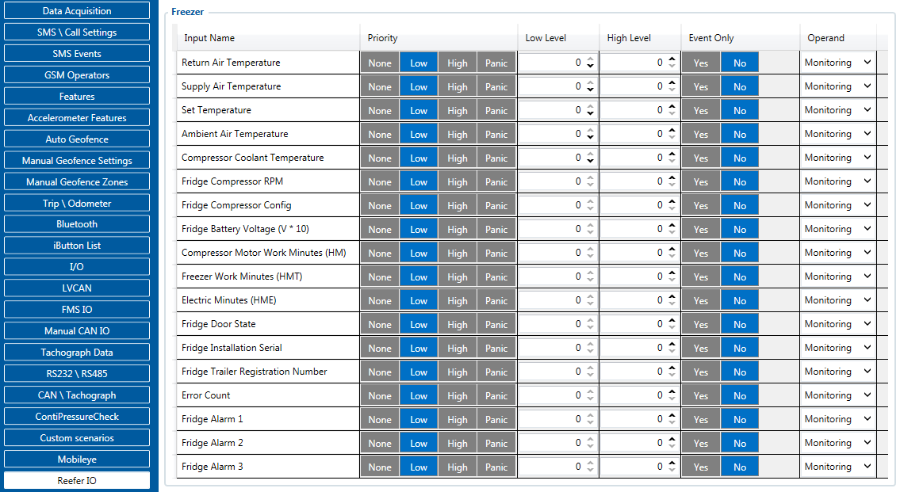

# FMC650 Reefer IO

FMC650 devices support data reading from Carrier Thermo freezers. This data could be sent to the server as other AVL elements. In order to do that you need to connect and set the configuration for [FMC650](https://wiki.teltonika-gps.com/view/FMC650) correctly.
At the creation/update of this document, [FMC650](https://wiki.teltonika-gps.com/view/FMC650) can support:

- Carrier (VECTOR 1800 | VECTOR 1850 | VECTOR 1850 MT | VECTOR 1550)

**Carrier configuration and installation instructions can be found [here](https://wiki.teltonika-gps.com/view/FMB640_Carrier)**

<!-- configurator-companions -->

## Configurator notes (EN)

English notes translated from the Configurator tab PDFs, generated **2026-11-05**:

- [`configurator/reefer-io.md`](configurator/reefer-io.md) — Reefer IO: cold-chain telematics and refrigeration units.
- [`configurator/euroscan-io.md`](configurator/euroscan-io.md) — Euroscan IO: Euroscan datalogger interface and temperature probes.
- [`configurator/tk-touchprint-io.md`](configurator/tk-touchprint-io.md) — TK Touchprint IO: ThermoKing Touchprint interface and setpoints.
- [`configurator/tk-transcan-io.md`](configurator/tk-transcan-io.md) — TK Transcan IO: ThermoKing Transcan interface and recorder.
- [`configurator/transcan-advance.md`](configurator/transcan-advance.md) — Transcan Advance: multi-zone datalogger gateway.

