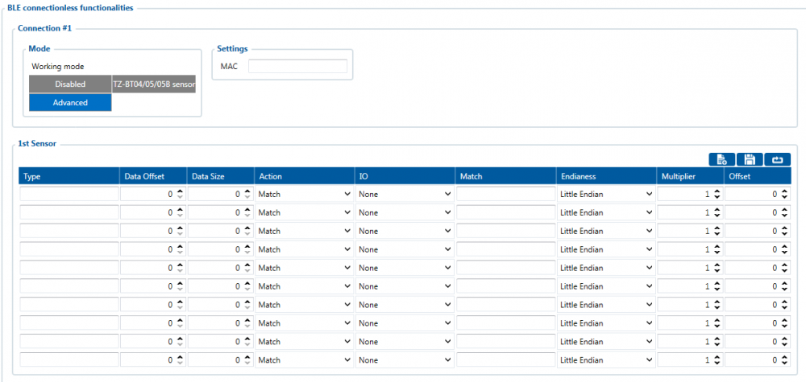
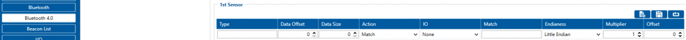
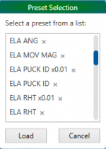
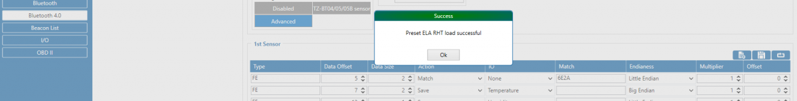

# FMC650 Bluetooth 4.0 settings

# Bluetooth® 4.0 settings

Bluetooth® 4.0 (Bluetooth® Low Energy, also referred as BLE) functionality.

Configurable parameters:

- ***Update frequency*** – changes sensor's temperature/humidity/battery voltage data update frequency. Minimum value: 30 s, maximum value: 65535 s, default value: 30.
- ***BLE Scan Duration*** - Sensors data reading time.
- ***Scan retries until error*** - Configured scan retries, to show the Error Value '3000' - sensor disconnected.
- ***Non Stop Scan*** - Enabled Non Stop Scan feature, the device will try to scan for the sensors all the time if any of them are configured.
- ***Working mode*** – Bluetooth® connection mode*. **Disabled**:* Bluetooth® 4.0 connection will not be used. ***TZ-BT04/05/05B sensor**:* this Bluetooth® connection will be used to communicate with TZ-BT04/05/05B sensor. ***Advanced** -* It allows to gather data from BLE device‘s broadcast packets regardless of what data packing protocol is used*.*
- ***Local Name*** – Bluetooth® local name user for pairing. If it is empty, name will be automatically generated: FMBxxx_<last 7 IMEI digits>. Maximum name length = 16 characters

# Configuration modes

Non Stop Scan Enabled.

In Configurator when Non Stop sensor scan is active update frequency & scan retries until error will be hidden.

Non Stop Scan Disabled, Scan period is selected manually.

From the picture above, the Scan time period will be selected from two sources, ***BLE Scan Duration* -** the time when sensors are scanned and the ***Update frequency*** - The time when the sensor information is packed as the AVL Data record.

For example:

***Update frequency** - 120 seconds.*

***BLE Scan Duration*** *- 60 Seconds*

Device will start the first scan after 120 seconds and will scan nearby BLE devices for 60 seconds to update configured sensor data. The sensor data will be updated every 120 seconds. Update Frequency is counted even while a scan is performed.

Update frequency period passes. 120 seconds -> 0 seconds, a 60 second scan is initiated. Update Frequency countdown is restarted (countdown from configured value to 0) while the scan (according to the BLE Scan duration parameter) is performed.

# Advanced Mode

When Advanced mode is selected a table with configurable parameters will appear:

- The table has 9 types of parameters:
 1. Type – EIR data type. This parameter will indicate which type to look for and work with. Note: We have also added type with value 0xFE which will indicate to work with a whole data packet and not just a single data type.
 2. Data Offset – start index of data we are interested in.
 3. Data Size – size of the data we are interested in.
 4. Action – two actions are possible: Match and Save. Match means that we want to perform a validation of certain data. Save means that we want to get certain data and later save it to an AVL record.
 5. IO – tells which IO element's data will be saved to. Possible choices for IO elements will be described later in the chapter. **Used only with Save action.**
 6. Match – hex string to be matched with BLE sensor data. **Used only with Match action.**
 7. Endianness – endianness of data: little endian (ex. 0x1122) or big endian (ex. 0x2211). **Used only with Save action.**
 8. Multiplier – value to be used to multiply output data. **Used only with Save action.**
 9. Offset – value to be added to output data. **Used only with Save action.**

**More information about Advanced Beacon Capturing Configuration can be found [HERE](https://wiki.teltonika-gps.com/view/Advanced_Beacon_Capturing_Configuration)**

# IO elements choices

| Name | Connection #1 AVL ID | Connection #2 AVL ID | Connection #3 AVL ID | Connection #4 AVL ID |
| --- | --- | --- | --- | --- |
| None | - | - | - | - |
| Temperature | 701 | 702 | 703 | 704 |
| Battery | 705 | 706 | 707 | 708 |
| Humidity | 709 | 710 | 711 | 712 |
| Custom0 | 713 | 714 | 715 | 716 |
| Illumination | 717 | 718 | 719 | 720 |
| Fuel | 721 | 722 | 723 | 724 |
| Fuel Frequency | 725 | 726 | 727 | 728 |
| Custom1 | 729 | 730 | 731 | 732 |
| Custom2 | 733 | 734 | 735 | 736 |
| Custom3 | 737 | 738 | 739 | 740 |
| Custom4 | 741 | 742 | 743 | 744 |

# Supported Sensors List

This list shows the supported BLE sensors and where their Presets can be found in the configurator to use those sensors with FMB devices. The prests and sensors have been fully tested by Teltonika and are confirmed to work properly.

While following the steps showed in the images below, you can find the supported sensors in our Configurator.

In the Configurator, find the Bluetooth® 4.0 Settings menu, select the advanced sensors mode which was mentioned before. The following window should appear.

At the top right corner, you should see the following **Buttons**, press on the first one from the left.

After the named **Button** was pressed the list with all supported sensors and the configuration presets should appear.

Select your sensor and click load. The correct configuration and recommended settings will appear in the configuration.

The supported sensors are listed below:

- [EYE Sensor](https://wiki.teltonika-gps.com/view/EYE_SENSOR_/_BTSMP1)
- BLE TPMS -Tire Pressure Monitoring System.
- Efento Humidity BLE sensors (version 2.2 and 4 presets)
- ELA ANG (Angle)
- ELA MOV AG (Movement and Angle)
- ELA PUCK ID (ID)
- ELA RHT (Temperature and Humidity)
- ELA T (Temperature)
- ELA MOV MAG (Movement Magnetic)
- Escort Fuel BLE sensors
- Escort luminosity BLE sensors
- Escort Temperature BLE sensors
- S1 BLE Motion, Humidity and Temperature Sensors
- Technoton Wireless fuel level sensors
- TZ-BT04 Temperature and Humidity Sensors
- TZ-BT05 Temperature and Humidity Sensors

[Save your own settings as a preset/delete the preset](https://wiki.teltonika-gps.com/view/How_to_add_a_BLE_preset_to_the_configurator)

# Visual demonstration

Here is a visual demonstration of Bluetooth® 4.0 sensors in a cold storage truck.

Load videoYouTubeYouTube might collect personal data. Privacy PolicyContinue
 Dismiss

# FMB Family Bluetooth® 4.0 support

Devices that are listed in table below shows which device model has Bluetooth® 4.0 hardware installed. If your device is manufactured before the day shown in the list it means that this model does not have Bluetooth® functionality or it has an older version installed. The date shown in the table depends on when hardware production has started, but not when first lot was sold.

| Device Model | BT 4.0 manufacture starting date |
| --- | --- |
| FM3001 | 2018.01 |
| — | — |
| FMB001 | 2018.04 |
| FMB010 | 2018.04 |
| FMB020 | All versions |
| FMB002 | All versions |
| FMB003 | All versions |
| FMB900 | 2018.08 |
| FMB920 | 2018.07 |
| FMB964 | 2019.07 |
| FMB110 | 2018.01 |
| FMB120 | 2018.01 |
| FMB122 | 2017.11 |
| FMB125 | 2017.11 |
| FMB130 | All versions |
| FMB140 | All versions |
| FMU125 | FW is on release, All versions |
| FMU126 | FW is on release, All versions |
| FMU130 | FW is on release, All versions |
| FMM125 | FW is on release, All versions |
| FMM130 | FW is on release, All versions |
| FMM0YX | FW is on release, All versions |
| FMC130 | FW is on release, All versions |
| FMB202 | All versions |
| FMB204 | All versions |
| FMB208 | All versions |
| FMC640 | All versions |
| FMM640 | All versions |
| FMC650 | All versions |
| FMM650 | All versions |
| FMT100 | All versions |
| FMP100 | All versions |
| FMC800 | All versions |
| FMM800 | All versions |
| FMC880 | All versions |
| FMM880 | All versions |

> **Note:** three screenshots (`Blue-tooth_4.0v2_settings_for_FMX6X0.png`, `Non_stop_scan_FMX6X0.png`, `Scan_FMX6X0.png`) are served by the archived snapshot from unprefixed `web.archive.org/images/...` paths that have no Wayback capture; they could not be preserved. All other figures are in `assets/`.

<!-- configurator-companions -->

## Configurator notes (EN)

English notes translated from the Configurator tab PDFs, generated **2026-11-05**:

- [`configurator/bluetooth-4.0.md`](configurator/bluetooth-4.0.md) — Bluetooth 4.0: BLE, pairing and Bluetooth sensors.

