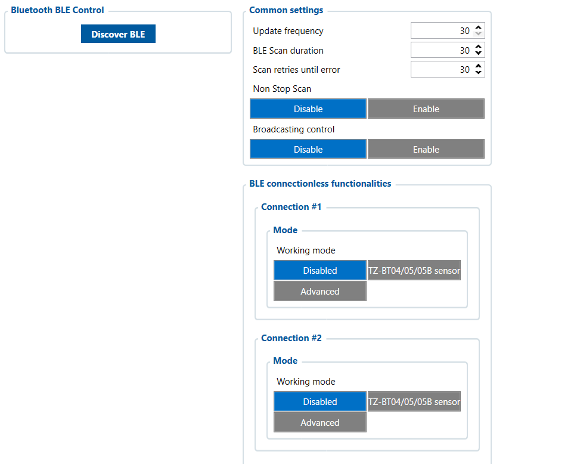

# Bluetooth 4.0 — Configurator notes (EN)

> **Note:** Supplementary notes extracted from the French Configurator tab PDF
> `bleutooth-40-tab.pdf`, generated on
> **2026-11-05T08:37:58Z** — newer than the wiki snapshot kept in
> this folder. The text was translated into English; it supplements the
> reference page [`bluetooth-4.0-settings.md`](../bluetooth-4.0-settings.md).
> PDF-extraction quirks: section titles sometimes appear
> after the text they introduce, figures reuse page-1
> filenames, and some wide tables are restituted row by row because the PDF
> text layer does not always preserve columns. Unarchived `docs.tinolyx.com`
> image links were removed; unique figures are grouped under `## Figures` at
> the end of the file.

<!-- PDF p. 2 -->

1. Add wireless telematics: Connect temperature sensors (refrigerated trailers), BLE fuel level gauges, or tire pressure sensors (TPMS).

2. Identify drivers or objects: Detect BLE badges or beacons to automatically associate a driver or a trailer with the truck.

3. Simplify installation: Reduce installation costs and time by avoiding running cables between the cab, the tank or the trailer.

4. Report data to Wialon: Transmit all these wireless measurements as inputs/outputs (BLE I/O) directly to your fleet management platform.

Bluetooth
The Bluetooth 4.0 tab extends the capabilities of the FMC650 device without any
physical wiring in the vehicle. It is mainly used to:

<!-- PDF p. 3 -->

Diagnostic and detection tool for nearby devices.

**Discover BLE**

Meaning: Instant radio scanning button.
Role: Starts a one-off scan to detect BLE devices (sensors, beacons) within the FMC650's range.
Parameters that define how the device searches for and updates wireless data.
Update frequency

### 1. Direct Search (Bluetooth BLE Control)

### 2. Global Scan Configuration (Common Settings)

<!-- PDF p. 4 -->

Meaning: Refresh rate for wireless data processing.
Current value: 30 .
Role: Sets the update interval for data read from BLE sensors.

**BLE Scan duration**

Meaning: Duration of each radio scanning session.
Current value: 30 .
Role: Sets the time during which the radio module actively listens for the
signal from peripherals before stopping the search.

**Scan retries until error**

Meaning: Tolerance to scan failures.
Current value: 30 .
Role: Defines the number of reconnection or listening attempts before declaring
a BLE communication error.

**Non Stop Scan**

Meaning: Permanent radio scanning.
Options: Disable , Enable .
Role: Enables or disables continuous listening for BLE signals ( Disable = intermittent scan to save power).

**Broadcasting control**

Meaning: Broadcasting of the FMC650 signal to the outside.
Options: Disable , Enable .
Role: Allows the device to itself emit BLE frames to other nearby
devices ( Disable = the device only listens).

### 3. Sensor Slots (BLE Connectionless Functionalities)

<!-- PDF p. 5 -->

Software configuration slots allowing remote sensors to be mapped to the FMC650.
Connection #1 / #2 / #3...
Meaning: Wireless device assignment channels.
Role: Associates a specific physical sensor (or a sensor type) with a logical
input of the FMC650.
Working Mode (Operating modes per connection)
Disabled : The channel is inactive (current configuration).
TZ-BT04/05/05B sensor : Automatically decodes the frames of Teltonika
environmental sensors (temperature, humidity).
Advanced : Allows third-party compatible sensors (BLE fuel, identification
beacons) to be integrated via manual protocol configuration.

## Figures

Unique figures extracted from the PDF. The extraction reuses the same
filenames for all pages; each image is therefore referenced only once here.

