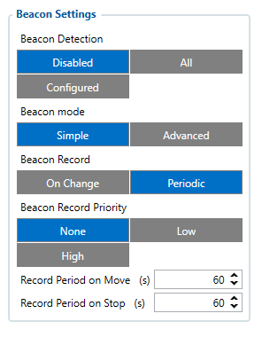
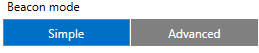
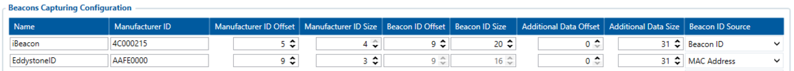
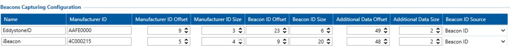
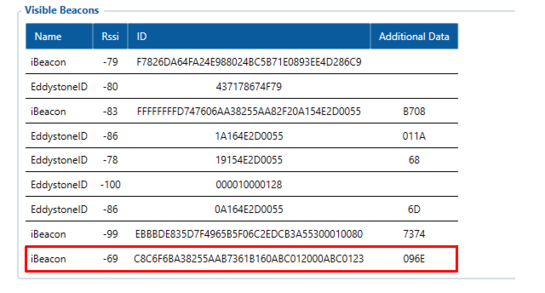
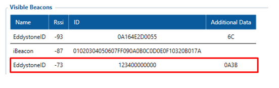

# FMC650 Beacon List

# Beacon List Settings

This page is dedicated for explanation of Bluetooth settings and also Beacon parameters in [**FMB device configurator**](https://wiki.teltonika-gps.com/view/Teltonika_Configurator_versions#For_FMB_series). A more extensive guide can be found [**How to start with FMB devices and Beacons?**](https://wiki.teltonika-gps.com/view/How_to_start_with_FMB_devices_and_Beacons%3F).

## Beacon Settings

**Beacon Detection**

- ***Disabled*** – Beacon detection is disabled.
- ***All*** – All visible beacons are detected (Max. up to 25 per record).
- ***Configured*** – device will only capture beacons by given data in Beacon list.

**Beacon Mode**

- ***Simple*** – When simple mode is selected beacon parsing is done automatically (Eddystone and iBeacon protocols are supported) (**AVL ID 10500**).
- ***Advanced*** – When advanced beacon mode is selected, beacon data capturing can be configured manually (**AVL ID 548**).

**Beacon Record**

- ***On Change*** – device will not create Beacon record after every scan procedure is completed unless scanned Beacon list will change.
- ***Periodic*** – All beacons are sent to the server. (Record will be saved according to configured period).

**Beacon Record Priority** - Beacon record saving period:

- ***None*** - No records will be generated
- ***Low*** - Beacon record will be generated and sent once link with the server is established
- ***High*** - Beacon record will be generated and sent immediately

## Advanced Beacon Capturing Configuration

Prior to capturing specific Beacon data it is mandatory to have Beacons communication protocol - advertising packet structure. Without knowing packet structure - it is impossible to configure device properly to capture important data.

Functionality allows to capture advertising packet of any kind of Beacon which broadcasts its information automatically. Beacon Capturing Configuration list also can be called as the set of rules to capture and transfer Beacon data. Advanced mode main purpose is to capture additional or only specific data (*by Manufacturers ID*) according to configured Offsets and Data sizes.

### Configurable parameters in Beacons Capturing Configuration table (Advanced Mode)

In advanced mode device can detect any Beacon type, the device can be configured to capture data from Universal beacons as seen in the configured in table (The fields in the Beacons Capturing Configuration will be empty), for example this configuration is set to detect iBeacon and EddyStone Beacons, also with additional data(in this case whole packet).

- **Name** - particular parameter does not affect Beacon capturing at all. You can name particular beacon capturing line as you wish. Note that if "dot" symbol is placed prior to the name - whole line in the table is disabled and beacons will not be captured;
- **Manufacturer ID** - most crucial and important part of the configuration. Device will look for provided ID and capture beacons if ID matches. Manufacturer ID consists of 4 Bytes (8bits) and it is required to write in the table full ID of 4 Bytes. Of course, in some cases Manufacturer ID of some Beacons may be shorter - in such case shorter ID can be configured but do not forget to add zeroes after the ID inside configuration – otherwise configuration will not be valid. Actually any numbers could be written because ID size in found Beacon advertising packet can be configured with further parameters;

**Note:** Manufacturer ID can be any set of bytes from the advertisement packet but selected bytes must never change in advertised packet.

- **Manufacturer ID Offset** - when device finds advertising packet from a beacon, device will check for the Manufacturer ID in specific part of the packet. Particular parameter commands device from which byte in the advertised packet to look for the ID;
- **Manufacturer ID Size** - maximum size is 4 Bytes (*same as maximum configurable parameter in Manufacturer ID*). This parameter indicates how many bytes in found advertising packet after offsetting to check. These bytes must match ID configured in Manufacturer ID section. If bytes match - Beacon advertisement packet is captured, if bytes do not match - packet is neglected;
- **Beacon ID Offset** - parameter works the same way as Manufacturer ID Offset but main purpose is to capture e.g. UUID of the beacon because Manufacturer ID never changes on the same provider Beacons;
- **Beacon ID Size** - parameter works the same way as Manufacturer ID Size but purpose is to capture specific part or whole e.g. UUID (major, minor);
- **Additional Data Offset** and **Additional Data Size** - allows to capture specific data of the Beacons advertised packet e.g. battery voltage or status. These additional parameters depend on Beacon type and advertisement packet. In order to capture full packet of the Beacon - Offset can be left at 0 and Size matched by actual length of the advertised packet.
- **Beacon ID Source**- Beacon ID source can be selected. When Beacon ID is used, source is used as configured in Beacon ID offset and Beacon ID size columns. When Beacon MAC address is selected, Beacon ID will be replaced with MAC address. IO structure remains the same, but Beacon ID size will always be reported as 0x06.

### EYE Sensor Capturing Configuration

As an example on how to set Beacons Capturing Configuration parameters EYE Sensor can be used. Protocols used can be found [here](https://wiki.teltonika-gps.com/view/EYE_SENSOR_/_BTSMP1).

Parameter valuesInformation shown after setting the parameters. Red rectangle indicates configured EYE sensors.

Eddystone temperature- **Name** - Eddystone and iBeacon were typed to name different sensors.
- **Manufacturer ID** - is taken from protocol description, which can be found [here](https://wiki.teltonika-gps.com/view/EYE_SENSOR_/_BTSMP1#Beacon_and_sensors_data). UUID and Type value is AAFE00 for Eddystone. CompanyID and Beacon Type are used for iBeacon which is 4C000215.
- **Manufacturer ID Offset** - passes 9bytes in advertising packet to indicate when Manufacturer ID starts. 5bytes for iBeacon.
- **Manufacturer ID Size** - number which indicates size of Manufacturer ID. 3bytes for Eddystone 4bytes for iBeacon.
- **Beacon ID Offset** - number used to indicate when Beacon ID starts in advertising packet.
- **Beacon ID Size** - number which indicates length of Beacon ID size, Instance ID is set in Eddystone and whole ID in iBeacon.
- **Additional Data Offset** and **Additional Data Size** - allows to capture specific data of the Beacons advertised packet e.g. Temperature.
- **Beacon ID Source**- configured ID output is shown in pictures. MAC address can be used as Source ID as well, in this case, It would be showed in ID section.

**Note**: Due to differencies in iBeacon and Eddystone advertising packets, number of Additional Data offset is different as well.

## Beacon List

List of authorized beacons, Eddystone and iBeacon protocols are *supported*.* Example of the configured beacons detection in the List:

Load videoLocal FileLocal File might collect personal data.https://wiki.teltonika-gps.com/view/File:BeaconCongif.mp4**Beacon Ids can be entered the following way: Namspace:CompanyID, UUID:Major:Minor. Any of the ID parts*
can be omitted ex., Namespace:. UUID::, UUID::Minor, etc

The Beacons settings are configured as showed. The iBeacon or Eddystone is added to the list with the following structure:

- ***iBeacon*** – 20 Bytes (**UUDI** (16-bytes : **Major**(2-bytes) : **Minor** (2-bytes))
- ***Eddystone*** – 16 Bytes (**Namespace** (10-bytes) : **Instance ID**(6-bytes))

There is a possibility to detect the devices just by UUID or Namespace (see the 2 and 6 elements in the list).
Or by the Major/Minor for iBeacons and Namespace for Eddystone. (see the 3 and 7 elements in the list).
There is also possible to select Beacons Detection as the Configured, in this case, the beacons will only be detected and send if they were added to the Beacons List.

When Advanced Beacon mode is selected - Beacon list acquires new option too. No longer it is required to insert full UUID, major or minor. In advanced mode it is possible to mask / ignore specific parts of UUID or major, or minor. Symbol " * " is used for masking. This allows to write shorter or only partial UUIDs in the Beacon list. Note: it is not possible to use " * " symbol to mask Manufacturer ID in the Advanced list.

## Beacon On Change/Periodic

[[File:BeaconRecords.png|right] The purpose of it is to create Beacon records only when there are changes in Beacon List. The parameter Beacon Record **(Parameter ID: 136)** has two possible settings: On Change (0) and Periodic (1). When On Change is selected, Beacon records are generated only when there are changes in the Beacon list. When Periodic is selected records will be saved according to configured period:

### Beacon On Change Scenarios:

**Example 1.**

*Non-Stop Scan* is Disabled. Scan starts. Beacon is detected and added to the list. Scan ends and Beacon records are created.

- The second scan starts. The same Beacon is still present. Scan ends and the Beacon record is not created because the list has not changed.
- The third scan starts. The same Beacon is still present but disappeared during that scan. Scan ends and Beacon record is not created because it is still considered that this Beacon is valid thus Beacon List hasn’t updated.
- The fourth scan starts. The same Beacon is not present from the start of the scan. Scan ends and Beacon is removed from Beacon list. Record is created since Beacon List has changed.

**Example 2.**

*Non-Stop Scan* is Disabled. Scan starts. Beacon is detected and added to the list. Scan ends and Beacon records are created.

- The second scan starts. The same Beacon is still present but is lost during that scan. Scan ends and the Beacon record is not created because the list has not changed.
- The third scan starts. At the start of the scan, Beacon was not present but during that scanning period, it has been detected again. At the end of the scan, the Beacon record is not created since Beacon List has not changed.

**Example 3.**

*Non-Stop Scan* is Enabled. Beacon Timeout is set to 10s. Beacon is detected and added to the list. Beacon record is created immediately after it is detected. The scan continues and during that time Beacon is lost. After 10s if Beacon has not been detected anymore Beacon record will be created. If that Beacon reappears after the set Beacon Timeout (in this case 10s) period has passed for that particular Beacon, a new Beacon record will be created. If That Beacon reappears before set Beacon Timeout (in this case 10s) period has passed. Beacon record will not be created.

## Parsing Advanced Beacon data from record (AVL ID 548)

| **Codec 8 Extended Record with Advanced beacon data** |
| --- |
| 00000000000000998E0100000185E7F31F600100000000000000000000000000000002240001000000000000000000010224006C02B714ACFD065EC3C011E39BBE1 / A514932AC44000546091E0201061AFF4C000215ACFD065EC3C011E39BBE1A514932AC4400054609CEA7140102030405060708090A0B0C0D0E0F11020C010B1F0201 / 061AFF4C0002150102030405060708090A0B0C0D0E0F11020C010BC80C010000F5AD |

| **Beacon data** |
| --- |
| **Unparsed Beacon data** |
| 02B714ACFD065EC3C011E39BBE1A514932AC44000546091E0201061AFF4C000215ACFD065EC3C011E39BBE1A514932AC4400054609CE / A7140102030405060708090A0B0C0D0E0F11020C010B1F0201061AFF4C0002150102030405060708090A0B0C0D0E0F11020C010BC80C |

**Beacon Parameters**

| **Parsed Beacon data** | — | — |
| --- | --- | --- |
| **Parsed Beacon data part** | **HEX Code Part** | — |
| — | Number of beacons | 02 |
| — | Signal Strength | B7 |
| — | Beacon Length | 14 |
| — | Beacon ID | ACFD065EC3C011E39BBE1A514932AC4400054609 |
| — | Additional Data length | 1E |
| — | Additional Data | 0201061AFF4C000215ACFD065EC3C011E39BBE1A514932AC4400054609CE |
| — | Signal Strength | A7 |
| — | Beacon Length | 14 |
| — | Beacon ID | 0102030405060708090A0B0C0D0E0F11020C010B |
| — | Additional data length | 1F |
| — | Additional data | 0201061AFF4C0002150102030405060708090A0B0C0D0E0F11020C010BC80C |

## Parsing Advanced Beacon data from record (AVL ID 548) from firmware version 03.01.00.Rev.03

| **Beacon data** |
| --- |
| **Unparsed Beacon data** |
| 01360001b10110f34b6f6aa38255aa9ef619154e2d0055021f0201060303aafe1716aafe0002f34b6f6aa38255a / a9ef619154e2d00550000360001ab0110e987706aa38255aa94321b154e2d0055021f0201060303aafe1716aafe0 / 002e987706aa38255aa94321b154e2d00550000360001a801101e74706aa38255faabcd000000000000021f0201060303aafe1716 / aafe00021e74706aa38255faabcd0000000000000000360001a201100c8c6f6ba38255aab7361a164e2d0055021f0201060303aafe171 / 6aafe00020c8c6f6ba38255aab7361a164e2d00550000 |

**Beacon Parameters**

The below table represents possible Beacon Parameters.

| **Parameters** | — |
| --- | --- |
| 00 | RSSI |
| 01 | Beacon ID |
| 02 | Additional beacon data |

| **Parsed Beacon data** | — | — |
| --- | --- | --- |
| **Parsed Beacon data part** | **HEX Code Part** | — |
| — | (Constant) | 01 |
| — | 1st Beacon data length | 36 |
| — | RSSI (Parameter 00) | 00 |
| — | RSSI length | 01 |
| — | RSSI value | B1 |
| — | Beacon ID (Parameter 01) | 01 |
| — | Beacon ID length | 10 |
| — | Beacon ID | F34B6F6AA38255AA9EF619154E2D0055 |
| — | Additional data (Parameter 02) | 02 |
| — | Additional data length | 1F |
| — | Additional data | 0201060303AAFE1716AAFE0002F34B6F6AA38255AA9EF619154E2D00550000 |
| — | 2nd Beacon data length | 36 |
| — | RSSI (Parameter 00) | 00 |
| — | RSSI length | 01 |
| — | RSSI value | AB |
| — | Beacon ID (Parameter 01) | 01 |
| — | Beacon ID length | 10 |
| — | Beacon ID | E987706AA38255AA94321B154E2D0055 |
| — | Additional data (Parameter 02) | 02 |
| — | Additional data length | 1F |
| — | Additional data | 0201060303AAFE1716AAFE0002E987706AA38255AA94321B154E2D00550000 |
| — | 3rd Beacon data length | 36 |
| — | RSSI (Parameter 00) | 00 |
| — | RSSI length | 01 |
| — | RSSI value | A8 |
| — | Beacon ID (Parameter 01) | 01 |
| — | Beacon ID length | 10 |
| — | Beacon ID | 1E74706AA38255FAABCD000000000000 |
| — | Additional data (Parameter 02) | 02 |
| — | Additional data length | 1F |
| — | Additional data | 0201060303AAFE1716AAFE00021E74706AA38255FAABCD0000000000000000 |
| — | 4th Beacon data length | 36 |
| — | RSSI (Parameter 00) | 00 |
| — | RSSI length | 01 |
| — | RSSI value | A2 |
| — | Beacon ID (Parameter 01) | 01 |
| — | Beacon ID length | 10 |
| — | Beacon ID | 0C8C6F6BA38255AAB7361A164E2D0055 |
| — | Additional data (Parameter 02) | 02 |
| — | Additional data length | 1F |
| — | Additional data | 0201060303AAFE1716AAFE00020C8C6F6BA38255AAB7361A164E2D00550000 |

<!-- configurator-companions -->

## Configurator notes (EN)

English notes translated from the Configurator tab PDFs, generated **2026-11-05**:

- [`configurator/beacon-list.md`](configurator/beacon-list.md) — Beacon List: BLE beacon list, UUIDs and calibration.

