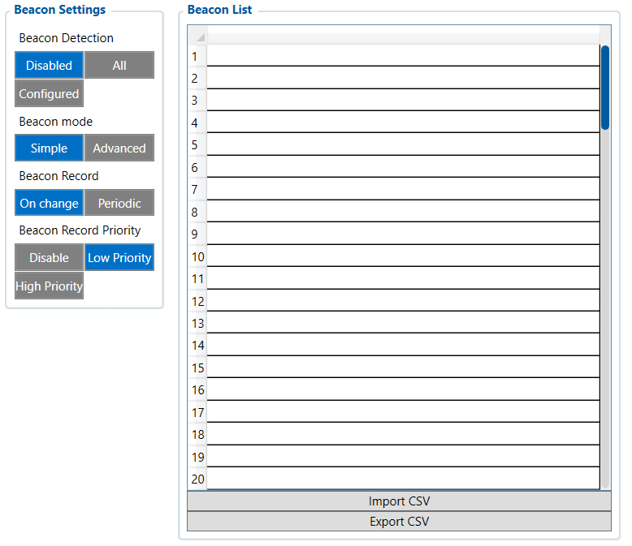

# Beacon List — Configurator notes (EN)

> **Note:** Supplementary notes extracted from the French Configurator tab PDF
> `beacon-list-tab.pdf`, generated on
> **2026-11-05T08:37:58Z** — newer than the wiki snapshot kept in
> this folder. The text was translated into English; it supplements the
> reference page [`beacon-list.md`](../beacon-list.md).
> PDF-extraction quirks: section titles sometimes appear
> after the text they introduce, figures reuse page-1
> filenames, and some wide tables are restituted row by row because the PDF
> text layer does not always preserve columns. Unarchived `docs.tinolyx.com`
> image links were removed; unique figures are grouped under `## Figures` at
> the end of the file.

<!-- PDF p. 2 -->

## Beacon List

The Beacon List tab is used to manage the Bluetooth Low Energy (BLE) beacons that the
FMC650 can detect nearby.
A beacon is generally a small BLE device that periodically broadcasts a radio
identifier. The FMC650 can detect this identifier and use it as additional
information in its AVL records.

### 1. Beacon Configuration (Beacon Settings)

<!-- PDF p. 3 -->

General parameters governing the detection and recording logic of BLE beacons.

**Beacon Detection**

Meaning: Activation state and beacon filtering mode.
Options: Disabled (disabled), All (all beacons), Configured (list only).
Role: Enables or disables beacon detection ( Disabled = function inactive).
Allows listening to everything that broadcasts ( All ) or filtering only the registered beacons
( Configured ).

**Beacon Mode**

Meaning: Complexity level of radio management.
Options: Simple , Advanced .
Role: Defines how to interpret the BLE signal. Simple mode focuses on
the raw identifier and proximity, while Advanced uses more extensive BLE
metadata.

**Beacon Record**

Meaning: Frequency of generation of beacon-related AVL points.
Options: On change , Periodic .
Role: Determines whether the FMC650 generates a data point as soon as a beacon
appears/disappears ( On change ) or at a regular time interval ( Periodic ).

**Beacon Record Priority**

Meaning: Degree of urgency assigned to the detection event.
Options: Disable , Low Priority , High Priority .
Role: Sets the transmission priority level of the event packet to the
server ( Low Priority = no emergency processing).
Storage slots for identifiers and list management tools.

### 2. List Management & Import/Export (Beacon List Management)

<!-- PDF p. 4 -->

**Beacon List (Slots 1 to 20)**

Meaning: Memory slots for recording the unique identifiers
(UUID/MAC) of authorized beacons.
Current value: [All empty].
Role: Serves as a whitelist when Beacon Detection is set to Configured .

**Import CSV / Export CSV**

Meaning: Configuration transfer tools by file.
Role: Allows large lists of beacon identifiers to be quickly injected or extracted
without manual entry.

## Figures

Unique figures extracted from the PDF. The extraction reuses the same
filenames for all pages; each image is therefore referenced only once here.

