# AVL Protocols & Teltonika FMC650 Remote Data Collection — Configurator notes (EN)

> **Note:** Supplementary notes extracted from the French PDF of the
> Configurator tab `protocoles-avl-telecollecte-teltonika-fmc650 (1).pdf`, generated on
> **2026-11-05T08:37:58Z** — newer than the wiki snapshot kept in
> this folder. The text was translated into English; it complements the
> reference page [`README.md`](../README.md).
> PDF extraction quirks: section titles sometimes appear after the text
> they introduce, figures reuse file names from page 1, and some wide
> tables are restituted row by row because the PDF text layer does not
> always preserve the columns. Unarchived `docs.tinolyx.com` image links
> were removed; unique figures are grouped under `## Figures`.

<!-- PDF p. 1 -->

## Contents

- General Architecture & Multi-Constellation GNSS Geolocation
- Electronic Tachograph Files (.ddd) & Regulatory Compliance
- AVL Transmission Principles & Communication Protocols
- Secure Authentication Process & IMEI Handshake
- Comparative Study of Teltonika Codecs (Codec 8, 8E & 16)
- Decoded Binary Structure of AVL Packets (Codec 8)
- Analysis of a Received Hexadecimal Frame (Decoded Real Case)
- Specificities of the Teltonika FMC650 Tracker & Configuration
- CAN Bus Interfacing, SAE J1939 & Heavy Vehicle FMS Standards
- Functional Relationship between the CAN Bus and AVL Packets
- Ingestion & Processing Pipeline in the Wialon Local Server

<!-- PDF p. 2 -->

Teltonika GPS trackers (FMB, FMC and FMM families) are high-precision embedded computers
designed for tracking automotive fleets, industrial vehicles and off-road machinery.
The first fundamental mission of a telematics device is to acquire spatial and temporal
positioning data in a reliable and uninterrupted manner.
The embedded GNSS module allows the device to accurately determine three critical
parameters:
Geodetic position: Latitude, longitude and altitude (in metres above sea level).
Instantaneous speed: Calculated in real time from the variation of the Doppler signal and
satellite data.
Atomic timestamp: Time perfectly synchronized in UTC format (Coordinated Universal Time).
Modern Teltonika devices integrate a multi-constellation receiver capable of querying
several international satellite networks simultaneously: GPS (United States), GLONASS (Russia),
Galileo (European Union) and BeiDou (China). This combined reception guarantees high
availability even in dense urban or mountainous environments. In addition, an
RTK (Real-Time Kinematic) correction is applied to further refine the
millimetre-level positioning accuracy.

## General Architecture & Multi-Constellation GNSS Geolocation

### 1.1 The GNSS System (Global Navigation Satellite System)

<!-- PDF p. 3 -->

> **Note:** the text on page 3 could not be reliably extracted from the source PDF.

<!-- PDF p. 4 -->

The Teltonika FMC650 device acts as a remote data collection gateway (Remote Tachograph Download - RDD). It extracts the regulatory files in the secure binary .ddd format
(Digital Data Distiller).
These files contain the complete history of the following elements:
1. Speed recorded second by second.
2. Total distance and stages travelled.
3. Exact driving times.
4. Detailed driver activities (driving, work, availability, rest).
The collection is performed from two distinct physical sources according to a strict legal frequency:
Driver Card: Insertion into the tachograph slot. Remote download mandatory
at least every 28 days.
Vehicle internal memory (Mass Storage): Mass memory of the on-board tachograph.
Download mandatory at least every 90 days.

## Electronic Tachograph Files (.ddd) & Regulatory Compliance

For goods and passenger transport vehicles subject to European social
legislation, the monitoring of driving times is legally governed by the
digital or smart tachograph.

### 2.1 The Legal .ddd Format (Digital Data Distiller)

### 2.2 Sources and Download Cycles

<!-- PDF p. 5 -->

> **Note:** the text on page 5 could not be reliably extracted from the source PDF.

<!-- PDF p. 6 -->

Telemetry follows a structured path from acquisition to the application server (e.g. Wialon):
1. The device captures the signal from the GNSS satellite constellations as well as the physical
(sensors, voltage) and logical (CAN bus) inputs/outputs.
2. The central processor assembles and encodes the raw metrics into binary
packets according to a proprietary protocol called Codec (Codec 8, Codec 8 Extended or Codec 16).
3. The binary packet is transmitted to the remote server by means of a TCP/IP or
UDP network socket.
4. The ingestion server receives the frame, checks its validity, and returns an acknowledgement
(ACK) specifying the number of records successfully saved.

## AVL Transmission Principles & Communication Protocols

AVL stands for Automatic Vehicle Location. It designates
the set of associated geolocation and telemetry structural data,
generated periodically or on an event basis by the device.

### 3.1 The Overall Transmission Flow

<!-- PDF p. 7 -->

> **Note:** the text on page 7 could not be reliably extracted from the source PDF.

<!-- PDF p. 8 -->

The connection is established strictly according to the 5-step sequence below:
The IMEI (International Mobile Equipment Identity) is the unique 15-digit registration number
engraved in the device's cellular modem. On connection, the device transmits this

## Secure Authentication Process & IMEI Handshake

Before any AVL or telematics data can be accepted by the remote server,
the device must imperatively validate a network authentication sequence called
Handshake.

### 4.1 Connection Sequence (Handshake)

### 4.2 IMEI Structure and Hexadecimal Encoding

<!-- PDF p. 9 -->

identifier encoded in binary ASCII, preceded by its length over 2 bytes (0x000F = 15 bytes).
On receipt of the IMEI frame, the server replies with a single validation byte:
1. 0x01: IMEI authorized and identified. The session remains open and the sending of AVL
packets begins.
2. 0x00: Unknown or rejected IMEI. The socket connection is immediately closed by the
server.
Once the AVL data packet has been transmitted, the server confirms receipt by returning a
signed 4-byte integer corresponding exactly to the number of records
inserted. If the number returned by the server differs from the number of records sent, the
device fully resends the packet (anti-loss mechanism).
Concrete IMEI example: 356307042441013
Length (2 bytes): 00 0F
ASCII values: 33 35 36 33 30 37 30 34 32 34 34 31 30 31 33
Complete frame transmitted: 000F333536333037303432343431303133

### 4.3 Server Responses & Reliability Mechanism (ACK)

<!-- PDF p. 10 -->

## Comparative Study of Teltonika Codecs (Codec 8, 8E & 16)

Teltonika has evolved the binary encoding structure of its frames to adapt to
modern vehicles and the proliferation of CAN data.

<!-- PDF p. 11 -->

Technical Analysis: Why Codec 8 Extended is essential
The classic Codec 8 limits parameter identifiers (AVL ID) to 255. However, data
from automotive and heavy goods vehicle CAN buses (DTC fault codes, specific temperatures, J1939 diagnostics) use AVL IDs that regularly exceed 10,000. If an
FMC650 device is configured with standard Codec 8, all these advanced CAN parameters will be
ignored and silently removed from the frame.

<!-- PDF p. 12 -->

Each record represents a unique timestamped reading comprising the position and the state of
the inputs/outputs:

## Decoded Binary Structure of AVL Packets (Codec 8)

An AVL packet is a rigorously structured binary envelope. It consists of a
synchronization header (Preamble), a length, a codec identifier, the raw
telematics records, and an integrity check key (CRC-16).

### 6.1 Structure of an Individual AVL Record

<!-- PDF p. 13 -->

Timestamp (8 bytes): Unix time elapsed in milliseconds since 01/01/1970
00:00:00 UTC.
Priority (1 byte): Urgency LEVEL (0 = Low/Periodic, 1 = High, 2 = Alarm/Panic).
GPS Element (15 bytes): Spatial coordinates and speed vector (detailed below).
IO Element (X bytes): Sensor metrics, voltages and CAN bus.
Longitude (4 bytes) & Latitude (4 bytes): Signed integer values (degrees × 107).
Most significant bit set to 1 for negative coordinates (South/West). Equals 0x00000000 if the
fix is invalid.
Altitude (2 bytes): Altitude in metres.
Angle (2 bytes): Heading in degrees relative to geographic North (0 to 359°).
Satellites (1 byte): Number of satellites synchronized at the time of the fix.
Speed (2 bytes): Instantaneous speed in km/h.
The IO Element groups all physical and digital quantities into subgroups classified
by data size:

### 6.2 Detail of the 'GPS Element' block (fixed 15 bytes)

### 6.3 Detail of the 'IO Element' block (Codec 8)

<!-- PDF p. 14 -->

Event IO ID (1 byte): Identifier of the AVL ID that triggered the record (equals 0 for regular periodic sending).
N (Total IO) (1 byte): Total number of IO parameters contained (N = N1 + N2 + N4 + N8).
N1, N2, N4, N8: Counters of elements encoded respectively on 1, 2, 4 and 8 bytes,
each counter being immediately followed by the pairs (AVL ID, Value).

<!-- PDF p. 15 -->

## Analysis of a Received Hexadecimal Frame (Decoded Real Case)

In order to make the theory concrete, here is the full byte-by-byte decoding of a real binary
frame received on the acceptance server port.
Raw Hexadecimal frame (54 bytes):
000000000000003608010000016840D8EA300100000000000000000000000000000001050
21503010101425E0F01F10000601A01450000000000000000010000C7CF

<!-- PDF p. 16 -->

Ingestion server response: 00 00 00 01 (Formal confirmation that the message was correctly recorded in the database)

<!-- PDF p. 17 -->

The FMC650 directly interrogates the high-speed networks of heavy vehicles. It reports
advanced metrics whose AVL identifiers far exceed the limit of 255 values
imposed by standard Codec 8 (for example J1939 engine diagnostic error codes whose ID is greater than 10,000).
To correctly configure the protocol on the device via the Teltonika Configurator software:
Open the Teltonika Configurator application.
Navigate to the System section → Protocol Settings tab.
Set the Data Protocol parameter to Codec 8 Extended.
Save and push the configuration to the FMC650 via USB or the FOTA WEB command.

## Specificities of the Teltonika FMC650 Tracker & Configuration

The Teltonika FMC650 is the reference telematics computer for professionals in
light and heavy transport and the cold chain (Carrier, Thermograph and TCA variants).

### 8.1 Why impose Codec 8 Extended on

FMC650?

### 8.2 Configuration Procedure

<!-- PDF p. 18 -->

A modern vehicle integrates dozens of computers (Engine ECU, ABS Brakes, Gearbox,
Air Conditioning) that continuously exchange raw frames. The FMC650 connects in passive listening
mode on these buses to capture strategic data.
Light Vehicles (Cars/Vans): Each manufacturer uses proprietary
undocumented addresses. Teltonika solves this via dedicated smart adapters (LV-CAN200, ALL-CAN300, CANCONTROL) that decode manufacturer protocols.
Heavy Vehicles & Special Machinery (Trucks, Construction, Agriculture): The industry applies
universal standards:
SAE J1939: Universal CAN standard for trucks, buses and off-road machinery.
FMS (Fleet Management System): European standard adopted by the 7 major
manufacturers (Volvo, Scania, Mercedes-Benz, MAN, DAF, Iveco, Renault Trucks).
SAE J1708: Older serial standard (RS-485) present on certain older-generation vehicles for fuel level measurement.

## CAN Bus Interfacing, SAE J1939 & Heavy Vehicle FMS Standards

Besides geographic coordinates, Teltonika FMC650 devices are designed to read
in real time all the electronic control units (ECUs) embedded in
industrial vehicles via the CAN bus (Controller Area Network).

### 9.1 The CAN Bus and Vehicle Remote Controls

### 9.2 Differentiation by Vehicle Typology

### 9.3 Physical Interconnection Methodology

<!-- PDF p. 19 -->

Exact tank level, instantaneous consumption and cumulative total consumption.
Engine speed (RPM), number of operating hours and actual odometer
mileage.
Brake pedal pressure, instantaneous engine torque, actual weight per axle.
Diagnostic Fault Codes (DTC): Extracted via J1939 DM1 (active faults) and
DM2 (history) messages, helping to avoid immobilizing breakdowns.
Electric Heavy Vehicle Data (EV FMS IO): Traction battery pack
voltage/temperature.
Live Tachograph Data (via K-Line/CAN FMS line).

### 9.4 Business Metrics Extracted

<!-- PDF p. 20 -->

## Functional Relationship between the CAN Bus and AVL Packets

It is essential to understand that the vehicle's CAN bus and the Teltonika AVL protocol
are two totally independent worlds. The FMC650 GPS tracker acts as an
isolation and translation gateway between these two worlds.

<!-- PDF p. 21 -->

1. At the vehicle level: The computers (ECUs) continuously broadcast raw CAN frames
on the physical bus (CAN ID, DLC, 8 bytes of payload).
2. Listening and Decoding by the device: The FMC650 device intercepts these raw frames,
filters them according to the FMS/J1939 specification and calculates the actual value (e.g. Engine Speed = 1450 RPM).
3. Association with an AVL ID: The internal computer assigns a fixed numeric identifier
(AVL ID) to this value. For example, engine speed is associated with AVL ID 190.
4. Encapsulation in the AVL packet: The pair (AVL ID: 190, Value: 1450) is inserted
into the IO Element section of the AVL record, alongside the GPS position and the
timestamp, then sent to the server.

### 10.1 The 4-Step Translation Process

<!-- PDF p. 22 -->

**Server Layer Independence**

Thanks to this abstraction, the central server (Wialon Local) never needs to know
the complex CAN architecture or the truck brand. For the server, whether a value
comes from an analogue temperature probe, a push button or the J1939 CAN bus
of a Volvo truck, it arrives in a strictly identical format: AVL ID X =
Value Y.

<!-- PDF p. 23 -->

## Ingestion & Processing Pipeline in the Wialon Local Server

This chapter details the entire software processing chain applied to the message
when the binary frame reaches the self-hosted Wialon Local server.

<!-- PDF p. 24 -->

### 11.1 Ingestion Sequence Step by Step

<!-- PDF p. 25 -->

1. Network listener (Listener): The Wialon Local network service listens on the port dedicated
to Teltonika devices. It accepts the TCP socket and receives the IMEI.
2. Unit validation: The IMEI is checked in the PostgreSQL/Wialon database. If
recognized, the server returns 0x01.
3. Parsing & Integrity Check: The server verifies the CRC-16 of the frame. It extracts the
Codec ID, splits the records and converts the raw AVL IDs into readable variables.
4. Acknowledgement (ACK): The server returns a 4-byte integer indicating the number
of messages inserted.
5. Physical Storage on Disk: The decoded messages are written sequentially to the raw
history storage system of Wialon (server location: /home/wialon/wlocal/storage/md).
6. Processing & Rules Engines:
Trips & Visualization: Reconstruction of routes on a map.
Geofencing: Automatic detection of virtual zone crossings.
Alert Engine: Evaluation of rules (speeding, panic button, disconnection).
Eco-driving & Fuel: Analysis of harsh braking and detection of
abnormal fuel drops (theft).
Sensor Calibration: Conversion of voltages or raw values into physical units
(litres, °C) via calibration tables.

## Figures

Unique figures extracted from the PDF. The extraction reuses the same file
names for all pages; each image is therefore referenced only once here.

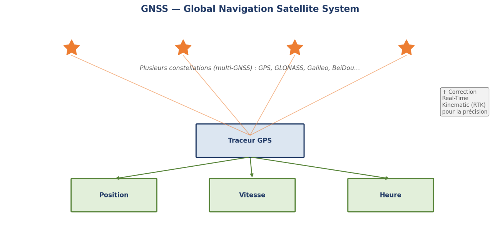

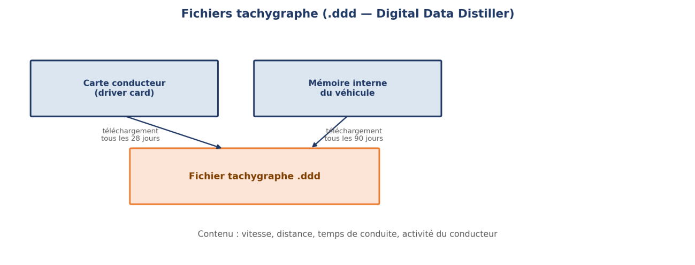

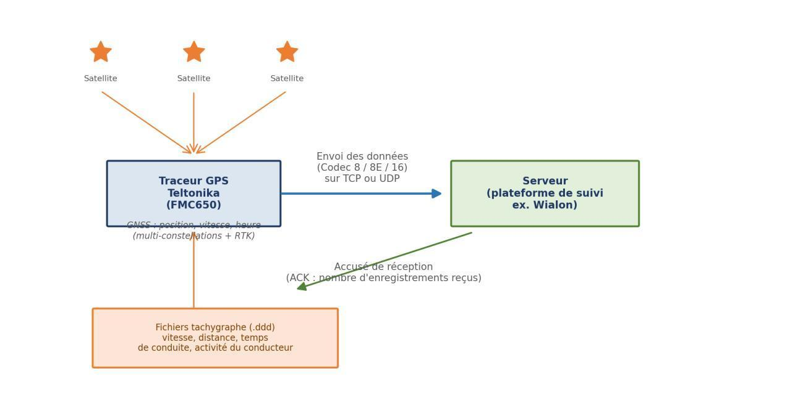

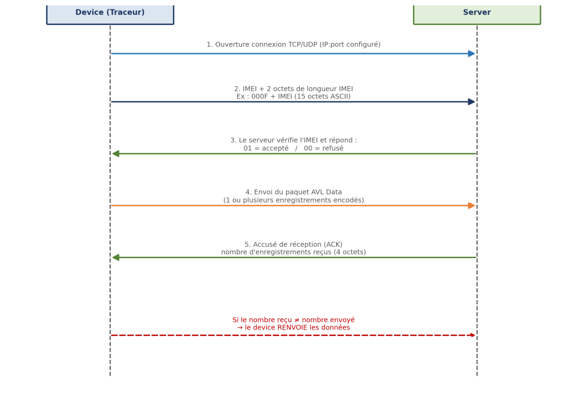

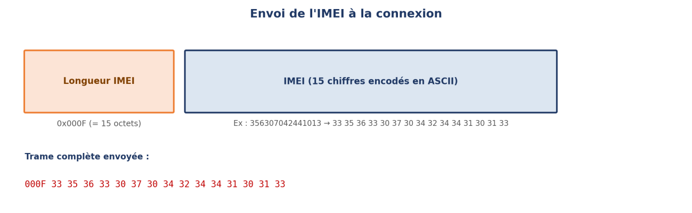

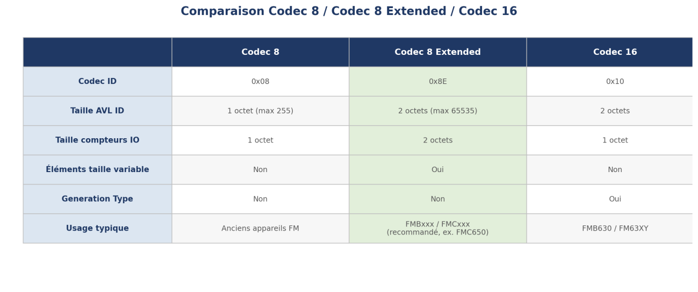

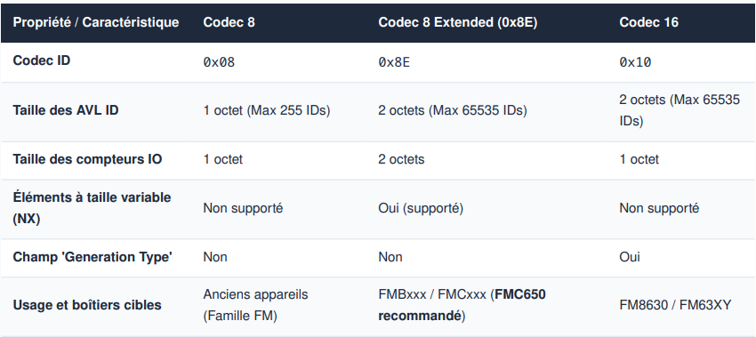

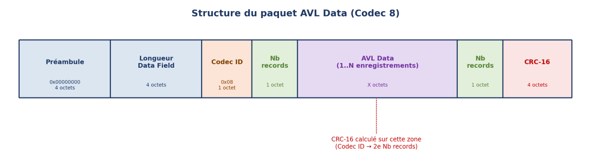

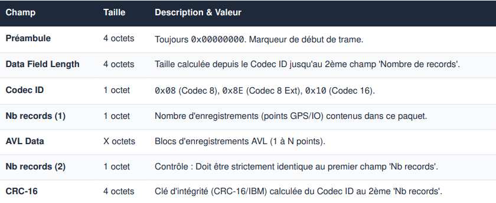

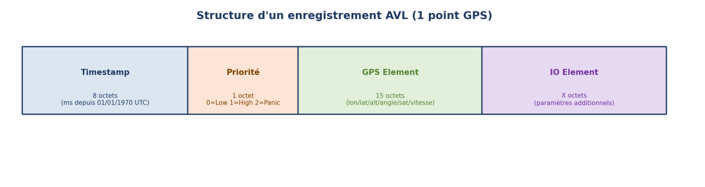

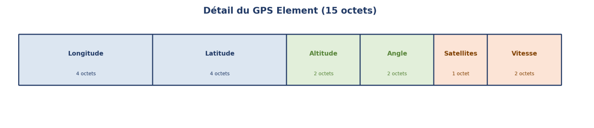

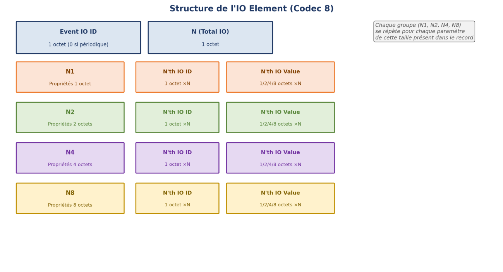

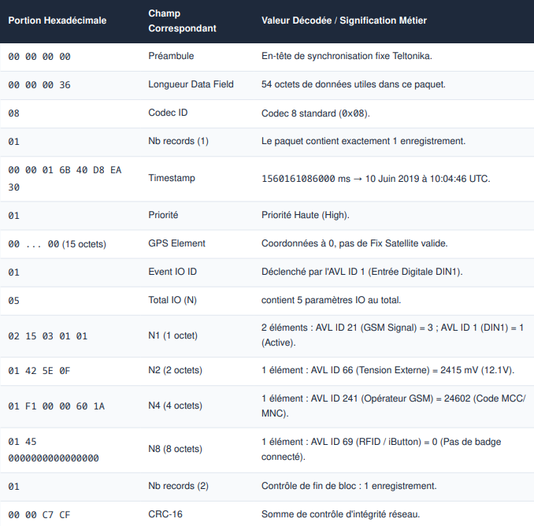

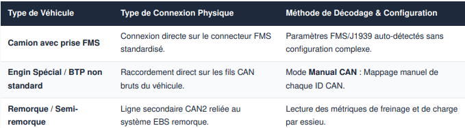

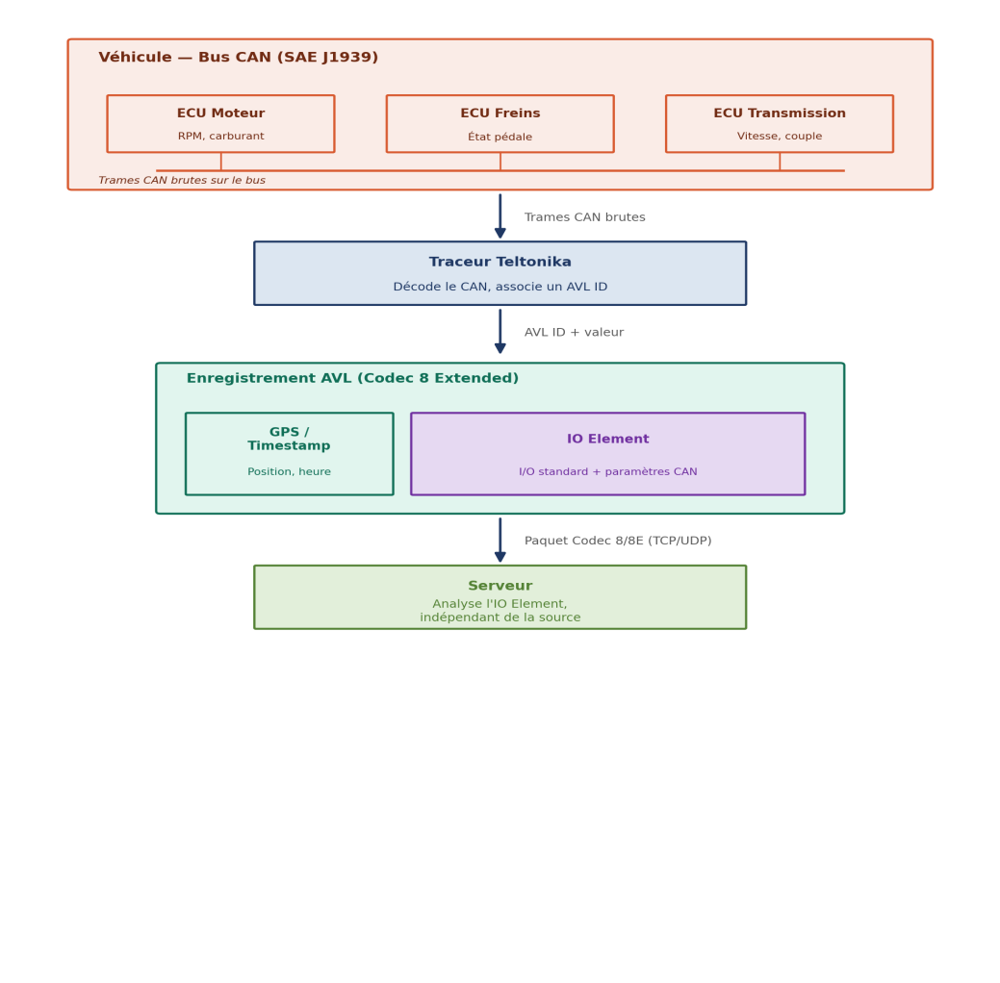

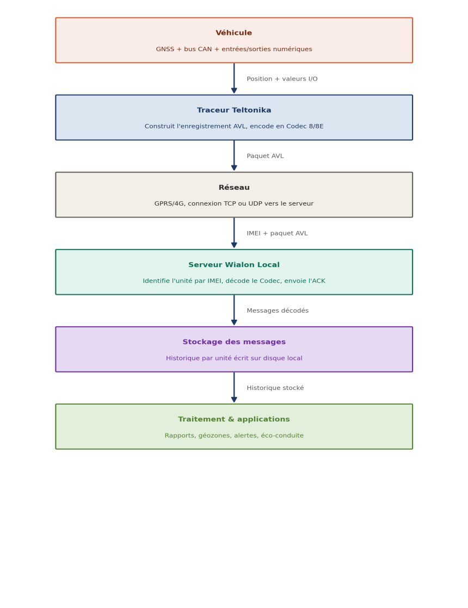
