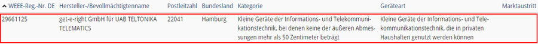
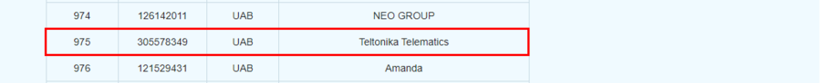

# FMC650 WEEE

WEEE logoThe Waste Electrical and Electronic Equipment Directive (WEEE Directive) is the European Community Directive 2002/96/EU which firstly was introduced in year 2003. The new WEEE Directive 2012/19/EU entered into force on 13 August 2012 and became effective on 14 February 2014.

# Description

Teltonika Telematics as responsible manufacturer is obligated to take care of it's produced electrical and electronic waste. Therefore in this article information can be found regarding WEEE memberships across Europe.

It is important to state, that Electrical and electronic equipment (EEE) and batteries contain materials, components and substances that may be hazardous and present a risk to human health and the environment. Hence, this EEE-product shall not be discarded together with household waste, but must be collected separately. Please contact your local municipality for information on authorized collection points in your area.

# Summary

| Country | Authorized Representative | Link to registry | Registration number |
| --- | --- | --- | --- |
| Germany | mplan eG | [WEEE registration check](https://www.ear-system.de/ear-verzeichnis/hersteller.jsf#no-back) | 29661125 |
| Lithuania | EGIO | [WEEE registration check](https://eei.lt/nariai/) | 305578349 |
| Italy | TELTONIKA ITALY S.R.L. | [WEEE registration check](https://www.registroaee.it/RicercaProduttori) | IT25020000016854 |

# Countries

## WEEE Italy

Teltonika Telematics has completed the WEEE Italy registration. TELTONIKA ITALY S.R.L has been named the authorized representative.

| Authorized Representative | Link to registry | Registration number |
| --- | --- | --- |
| TELTONIKA ITALY S.R.L | [WEEE Italy registration check](https://www.registroaee.it/RicercaProduttori) | IT25020000016854 |

## WEEE Germany

---

Teltonika Telematics has completed the WEEE Germany registration. mplan eG has been named the authorized representative.

| Authorized Representative | Link to registry | Registration number |
| --- | --- | --- |
| mplan eG | [WEEE Germany registration check](https://www.ear-system.de/ear-verzeichnis/hersteller.jsf#no-back) | 29661125 |

**Attachments**

---

| Stiftung EAR |
| --- |

## Lithuania

---

Teltonika Telematics has completed the WEEE Lithuania registration. VšĮ “Elektronikos gamintojų ir importuotojų organizacija" – EGIO has been named the authorized representative.

| Authorized Representative | Link to registry | Registration number |
| --- | --- | --- |
| EGIO | [WEEE Lithuania registration check](https://eei.lt/nariai/) | 305578349 |

**Attachments**

---

| Stiftung EAR |
| --- |

> **Note:** the newest Wayback capture of this page is 2026-04-22, but the archived browser session resolves to the 2026-01-24 capture; both renders have identical text, so the content above is the 2026-01-24 capture.
