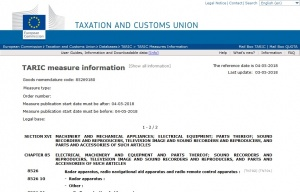

# FMC650 HS

The **Harmonized Commodity Description and Coding System**, also known as the **Harmonized System** (**HS**) of tariff nomenclature is an internationally standardized system of names and numbers to classify traded products. It came into effect in 1988 and has since been developed and maintained by the [World Customs Organization](https://en.wikipedia.org/wiki/World_Customs_Organization) (WCO) (formerly the Customs Co-operation Council), an independent intergovernmental organization based in Brussels, Belgium, with over 200 member countries.

# Attachments

FMC650 nomenclature code - **85269120**.

FMC640 nomenclature code in European Commission website
