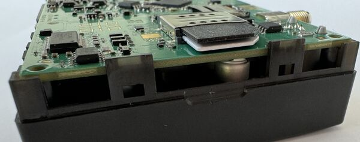

# 2025.07.30: New PCB changes

We would like to inform you about the new PCB changes with two separate nano SIM slots starting in start - September 2025.

| Change description | — |
| --- | --- |
| Change type | Intenal/visual |
| Detailed description | SIM Holder changes on PCB – instead of DualSIM Holder that fits 2 full-size (2FF) SIM cards – new PCB will have 2 SIM holders that fit Nano SIM (4FF) size cards. |
| Old version | — |
| Old version | /  |
| New version | Device SIM placement by the photo is that SIM1 will be placed at the left side and SIM2 at the right side |
| New version | /  |
| Change reasons | Currently most of the SIM cards provided by operators can be disassembled into 3 parts - Standard/Micro/Nano. Depending on the SIM card construction - during device usage in harsh conditions, SIM assembly might come apart which causes instability when connecting to the operator. The new nano SIM slot design eliminates these tolerance issues, resulting in improved SIM card detection and reliability. |
| Product release date | Planned date: September, 2025 will be started manufacture. October and November will be transitioning period |

| Affected products | — | — |
| --- | --- | --- |
| Model | Affected order codes | Order code changes |
| FMC650 | FMC650*******order codes | No changes |

| Change impact | — |
| --- | --- |
| Risk assessment | Teltonika Telematics Hardware and QA teams have tested the updated SIM slot, which now supports nano SIM cards directly. This change algines with current market trends favoring nano SIM formats. The new nano SIM slot design eliminates these tolerance issues, resulting in improved SIM card detection and reliability. Most of the SIM cards provided by operators can be disassembled into 3 parts - Standard/Micro/Nano. Therefore, during transitioning period and/or if you have a stock of SIM cards – the SIM cards can still be used up. |
| Suggested implementation plan | Recheck with your operator if the SIM cards you are orderring can be dissasembled into 3 parts (Mini SIM/Micro Sim/Nano SIM) Update the end user/installer documentations providing updated information on SIM1/SIM2 locations. From the left side of photo is SIM1 from the right side is SIM2 |

| Acknowledgement of PCN receipt |
| --- |
| If no feedback is received within two weeks after the issue date of this notification - Teltonika may accept that this change has been tacitly accepted and can implement the change as indicated above |

> **Note:** `New_nano_SIM.jpg` — the "New version" photo (SIM1 left / SIM2 right) is served by the archived snapshot from an unprefixed `web.archive.org/images/...` path with no Wayback capture (CDX-verified for both thumbnail and original), so it could not be preserved.
