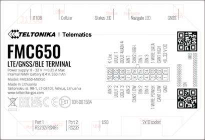
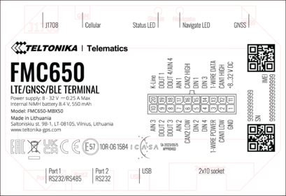

# 2023.06.22: Top Marking Changes

| Change description | — | — |
| --- | --- | --- |
| Change type | External/visual | — |
| Detailed description | Top label design changed | — |
| Detailed description | Old version: /  | New version: /  |
| Change reasons | Added ICASA approval marking. (More information: FMC650 ICASA) / | — |
| Product release date | Planned date: 2023 July | — |

| Affected products | — | — |
| --- | --- | --- |
| Model | Affected order codes | Order code changes |
| FMC650-MBX50 | FMC6501T**** | No changes |

| Change impact | — |
| --- | --- |
| Risk assessment | Risk assessment for devices management required |
| Suggested implementation plan | No implementation plan needed |

| Acknowledgement of PCN receipt |
| --- |
| If no feedback is received within two weeks after the issue date of this notification - Teltonika may accept that this change has been tacitly accepted and can implement the change as indicated above |
