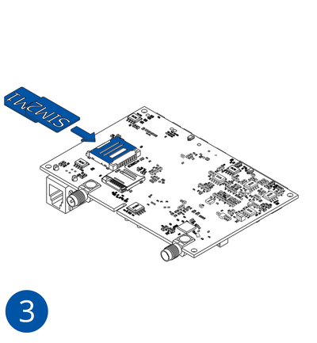
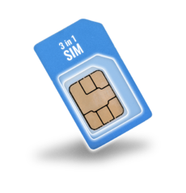

# 2023.04.12: SIM usage recommendation update

We would like to inform you about the SIM usage recommendation change - due to SIM card market tendencies (Standard size SIM cards being made to split to 3 parts) [FMC640 First Start](https://wiki.teltonika-gps.com/view/FMC640_First_Start#How_to_insert_SIM_card_and_connect_the_battery)

| Recommendation description | — |
| --- | --- |
| Recommendation reason | Due to SIM card market tendencies (Standard size SIM cards being made to split to 3 parts) |
| Detailed description | New paragraph about SIM usage is added to product First Start description. / Previously SIM insertion recommendation was only described in schematics - SIM1 shown in lower slot, SIM2 in upper slot.  / Due to SIM market tendencies the documentation was updated to more clearly state SIM1 and SIM2 usage recommendations: /  FMX6 devices use Standard size SIM cards for SIM1 and SIM2. Currently most of the SIM cards provided by operators can be disassembled into 3 parts - Standard/Micro/Nano. Depending on the SIM card construction - during device usage in harsh conditions, SIM assembly might come apart which causes instability when connecting to operator. / To avoid such risk: / 1) If possible - ask operator for Standard SIM card with solid construction (not pre-cut to 3 parts) / 2) Do not use SIM cards that were previously disassembled (SIM was taken apart previously) / 3) If you plan to use only one SIM card - insert it into SIM1 slot (lower slot) - this ensures greater pressure on SIM contacts as the contact bed is pushed by PCB. / When 2 SIM cards are used simultaneously risk is mitigated as well - when SIM1 is inserted, a greater pressure is applied for SIM2, so SIM parts are harder to come lose / |

| Change impact | — |
| --- | --- |
| Risk assessment | Recommendation updated to mitigate risk. |
| Suggested implementation plan | If you used one SIM card and it's placed in SIM1 slot (lower) - no implementation plan needed. / If you used 2 SIM cards - SIM1 in lower slot, SIM2 in upper slot - no implementation plan needed. / If you used eSIM - no implementation plan needed. / If you used one SIM card and it is inserted into SIM2 slot (upper) - to mitigate risk of bad operator connectivity due to SIM construction - for future installations - when only 1 SIM card is used - insert it into SIM1 slot (lower) Additionally: If possible - ask operator for Standard SIM card with solid construction (not pre-cut to 3 parts) |
