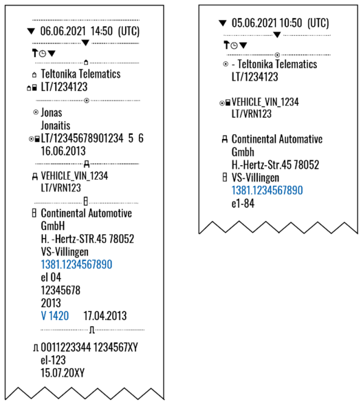
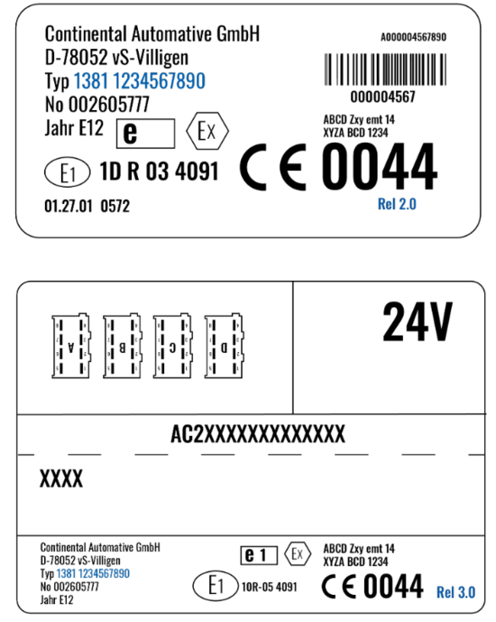
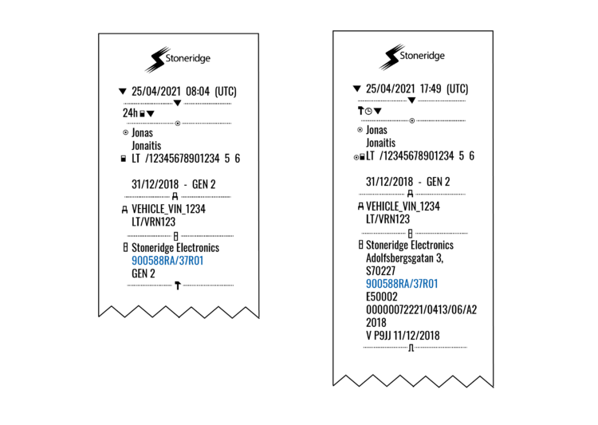
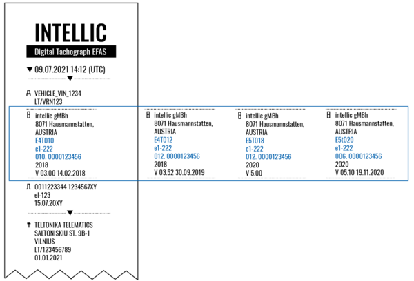
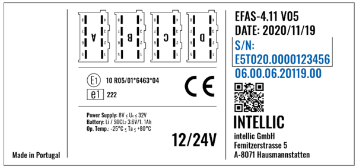
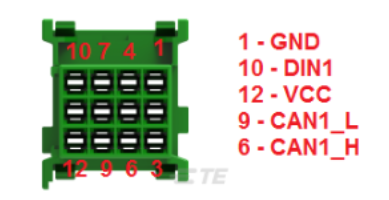
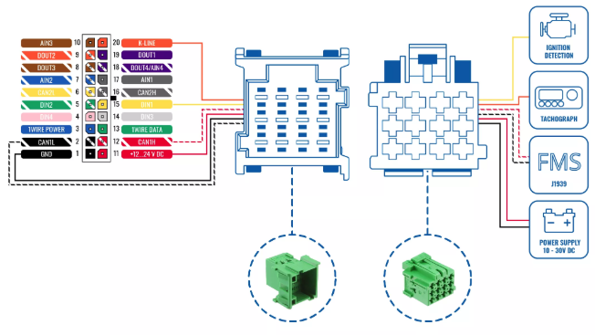
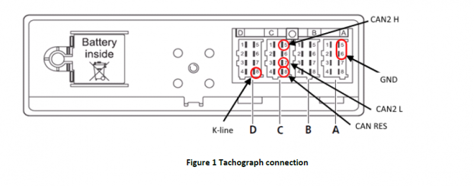
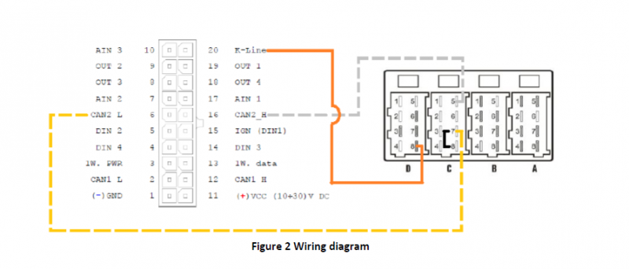
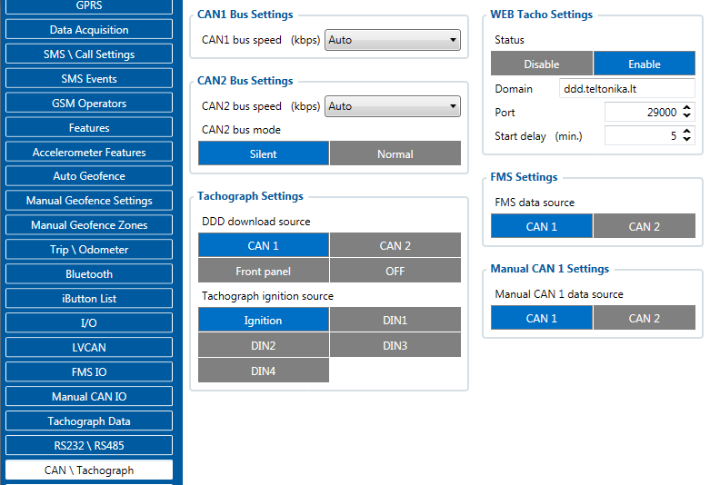

# FMC650 and Tachograph Solution

# Introduction

Teltonika [WEB Tacho](https://ddd.teltonika.lt/) is an online service that allows remotely downloading Tachograph files from supported tachographs. The solution is a big forward leap in remote tachograph data files download, manageable, and does not require any complex software* installation. Everything is accessible via the web page. Now you can download tachograph files from any place and from any PC via internet access. FMM650 device has a possibility to connect to Web Tacho IP every 1 hour and check if there are any schedules for downloading DDD files. If FMM650 connects to the Web tacho server, and there is a planned schedule but another device is already downloading and the company card is in use, the device
keeps a link with the Web Tacho server but still sends data to the main server with AVL data. After
successful download, the device closes the link with Web Tacho and reconnects after 1 hour. Data is
stored on a secure server and can be accessed only by your authorized users. You don't need to worry that any file is lost and you have to download it from tachograph once again.

**– requires company card reader software installation on a single company PC*

## IMPORTANT notice regarding EU Directive for Tachograph usage starting from year 2023

New tachographs **Smart tachograph version 2** for new heavy vehicles will be mandatory from **21st August, 2023** and for light commercial vehicles from **1st July, 2026**. These tachographs are designed and developed because of new changes in Regulation (EU). The communication for supporting **SMART TACHOGRAPH VERSION 2** were implemented ONLY for new devices **FMC650**, **FMM650**, **FMB641**, **FMB640**, **FMC640**, **FMM640**

For **FMC650** DDD download feature from new tachographs would be available from **03.00.14.rev.07**.

# Supported tachographs and formats

The solution supports not only the standard DDD file extension but also Spanish TGD and French V1B, C1B file formats. You simply set the required one in Web Tacho user settings.

**NOTE:** To check whether the VDO tachograph is supported or not, Teltonika [Tachograph Lookup](https://tacholookup.teltonika.lt/) can be used.

Supported devices are:

- Siemens VDO Digital Tachograph
- Stoneridge Tachograph
- Intellic EFAS version 4

## Siemens VDO Digital Tachograph

Siemens VDO Digital Tachograph – DTCO 1381 (release 1.3a, 1.4 or later):
the version can be checked on tachograph or in the printout (Technical data: printout -> vehicle -> techn. data) as shown in pictures below:

Tachograph Part number - 1381.1234567890 is indicated in blue color - you can use TachoLookup([Tachograph Lookup](https://tacholookup.teltonika.lt/)) to doublecheck if tachograph is supported.
Software version V1420 indicates that tachograph is version (release) 1.4.
The same information can be found behind the print cabinet label and on the label on the back of the tachograph:

## Stoneridge Tachograph

Stoneridge Tachograph – SE5000 (release 7.1 or later). The version can be checked on tachograph or in the printout (Daily Driver printout on the left: PRINT -> 24h card/ Technical data on the right: PRINT -> technical data) as shown in pictures below:

Tachograph part number is indicated in blue 900588RA/37R01 "RA" indicates that this is 8th revision. Other revisions can be checked by looking at number after "R", for example R7.1 - Revision 7.1. You can use TachoLookup([Tachograph Lookup](https://tacholookup.teltonika.lt/)) to doublecheck if tachograph is supported.

## Intellic EFAS version 4

Intellic EFAS 4 - we support EFAS-4 tachographs from version 4.5. Supported tachographs can be identified by the first 6 digits of “EU-serial code” and should start with: E4T010, E4T012, E5T018, E5T020 as shown in the printout (Technical data: Printout ->Technical data) example bellow:

Required numbers are indicated in blue color E4T010 e1222 010.0000123456 this is a combination of Device part number and serial code. You can use Tachograph lookup ([Tachograph Lookup](https://tacholookup.teltonika.lt/)) to check if tachograph is supported - enter the combination without e1-222 part and dots: E4T0100100000123456
This information can be found on the tachograph label as well:

# Remote Data Download (RDD) via FMS

When RDD (Remote Data Download) signal available on **FMS**.

Applies to:

- DAF CF - LF - XF
- IVECO Stralis I / II/ Hi-Way
- Renault D / Magnum DXI & E-TECH / Midlum DXI / Premium DXI / Renault T-K-C
- Volvo FH - FM - FL

If the **RDD** signal is available on the **FMS** interface, no additional connection is required. In this case, the **CANx LOW and HIGH** wires from the FMx640 are connected to **PIN 6 and 9** on the **FMS** connector.
Additionally, **PIN 10** can be used for ignition detection using **DIN1** wire.

More information about FMS CABLE can be found on [Teltonika Page](https://teltonika-gps.com/product/fms-cable/)

For the following vehicles regarding the **RDD**, please contact the manufacturer:

- MAN TGX - TGA - TGL - TGM
- Mercedes Actros / Antos / Atego / Arocs / Axor II
- Scania R - P - G - S

If the **RDD** signal is **NOT** available on the **FMS** interface, you need to retrieve the **RDD** data by connecting to the tachograph's C connector using provided instructions below.

# Connecting to tachograph

Before connecting tachograph wires, it is required to measure CAN line resistance
while tachograph is switched off:

1. Turn off the vehicle ignition;
2. Measure resistance between the C5 (CAN2 H) and C7 (CAN2 L) contacts;
3. If the multimeter shows ~120 Ohms, skip the next step;
4. If the multimeter shows kilo Ohms resistance then it is needed to connect tachograph C8 (CAN-RES) and C7 (CAN2 L) contacts with wire and then perform further actions;
5. Re-measure the resistance of the line – it has to be ~120 Ohms.
6. Connect CAN2 L and CAN2 H wires to tachograph (C5 (CAN2 H) and C7 (CAN2 L))

- All of the same level CAN-L and CAN-H wires must be interlaced with each other.

- CAN wire needs to be installed as far as possible from the GSM antenna.

Below is a wiring diagram of the Tachograph and FMC650 device:

# Checking connection (tachocheck SMS)

After successful connection *tachocheck* SMS message can be sent to the device to check if there is data present on the connected lines, in other words, if connections were done correctly. It is
used for getting status information.

For more information about *tachocheck* command, please refer to [FMB tachocheck](https://wiki.teltonika-gps.com/view/FMB_tachocheck).

# Configuring device

**In FMC650 configurator “CAN/Tachograph” section tachograph settings should be set in order to download files.**

**Tachograph settings:**
**DDD download source** – to which CAN line tachograph is connected;
**Tachograph ignition source** – which DIN is connected to vehicle ignition ("Ignition" parameter - tachograph ignition source will be the same as configured in "System" -> "Ignition Source");

**WEB Tacho Settings:**
**Status** - functionality enabling;
**Domain** – server domain where files will be send;
**Port** – server port where files will be send;
**Start delay** – delay after turning on ignition to start procedure of file sending.

# Internal links

[https://teltonika-gps.com/product/tachograph-web/](https://teltonika-gps.com/product/tachograph-web/) [https://teltonika-gps.com/product/FMC650](https://teltonika-gps.com/products/trackers/fmc650) [https://wiki.teltonika-gps.com/view/FMC650](https://wiki.teltonika-gps.com/view/FMC650)

> **Note:** the source introduction refers to the **FMM650** (and the compatibility list also names FMB/FMM640 and FMB641), although this is the FMC650 page. The text is kept verbatim.

