# FMC650 First Start

**Leading LTE/GNSS/BLE Terminal for advanced applications**

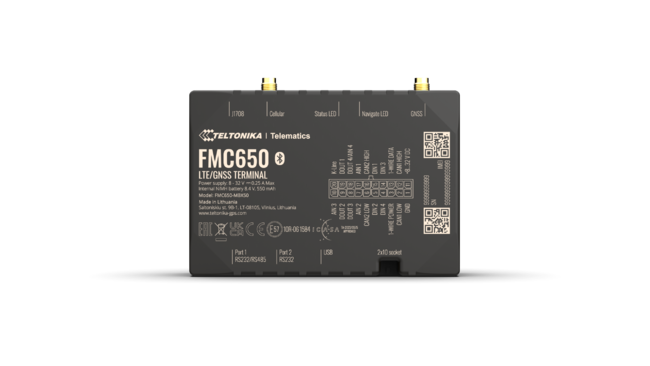

# How to insert SIM card and connect the battery

1. **Unscrew** 4 screws counterclockwise that are located on the **bottom** of the device.
2. Remove the **cover**.
3. Insert **SIM** card as shown with **PIN request disabled** or read **[Security info](https://wiki.teltonika-gps.com/view/FMB640_Security_info)** how to enter it later in [Teltonika Configurator](https://wiki.teltonika-gps.com/view/Teltonika_Configurator). Make sure that SIM card **cut-off corner** is pointing forward to slot. **SIM slot 2** is on the right, closer to the cellular antenna socket, **SIM slot 1** is on the opposite side.
4. Connect **battery** as shown to device.
5. After **configuration**, see “**PC Connection (Windows)**”, attach device **cover** back.
6. **Screw** in all screws. Device is ready to be mounted.

`1 ⋙ cover` 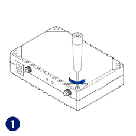

`2 ⋙ cover` 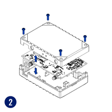

`3 ⋙ cover` 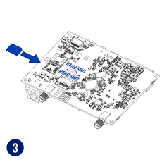

`4 ⋙ cover` 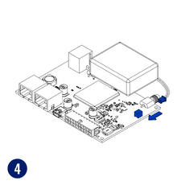

`5 ⋙ cover` 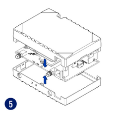

`6 ⋙ cover` 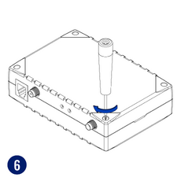

 **SIM card insertion/removal must be performed when device is powered off – external voltage and internal battery disconnected. Otherwise SIM card might be damaged or device will not detect it.**

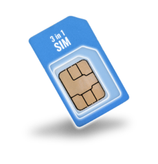
**FMX6 devices use Standard size SIM cards for SIM1 and SIM2. Currently most of the SIM cards provided by operators can be disassembled into 3 parts - Standard/Micro/Nano. Depending on the SIM card construction - during device usage in harsh conditions, SIM assembly might come apart which causes instability when connecting to operator.**

**To avoid such risk:**

1. If possible - ask operator for Standard SIM card with solid construction (not pre-cut to 3 parts)
2. Do not use SIM cards that were previously disassembled (SIM was taken apart previously)
3. If you plan to use only one SIM card - insert it into SIM1 slot (lower slot) - this ensures greater pressure on SIM contacts as the contact bed is pushed by PCB.

   When 2 SIM cards are used simultaneously risk is mitigated as well - when SIM1 is inserted, a greater pressure is applied for SIM2, so SIM parts are harder to come lose.

> **Note:** Starting from batch 46, which started to be manufactured on October 2025, all FMC650 devices are equipped with nano-SIM ports, making this disclaimer no longer applicable to devices manufactured in or after this batch.

# How to insert microSD card into FMM650

> **Note:** the source page heading reads “FMM650” (sibling device of the FMX6 family). The procedure is shown on the FMC650 template page — whether the microSD slot exists depends on device spec/variant.

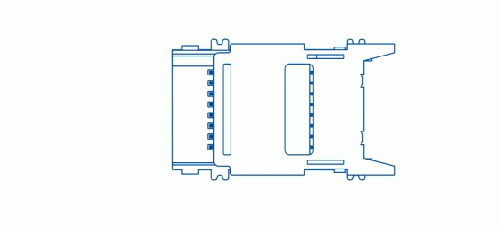

1. Push microSD card lock case.
2. Open microSD card locker.
3. Correctly insert microSD card into slot.
4. Close microSD card locker.
5. Push microSD card lock case to locked position.

# 2x10 socket pinout

## Pinout table

| PIN NUMBER | PIN NAME | DESCRIPTION |
| --- | --- | --- |
| 1 | GND (-) | Ground |
| 2 | CAN1L | SAE J1939 CAN interface Low channel 1 |
| 3 | 1 WIRE POWER | Power supply pin for Dallas 1-Wire® devices |
| 4 | DIN 4 | Digital input, channel 4 |
| 5 | DIN 2 | Digital input, channel 2 |
| 6 | CAN2L | SAE J1939 CAN interface Low channel 2 |
| 7 | AIN2 | Analog input, channel 2. Input range: 0-30V/0-10V DC |
| 8 | DOUT3 | Digital output. Open collector output |
| 9 | DOUT2 | Digital output. Open collector output |
| 10 | AIN3 | Analog input, channel 3. Input range: 0-30V/0-10V DC |
| 11 | VCC (+) | Power supply (+8-32 V DC) |
| 12 | CAN1H | SAE J1939 CAN interface High channel 1 |
| 13 | 1 WIRE DATA | Data channel for Dallas 1-Wire® devices |
| 14 | DIN 3 | Digital input, channel 3 |
| 15 | DIN 1 | Digital input, channel 1. DEDICATED FOR IGNITION INPUT |
| 16 | CAN2H | SAE J1939 CAN interface High channel 2 |
| 17 | AIN1 | Analog input, channel 1. Input range: 0-30V/0-10V DC |
| 18 | DOUT4/AIN4 | Digital output. Open collector output OR Analog input, channel 4. Input range: 0-30V/0-10V DC |
| 19 | DOUT1 | Digital output. Open collector output |
| 20 | K-LINE | K-LINE interface for online Tachograph Vehicle Data transfer |

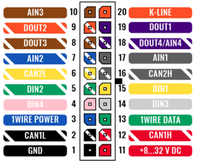

*Diagram: [File:Fmc_650_2x10_pinout.png](https://wiki.teltonika-gps.com/view/File:Fmc_650_2x10_pinout.png)*

## PC Connection (Windows)

1. Power-up FMC650 with **DC voltage (8 - 32V)** power supply using **supplied power cable**. LED’s should start blinking, see “**[FMC650 LED status](https://wiki.teltonika-gps.com/view/FMC650_LED_status)**”.
2. Connect device to computer using **Mini-USB cable**. You will need to install USB drivers, see **How to install USB drivers (Windows)**.

3. You are now ready to use the device on your computer.

## How to install USB drivers (Windows)

**NOTE:** The Teltonika COM driver supports Windows x64 (Intel/AMD) only; ARM processors **are not supported**.

1. Please download COM port drivers from Teltonika **[here](https://wiki.teltonika-gps.com/images/d/d0/TeltonikaCOMDriver.zip)**.
2. Extract and run **TeltonikaCOMDriver.exe**.
3. Click **Next** in driver installation window.
4. In the following window click **Install** button.
5. Setup will continue installing the driver and eventually the confirmation window will appear. Click **Finish** to complete the setup.

## Configuration (Windows)

At first FMC650 device will have default factory settings set. These settings should be changed according to the user's needs.
Main configuration can be performed via **[Teltonika Configurator](https://wiki.teltonika-gps.com/view/Teltonika_Configurator)** software. Get the latest FMC650 **Configurator** version from **[here](https://wiki.teltonika-gps.com/view/Teltonika_Configurator_versions)**. Configurator operates on Microsoft Windows OS and uses prerequisite MS .NET Framework. Make sure you have the correct version installed.

**MS .NET requirements**

| Operating system | MS .NET Framework version | Version | Link |
| --- | --- | --- | --- |
| Windows Vista, Windows 7, Windows 8.1, Windows 10 | MS .NET Framework 4.6.2 | 32 and 64 bit | www.microsoft.com |

Downloaded **Configurator** will be in compressed archive. Extract it and launch **Configurator.exe**. After launch software language can be changed by clicking the **language icon** in the right bottom corner:

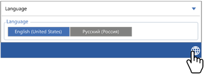

Configuration process begins by pressing on connected device:

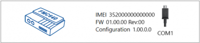

After connection to Configurator **Status window** will be displayed:

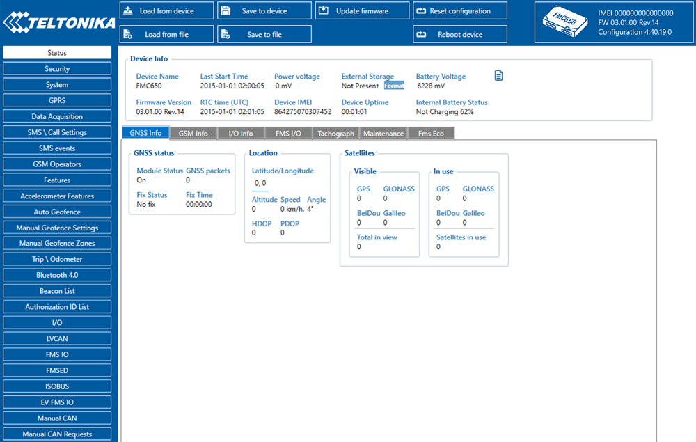

Various **[Status window](https://wiki.teltonika-gps.com/view/FMC650_Status_info)** tabs display information about **[GNSS](https://wiki.teltonika-gps.com/view/FMC650_Status_info#GNSS_Info), [GSM](https://wiki.teltonika-gps.com/view/FMC650_Status_info#GSM_Info), [I/O](https://wiki.teltonika-gps.com/view/FMC650_Status_info#I.2FO_Info), [Maintenance](https://wiki.teltonika-gps.com/view/FMC650_Status_info#Maintenance)** and etc. FMC650 has one user editable profile, which can be loaded and saved to the device. After any modification of configuration the changes need to be saved to device using **Save to device** button. Main buttons offer following functionality:

1. **Load from device** – loads configuration from device.
2. **Save to device** – saves configuration to device.
3. **Load from file** – loads configuration from file.
4. **Save to file** – saves configuration to file.
5. **Update firmware** – updates firmware on device.
6. **Read records** – read records from device.
7. **Reboot device** – restarts device.
8. **Reset configuration** – sets device configuration to default.

Most important configurator section is GPRS – where all your server and **[GPRS settings](https://wiki.teltonika-gps.com/view/FMC650_GPRS_settings)** can be configured and **[Data Acquisition](https://wiki.teltonika-gps.com/view/FMC650_Data_acquisition_settings)** – where data acquiring parameters can be configured.
More details about FMC650 configuration using Configurator can be found **[here](https://wiki.teltonika-gps.com/view/FMC640_Configuration)**.

## Quick SMS configuration

Default configuration has optimal parameters present to ensure best performance of track quality and data usage.
Quickly set up your device by sending this SMS command to it:

```
"  setparam 2001:APN;2002:APN_username;2003:APN_password;2004:Domain;2005:Port;2006:0"
```

GPRS settings:

- 2001 – APN
- 2002 – APN username (if there are no APN username, empty field should be left)
- 2003 – APN password (if there are no APN password, empty field should be left)

Server settings:

- 2004 – Domain
- 2005 – Port
- 2006 – Data sending protocol (0 – TCP, 1 – UDP)

**Note**: Before SMS text, two space symbols should be inserted.

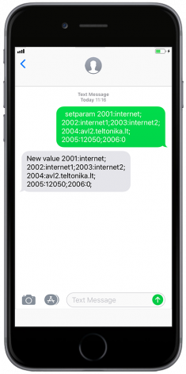

**Default configuration settings**

**Movement and ignition detection:**

-  Vehicle movement will be detected by accelerometer
-  Ignition will be detected by vehicle power voltage between 13,2 – 30 V

**Device makes a record On Moving if one of these events happen:**

-  300 seconds passes
-  Vehicle turns 10° degrees
-  Vehicle drives 100 meters
-  Speed difference between last coordinate and current position is greater than 10 km/h

**Device makes a record On Stop if:**

-  1 hour passes while vehicle is stationary and ignition is off

**Records sending to server:**

-  If device has made a record it is sent to the server every 120 seconds

After successful SMS configuration, FMC650 device will **synchronize time** and **update records** to **configured server**. Time intervals and default I/O elements can be changed by using [Teltonika Configurator](https://wiki.teltonika-gps.com/view/Teltonika_Configurator) or [SMS parameters](https://wiki.teltonika-gps.com/view/FMC650_Parameter_list).

# Mounting recommendations

- **Connecting wires**
  - Wires should be connected while the module is not plugged in.
  - Wires should be fastened to stable wires or other non-moving parts. Any heat emitting and/or moving objects should be kept away from the wires.
  - There should be no exposed wires. If factory isolation was removed while connecting wires, the isolation material should be applied.
  - If the wires are placed in the exterior or in places where they can be damaged or exposed to heat, humidity, dirt, etc., additional isolation should be applied and the wires should not be loose.
  - Wires cannot be connected to the board computers or control units.
- **Connecting power source**
  - Be sure that after the car computer goes to sleep mode, power might be still available on the power wires. Depending on car, this may happen in 5 to 30 minutes period.
  - When module is connected, measure voltage again to make sure it did not decrease.
  - It is recommended to connect to the main power cable in the fuse box.
  - 3 A, 125 V external fuse shall be used.
- **Connecting ignition wire**
  - Be sure to check if it is a real ignition wire i. e. power does not disappear after starting the engine.
  - Check if this is not an ACC wire (when key is in the first position, most of the vehicle electronics are available).
  - Check if power is still available when you turn off any of vehicles devices.
  - Ignition is connected to the ignition relay output. As alternative, any other relay, which has power output when ignition is on, may be chosen.
- **Connecting ground wire**
  - Ground wire is connected to the vehicle frame or metal parts that are fixed to the frame.
  - If the wire is fixed with the bolt, the loop must be connected to the end of the wire.
  - For better contact scrub paint from the spot where loop is going to be connected.

> 
> **PAY ATTENTION!** Connecting the power supply must be carried out in a very low impedance point of on-board vehicle network. These points in the car are the battery terminals. Therefore, we recommend connecting the power of FMC650 (GND and POWER wires) directly to the battery terminals. Another valid option is to connect the wires to the main POWER cable inside the fuse box (if there is none, then to the power supply where the fuses of vehicle’s computer are), GND wire must be connected in a special point, designed to connect GND vehicle computer. Connecting the GND at an arbitrary point to the mass of the car is unacceptable, as static and dynamic potentials on the line GND will be unpredictable, which can lead to unstable FMC650 operation and even its failure.

# Safety information

This message contains information on how to operate FMC650 safely. By following these requirements and recommendations, you will avoid dangerous situations. You must read these instructions carefully and follow them strictly before operating the device!

- The device uses SELV limited power source. The nominal voltage is +12 V DC. The allowed voltage range is +10..+30V DC.
- To avoid mechanical damage, it is advised to transport the device in an impact-proof package. Before usage, the device should be placed so that its LED indicators are visible. They show the status of device operation.

- When connecting the 2x10 connector cables, the appropriate jumpers of the vehicle power supply should be disconnected.

- Before unmounting the device from the vehicle, the 2x10 connector must be disconnected.
- The device is designed to be mounted in a zone of limited access, which is inaccessible to the operator. All related devices must meet the requirements of EN 60950-1 standard.
- The device FMC650 is not designed as a navigational device for boats.

## Precautions

- Do not disassemble the device. If the device is damaged, the power supply cables are not isolated or the isolation is damaged, DO NOT touch the device before unplugging the power supply.
- All wireless data transferring devices produce interference that may affect other devices which are placed nearby.
- The device must be connected only by qualified personnel.
- The device must be firmly fastened in a predefined location.
- The programming must be performed using a PC with autonomic power supply.
- The device is susceptible to water and humidity.
- Installation and/or handling during a lightning storm is prohibited.

## Sources

- Page: [FMC650 First Start](https://wiki.teltonika-gps.com/view/FMC650_First_Start) — Teltonika Telematics Wiki
- Text captured from the archived copy: [web.archive.org, 2026-06-12](https://web.archive.org/web/20260612201747/https://wiki.teltonika-gps.com/view/FMC650_First_Start)
- Product page: [teltonika-gps.com/product/fmc650](https://teltonika-gps.com/product/fmc650)
- Media files referenced above live in [assets/first-start/](assets/first-start/) — original URLs listed in [assets/first-start/sources.md](assets/first-start/sources.md).
