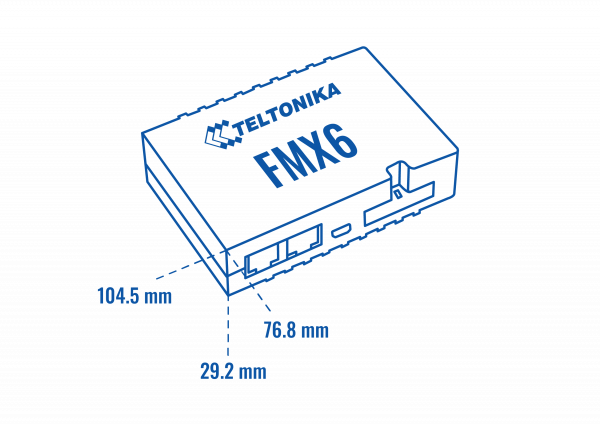

# FMC650 General description

Teltonika FMC650 is a direct successor to current most popular 4G PROFESSIONAL lineup device – FMC640. FMC650 has 4G (LTE Cat 1) network coverage including 2G (GSM) fallback compatibility. Device equipped with GNSS and LTE modules, external GNSS and LTE antennas. Separate GNSS module improves the accuracy of the track, making FMC650 more suitable for free flow electronic tolling system integration. Compared to FMC640 – FMC650 has a new processor that improves the devices computation power along with increased device internal memory it can be tailored to more specific use cases. Switchable CAN terminators that will allow you to use the device in CAN network with numerous nodes. Lastly, it can be powered via USB for easier configuration process. All the features that are supported by FMC640 is also supported by FMC650, therefore it will maximize your fleet efficiency with features like FMS CAN data (J1939), fuel CAN data (J1708), tachograph live data (K-Line), remote tachograph file download, various third party RS232 or RS485 devices support and Dual-SIM or eSIM compatibility. Terminal is suitable for applications like international logistics, refrigerated transport, agriculture, construction & mining, security & emergency services and even more.

# Package contents

Usually the FMC650 device sample is supplied to the customer in a cardboard box
containing all the equipment that is necessary for operation. The package contains:

- FMC650 device;
- 4 screws for assembling device
- GPS/GLONASS antenna
- GSM antenna
- USB cable
- Ni-MH Rechargeable battery, 8.4V, 550 mA.
- Input and output power supply cable with 2x10 connection pins.

# Basic characteristics

Cellular:

| Technology | Supported bands |
| --- | --- |
| 2G bands (SLM320) | SLM320-PE2C: B2/B3/B5/B8 |
| 2G bands (SLM320) | SLM320-L16A: B2/B3/B5/B8 |
| 4G bands (SLM320) | SLM320-PE2C: LTE-FDD:B1/B3/B7/B8/B20/B28 / LTE-TDD:B38/B40/B41 |
| 4G bands (SLM320) | SLM320-L16A: LTE-FDD:B1/B2/B3/B4/B5/B7/B8/B20/B28 / LTE-TDD:B40 |
| Data transfer | LTE FDD: Max 10Mbps (DL)/Max 5Mbps (UL) LTE TDD |
| Data transfer | Max 8Mbps (DL)/Max 2Mbps (UL) GPRS: Max 85.6Kbps (DL)/Max 85.6Kbps (UL) |

GNSS features:

- module name: Airoha AG3335MB
- L1 and L5 dual-band GNSS receiver
- -165 dBM sensitivity
- Hot start <1s
- Warm Start < 25s
- Cold start < 35s
- GPS, GLONASS, GALILEO, BEIDOU, SBAS, QZSS
- Accuracy < 2,5 CEP

Hardware features:

- NXP i.MX RT1064 processor;
- 16 MB internal Flash memory (10 MB is used for record saving);
- External memory card slot;
- Built-in accelerometer;
- Built-in Bluetooth 5.0;
- Internal backup battery included;

Interface:

- Integrated KLINE
- Dual CAN J1939
- J1708 CAN
- RS485 and 2x RS232 support
- 4 Digital Inputs for object status monitoring
- 4 Digital Open-collector Outputs (controlling external relays, LED, buzzers, etc.)
- 4 Analog Inputs
- 1-wire interface
- Ni-Mh 550 mAh internal battery
- MicroSD card
- 2 status LED
- Dimensions: L(104,1mm)xW(76,8mm)xH(31,5mm)
- Configuration and firmware update (via FOTA and USB cable)
- External GSM antenna for higher sensitivity
- External GNSS antenna for higher sensitivity

Special features:

- Fast position fix;
- High Quality track even in high density urban canyon;
- Ultra small case;
- Ready for harsh environment;
- Easy to mount in limited access areas;
- Firmly fasten;
- 2 LED status indication;
- Real time tracking;
- Smart data acquisition based on:
 - Time;
 - Speed;
 - Angle;
 - Distance;
- Ignition or any other I/O event;
- Sending acquired data via GPRS;
- GPRS and SMS I/O events;
- Virtual odometer;
- Jamming detection;
- Configurable using Secured SMS Commands;
- 2x SIM card; 1x eSIM;
- Overvoltage protection (compatible with pulse 5a and pulse 5b);
- Reverse polarity protection;

| Description | Voltage | Duration |
| --- | --- | --- |
| Normal operation | +8 ... +32 V | Unlimited |
| Protection turns on, device turns off | 34 V | Unlimited |
| Maximum voltage | < 70 V | Unlimited |
| Maximum voltage impulse | 90 V | 5 ms |

# Technical features

| Part name | Physical specification |
| --- | --- |
| Navigation indication | LED |
| Modem indication | LED |
| Socket | Soldered inner socket |
| USB | Mini USB socket |
| GNSS | External GNSS antenna |
| GSM | External GSM antenna |

| **Technical details** | — |
| --- | --- |
| 2 W max. / Current consumption at 12 V | GPRS: average 60 mA / Nominal: average 45 mA / GNSS sleep: average 32 mA / Deep Sleep: average 4 mA / Online Deep Sleep: average 11 mA |
| 2 W max. / Current consumption at 24 V | GPRS: average 35 mA / Nominal: average 24 mA / GNSS sleep: average 17 mA / Deep Sleep: average 2,9 mA / Online Deep Sleep: average 7 mA |
| Battery charge current | Average 55 mA |
| Operating temperature (without battery) | -40..+85 |
| Storage temperature (without battery) | -40..+85 |
| Storage relative humidity | 5..95% (no condensation) |
| Device + case + battery weight | 201 g |

Dimension drawing:

> **Note:** this is the generic **TELTONIKA FMX6 family** outline shell; its printed dimensions (104.5 × 76.8 × 29.2 mm) differ from the "Dimensions: L(104,1mm)xW(76,8mm)xH(31,5mm)" figure above — a discrepancy inherited from the wiki source. Transcribed in [schemas/fmx6-dimensions.md](schemas/fmx6-dimensions.md).

# Technical information about internal battery

| Internal back-up battery | Battery voltage (V) | Nominal Capacity (mAh) | Charging temperature (°C) |
| --- | --- | --- | --- |
| Ni-MH rechargeable battery | 8.4～10.0 | 550 | 0 – 45 |

Batteries are covered by 6 month [warranty](https://teltonika.lt/warranty-repair/) support.

|  | CAUTION: RISK OF EXPLOSION IF BATTERY IS REPLACED BY AN INCORRECT TYPE. DISPOSE OF USED BATTERIES ACCORDING TO THE INSTRUCTIONS. |
| --- | --- |
|  | Battery should not be disposed of into general household waste. / Bring damaged or worn-out batteries to your local recycling center or dispose them into a battery recycle bin commonly found in supermarkets. |

# Battery tests

The amount of time the device will work from internal battery depends on the battery health, how often the device saves/sends information to the server, external peripherals connected to the device and the results may also differ depending on firmware used.

For general comparison purpose, and to see what results can be achieved, you can refer to the following internal test results in different modes and sending frequencies:

| Mode: | Min Period (data saving frequency) | Send Period (data sending frequency) | Starting Voltage | Cut off Voltage | Time achieved |
| --- | --- | --- | --- | --- | --- |
| Operating | 10 seconds | 60 seconds | 10,1V | 7,0V | 452 min (7 hours 32 minutes) |
| Operating | 60 seconds | 60 seconds | 10,1V | 7,0V | 507 min (8 hours 27 minutes) |
| Deep Sleep | 12 hours | 12 hours | 10,2V | 8,2V | 5040 min (84 hours 0 minutes) |
| Online Deep Sleep | 12 hours | 12 hours | 10,0V | 8,6V | 1440 min (24 hours 0 minutes) |

# Electrical characteristics

| Characteristic description | **Value** | — | — | — |
| --- | --- | --- | --- | --- |
| Characteristic description | Min. | Typ. | Max. | Unit |
| **Supply Voltage:** | — | — | — | — |
| Supply Voltage / (Recommended Operating Conditions) | +8 | — | +32 | V |
| **Digital Output (Open Drain grade):** | — | — | — | — |
| Drain current (Digital Output OFF) | — | — | 120 | µA |
| Drain current / (Digital Output ON, Recommended Operating Conditions) | — | — | 0.5 | A |
| Static Drain-Source resistance / (Digital Output ON) | — | 400 | 300 | mΩ |
| **Digital Input:** | — | — | — | — |
| Input resistance (DIN1) | 15 | — | — | kΩ |
| Input resistance (DIN2) | 15 | — | — | kΩ |
| Input resistance (DIN3) | 15 | — | — | kΩ |
| Input voltage / (Recommended Operating Conditions) | 0 | — | Supply voltage | V |
| Input Voltage threshold (DIN1) | — | 7.5 | — | V |
| Input Voltage threshold (DIN2, DIN3, DIN4) | — | 2.5 | — | V |
| **Analog Input:** | — | — | — | — |
| Input voltage / (Recommended Operating Conditions), Range 1 | 0 | — | +10 | V |
| Input resistance, Range 1 | — | 120 | — | kΩ |
| Input voltage / (Recommended Operating Conditions), Range 2 | 0 | — | +30 | V |
| Input resistance, Range 2 | — | 147 | — | kΩ |
| **Output Supply Voltage 1-Wire:** | — | — | — | — |
| Supply voltage | +3.3 | — | +3.9 | V |
| Output inner resistance | — | 7 | — | Ω |
| Output current (Uout > 3.0 V) | — | 30 | — | mA |
| Short circuit current (Uout = 0) | — | 75 | — | mA |
| **CAN Interface:** | — | — | — | — |
| Internal terminal resistors CAN bus | — | 120/60 | — | Ω |
| Differential input resistance | 19 | 30 | 52 | kΩ |
| Recessive output voltage | 2 | 2.5 | 3 | V |
| Differential input resistance | 0.5 | 0.7 | 0.9 | V |
| Common mode input voltage | -30 | — | 30 | V |
| Power supply current (Hardware version with internal battery): | — | — | — | — |
| — | — | — | — | — |
| Deep Sleep, average, Icc.ds | — | 2.5 | 4 | mA |
| Sleep, average, Icc.ds, Vcc=10V | — | 45 | — | mA |
| Sleep, average, Icc.ds, Vcc=30V | — | 25 | — | mA |
| Ucc=12.6V, all modules fully working, internal battery is charging, Icc1 | — | — | 350 | mA |
| Ucc=12.6V, all modules fully working, internal battery is charging, Icc2 | — | — | 300 | mA |
| Ucc=25.2V, all modules fully working, internal battery is charging, Icc3 | — | — | 195 | mA |
| Ucc=25.2V, all modules fully working, internal battery is charging, Icc4 | — | — | 140 | mA |
| **RS232/RS485 Input Voltage:** | — | — | — | — |
| RS485 input voltage range on A or B pin / (common-mode voltage) | -7 | — | +12 | V |
| RS232 input voltage range / (common-mode voltage) | -15 | — | +15 | V |

|  | Analog Input error margin can increase if temperature varies. |
| --- | --- |

# Absolute maximum ratings

| Characteristic description | **Value** | — | — | — |
| --- | --- | --- | --- | --- |
| Characteristic description | Min. | Typ. | Max. | Unit |
| Supply Voltage / (Absolute Maximum Ratings) | -32 | — | +32 | V |
| Drain-Source clamp threshold voltage / (Absolute Maximum Ratings), (Idrain = 2 mA) | — | — | +36 | V |
| Digital Input Voltage / (Absolute Maximum Ratings) | -32 | — | +32 | V |
| Analog Input Voltage / (Absolute Maximum Ratings) | -32 | — | +32 | V |
| RS232 Input Voltage / (Absolute Maximum Ratings) | -25 | — | +25 | V |
