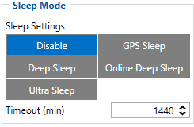
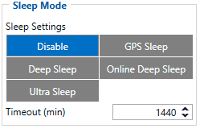

# FMC650 Sleep modes

There are three sleep modes: GPS sleep, Deep sleep and Online Deep sleep mode.

# Video Demonstration

Here is a visual demonstration of the sleep modes and how they they affect the device.

Load videoYouTubeYouTube might collect personal data. Privacy PolicyContinue
 Dismiss

# GPS Sleep mode

FMC650 is able to go into GPS sleep mode if such mode is enabled.Sleep mode timeout starts counting when the device is in STOP mode. After timeout is reached and all conditions for GPS sleep mode are met, the device goes into sleep mode.

[](https://wiki.teltonika-gps.com/view/File:GPS_Sleep_.gif)

```
When in GPS sleep mode, FMC650 turns the GPS module off and continues making new periodic records. As a result power usage decreases, in turn saving vehicle battery.FMC650 will enter GPS sleep mode if ALL of these conditions are met:
```

- FMC650 is configured to work in GPS Sleep mode and sleep timeout is reached;
- Device time must be synchronized with GPS satellites. From Firmware 03.18.15 version, this condition depends on the “Records saving/sending without TS” parameter:

- After Position Fix - FMC650 time is synchronized with GNSS satellites and GPS fix is obtained;
- After Time Sync - FMC650 time is synchronized over NTP, NITZ, or GNSS satellites;
- Always - FMC650 will enter sleep mode without time synchronization and GPS fix.

- Movement is not detected by the accelerometer and configured movement source;
- Ignition (configured ignition source) is off;

- There are no SMS messages being received.

|  | On Firmware version older than 03.18.15, the device time has to be synchronized with GNSS satellites and GPS fix has to be obtained in order for the device to enter GPS Sleep mode. |
| --- | --- |

- USB is not connected.

FMC650 exits GPS sleep mode if ONE of following conditions is true:

- Movement by accelerometer or configured movement source is detected;
- Ignition (configured ignition source) is turned on.

# Deep Sleep mode

While in deep sleep mode, FMC650 sets the GNSS receiver to sleep mode and turns off GSM/GPRS module (hence it is not possible to wake up the device via SMS). Despite records with the last known coordinate being saved and sent to the AVL server (GSM/GPRS module is turned on to send data and then it is turned off), power usage is decreased to save the vehicle's battery.

[](https://wiki.teltonika-gps.com/view/File:Deep_Sleep_.gif)

Please note that power saving depends on two configurable parameters: *Send Period* and *Minimum Record Saving Period* in "X on Stop Mode". When records are sent successfully in deep sleep mode, open link timeout counter will be skipped and FMC650 will enter deep sleep mode immediately.Because a lot of functions are disabled in deep sleep mode following I/O elements are disabled from records that are generated in this mode: GSM Signal, GNSS Status, GNSS PDOP, GNSS HDOP, GSM CellID, GSM Area Code, Active GSM Operator, Trip Odometer, Total Odometer, Speed, Fuel Rate GPS, Fuel Used GPS and ICCID.

FMC650 can enter deep sleep mode if ALL of these conditions are met:

- FMC650 is configured in Deep Sleep mode and sleep timeout is reached;
- Device time must be synchronized with GPS satellites. From Firmware 03.18.15 version, this condition depends on the “Records saving/sending without TS” parameter:

- After Position Fix - FMC650 time is synchronized with GNSS satellites and GPS fix is obtained;
- After Time Sync - FMC650 time is synchronized over NTP, NITZ, or GNSS satellites;
- Always - FMC650 will enter sleep mode without time synchronization and GPS fix.

- Ignition (configured ignition source) is off;

- Movement is not detected by the accelerometer or configured movement source;
- *Min. Record Saving Period* ([Data Acquisition Mode settings](https://wiki.teltonika-gps.com/view/FMC650_Data_acquisition_settings)) must be larger than *Open Link Timeout* parameter, so that FMC650 could close GPRS link;
- The difference between *Send Period* ([Data Acquisition Mode settings](https://wiki.teltonika-gps.com/view/FMC650_Data_acquisition_settings)) and *Open Link Timeout* must be more than 90 seconds, so that FMC650 could close GPRS link within at least 90 seconds;
- There are no SMS messages being received;
- Data socket(s) are closed;
- Data sending is not in progress;
- FOTA is not in progress.

|  | On Firmware version older than 03.18.15, the device time has to be synchronized with GNSS satellites and GPS fix has to be obtained in order for the device to enter Deep Sleep mode. |
| --- | --- |

- USB is not connected.

FMC650 exits deep sleep mode if ONE of following conditions is true:

- Movement by accelerometer or configured movement source is detected;
- Ignition (configured ignition source) is turned on.

# Online Deep Sleep mode

In this mode, the device works as in deep sleep mode, but without deregistering from the GSM network. GSM part stays powered so this increases power consumption. In this mode, the device should send/receive SMS and make/accept calls. It does not close the GPRS context if one was previously opened.

[](https://wiki.teltonika-gps.com/view/File:Online_Deep_Sleep_.gif)

Conditions to enter online deep sleep mode are the same as entering deep sleep mode.
FMC650 exits online sleep mode if ONE of following conditions is true:

- Movement by accelerometer or configured movement source is detected;
- Ignition (configured ignition source) is turned on.

[](https://wiki.teltonika-gps.com/view/File:Ultra_Sleep.gif)
