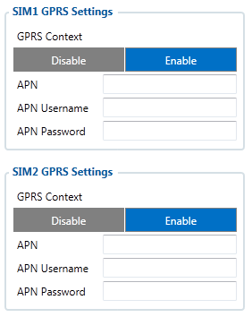
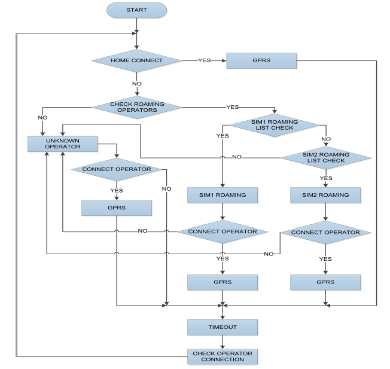

# FMC650 Dual SIM

# Introduction to Dual SIM Functionality

FMC650 is able to operate in DUAL SIM switching mode to minimize the bill accounts for
GSM/GPRS services.

SIM1 card has higher priority than SIM2. For one SIM
card using it must be placed in SIM1 slot for FMC650 to switch minimum times. (SIM1 SLOT is closer to PCB, SIM2 SLOT
is the upper one).
If SIM card is inserted into SIM 2 slot and 1 SIM operator list mode is used, FMC650 will
work normally, but there will be more switching activities. In addition, APN settings in GPRS
should be entered for SIM 1 and SIM 2 to avoid not sending records over GPRS.

SIM 1 and SIM 2 APN settings are set in the GPRS tab (Figure). Information about APN and
authentication type should be provided by your GSM operator.

- **Dual SIM algorithm**

Two SIM cards use algorithm is shown in the diagram below :

- **Home Network**

FMC650 gets possible operator codes list from the network and compares them with the operator codes
inserted in Home profile’s list. At first, it tries to connect to SIM 1 Home Operator, if operator is
unreachable; the device switches to SIM 2 slot and tries to connect to SIM 2 Home Operator.
When the connection procedure is successful, FMC650 stays connected to the available
Home operator using the SIM card, which was inserted for and works according to the Home
profile parameter settings.
If none of the Home operators could be connected with, FMC650 switches to the SIM 1
card tries to connect to its roaming operators from SIM 1 Roaming profile.
