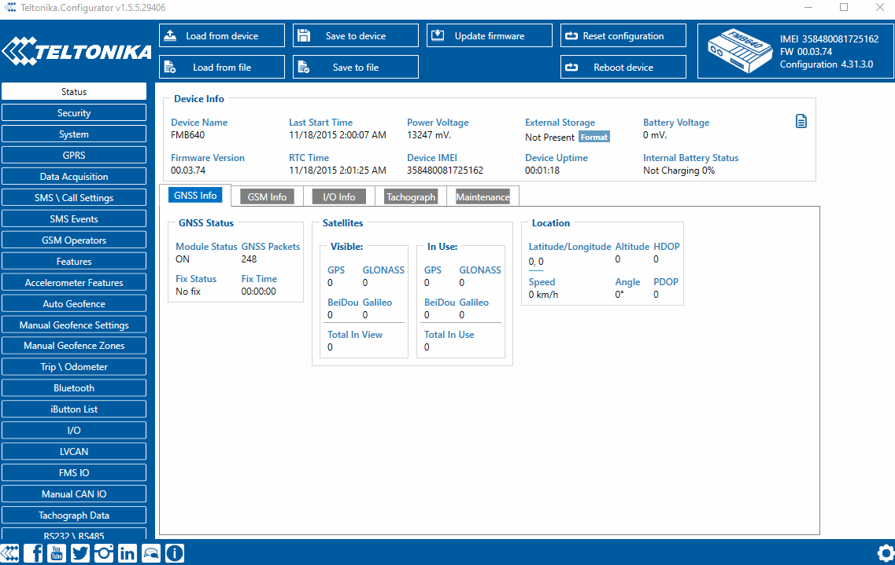
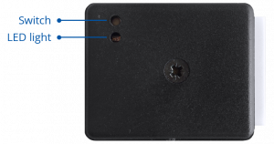

# FMC650 CAN adapters

FMC650 supports CAN adapters over RS232 connection. **CAN adapter support is added from 03.00.15.rev.06 firmware** Easy steps to install and configure following CAN adapters on FMC650 device:

- [LV-CAN200](https://wiki.teltonika-gps.com/view/LV-CAN200)
- [ALL-CAN300](https://wiki.teltonika-gps.com/view/ALL-CAN300)
- [ECAN02](https://wiki.teltonika-gps.com/view/ECAN02)

# Installing CAN adapter with FMC650 device

## Installing LV-CAN200 / ALL-CAN300

You can watch [LV-CAN200](https://wiki.teltonika-gps.com/view/LV-CAN200) / [ALL-CAN300](https://wiki.teltonika-gps.com/view/ALL-CAN300) installation video in our YouTube channel [**here**](https://youtu.be/V9RTdSy1E8w) or follow connection instructions below.

### Tools needed for installation

- [LV-CAN200](https://wiki.teltonika-gps.com/view/LV-CAN200) or [ALL-CAN300](https://wiki.teltonika-gps.com/view/ALL-CAN300)
- Connection scheme (Please contact Teltonika Sales Representative and provide information about **vehicle manufacturer**, **model** and **year**.
- FMC650 device
- Pliers
- Quick splice connectors (If vehicle CAN bus wires are very thin CAN adapter wires should be connected directly)
- Plastic pry tool
- Zip ties

### Installation steps

1. Be ready with a vehicle **connection scheme** that you have received from a Teltonika Sales Representative.
2. **Check the scheme** for the current vehicle connection. Look for connectors matching **PINs numbers** and colors (maybe different) according to the connection scheme.
3. Connect CAN adapter with FMC650:
 1. Connect CAN adapter's RS232 to RJ45 of FMC650.
4. Connect CAN adapter **CAN wires (CAN L, CAN H)** as specified in connection scheme.**Do not swap CAN L and CAN H lines.Not all CAN adapter wires may be used in the vehicle.**
5. Connect CAN adapter **positive** and **ground** wires to the vehicle power supply lines or near FMC650 power wires.**Do not swap power supply lines.Make sure that voltage does not exceed 30V.**
6. Switch vehicle **ignition to ACC** position. CAN adapter **LED diode** on the back should start **blinking**.
7. Configure CAN adapter to read CAN bus data or control vehicle by setting its **program number** - CAN Adapter configuration

**NOTE:** There are can be two color versions of CAN adapters cables (yellow/blue ones and purple ones) as shown below.

LV-CAN200 connection example with yellow and blue cables. This is not a connection diagram for your vehicle. Every vehicle has a specific scheme.LV-CAN200 connection example with purple cables. This is not a connection diagram for your vehicle. Every vehicle has a specific scheme.

## Installing LV-CAN200 / ALL-CAN300 + ECAN02

### Tools needed for installation

- [LV-CAN200](https://wiki.teltonika-gps.com/view/LV-CAN200) / [ALL-CAN300](https://wiki.teltonika-gps.com/view/ALL-CAN300)
- Connection scheme (Please contact Teltonika Sales Representative and provide information about **vehicle manufacturer**, **model** and **year**.
- [ECAN02](https://wiki.teltonika-gps.com/view/ECAN02) (Used for contactless connection. If **two CAN lines** need to be connected, **two ECAN02 adapters** must be used.)
- FMC650 device
- Pliers
- Quick splice connectors (If vehicle CAN bus wires are very thin CAN adapter wires should be connected directly)
- Plastic pry tool
- Zip ties

### Installation steps

1. Follow the same **1, 2, 3** installation steps as with LV-CAN200 installation.
2. Connect the appropriate CAN bus pair of wires between the CAN adapter and [ECAN02](https://wiki.teltonika-gps.com/view/ECAN02):
If **CAN1 line** need to be connected as specified in the connection scheme:

If **CAN2 line** need to be connected as specified in the connection scheme:
 1. Connect CAN adapter **CAN1 L** to **CAN L** of [ECAN02](https://wiki.teltonika-gps.com/view/ECAN02).
 2. Connect CAN adapter **CAN1 H** to **CAN H** of [ECAN02](https://wiki.teltonika-gps.com/view/ECAN02).
 1. Connect CAN adapter **CAN2 L** to **CAN L** of [ECAN02](https://wiki.teltonika-gps.com/view/ECAN02).
 2. Connect CAN adapter **CAN2 H** to **CAN H** of [ECAN02](https://wiki.teltonika-gps.com/view/ECAN02).**Do not swap CAN L and CAN H lines.Not all CAN adapter wires may be used in the vehicle.**
3. Fasten [ECAN02](https://wiki.teltonika-gps.com/view/ECAN02) **on vehicle CAN bus wires** according to the connection scheme. **Make sure CAN H and CAN L of vehicle corresponds to CAN H, CAN L markings on [ECAN02](https://wiki.teltonika-gps.com/view/ECAN02)** PCB.
4. Connect CAN adapter **positive** and **ground** wires to the vehicle power supply lines or near FMC650 power wires.**Do not swap power supply lines.Make sure that voltage does not exceed 30V.**
5. Configure CAN adapter to read CAN bus data by setting its **program number** - CAN Adapter configuration

# CAN Adapter Configuration

## CAN Adapter program number selection

---

CAN Adapter must be set to the program number which depends on the vehicle model. **Needed program number is always written on CAN Adapter mounting scheme.** In order to be able to enter the program number in the adapter **Software date of the CAN adapter must be newer than the connection scheme date**.
CAN adapter Software date can be checked:

- Via [Teltonika Configurator→Status→CAN Adapter](https://wiki.teltonika-gps.com/view/FMC650_Status_info#CAN_Adapter_Info)
- Via SMS command - [lvcangetinfo](https://wiki.teltonika-gps.com/view/FMB_lvcangetinfo)

The number of digits required to enter the correct Program No. may vary depending on the Software and manufacture date of your CAN Adapter:

- [LV-CAN200 adapter changes](https://wiki.teltonika-gps.com/view/LV-CAN200#Adapter_changes)
- [ALL-CAN300 adapter changes](https://wiki.teltonika-gps.com/view/ALL-CAN300#Adapter_changes)

### Entering via SMS command

---

Required conditions:

- CAN adapter properly connected to FMC650 device

CAN adapter program number can be set remotely, using an SMS command.
Send following **SMS command** to FMC650 device:

- If you have set SMS login and password: `login pass lvcansetprog X`
- If SMS login and password are not set leave two spaces before the command: `lvcansetprog X`

Command example: `lvcansetprog 11434`
SMS response: `LVCAN ProgNum: 11434`

If during SMS command FMC650 was in the following Sleep mode:

- [GPS Sleep](https://wiki.teltonika-gps.com/view/FMC650_Sleep_modes#GPS_Sleep_mode) - Program No. will be set immediately.
- [Deep Sleep](https://wiki.teltonika-gps.com/view/FMC650_Sleep_modes#Deep_Sleep_mode) - Program No. will be set after the device wakes up.
- [Online Deep Sleep](https://wiki.teltonika-gps.com/view/FMC650_Sleep_modes#Online_Deep_Sleep_mode) - Program No. will be set immediately.

### Entering via Teltonika Configurator

---

Required conditions:

- CAN adapter properly connected to FMC650 device

CAN adapter program number can be set via **[Teltonika Configurator](https://wiki.teltonika-gps.com/view/Teltonika_Configurator) → LVCAN → Program Number**. When the program number is entered press  **Save to device** button that saves the entered program number into FMC650.

[](https://wiki.teltonika-gps.com/view/File:Fmx640.gif)

### Entering manually

---

Required conditions:

- CAN adapter properly connected to FMC650 device
- Vehicle ignition must be ON

Depending on the used CAN Adapter, the length of the setup sequence will vary.

Steps to set program number:

LV-CAN200 back

| For / ALL-CAN300 / LV-CAN200 / 3 digit | For / ALL-CAN300 / LV-CAN200 / 4 digit | For / ALL-CAN300 / LV-CAN200 / 5 digit | 1. Hold SWITCH down until LED stars blink. |
| --- | --- | --- | --- |
| For / ALL-CAN300 / LV-CAN200 / 3 digit | For / ALL-CAN300 / LV-CAN200 / 4 digit | For / ALL-CAN300 / LV-CAN200 / 5 digit | 2. Release the SWITCH. |
| For / ALL-CAN300 / LV-CAN200 / 3 digit | For / ALL-CAN300 / LV-CAN200 / 4 digit | For / ALL-CAN300 / LV-CAN200 / 5 digit | 3. Then the LED starts blinking and counting the first digit of the program number (one blink means digit 1, two blinks mean digit 2, etc). To stop the counter, push SWITCH. |
| For / ALL-CAN300 / LV-CAN200 / 3 digit | For / ALL-CAN300 / LV-CAN200 / 4 digit | For / ALL-CAN300 / LV-CAN200 / 5 digit | 4. Release the SWITCH, then the LED starts blinking and counting the second digit of the program number. To stop the counter, push SWITCH. |
| For / ALL-CAN300 / LV-CAN200 / 3 digit | For / ALL-CAN300 / LV-CAN200 / 4 digit | For / ALL-CAN300 / LV-CAN200 / 5 digit | 5. Release the SWITCH, then the LED starts blinking and counting the third digit on the program number. To stop the counter, push SWITCH. |
| — | For / ALL-CAN300 / LV-CAN200 / 4 digit | For / ALL-CAN300 / LV-CAN200 / 5 digit | 6. Release the SWITCH, then the LED starts blinking and counting the fourth digit on the program number. To stop the counter, push SWITCH. |
| — | — | For / ALL-CAN300 / LV-CAN200 / 5 digit | 7. Release the SWITCH, then the LED starts blinking and counting the fifth digit on the program number. To stop the counter, push SWITCH. |
| **All Devices** | 8. Release SWITCH, if programming is successful LED will blink 10 times. | — | — |

---

#### Send data with 0 if the ignition is off

---

Depending on CAN Adapter I/O parameters and ignition status, FMC650 can send locked (last known) CAN Adapter I/O and active (real-time) parameter values or reset values to 0. When the ignition is off, CAN Adapter I/O parameters values sent to the server are:

| CAN Adapter I/O element | Status |
| --- | --- |
| Vehicle Speed | reset |
| Accelerator pedal position | reset |
| Total fuel used | lock |
| Fuel level (liters) | lock |
| Engine RPM | reset |
| Total mileage | lock |
| Fuel level (%) | lock |
| Program number | lock |
| Module ID | lock |
| Engine Work Time | lock |
| Engine Work Time (counted) | lock |
| Total Mileage (counted) | lock |
| Fuel Consumed (counted) | lock |
| Fuel Rate | reset |
| Program number | lock |
| AdBlue Level (%) | lock |
| AdBlue Level (liters) | lock |
| Engine Load | reset |
| Engine Temperature | active |
| Axle 1 Load | lock |
| Axle 2 Load | lock |
| Axle 3 Load | lock |
| Axle 4 Load | lock |
| Axle 5 Load | lock |
| Control State Flags | active |
| Agricultural Machinery Flags | active |
| Harvesting Time | lock |
| Area of Harvest | reset |
| Mowing Efficiency | active |
| Grain Mown Volume | active |
| Grain Moisture | active |
| Harvesting Drum RPM | reset |
| Gap Under Harvesting Drum | active |
| Security State Flags | active |
| Tachograph Total Vehicle Distance | lock |
| Trip Distance | reset |
| Tachograph Vehicle Speed | reset |
| Tachograph Driver Card Presence | active |
| Driver1 States | active |
| Driver2 States | active |
| Driver1 Continuous Driving Time | active |
| Driver2 Continuous Driving Time | active |
| Driver1 Cumulative Break Time | active |
| Driver2 Cumulative Break Time | active |
| Driver1 Selected Activity Duration | active |
| Driver2 Selected Activity Duration | active |
| Driver1 Cumulative Driving Time | active |
| Driver2 Cumulative Driving Time | active |

### SMS Configuration

---

All CAN Adapter IO elements can be configured remotely via SMS commands.

#### SMS/GPRS Commands

CAN Adapters have several dedicated SMS/GPRS commands.
SMS command structure:

```
<SMS login><space><SMS password><space><command><space><value>
```

SMS command [lvcangetinfo](https://wiki.teltonika-gps.com/view/FMB_lvcangetinfo) example:

- If you have set SMS login and password: `login pass lvcangetinfo`
- If SMS login and password are not set leave two spaces before the command: `aalvcangetinfo`

GPRS commands require [Codec 12](https://wiki.teltonika-gps.com/view/Codec) protocol.

For more SMS commands please see [SMS/GPRS command list](https://wiki.teltonika-gps.com/view/FMC650_SMS/GPRS_command_list)

| COMMAND | DESCRIPTION | RESPONSE |
| --- | --- | --- |
| lvcansetprog # | Set program number to CAN Adapter that is connected to FMC650. / # - three digit number that identity vehicle. | Yes |
| lvcansimpletacho # | Add or remove simpletacho start byte. / # - 0 or 1 (0 – don’t add start byte, 1 – add start byte). | No |
| lvcangetprog | Get program number from CAN Adapter that is connected to FMC650. | Yes |
| lvcangetinfo | Get information about connected CAN Adapter | Yes |
| lvcanclear # | Clear Total Mileage (counted), Engine Work Time (counted), Fuel Consumed (counted) parameters values. / # - parameter (0 – Engine work time (counted), 1 – Fuel Consumed (counted), 2 – Vehicle Mileage (counted)). | Yes |

# CAN Adapter State Flags

CAN Adapters receive data about the states of various systems within the vehicle, and send them as flags to FMC650. FMC650 device stores these flags in hexadecimal format, as one variable. **Note!** To retrieve all flags, Firmware version **03.00.16.Rev.01** for **FMx650 / FMx641** or newer must be used. Below are the table of flags that are kept by [LV-CAN200](https://wiki.teltonika-gps.com/view/LV-CAN200), [ALL-CAN300](https://wiki.teltonika-gps.com/view/ALL-CAN300) and information how to retrieve them:

## Security State Flags P4

| Byte | Bit | Value bitmasks | LVCAN | ALLCAN |
| --- | --- | --- | --- | --- |
| 0 | 0 | 0x00 – CAN1 connected, currently no data is received / 0x01 – CAN1 connected, currently data is received / 0x02 – CAN1 not connected, needs connection / 0x03 – CAN1 not connected does not need connection | ✔ | ✔ |
| 0 | 2 | 0x00 – CAN2 connected, currently no data is received / 0x01 – CAN2 connected, currently data is received / 0x02 – CAN2 not connected, needs connection / 0x03 – CAN2 not connected does not need connection | ✔ | ✔ |
| 0 | 4 | 0x00 – CAN3 connected, currently no data is received / 0x01 – CAN3 connected, currently data is received / 0x02 – CAN3 not connected, needs connection / 0x03 – CAN3 not connected does not need connection | — | — |
| 1 | 8 | 0x01 – ignition on | ✔ | ✔ |
| 1 | 9 | 0x02 – key in ignition lock | — | ✔ |
| 1 | 10 | 0x04 – Webasto | — | ✔ |
| 1 | 11 | 0x08 – engine is working | — | ✔ |
| 1 | 12 | 0x10 – standalone engine | — | ✔ |
| 1 | 13 | 0x20 – ready to drive | — | ✔ |
| 1 | 14 | 0x40 – engine is working on CNG | ✔ | ✔ |
| 1 | 15 | 0x80 – work mode (0 – private, 1 – company) | — | ✔ |
| 2 | 16 | 0x01 – operator is present | — | ✔ |
| 2 | 17 | 0x02 – interlock active | — | ✔ |
| 2 | 18 | 0x04 – handbrake is active | — | ✔ |
| 2 | 19 | 0x08 – footbrake is active | — | ✔ |
| 2 | 20 | 0x10 – clutch is pushed | — | ✔ |
| 2 | 21 | 0x20 – status of the hazard warning lights switch active | — | ✔ |
| 2 | 22 | 0x40 – front left door opened | ✔ | ✔ |
| 2 | 23 | 0x80 – front right door opened | ✔ | ✔ |
| 3 | 24 | 0x01 – rear left door opened | ✔ | ✔ |
| 3 | 25 | 0x02 – rear right door opened | ✔ | ✔ |
| 3 | 26 | 0x04 – trunk door opened | ✔ | ✔ |
| 3 | 27 | 0x08 – engine cover opened | ✔ | ✔ |
| 3 | 28 | 0x10 – charging wire is plugged | — | ✔ |
| 3 | 29 | 0x20 – battery charging on | — | ✔ |
| 3 | 30 | 0x40 – electric engine is working | — | ✔ |
| 3 | 31 | 0x80 – car is closed with factory remote control | — | ✔ |
| 4 | 32 | 0x01 – car is closed | — | ✔ |
| 4 | 33 | 0x02 – factory installed alarm is active | — | ✔ |
| 4 | 34 | 0x04 – emulated alarm is active | — | ✔ |
| 4 | 35 | 0x08 – signal of closing with factory remote control was sent | — | ✔ |
| 4 | 36 | 0x10 – signal of opening with factory remote control was sent | — | ✔ |
| 4 | 37 | 0x20 – rearm signal was sent | — | ✔ |
| 4 | 38 | 0x40 – trunk was opened with remote control | — | ✔ |
| 4 | 39 | 0x80 – CAN module is in SLEEP mode | ✔ | ✔ |
| 5 | 40 | 0x01 – signal of closing with factory remote control was sent 3 times | — | ✔ |
| 5 | 41 | 0x02 – parking is active | — | ✔ |
| 5 | 42 | 0x04 – reverse is active | — | ✔ |
| 5 | 43 | 0x08 – neutral is active | — | ✔ |
| 5 | 44 | 0x10 – drive is active | — | ✔ |
| 5 | 45 | 0x20 – engine lock active | — | — |
| 5 | 46 | 0x40 – request to lock the engine (activation after attempt to restart the engine) | — | — |
| 5 | 47 | 0x80 – factory armed | — | — |
| 6 | 48 | 0x01 - roof opened | ✔ | ✔ |

> **Note:** the two CAN-adapter pin-out diagrams (`FMx650_and_can_pin-out_yellow_blue.png`, `FMx650_and_can_pin-out_pink.png`) are not present in any Wayback capture (verified against the CDX index); all other figures are in `assets/`.
