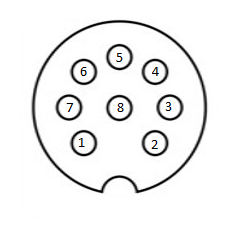
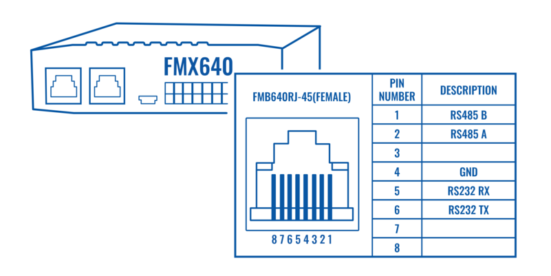
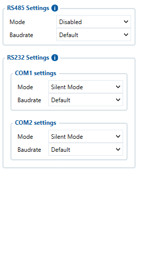
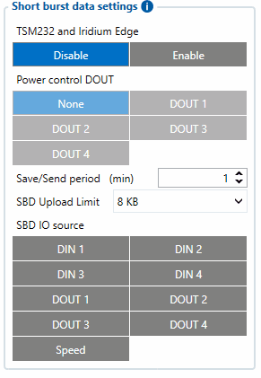
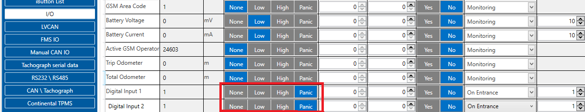

# FMC650 Short Burst Data

## Introduction

Since 00.02.05 firmware version device supports Iridium devices - TSM-232 and Iridium Edge which can send *short burst data* (SBD) to the server. This means some data can be sent from the FM device to the server through satellites. From firmware version - **01.02.22.Rev.02**, FMC650 support for **Iridium Edge** is added. Iridium Edge features an all-in-one SBD module and antenna, with a power supply. The plug-and-play satellite IoT terminal can be easily paired with FMC650 device in order to expand its functionality to no GSM coverage zones.
Current Iridium implementation offers the ability to generate and send SBD records after a set period after the GSM signal is lost. This ensures constant connectivity as the Iridium network is available globally.

## Connecting Iridium device to FMC650

In order to properly connect the Iridium device to FMC650, Iridium has to be connected to the device via RS-232 - COM1 or COM2 (with RJ-45 connector, where 4 pin is GND, 5 pin is RS232 Rx and 6 PIN is RS232 Tx). Additionally **Pin No. 6** - power control (reference in the image below) must be connected to one of the FMC650 DOUTs (1/2/3/4), in order to allow the device to power ON/OFF Iridium device on demand.

Iridium Edge pinout and RS232 COM 1/2 connection:

| / Pin. No | / Signal name | / Signal direction (with respect to Iridium Edge) | / Description |
| --- | --- | --- | --- |
| / 1 | / Spare | / - | / Unused |
| / 2 | / Ground | / Input | / Signal and power GND |
| / 3 | / RS232_RX | / Input | / RS232 input |
| / 4 | / RS232_TX | / Output | / RS232 output |
| / 5 | / Power | / Input | / 9-32 V positive terminal |
| / 6 | / ON/OFF | / Input | / Optional line to power down Iridium edge |
| / 7 | / Network available | / Output | / |
| / 8 | / Power Detection | / Output | / Active high then Iridium Edge is powered |

## Configuring FMC650

In order to properly configure FMC650 to get SBD records, first it is necessary to select correct RS232 mode in RS-232 / RS 485 TAB - “**Satellite backup”** mode must be selected in COM1/COM2 settings. Baudrate should be set to 19200.

Furthermore, in the *Features TAB* in *Short burst data settings*, *TSM232 and Iridium Edge* must be enabled. ***Power control DOUT*** configures DOUT pin which can control Iridium Edge ON/OFF pin. Configure if DOUT pin is connected. Respective power control DOUT to which Iridium device's *PIN6* is connect must be selected.

***Save/Send period*** configures how long will FMB device wait after losing the signal to generate SBD packet. If the signal is not recovered, it will send it indefinitely (or till the SBD Upload limit is reached, if such is set).

***SBD Upload Limit*** is configurable and resets every month. This option can ensure that no additional data is used so that no unexpected costs are experienced by the customer. The default value is 8000 (for 8KB plan). This option can be disabled by setting the Upload limit to 0. The monthly data usage counter can be reset by using the SMS/GPRS command - **sbdlimitsreset**.

***SBD IO source*** configures IO source which can trigger SBD record saving. 9 elements can generate Alarm for SDB sending. These elements are:

- Digital input 1
- Digital input 2
- Digital input 3
- Digital input 4
- Digital output 1
- Digital output 2
- Digital output 3
- Digital output 4
- Speed

Configurator parameter IDs and their explanation:

| Parameter ID / | Parameter name | **Values** | Explanation | — | — |
| --- | --- | --- | --- | --- | --- |
| — | — | Min | Max | Default | — |
| 99420 | Iridium Edge | 0 | 1 | 0 | This parameter enables or disables Iridium Edge functionality |
| 99421 | Save/Send period | 0 | 1440 | 0 | This parameter lets to configure Iridium Edge sending period |
| 99422 | SBD IO source* | 0 | 8 | 0 | SBD IO elements which when enabled are included into the SBD record |
| 99423 | SBD UploadLimit | 0 | 30000 | 8000 | Limit to save user from exceeding the monthly plan. Max limit of 30000 due to 30KB plan. If set to 0 – limit will be off. |
| 99424 | Power control DOUT | 1 | 5 | 1 | Device DOUT which can control ON/OFF pin of the Iridium Edge |
| 151 | RS232 Mode | 0 | 23 | 0 | RS-232 mode selection. "Satellite backup" - 15 |

***** SBD IO source parameter is configured with bitmasks (used for configuring I/O source elements via SMS/GPRS command) :

- Disabled = 0x00,
- Din1 = 0x01,
- Din2 = 0x02,
- Din3 = 0x04,
- Din4 = 0x08,
- Dout1 = 0x10,
- Dout2 = 0x20,
- Dout3 = 0x40,
- Dout4 = 0x80,
- Speed = 0x100

For example: to enable Din1, Din3 and Dout4: 0x01 + 0x04 + 0x80 = 0x85 convert to decimal --> 133.

## Setting up Alarm priority records

In addition, you can select which IO element can generate Alarm priority record. The configurable IO parameters are listed as *SBD IO source* in list above. In order to do that you need to configure these **IO** elements as **Panic priority**. If properly configured SBD records are generated and sent if there is no GSM connection.

In the scenario shown in the above picture when panic record is made (generated by *Digital Input 1* or *Digital Input 2*) internal 90 seconds timer will start to tick and if in that timeout device will not send the record through GPRS network it will be sent with Iridium satellites.

## SDB record structure

SDB Record which will be sent through the Iridium satellites network will be different than the regular record. It will contain 4 bytes timestamp, 3 bytes longitude, 3 bytes latitude, 1 byte record generation info, 1 byte DIN,DOUT info, 1 byte Speed value.

| Timestamp | Longitude | Latitude | SDB AVL ID and flags | DIN/DOUT info | Reserved | Speed |
| --- | --- | --- | --- | --- | --- | --- |
| 4B | 3B | 3B | 1B | 1B | 1B | 1B |

***Timestamp*** - Indicates when record was generated.

***Longitude*** - In this packet is encoded in 3 bytes data. The server that gets this data should divide the result from 46603,375 and subtract 180 to get the actual longitude value. This coefficient is got in the following way: 16777215(maximum 3 bytes value) divided by 360 (maximum longitude value then 180 is added). This calculation is used to fit negative and positive values to 3 bytes width variable.

***Latitude*** - Is calculated in the same way as longitude but since latitude maximum value is two times smaller than longitude it can produce a bit more accurate data. The coefficient for latitude is 93206,75. This coefficient is got in the following way: 16777215(maximum 3 bytes value) divided by 180 (maximum latitude value then 90 is added). This calculation is used to fit negative and positive values to 3 bytes width variable.

***SBD AVL ID and flags*** – Custom ID that will indicate what caused the record to be generated (final ID will (as only periodic records are generated, ID is not used)).
This byte is divided in two parts of four bits, as shown in table below:

| **/ Flags (not used yet)** | **/ SBD AVL ID** | — | — | — | — | — | — |
| --- | --- | --- | --- | --- | --- | --- | --- |
| / Bit 7 | / Bit 6 | / Bit 5 | / Bit 4 | / Bit 3 | / Bit 2 | / Bit 1 | / Bit 0 |

SBD AVL ID is used to show which IO element generated the Panic element. The list of currently implemented possible values is described below:

| / ID | / 0 | / 1 | / 2 | / 3 | / 4 | / 5 | / 6 | / 7 | / 8 | / 9 |
| --- | --- | --- | --- | --- | --- | --- | --- | --- | --- | --- |
| / IO element | / Periodic rec. | / Digital Input 1 | / Digital input 2 | / Digital input 3 | / Digital input 4 | / Digital output 1 | / Digital output 2 | / Digital output 3 | / Digital output 4 | / Speed |

Data from Bit 7 to Bit 4 are not used at the moment. The server should ignore this data part.

***DIN/DOUT info*** - Displays configured IO elements values of enabled IO elements in SBD IO source settings - (parameter ID 99422). Since digital inputs can contain only logic 1 or 0 they are bit masked in one byte.

| / DIN1 | / DIN2 | / DIN3 | / DIN4 | / DOUT1 | / DOUT2 | / DOUT3 | / DOUT4 |
| --- | --- | --- | --- | --- | --- | --- | --- |
| / Bit 7 | / Bit 6 | / Bit 5 | / Bit 4 | / Bit 3 | / Bit 2 | / Bit 1 | / Bit 0 |

***Reserved*** - Not used.

***Speed*** – Indicates the speed of the vehicle if configured. If not (or in case of no GPS) – it will display 255.

# SBD packet example

**Unparsed data:**

*01004C01001CF99DD263333030323334303634303730383330000018000059282DBC03000B0036A2B8193D120000000302001C*
 *59282BA391F5ABCDBFDD0180000059282BA891F5ABCDBFDD0180000059282BA391F5AB*

{01} – Protocol revision number
{00}{4C} – overall message length
{01} – MO header IEI
{00}{1C} – MO header length
{F9}{9D}{D2}{63} – CDR Reference
{33}{30}{30}{32}{33}{34}{30}{36}{34}{30}{37}{30}{38}{33}{30} – IMEI of the device
{00} – Session status (Transfer OK in this case)
{00}{18} – MOMSN
{00}{00} – MTMSN
{59}{28}{2D}{BC} – Time of session
{03} – MO Location information IEI
{00}{0B} – MO Location information length
{00}{36}{A2}{B8}{19}{3D}{12} – MO latitude and longitude as described in Iridium documentation.
{00}{00}{00}{03} – CEP radius
{02} – Payload IEI
{00}{1C} – Payload length
{59}{28}{2B}{A3}{91}{F5}{AB}{CD}{BF}{DD}{01}{80}{00}{00} – Record 1
{59}{28}{2B}{A8}{91}{F5}{AB}{CD}{BF}{DD}{01}{80}{00}{00} – Record 2

There blue part of record is satellite device generated data and green is actual record payload which was sent to server from FMC650. Information of the first record should be parsed like this:

{59}{28}{2B}{A3} – Timestamp of record generation in GMT0;
{91}{F5}{AB} – Longitude (recalculated value is 25,255756)
{CD}{BF}{DD} – Latitude (recalculated value is 54,832396)
{01} – DIN1 generated event
{80} – DIN1 on, while DIN2, DIN3, DIN4, DOUT1, DOUT2, DOUT3, DOUT4 – off
{00} – Reserved byte
{00} – Vehicle was stopped when the record was generated
