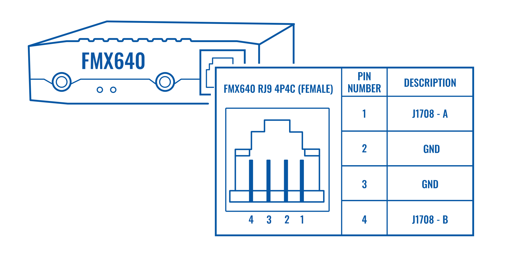
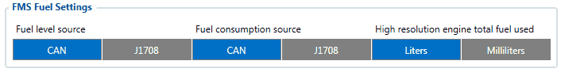
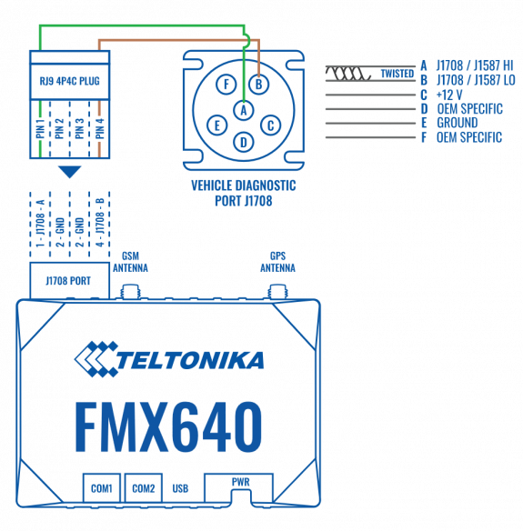
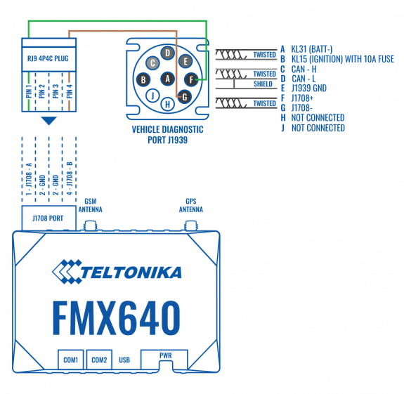

# FMC650 J1708

# Description

SAE J1708 is a standard used for serial communications between ECUs on heavy-duty. The hardware utilized is RS-485 transceivers wired for open collector operation through the use of a pullup and pulldown of the separate data lines.

With [FMC650](https://wiki.teltonika-gps.com/view/FMC650), J1708 functionality is used to read vehicle's Fuel Level and Fuel consumption.

Because J1708 is not a CAN-BUS protocol, [FMC650](https://wiki.teltonika-gps.com/view/FMC650) CAN1 and CAN2 lines cannot be used to read J1708 information. [FMC650](https://wiki.teltonika-gps.com/view/FMC650) has a special J1708 Port, which utilizes an RJ9 4P4C connector.

# Software Configuration of FMC650 with J1708

J1708 configuration is done in the [FMS IO](https://wiki.teltonika-gps.com/view/FMC650_LVCAN_I/O,FMS_IO_and_Tachograph_data_elements) Tab.

When J1708 is enabled as a Fuel Level source, Fuel-related data will be taken from the J1708 line, FMS Fuel data will be ignored.

# Connection with Vehicle port

J1708 connector is not supported by all vehicles. Only VOLVO, RENAULT, and American truck manufacturers implement the J1708 connector.

Trucks utilize *Deutsch 6-PIN or Deutsch 9-PIN connector*, which are used to connect FMC650 to J1708.

 

|  | NOTE: Most of the Volvo trucks need an J1708 connection to be able to receive fuel level data |
| --- | --- |
