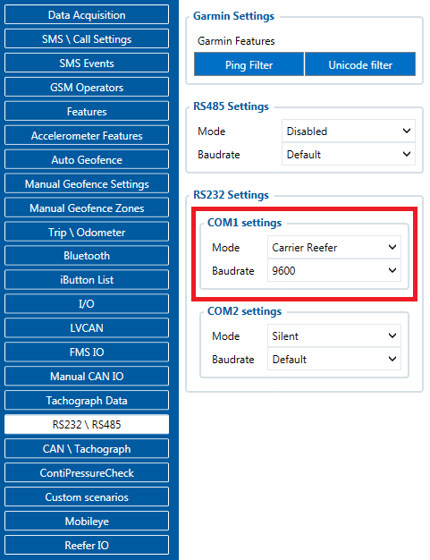
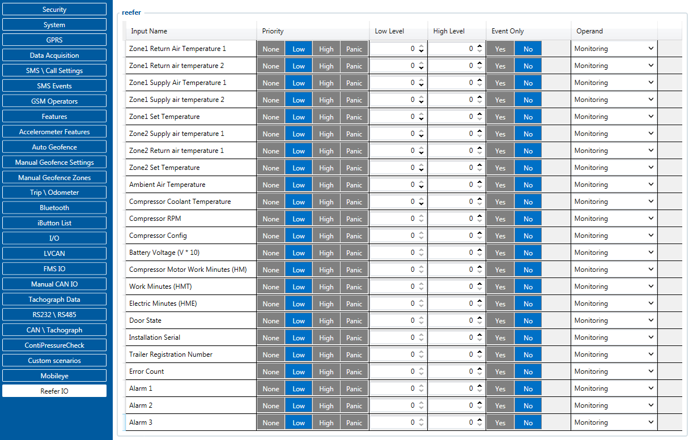
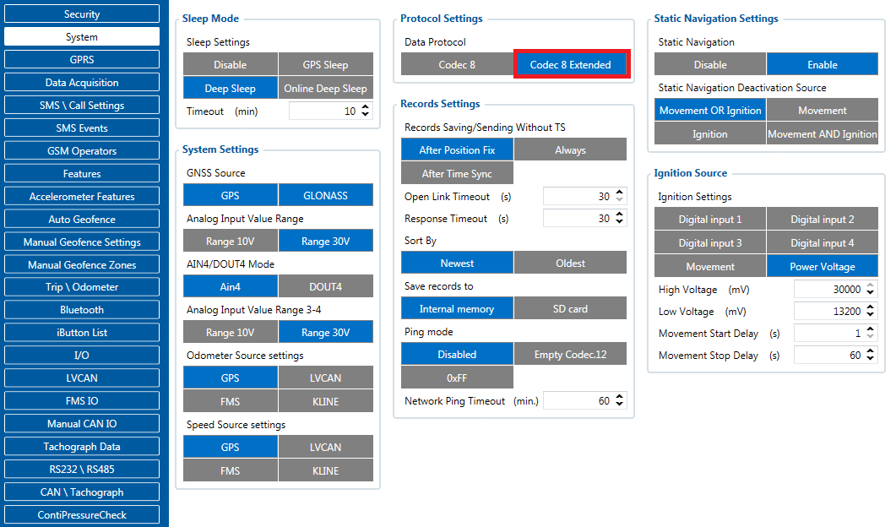

# FMC650 Carrier

# Introduction

Usually cargo is equally as important as the vehicle itself, with temperature data you can be assured that goods which you are delivering will maintain high quality, thus Teltonika is offering ability to monitor real-time information from Carrier Freezers. The Carrier Control box/ecu is connected via RS232 port of the professional FMC6 trackers. The solution is easy to install and to configure. This allows to monitor the main information of the freezer trailer such as Temperature, Fridge door status, Alarms etc. and generate events according to your needs. For more information please refer to the installation manual below.

# Supported Carrier Refrigerators

SUPPORTED CARRIER REFRIGERATORS:
VECTOR 1800 | VECTOR 1850 | VECTOR 1850 MT | VECTOR 1550

# Installation guide

Installation manual for Carrier Vector 1550 can be downloaded here:

Installation requires ["Carrier reefer cable"](https://teltonika-gps.com/product/carrier-reefer-cable/#description)

# Configuration

Make sure FMC6 device is configured to receive data from “Carrier Reefer”. To do this, enter the configurator window, select RS232 \ RS485 section displayed in the screenshot below and configure accordingly (COM1 Settings, Mode “Carrier Reefer”, Baudrate: 9600)

The screenshot below displays Reefer I/O parameters section, here you can set up your device to send required parameters

[Codec 8 Extended](https://wiki.teltonika-gps.com/view/Codec#Codec_8_Extended) should be selected as the main data protocol in the “Protocol Settings” tab, which is located in “System” section.

