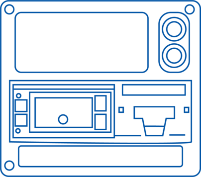
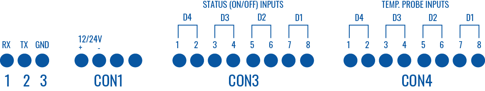
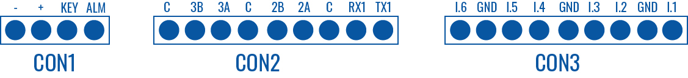
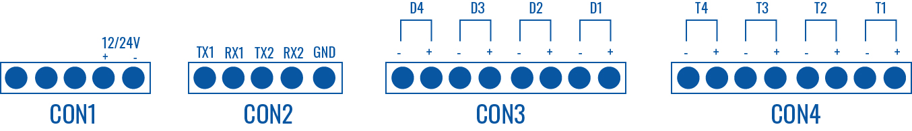
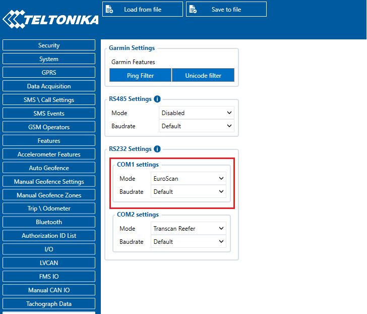
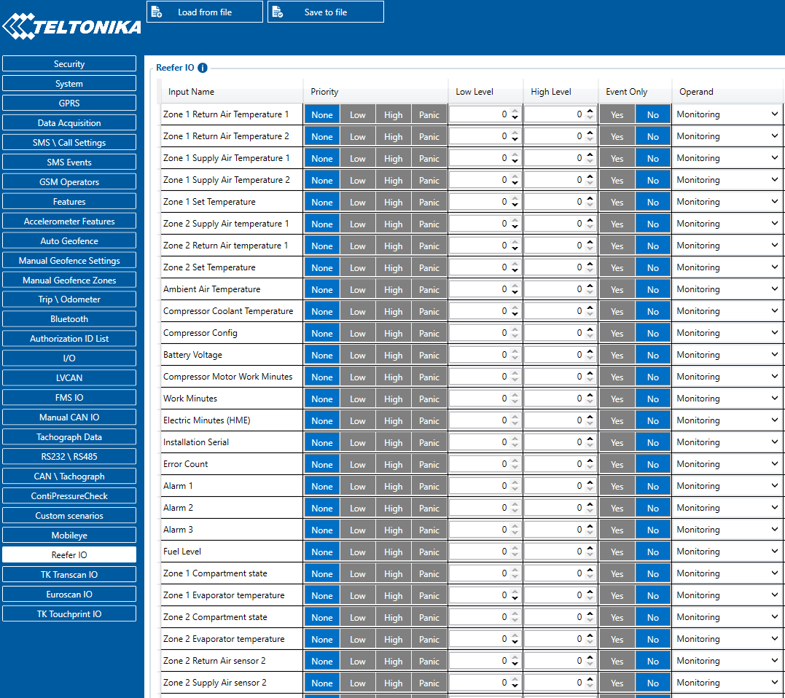
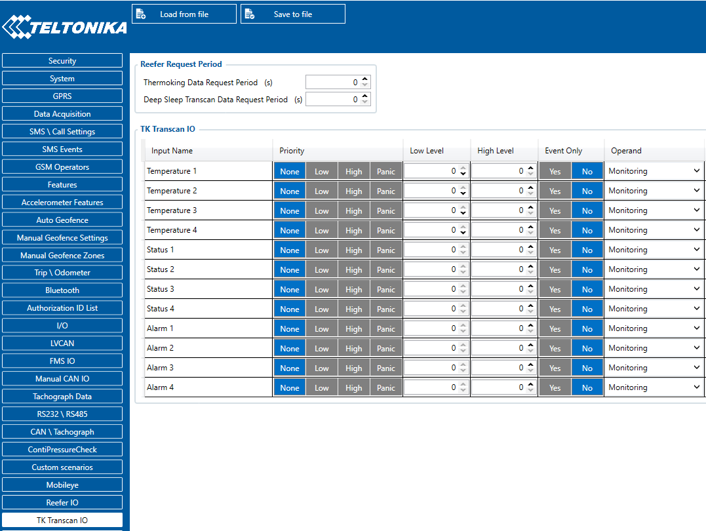
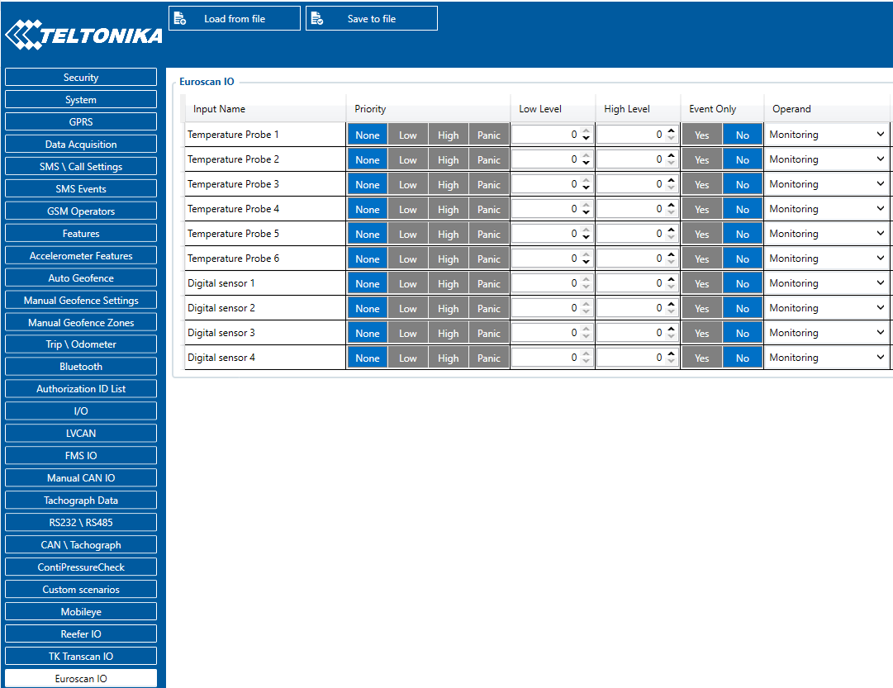
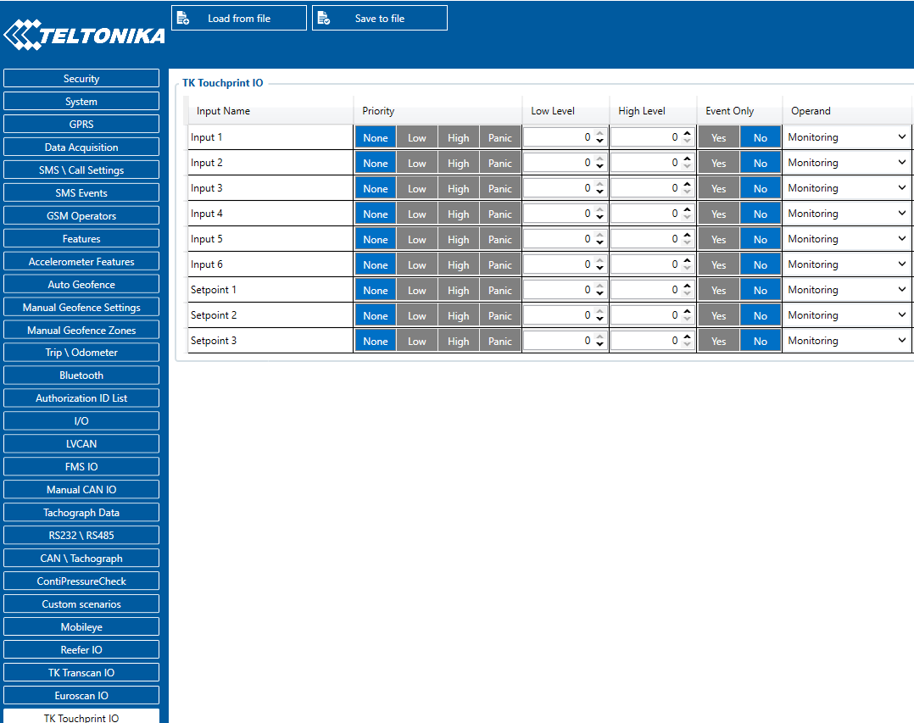

# FMC650 Thermograph

# Introduction

With an increasing demand for cold-chain supply chains, Teltonika is offering the ability to monitor real-time information from freezer trailer thermographs. Each thermograph has an RS232 communication line where FMC650 devices can connect via COM1/COM2 port of the device. The solution is easy to install and configure. This allows you to monitor the main information of the freezer trailer such as Temperature, Fridge door status, Alarms, etc., and generate events according to your needs. For more information please refer to the installation manual below.

**NOTE:** this feature is available from FW ver. **01.02.23.Rev.00**.
Apache Thermograph functionality is available from FW ver. **03.01.01.Rev.06**.

# Supported Thermographs

FMC650 can be connected to Euroscan, DataCold600, Transcan2, TouchPrint and Apache Thermographs.

Refer to the table below to see which freezers use which thermograph:

| — | **Thermograph Type** | — | — | — |
| --- | --- | --- | --- | --- |
| Freezer Type | Euroscan | DataCold600 | Transcan2 | TouchPrint/TouchLog |
| Carrier | + | + | - | - |
| ThermoKing | + / | - | + | + |

# RS-232 Interface

RS-232 supports full-duplex communication which means the data can be both sent and received at the same time as they use separate transmission lines. Most of the modes are the same as for FMC650. When entering Sleep or Deep sleep RS-232 will be powered off. FMC650 RS-232 connection diagram is shown in the figure below:

# Installation guide

## TouchPrint/TouchLog/Transcan2

**TouchPrint pinout**:

No configuration is necessary.

If the equipment does not receive information from the thermographer, the speed of the port accessing the configuration menu:

Keep the blue and red buttons pressed at the same time. "Enter PIN code" is displayed on the screen, enter pin "1111" by pressing the blue button four times. Travel for the options with the red button.

The ENG Display> OFF option must be ON, change its value with the keys ◄ and ►. Once switched to ON, keep scrolling through the options until you find Baud Rate> 9600. The value should be 9600, otherwise, adjust the speed by moving the cursor with the ◄ and ► keys, and adjust the speed with the keys ▲ and ▼.

**TouchLog/Transcan2 pinout**:

AVL IDs for Touchprint/Transcan2:

| Parameter name | Input 1 | Input 2 | Input 3 | Input 4 | Input 5 | Input 6 | Setpoint 1 | Setpoint 2 | Setpoint 3 |
| --- | --- | --- | --- | --- | --- | --- | --- | --- | --- |
| AVL ID | 10695 | 10696 | 10697 | 10698 | 10699 | 10700 | 10701 | 10702 | 10703 |

Configuration: No configuration is necessary.

See ThermoKing Configuration.

## Carrier Datacold 600

To properly use DataCold 600 with FMX640 these steps must be followed:

- In FMX640 RS232 settings **DataCold mode** is selected and **Baudrate set to 38400**
- **Partner mode enabled** on DataCold 600

To enable Partner mode on DataCold 600:

1. Press and hold the green button for 4 seconds
2. Insert password. Default password - 1111
3. Press the blue button to open 11 communication settings
4. Press the green button to select edit action
5. 11.1.0 Com1 Port settings should be opened, then press the green button again
6. Then search for Partner protocol and press the green button to accept changes

Important note - RX and TX are inverted via the RS-232 connection. Scheme to properly manage DataCold 600 RS232 connection:
Pinout of DataCold600

Available parameters (AVL IDs) with DataCold 600:

| Parameter name | Zone 1 Compartment state | Zone 1 Compartment mode | Zone 1 Return Air Sensor | Zone 1 Supply Air Sensor | Zone 1 Set Temperature | Zone 1 Evaporator temperature | Zone 2 Return Air Sensor | Zone 2 Supply Air Sensor | Zone 2 Set Temperature | Zone 3 Compartment state | Zone 3 Compartment mode | Zone 3 Set Temperature |
| --- | --- | --- | --- | --- | --- | --- | --- | --- | --- | --- | --- | --- |
| AVL ID | 10045 | 10046 | 10047 | 10048 | 10049 | 10050 | 10056 | 10057 | 10058 | 10063 | 10064 | 10067 |

| Parameter name | Speed mode | Ambient Air Temperature | Compressor Config | Installation Serial | Analog Input 1-3 | Manufacturer ID | Battery State Flags | Fuel state flags | Maintenance 1-5 Hours | Run Mode | Error Codes | Temperature Probe 1-6 |
| --- | --- | --- | --- | --- | --- | --- | --- | --- | --- | --- | --- | --- |
| AVL ID | 10071 | 10350 | 10353 | 10356 | 10468-10470 | 10472 | 10473 | 10474 | 10475-10479 | 10480 | 10639 | 10644-10649 |

Run mode explanation:

| Run mode | StartStop | Continious | CycleCentry | Unknown/Now available |
| --- | --- | --- | --- | --- |
| Value (HEX) | 0 | 1 | 2 | 7 |

Fuel and Battery state flag explanation:

| Fuel/Battery Flag Status | Available | Error | Alarm | Digital sensor |
| --- | --- | --- | --- | --- |
| Enum (bit field) value | 0 | 1 | 2 | 3 |

## Euroscan

To properly use Euroscan with FMX640 these steps must be followed:

- In FMX640 RS232 settings **Euroscan mode** is selected and **Baudrate set to 38400**
- **Partner mode enabled** on Euroscan

To enable Partner mode on Euroscan :

1. Press and hold the green button for 4 seconds
2. Insert password. Default password - 1111
3. Press the blue button to open 11 communication settings
4. Press the green button to select edit action
5. 11.1.0 Com1 Port settings should be opened, then press the green button again
6. Then search for Partner protocol and press the green button to accept changes

Important note - RX and TX are inverted via the RS-232 connection. Scheme to properly manage Euroscan RS232 connection:
Pinout of DataCold600

Available parameters (AVL IDs) with Euroscan :

| External Sensor Temperature 1 | External Sensor Temperature 2 | External Sensor Temperature 3 | External Sensor Temperature 4 | External Sensor Temperature 5 | External Sensor Temperature 6 | Digital Sensor 1 | Digital Sensor 2 | Digital Sensor 3 | Digital Sensor 4 |
| --- | --- | --- | --- | --- | --- | --- | --- | --- | --- |
| 484 | 485 | 486 | 487 | 488 | 489 | 10464 | 10465 | 10466 | 10467 |

## Apache

In order to properly use Apache with FMX 650 device confirm the following:

- Mode set to "Apache Thermograph"
- Baudrate set to **Default**

For more information please see Configuration section of the page.

Connect sensors to thermograph via this schematic:

Connect thermograph's RX and TX to device's TX and RX:

# Configuration

Make sure the FMC650 device is configured to receive data from “Transcan2 Reefer”, "Touchprint Reefer", "Euroscan:, "DataCold Reefer". To do this, enter the configurator window, select the RS232 \ RS485 section displayed in the screenshots below, and configure accordingly (COM1/COM2 Settings, Mode “Transcan2 Reefer”, "Touchprint Reefer", "Euroscan"or "DataCold Reefer", Baudrate: Default)

### DataCold Reefer

To configure "DataCold Reefer" I/O parameters, please select "Reefer IO":

Data sending parameters (AVL ID) used for "DataCold Reefer" are these: 10040 - 10649. For more in-depth information, please refer to **[Reefer IO data sending parameters](https://wiki.teltonika-gps.com/view/FMC650_Teltonika_Data_Sending_Parameters_ID#Reefer_IO).**

### TK Transcan2 Reefer

To configure "Transcan2 Reefer" I/O parameters, please select "TK Transcom IO":

Data sending parameters (AVL ID) used for "Transcan2
" are these: 10683 - 10694. For more in-depth information, please refer to **[Transcan IO data sending parameters](https://wiki.teltonika-gps.com/view/FMC650_Teltonika_Data_Sending_Parameters_ID#TK_Transcan_IO)**

### Euroscan IO

To configure "Euroscan refeer" I/O parameters select "Euroscan IO":

Data sending parameters (AVL ID) used for "Euroscan" are these: 484-489 and 10464-10467. For more in-depth information, please refer to **[Euroscan IO data sending parameters](https://wiki.teltonika-gps.com/view/FMC650_Teltonika_Data_Sending_Parameters_ID#TK_Euroscan_IO).**

### TK Touchprint/Touchlog I/O

To configure "Touchprint Reefer" I/O parameters select "TK Touchprint IO":

Data sending parameters (AVL ID) used for "Touchprint Reefer" are these: 10695 - 10703. For more in-depth information, please refer to **[Touchprint IO data sending parameters](https://wiki.teltonika-gps.com/view/FMC650_Teltonika_Data_Sending_Parameters_ID#TK_Touchprint_IO).**

### Apache Thermograph

In **RS232/RS485** section under **RS232 settings** select “Apache Thermograph” mode and Baudrate should be set to "Default":

Navigate to "Apache Thermograph" section to continue the configuration process.

Data sending parameters (AVL ID) used for "Apache Thermograph" are these: 13362 - 13583. For more in-depth information, please refer to **[Apache Thermograph data sending parameters](https://wiki.teltonika-gps.com/view/FMC650_Teltonika_Data_Sending_Parameters_ID#Apache_Thermograph).**

[Codec 8 Extended](https://wiki.teltonika-gps.com/view/Codec#Codec_8_Extended) should be selected as the main data protocol in the “Protocol Settings” tab, which is located in the “System” section.
