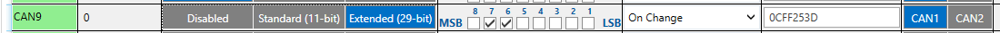

# FMC650 Parameter list

# System parameters

| Parameter ID | Parameter Type | Default value | **Value range** | Value | Parameter name | — |
| --- | --- | --- | --- | --- | --- | --- |
| **Parameter ID** | **Parameter Type** | **Default value** | **Min** | **Max** | **Value** | **Parameter name** |
| 100 | Unit8 | 0 | 0 | 3 | 0 - Ignition | Movement Source |
| 100 | Unit8 | 0 | 0 | 3 | 1 - Movement Sensor | Movement Source |
| 100 | Unit8 | 0 | 0 | 3 | 2 - GNSS | Movement Source |
| 100 | Unit8 | 0 | 0 | 3 | 3 - CAN Speed | Movement Source |
| 102 | Uint8 | 2 | 0 | 3 | 0 – Disabled | Sleep Mode |
| 102 | Uint8 | 2 | 0 | 3 | 1 – GPS Sleep | Sleep Mode |
| 102 | Uint8 | 2 | 0 | 3 | 2 – Deep Sleep | Sleep Mode |
| 102 | Uint8 | 2 | 0 | 3 | 3 – Online Deep Sleep | Sleep Mode |
| 103 | Uint8 | 10 | 1 | 3000 | Minutes | Sleep timeout |
| 106 | Uint8 | 1 | 0 | 1 | 0 - Disabled | Static Navigation |
| 106 | Uint8 | 1 | 0 | 1 | 1 - Enabled | Static Navigation |
| 123 | Uint8 | 0 | 0 | 3 | 0 - Movement OR Ignition | Static Navigation Deactivation Source |
| 123 | Uint8 | 0 | 0 | 3 | 1 - Movement | Static Navigation Deactivation Source |
| 123 | Uint8 | 0 | 0 | 3 | 2 - Ignition | Static Navigation Deactivation Source |
| 123 | Uint8 | 0 | 0 | 3 | 3 - Movement AND Ignition | Static Navigation Deactivation Source |
| 111 | Uint8 | 1 | 0 | 1 | 0 - Range 10 V | Analog input value range |
| 111 | Uint8 | 1 | 0 | 1 | 1 - Range 30 V | Analog input value range |
| 122 | Uint8 | 1 | 0 | 1 | 0 - Range 10 V | Analog Input Value Range 3-4 |
| 122 | Uint8 | 1 | 0 | 1 | 1 - Range 30 V | Analog Input Value Range 3-4 |
| 115 | Uint8 | 0 | 0 | 1 | 0 - Ain4 | AIN4/DOUT4 |
| 115 | Uint8 | 0 | 0 | 1 | 1 - DOUT4 | AIN4/DOUT4 |
| 117 | Uint8 | 0 | 0 | 3 | 0 - GPS | Odometer Source Settings |
| 117 | Uint8 | 0 | 0 | 3 | 1 - LVCAN | Odometer Source Settings |
| 117 | Uint8 | 0 | 0 | 3 | 2 - FMS | Odometer Source Settings |
| 117 | Uint8 | 0 | 0 | 3 | 3 - KLINE | Odometer Source Settings |
| 118 | Uint8 | 0 | 0 | 3 | 0 - GPS | Speed Source settings |
| 118 | Uint8 | 0 | 0 | 3 | 1 - LVCAN | Speed Source settings |
| 118 | Uint8 | 0 | 0 | 3 | 2 - FMS | Speed Source settings |
| 118 | Uint8 | 0 | 0 | 3 | 3 - KLINE | Speed Source settings |
| 221 | Uint8 | 0 | 0 | 3 | 0 - Dont Send | IO Send Mode |
| 221 | Uint8 | 0 | 0 | 3 | 1 - Send Zero | IO Send Mode |
| 221 | Uint8 | 0 | 0 | 3 | 2 - Send Last Known Value | IO Send Mode |
| 221 | Uint8 | 0 | 0 | 3 | 3 - Send 0xFF | IO Send Mode |
| 113 | Uint8 | 0 | 0 | 1 | 0 - Codec 8 | Data Protocol |
| 113 | Uint8 | 0 | 0 | 1 | 1 - Codec 8 Extended | Data Protocol |
| 107 | Uint8 | 0 | 0 | 1 | 0 - After Position Fix | Saving/Sending without (TS) time synchronization |
| 107 | Uint8 | 0 | 0 | 1 | 1 - Always | Saving/Sending without (TS) time synchronization |
| 107 | Uint8 | 0 | 0 | 1 | 2 - After Time Sync | Saving/Sending without (TS) time synchronization |
| 1000 | Uint8 | 30 | 30 | 259200 | Seconds | Open Link timeout |
| 1001 | Uint8 | 30 | 5 | 300 | Seconds | Response Timeout |
| 1002 | Uint8 | 0 | 0 | 1 | 0 - Newest | Sort By |
| 1002 | Uint8 | 0 | 0 | 1 | 1 - Oldest | Sort By |
| 1006 | Uint8 | 0 | 0 | 1 | 0 - Internal memory | Save records to |
| 1006 | Uint8 | 0 | 0 | 1 | 1 - SD card | Save records to |
| 1007 | Uint8 | 0 | 0 | 2 | 0 - Disabled | Ping mode |
| 1007 | Uint8 | 0 | 0 | 2 | 1 - Empty Codec 12 | Ping mode |
| 1007 | Uint8 | 0 | 0 | 2 | 2 - 0xFF | Ping mode |
| 1003 | Uint8 | 60 | 1 | 259200 | Minutes | Ping timeout (min.) |
| 109 | Uint8 | 3 | 1 | 15 | 0 - Disable | GNSS Source |
| 109 | Uint8 | 3 | 1 | 15 | 1 - GPS only | GNSS Source |
| 109 | Uint8 | 3 | 1 | 15 | 3 - GPS + GLONASS | GNSS Source |
| 109 | Uint8 | 3 | 1 | 15 | 5 - GPS + Galileo | GNSS Source |
| 109 | Uint8 | 3 | 1 | 15 | 9 - GPS + Beidou | GNSS Source |
| 109 | Uint8 | 3 | 1 | 15 | 15 - GPS + Galileo + Glonass + Beidou | GNSS Source |
| 110 | Unit8 | 0 | 0 | 1 | 0 - On Need | Battery Charge Mode |
| 110 | Unit8 | 0 | 0 | 1 | 1 - After ignition ON | Battery Charge Mode |
| 101 | Uint8 | 32 | 1 | 63 | 1 - DIN1 | Ignition settings |
| 101 | Uint8 | 32 | 1 | 63 | 2 - DIN2 | Ignition settings |
| 101 | Uint8 | 32 | 1 | 63 | 4 - DIN3 | Ignition settings |
| 101 | Uint8 | 32 | 1 | 63 | 8 - DIN4 | Ignition settings |
| 101 | Uint8 | 32 | 1 | 63 | 16 - Movement | Ignition settings |
| 101 | Uint8 | 32 | 1 | 63 | 32 - Power Voltage | Ignition settings |
| 101 | Uint8 | 32 | 1 | 63 | If multiple - sum values of desired Ignition sources. E.g. DIN3+DIN4 = 12 | Ignition settings |
| 104 | Uint16 | 30000 | 0 | 30000 | Millivolts | Sets High voltage level |
| 105 | Uint16 | 13200 | 0 | 29999 | Millivolts | Low voltage level |
| 19001 | Uint8 | 1 | 1 | 60 | Seconds | Movement Start Delay(s) |
| 19002 | Uint16 | 60 | 5 | 60 | Seconds | Movement Stop Delay(s) |
| 900 | Uint8 | 1 | 0 | 3 | GPS only | Synchronization settings |
| 900 | Uint8 | 1 | 0 | 3 | 1 – NITZ and NTP | Synchronization settings |
| 900 | Uint8 | 1 | 0 | 3 | 2 – NTP | Synchronization settings |
| 900 | Uint8 | 1 | 0 | 3 | 3 – NITZ | Synchronization settings |
| 910 | Uint8 | 0 | 0 | 300 | Seconds | NTP Resync |
| 902 | S8[55] | avl1.teltonika.lt | 0 | 55 char string | Char string | NTP server 1 |
| 903 | S8[55] | pool.ntp.org | 0 | 55 char string | Server address | NTP server 2 |

# GPRS parameters

| Parameter ID | Parameter Type | Default value | **Value range** | Value | Parameter name | — |
| --- | --- | --- | --- | --- | --- | --- |
| **Parameter ID** | **Parameter Type** | **Default value** | **Min** | **Max** | **Value** | **Parameter name** |
| 2022 | Uint8 | 0 | 0 | 1 | Boolean | GPRS activation |
| 2023 | Uint8 | 100 | 0 | 1000 | Megabytes | Home Limit (MB) |
| 2024 | Uint8 | 10 | 0 | 100 | Megabytes | Roaming Limit (MB) |
| 2001 | S8[32] | Empty | 0 | 32 char string | Text | SIM1 APN Name |
| 2002 | S8[30] | Empty | 0 | 30 char string | Text | SIM1 APN username |
| 2003 | S8[30] | Empty | 0 | 30 char string | Text | SIM1 APN Password |
| 2011 | Uint8 | 1 | 0 | 1 | Boolean | SIM2 GPRS content activation |
| 2012 | S8[32] | Empty | 0 | 32 char string | Text | SIM2 APN Name |
| 2013 | S8[30] | Empty | 0 | 30 char string | Text | SIM2 APN username |
| 2014 | S8[30] | Empty | 0 | 30 char string | Text | SIM2 APN Password |
| 2004 | S8[55] | Empty | 0 | 55 char string | Internet address | Server #1 Domain |
| 2005 | Uint16 | 0 | 0 | 65535 | Port number | Target Server #1 Port |
| 2006 | Uint8 | 0 | 0 | 1 | Boolean | Server #1 Protocol |
| 2007 | S8[55] | Empty | 0 | 55 char string | Internet address | Server #2 Server Domain |
| 2008 | Uint8 | 0 | 0 | 65535 | Port number | Server #2 Server Port |
| 2009 | Uint8 | 0 | 0 | 1 | Boolean | 2nd Server Protocol |
| 13003 | Uint8 | 1 | 0 | 1 | Boolean | FOTA WEB status |
| 13000 | S8[55] | fm.teltonika.lt | 0 | 55 char string | Internet address | FOTA WEB Domain |
| 13001 | Uint8 | 5000 | 0 | 65535 | Port number | FOTA WEB port |
| 13002 | Uint16 | 720 | 30 | 65535 | Minutes | FOTA WEB Period (min) |

# SMS/Call settings

| Parameter ID | Parameter Type | Default value | **Value range** | Value | Parameter name | — |
| --- | --- | --- | --- | --- | --- | --- |
| **Parameter ID** | **Parameter Type** | **Default value** | **Min** | **Max** | **Value** | **Parameter name** |
| 3000 | Uint8 | 0 | 0 | 1 | Boolean | SMS data sending settings |
| 1002 | S8[16] | Empty | Empty | 16 digits | Phone number | Data send number |
| 4000-4009 | S8[16] | Empty | Empty | 16 digits | Phone number(s) | Authorized phone numbers |
| 9000-9009 | Uint8 | 0 | 0 | 255 | AVL ID(s) | SMS Events AVL ID list |
| 7000-7009 | S8[16] | Empty | Empty | 16 digits | GSM Number(s) | GSM Predefined Numbers [1-10] |
| 3004 | S8[5] | Empty | Empty | 5 char | Text | SMS Password |
| 3005 | Uint8 | 0 | 0 | 4 | Mode | Incoming call action |
| 3006 | Uint16 | 0 | -720 | 840 | Number | SMS Event Time Zone |
| 3009 | Uint8 | 0 | 0 | 10 | Phone number | DIN 1 GSM Number |
| 3011 | Uint8 | 0 | 0 | 1 | Boolean | DIN 2 Call Trigger |
| 3012 | Uint8 | 0 | 0 | 10 | Phone number | DIN 2 GSM Number |
| 3013 | Uint8 | 0 | 0 | 1 | Boolean | DIN 3 Call Trigger |
| 3014 | Uint8 | 0 | 0 | 10 | Phone number | DIN 3 GSM Number |
| 3015 | Uint8 | 0 | 0 | 1 | Boolean | DIN 4 Call Trigger |
| 3016 | Uint8 | 0 | 0 | 10 | Phone number | DIN 4 GSM Number |

# SMS Events

| Parameter ID | Parameter Type | Default value | **Value range** | Value | Parameter name | — |
| --- | --- | --- | --- | --- | --- | --- |
| **Parameter ID** | **Parameter Type** | **Default value** | **Min** | **Max** | **Value** | **Parameter name** |
| 9000-9009 | Uint8 | 0 | 0 | 255 | AVL ID(s) | SMS Events AVL ID list [1-10] |
| 7000-7009 | S8[16] | Empty | Empty | 16 digits | GSM Number(s) | GSM Event Number list [1-10] |
| 8000-8009 | String | Empty | Empty | 160 char | Text | SMS Event Text [1-10] |

# GSM Operators

| Parameter ID | Parameter Type | Default value | **Value range** | Value | Parameter name | — |
| --- | --- | --- | --- | --- | --- | --- |
| **Parameter ID** | **Parameter Type** | **Default value** | **Min** | **Max** | **Value** | **Parameter name** |
| 5000-5049 | Uint32 | 0 | 0 | 999999 | MCC+MNC number(s) | SIM1 Roaming Operator List |
| 9500-9549 | Uint32 | 0 | 0 | 999999 | MCC+MNC number(s) | SIM2 Roaming/ Home Operator List |
| 5500-5549 | Uint32 | 0 | 0 | 999999 | MCC+MNC number(s) | Black List |

# Data Acquisition

- Home Network GSM operator code “Vehicle on STOP” parameters

| Parameter ID | Parameter Type | Default value | **Value range** | Value | Parameter name | — |
| --- | --- | --- | --- | --- | --- | --- |
| **Parameter ID** | **Parameter Type** | **Default value** | **Min** | **Max** | **Value** | **Parameter name** |
| 10000 | Uint32 | 3600 | 0 | 2592000 | Seconds | Min Period |
| 10005 | Uint32 | 120 | 0 | 2592000 | Seconds | Send Period |
| 10004 | Uint8 | 1 | 1 | 255 | Amount | Min Saved Records |

- Home Network GSM operator code “Vehicle MOVING” parameters

| Parameter ID | Parameter Type | Default value | **Value range** | Value | Parameter name | — |
| --- | --- | --- | --- | --- | --- | --- |
| **Parameter ID** | **Parameter Type** | **Default value** | **Min** | **Max** | **Value** | **Parameter name** |
| 10050 | Uint32 | 3600 | 0 | 2592000 | Seconds | Min Period |
| 10051 | Uint16 | 100 | 0 | 65535 | Amount | Min Distance |
| 10052 | Uint8 | 10 | 0 | 180 | Number | Min Angle |
| 10053 | Uint32 | 10 | 0 | 255 | Seconds | Min Speed Delta |
| 10055 | Uint32 | 120 | 0 | 2592000 | Seconds | Send Period |
| 10054 | Uint8 | 1 | 1 | 255 | Amount | Min Saved Records |

- Roaming Network GSM operator code “Vehicle on STOP” parameters

| Parameter ID | Parameter Type | Default value | **Value range** | Value | Parameter name | — |
| --- | --- | --- | --- | --- | --- | --- |
| **Parameter ID** | **Parameter Type** | **Default value** | **Min** | **Max** | **Value** | **Parameter name** |
| 10100 | Uint32 | 3600 | 0 | 2592000 | Seconds | Min Period |
| 10105 | Uint32 | 120 | 0 | 2592000 | Seconds | Send Period |
| 10104 | Uint8 | 1 | 1 | 255 | Amount | Min Saved Records |

- Roaming Network GSM operator code “Vehicle MOVING” parameters

| Parameter ID | Parameter Type | Default value | **Value range** | Value | Parameter name | — |
| --- | --- | --- | --- | --- | --- | --- |
| **Parameter ID** | **Parameter Type** | **Default value** | **Min** | **Max** | **Value** | **Parameter name** |
| 10150 | Uint32 | 300 | 0 | 2592000 | Seconds | Min Period |
| 10151 | Uint16 | 100 | 0 | 65535 | Amount | Min Distance |
| 10152 | Uint8 | 10 | 0 | 180 | Number | Min Angle |
| 10153 | Uint32 | 10 | 0 | 255 | Seconds | Min Speed Delta |
| 10155 | Uint32 | 120 | 0 | 2592000 | Seconds | Send Period |
| 10154 | Uint8 | 1 | 1 | 255 | Amount | Min Saved Records |

- Unknown Network GSM operator code “Vehicle on STOP” parameters

| Parameter ID | Parameter Type | Default value | **Value range** | Value | Parameter name | — |
| --- | --- | --- | --- | --- | --- | --- |
| **Parameter ID** | **Parameter Type** | **Default value** | **Min** | **Max** | **Value** | **Parameter name** |
| 10200 | Uint32 | 3600 | 0 | 2592000 | Seconds | Min Period |
| 10205 | Uint32 | 120 | 0 | 2592000 | Seconds | Send Period |
| 10204 | Uint8 | 1 | 1 | 255 | Amount | Min Saved Records |

- Unknown Network GSM operator code “Vehicle MOVING” parameters

| Parameter ID | Parameter Type | Default value | **Value range** | Value | Parameter name | — |
| --- | --- | --- | --- | --- | --- | --- |
| **Parameter ID** | **Parameter Type** | **Default value** | **Min** | **Max** | **Value** | **Parameter name** |
| 10250 | Uint32 | 300 | 0 | 2592000 | Seconds | Min Period |
| 10251 | Uint16 | 100 | 0 | 65535 | Amount | Min Distance |
| 10252 | Uint8 | 10 | 0 | 180 | Number | Min Angle |
| 10253 | Uint32 | 10 | 0 | 255 | Seconds | Min Speed Delta |
| 10255 | Uint32 | 120 | 0 | 2592000 | Seconds | Send Period |
| 10254 | Uint8 | 1 | 1 | 255 | Amount | Min Saved Records |

# Features

- Green driving parameters

| Parameter ID | Parameter Type | Default value | **Value range** | Value | Parameter name | — |
| --- | --- | --- | --- | --- | --- | --- |
| **Parameter ID** | **Parameter Type** | **Default value** | **Min** | **Max** | **Value** | **Parameter name** |
| 11000 | Uint8 | 0 | 0 | 3 | 0 – Disable | Scenario Settings |
| 11000 | Uint8 | 0 | 0 | 3 | 1 – Low Priority | Scenario Settings |
| 11000 | Uint8 | 0 | 0 | 3 | 2 – High Priority | Scenario Settings |
| 11000 | Uint8 | 0 | 0 | 3 | 3 – Panic Priority | Scenario Settings |
| 11003 | Uint8 | 0 | 0 | 5 | 0 – None | Green driving digital output control settings |
| 11003 | Uint8 | 0 | 0 | 5 | 1 – No DOUT control | Green driving digital output control settings |
| 11003 | Uint8 | 0 | 0 | 5 | 2 – DOUT 1 | Green driving digital output control settings |
| 11003 | Uint8 | 0 | 0 | 5 | 3 – DOUT 2 | Green driving digital output control settings |
| 11003 | Uint8 | 0 | 0 | 5 | 4 – DOUT 3 | Green driving digital output control settings |
| 11003 | Uint8 | 0 | 0 | 5 | 5 – DOUT4 (Mode must be selected) | Green driving digital output control settings |
| 11007 | Uint8 | 0 | 0 | 3 | 0 – GNSS | Source |
| 11007 | Uint8 | 0 | 0 | 3 | 1 – Accelerometer | Source |
| 11007 | Uint8 | 0 | 0 | 3 | 2 – GNSS Algorithm A1 | Source |
| 11007 | Uint8 | 0 | 0 | 3 | 3 – Accelerometer Algorithm A1 | Source |
| 11019 | Uint8 | 0 | 0 | 1 | 0 – Disable | Advanced Eco Driving |
| 11019 | Uint8 | 0 | 0 | 1 | 1 – Enable | Advanced Eco Driving |
| 11008 | Uint8 | 0 | 0 | 1 | 0 – Disable | Eco/Green Driving Duration |
| 11008 | Uint8 | 0 | 0 | 1 | 1 – Enable | Eco/Green Driving Duration |
| 11011 | Uint8 | 0 | 0 | 1 | 0 – Disable | Cornering active output duration |
| 11011 | Uint8 | 0 | 0 | 1 | 1 – Enable | Cornering active output duration |
| 11015 | Uint8 | 0 | 0 | 1 | 0 – Disable | Eco Driving Maximum |
| 11015 | Uint8 | 0 | 0 | 1 | 1 – Enable | Eco Driving Maximum |
| 11004 | Uint8 | 2.2 | 0.5 | 10 | m/s^2 | Max Acceleration |
| 11005 | Uint8 | 2.5 | 0.5 | 10 | m/s^2 | Max Braking |
| 11006 | Uint8 | 3.4 | 0.5 | 10 | m/s^2 | Max Cornering |
| 11001 | Uint8 | 200 | 100 | 5000 | ms | DOUT ON Duration |
| 11002 | Uint8 | 200 | 100 | 5000 | ms | DOUT ON Duration |

- Overspeeding parameters

| Parameter ID | Parameter Type | Default value | **Value range** | Value | Parameter name | — |
| --- | --- | --- | --- | --- | --- | --- |
| **Parameter ID** | **Parameter Type** | **Default value** | **Min** | **Max** | **Value** | **Parameter name** |
| 11100 | Uint8 | 0 | 0 | 3 | 0 – Disable | Scenario Settings |
| 11100 | Uint8 | 0 | 0 | 3 | 1 – Low Priority | Scenario Settings |
| 11100 | Uint8 | 0 | 0 | 3 | 2 – High Priority | Scenario Settings |
| 11100 | Uint8 | 0 | 0 | 3 | 3 – Panic Priority | Scenario Settings |
| 11103 | Uint8 | 0 | 0 | 5 | 0 – Disabled | Output control |
| 11103 | Uint8 | 0 | 0 | 5 | 1 – No DOUT control | Output control |
| 11103 | Uint8 | 0 | 0 | 5 | 2 – DOUT1 | Output control |
| 11103 | Uint8 | 0 | 0 | 5 | 3 – DOUT2 | Output control |
| 11103 | Uint8 | 0 | 0 | 5 | 4 – DOUT3 | Output control |
| 11103 | Uint8 | 0 | 0 | 5 | 5 – DOUT4 (Mode must be selected) | Output control |
| 11104 | Uint16 | 90 | 0 | 260 | Speed | Max Speed (km/h) |
| 11101 | Uint8 | 200 | 100 | 5000 | ms | DOUT ON Duration |
| 11102 | Uint8 | 200 | 100 | 5000 | ms | DOUT ON Duration |

- Network Jamming parameters

| Parameter ID | Parameter Type | Default value | **Value range** | Value | Parameter name | — |
| --- | --- | --- | --- | --- | --- | --- |
| **Parameter ID** | **Parameter Type** | **Default value** | **Min** | **Max** | **Value** | **Parameter name** |
| 11300 | Uint8 | 0 | 0 | 3 | 0 – Disable | Scenario Settings |
| 11300 | Uint8 | 0 | 0 | 3 | 1 – Low Priority | Scenario Settings |
| 11300 | Uint8 | 0 | 0 | 3 | 2 – High Priority | Scenario Settings |
| 11300 | Uint8 | 0 | 0 | 3 | 3 – Panic Priority | Scenario Settings |
| 11304 | Uint8 | 0 | 0 | 5 | 0 – Disable | Output control |
| 11304 | Uint8 | 0 | 0 | 5 | 1 – No DOUT control | Output control |
| 11304 | Uint8 | 0 | 0 | 5 | 2 – DOUT1 | Output control |
| 11304 | Uint8 | 0 | 0 | 5 | 3 – DOUT2 | Output control |
| 11304 | Uint8 | 0 | 0 | 5 | 4 – DOUT3 | Output control |
| 11304 | Uint8 | 0 | 0 | 5 | 5 – DOUT4 (Mode must be selected) | Output control |
| 11306 | Uint8 | 0 | 0 | 2 | 0 – Low | Output control |
| 11306 | Uint8 | 0 | 0 | 2 | 1 – Normal | Output control |
| 11306 | Uint8 | 0 | 0 | 2 | 2 – High | Output control |
| 11303 | Uint8 | 1 | 0 | 1 | 0 – Disable | Eventual Records |
| 11303 | Uint8 | 1 | 0 | 1 | 1 – Enable | Eventual Records |
| 11301 | Int32 | 0 | 0 | 65530 | Milliseconds | DOUT ON Duration |
| 11302 | Int32 | 200 | 0 | 5000 | Milliseconds | DOUT ON Duration |
| 11309 | Int32 | 0 | 0 | 3600 | Seconds | DOUT Hold Delay Duration |
| 11305 | Uint16 | 60 | 0 | 65535 | Seconds | Time Until Jamming Event Detection |

- DOUT Control Via Call parameters

| Parameter ID | Parameter Type | Default value | **Value range** | Value | Parameter name | — |
| --- | --- | --- | --- | --- | --- | --- |
| **Parameter ID** | **Parameter Type** | **Default value** | **Min** | **Max** | **Value** | **Parameter name** |
| 12000 | Uint8 | 0 | 0 | 4 | 0 – Disabled | Digital Output control |
| 12000 | Uint8 | 0 | 0 | 4 | 1 – DOUT1 | Digital Output control |
| 12000 | Uint8 | 0 | 0 | 4 | 2 – DOUT2 | Digital Output control |
| 12000 | Uint8 | 0 | 0 | 4 | 3 – DOUT3 | Digital Output control |
| 12000 | Uint8 | 0 | 0 | 4 | 4 – DOUT4 (Mode must be selected) | Digital Output control |
| 12001 | Uint8 | 0 | 0 | 4 | 0 – None | DOUT Deactivation Settings |
| 12001 | Uint8 | 0 | 0 | 4 | 1 – DIN1 | DOUT Deactivation Settings |
| 12001 | Uint8 | 0 | 0 | 4 | 2 – DIN2 | DOUT Deactivation Settings |
| 12001 | Uint8 | 0 | 0 | 4 | 3 – DIN3 | DOUT Deactivation Settings |
| 12001 | Uint8 | 0 | 0 | 4 | 4 – DIN4 | DOUT Deactivation Settings |
| 12002 | Uint16 | 5 | 0 | 2147483647 | Seconds | Duration Timeout |

- Immobilizer parameters

| Parameter ID | Parameter Type | Default value | **Value range** | Value | Parameter name | — |
| --- | --- | --- | --- | --- | --- | --- |
| **Parameter ID** | **Parameter Type** | **Default value** | **Min** | **Max** | **Value** | **Parameter name** |
| 11700 | Uint8 | 0 | 0 | 3 | 0 – Disable | Scenario Settings |
| 11700 | Uint8 | 0 | 0 | 3 | 1 – Low Priority | Scenario Settings |
| 11700 | Uint8 | 0 | 0 | 3 | 2 – High Priority | Scenario Settings |
| 11700 | Uint8 | 0 | 0 | 3 | 3 – Panic Priority | Scenario Settings |
| 11702 | Uint8 | 0 | 0 | 5 | 0 – Disable | Immobilizer output control |
| 11702 | Uint8 | 0 | 0 | 5 | 1 – No DOUT control | Immobilizer output control |
| 11702 | Uint8 | 0 | 0 | 5 | 2 – DOUT1 | Immobilizer output control |
| 11702 | Uint8 | 0 | 0 | 5 | 3 – DOUT2 | Immobilizer output control |
| 11702 | Uint8 | 0 | 0 | 5 | 4 – DOUT3 | Immobilizer output control |
| 11702 | Uint8 | 0 | 0 | 5 | 5 – DOUT4 (Mode must be selected) | Immobilizer output control |
| 11701 | Uint8 | 1 | 0 | 1 | 0 – Disable | Eventual Records |
| 11701 | Uint8 | 1 | 0 | 1 | 1 – Enable | Eventual Records |
| 11703 | Uint8 | 1 | 0 | 1 | 0 – Disable | iButton List Check |
| 11703 | Uint8 | 1 | 0 | 1 | 1 – Enable | iButton List Check |
| 11703 | Uint8 | 1 | 0 | 1 | 2 – Beacon | iButton List Check |
| 11703 | Uint8 | 1 | 0 | 1 | 3 – Both | iButton List Check |
| 11707 | Uint8 | 30 | 0 | 65535 | Seconds | Ignition TMO |
| 11713 | Uint8 | 30 | 0 | 65535 | Seconds | Authorization TMO |

- iButton Read Notification parameters

| Parameter ID | Parameter Type | Default value | **Value range** | Value | Parameter name | — |
| --- | --- | --- | --- | --- | --- | --- |
| **Parameter ID** | **Parameter Type** | **Default value** | **Min** | **Max** | **Value** | **Parameter name** |
| 11704 | Uint8 | 0 | 0 | 5 | 0 – Disable | iButton read notification output control |
| 11704 | Uint8 | 0 | 0 | 5 | 1 – No DOUT control | iButton read notification output control |
| 11704 | Uint8 | 0 | 0 | 5 | 2 – DOUT1 | iButton read notification output control |
| 11704 | Uint8 | 0 | 0 | 5 | 3 – DOUT2 | iButton read notification output control |
| 11704 | Uint8 | 0 | 0 | 5 | 4 – DOUT3 | iButton read notification output control |
| 11704 | Uint8 | 0 | 0 | 5 | 5 – DOUT4 (Mode must be selected) | iButton read notification output control |
| 11705 | Uint8 | 200 | 0 | 5000 | Milliseconds | DOUT ON Duration |
| 11706 | Uint8 | 0 | 0 | 1 | 0 – Disable | iButton List Checking |
| 11706 | Uint8 | 0 | 0 | 1 | 1 – Enable | iButton List Checking |
| 11708 | Uint8 | 0 | 0 | 1 | 0 – Disable | Depend On Ignition |
| 11708 | Uint8 | 0 | 0 | 1 | 1 – Enable | Depend On Ignition |

# Auto Geofence

| Parameter ID | Parameter Type | Default value | **Value range** | Value | Parameter name | — |
| --- | --- | --- | --- | --- | --- | --- |
| **Parameter ID** | **Parameter Type** | **Default value** | **Min** | **Max** | **Value** | **Parameter name** |
| 20000 | Uint8 | 0 | 0 | 3 | 0 – Disable | Priority |
| 20000 | Uint8 | 0 | 0 | 3 | 1 – Low priority | Priority |
| 20000 | Uint8 | 0 | 0 | 3 | 2 – High priority | Priority |
| 20000 | Uint8 | 0 | 0 | 3 | 3 – Panic priority | Priority |
| 20002 | Uint8 | 1 | 0 | 1 | Boolean | Eventual records |
| 20001 | Uint8 | 0 | 0 | 2 | 0 - On exiting zone | AutoGeofence event generating |
| 20001 | Uint8 | 0 | 0 | 2 | 1 - On entering zone | AutoGeofence event generating |
| 20001 | Uint8 | 0 | 0 | 2 | 2 - On both | AutoGeofence event generating |
| 20003 | Uint16 | 60 | 0 | 65535 | Minutes | Activation timeout |
| 20004 | Uint32 | 100 | 0 | 1000000 | Metres | Radius |
| 20005 | Uint8 | 0 | 0 | 5 | 0 - Ignition | Deactivate by |
| 20005 | Uint8 | 0 | 0 | 5 | 1 - iButton | Deactivate by |

# Manual Geofence

| Parameter ID | Parameter Type | Default value | **Value range** | Value | Parameter name | — |
| --- | --- | --- | --- | --- | --- | --- |
| **Parameter ID** | **Parameter Type** | **Default value** | **Min** | **Max** | **Value** | **Parameter name** |
| 20100 | Uint8 | 0 | 0 | 3 | 0 – Disabled | Priority |
| 20100 | Uint8 | 0 | 0 | 3 | 1 – Low | Priority |
| 20100 | Uint8 | 0 | 0 | 3 | 2 – High | Priority |
| 20100 | Uint8 | 0 | 0 | 3 | 3 – Panic | Priority |
| 20101 | Uint8 | 0 | 0 | 2 | 0 - On exiting zone | Operand |
| 20101 | Uint8 | 0 | 0 | 2 | 1 - On entering zone | Operand |
| 20101 | Uint8 | 0 | 0 | 2 | 2 - On both | Operand |
| 20102 | Uint8 | 1 | 0 | 1 | Boolean | Eventual records |
| 20103 | Uint32 | 1 | 0 | 1000000 | Border value | Frame border |
| 20104 | Uint8 | 0 | 0 | 1 | 0 - Circle | Shape type |
| 20104 | Uint8 | 0 | 0 | 1 | 1 - Rectangle | Shape type |
| 20105 | Uint32 | 5 | 0 | 1000000 | Metres | Radius |
| 20106 | Double | 0 | -180 | 180 | Coordinate | X1 |
| 20107 | Double | 0 | -90 | 90 | Coordinate | Y1 |
| 20108 | Double | 0 | -180 | 180 | Coordinate | X2 |
| 20109 | Double | 0 | -90 | 90 | Coordinate | Y2 |
| 20110 | Uint8 | 0 | 0 | 5 | 0 – Disable | Geozone Overspeeding #1 DOUT control |
| 20110 | Uint8 | 0 | 0 | 5 | 1 – No DOUT control | Geozone Overspeeding #1 DOUT control |
| 20110 | Uint8 | 0 | 0 | 5 | 2 – DOUT1 | Geozone Overspeeding #1 DOUT control |
| 20110 | Uint8 | 0 | 0 | 5 | 3 – DOUT2 | Geozone Overspeeding #1 DOUT control |
| 20110 | Uint8 | 0 | 0 | 5 | 4 – DOUT3 | Geozone Overspeeding #1 DOUT control |
| 20110 | Uint8 | 0 | 0 | 5 | 5 – DOUT4 (Mode must be selected) | Geozone Overspeeding #1 DOUT control |
| 20111 | Uint16 | 90 | 0 | 1000 | km/h | Max allowed speed |

Similarly to a group defined in the upper table. You can this table for better viewing by clicking this [link](https://wiki.teltonika-gps.com/view/FMC640_Manual_Geofence_Table).

| Zone number | **Parameter** | — | — | — | — | — | — | — | — | — | — | — | — | — | — | — | — | — | — | — | — | — | — | — | — | — | — | — |
| --- | --- | --- | --- | --- | --- | --- | --- | --- | --- | --- | --- | --- | --- | --- | --- | --- | --- | --- | --- | --- | --- | --- | --- | --- | --- | --- | --- | --- |
| Zone number | Priority | Event generating | Eventual records | Frame border | Shape type | Radius | X1 | Y1 | X2 | Y2 | X3 | Y3 | X4 | Y4 | X5 | Y5 | X6 | Y6 | X7 | Y7 | X8 | Y8 | X9 | Y9 | X10 | Y10 | Overspeeding | Max allowed speed |
| **1** | **20100** | **20101** | **20102** | **20103** | **20104** | **20105** | **20106** | **20107** | **20108** | **20109** | **60310** | **60311** | **60312** | **60313** | **60314** | **60315** | **60316** | **60317** | **60318** | **60319** | **60320** | **60321** | **60322** | **60323** | **60324** | **60325** | **20110** | **20111** |
| **2** | **20120** | **20121** | **20122** | **20123** | **20124** | **20125** | **20126** | **20127** | **20128** | **20129** | **60330** | **60331** | **60332** | **60333** | **60334** | **60335** | **60336** | **60337** | **60338** | **60339** | **60340** | **60341** | **60342** | **60343** | **60344** | **60345** | **20130** | **20131** |
| **3** | **20140** | **20141** | **20142** | **20143** | **20144** | **20145** | **20146** | **20147** | **20148** | **20149** | **60350** | **60351** | **60352** | **60353** | **60354** | **60355** | **60356** | **60357** | **60358** | **60359** | **60360** | **60361** | **60362** | **60363** | **60364** | **60365** | **20150** | **20151** |
| **4** | **20160** | **20161** | **20162** | **20163** | **20164** | **20165** | **20166** | **20167** | **20168** | **20169** | **60370** | **60371** | **60372** | **60373** | **60374** | **60375** | **60376** | **60377** | **60378** | **60379** | **60380** | **60381** | **60382** | **60383** | **60384** | **60385** | **20170** | **20171** |
| **5** | **20180** | **20181** | **20182** | **20183** | **20184** | **20185** | **20186** | **20187** | **20188** | **20189** | **60390** | **60391** | **60392** | **60393** | **60394** | **60395** | **60396** | **60397** | **60398** | **60399** | **60400** | **60401** | **60402** | **60403** | **60404** | **60405** | **20190** | **20191** |
| **6** | **20200** | **20201** | **20202** | **20203** | **20204** | **20205** | **20206** | **20207** | **20208** | **20209** | **60410** | **60411** | **60412** | **60413** | **60414** | **60415** | **60416** | **60417** | **60418** | **60419** | **60420** | **60421** | **60422** | **60423** | **60424** | **60425** | **20210** | **20211** |
| **7** | **20220** | **20221** | **20222** | **20223** | **20224** | **20225** | **20226** | **20227** | **20228** | **20229** | **60430** | **60431** | **60432** | **60433** | **60434** | **60435** | **60436** | **60437** | **60438** | **60439** | **60440** | **60441** | **60442** | **60443** | **60444** | **60445** | **20230** | **20231** |
| **8** | **20240** | **20241** | **20242** | **20243** | **20244** | **20245** | **20246** | **20247** | **20248** | **20249** | **60450** | **60451** | **60452** | **60453** | **60454** | **60455** | **60456** | **60457** | **60458** | **60459** | **60460** | **60461** | **60462** | **60463** | **60464** | **60465** | **20250** | **20251** |
| **9** | **20260** | **20261** | **20262** | **20263** | **20264** | **20265** | **20266** | **20267** | **20268** | **20269** | **60470** | **60471** | **60472** | **60473** | **60474** | **60475** | **60476** | **60477** | **60478** | **60479** | **60480** | **60481** | **60482** | **60483** | **60484** | **60485** | **20270** | **20271** |
| **10** | **20280** | **20281** | **20282** | **20283** | **20284** | **20285** | **20286** | **20287** | **20288** | **20289** | **60490** | **60491** | **60492** | **60493** | **60494** | **60495** | **60496** | **60497** | **60498** | **60499** | **60500** | **60501** | **60502** | **60503** | **60504** | **60505** | **20290** | **20291** |
| **11** | **20300** | **20301** | **20302** | **20303** | **20304** | **20305** | **20306** | **20307** | **20308** | **20309** | **60510** | **60511** | **60512** | **60513** | **60514** | **60515** | **60516** | **60517** | **60518** | **60519** | **60520** | **60521** | **60522** | **60523** | **60524** | **60525** | **20310** | **20311** |
| **12** | **20320** | **20321** | **20322** | **20323** | **20324** | **20325** | **20326** | **20327** | **20328** | **20329** | **60530** | **60531** | **60532** | **60533** | **60534** | **60535** | **60536** | **60537** | **60538** | **60539** | **60540** | **60541** | **60542** | **60543** | **60544** | **60545** | **20330** | **20331** |
| **13** | **20340** | **20341** | **20342** | **20343** | **20344** | **20345** | **20346** | **20347** | **20348** | **20349** | **60550** | **60551** | **60552** | **60553** | **60554** | **60555** | **60556** | **60557** | **60558** | **60559** | **60560** | **60561** | **60562** | **60563** | **60564** | **60565** | **20350** | **20351** |
| **14** | **20360** | **20361** | **20362** | **20363** | **20364** | **20365** | **20366** | **20367** | **20368** | **20369** | **60570** | **60571** | **60572** | **60573** | **60574** | **60575** | **60576** | **60577** | **60578** | **60579** | **60580** | **60581** | **60582** | **60583** | **60584** | **60585** | **20370** | **20371** |
| **15** | **20380** | **20381** | **20382** | **20383** | **20384** | **20385** | **20386** | **20387** | **20388** | **20389** | **60590** | **60591** | **60592** | **60593** | **60594** | **60595** | **60596** | **60597** | **60598** | **60599** | **60600** | **60601** | **60602** | **60603** | **60604** | **60605** | **20390** | **20391** |
| **16** | **20400** | **20401** | **20402** | **20403** | **20404** | **20405** | **20406** | **20407** | **20408** | **20409** | **60610** | **60611** | **60612** | **60613** | **60614** | **60615** | **60616** | **60617** | **60618** | **60619** | **60620** | **60621** | **60622** | **60623** | **60624** | **60625** | **20410** | **20411** |
| **17** | **20420** | **20421** | **20422** | **20423** | **20424** | **20425** | **20426** | **20427** | **20428** | **20429** | **60630** | **60631** | **60632** | **60633** | **60634** | **60635** | **60636** | **60637** | **60638** | **60639** | **60640** | **60641** | **60642** | **60643** | **60644** | **60645** | **20430** | **20431** |
| **18** | **20440** | **20441** | **20442** | **20443** | **20444** | **20445** | **20446** | **20447** | **20448** | **20449** | **60650** | **60651** | **60652** | **60653** | **60654** | **60655** | **60656** | **60657** | **60658** | **60659** | **60660** | **60661** | **60662** | **60663** | **60664** | **60665** | **20450** | **20451** |
| **19** | **20460** | **20461** | **20462** | **20463** | **20464** | **20465** | **20466** | **20467** | **20468** | **20469** | **60670** | **60671** | **60672** | **60673** | **60674** | **60675** | **60676** | **60677** | **60678** | **60679** | **60680** | **60681** | **60682** | **60683** | **60684** | **60685** | **20470** | **20471** |
| **20** | **20480** | **20481** | **20482** | **20483** | **20484** | **20485** | **20486** | **20487** | **20488** | **20489** | **60690** | **60691** | **60692** | **60693** | **60694** | **60695** | **60696** | **60697** | **60698** | **60699** | **60700** | **60701** | **60702** | **60703** | **60704** | **60705** | **20490** | **20491** |
| **21** | **20500** | **20501** | **20502** | **20503** | **20504** | **20505** | **20506** | **20507** | **20508** | **20509** | **60710** | **60711** | **60712** | **60713** | **60714** | **60715** | **60716** | **60717** | **60718** | **60719** | **60720** | **60721** | **60722** | **60723** | **60724** | **60725** | **20510** | **20511** |
| **22** | **20520** | **20521** | **20522** | **20523** | **20524** | **20525** | **20526** | **20527** | **20528** | **20529** | **60730** | **60731** | **60732** | **60733** | **60734** | **60735** | **60736** | **60737** | **60738** | **60739** | **60740** | **60741** | **60742** | **60743** | **60744** | **60745** | **20530** | **20531** |
| **23** | **20540** | **20541** | **20542** | **20543** | **20544** | **20545** | **20546** | **20547** | **20548** | **20549** | **60750** | **60751** | **60752** | **60753** | **60754** | **60755** | **60756** | **60757** | **60758** | **60759** | **60760** | **60761** | **60762** | **60763** | **60764** | **60765** | **20550** | **20551** |
| **24** | **20560** | **20561** | **20562** | **20563** | **20564** | **20565** | **20566** | **20567** | **20568** | **20569** | **60770** | **60771** | **60772** | **60773** | **60774** | **60775** | **60776** | **60777** | **60778** | **60779** | **60780** | **60781** | **60782** | **60783** | **60784** | **60785** | **20570** | **20571** |
| **25** | **20580** | **20581** | **20582** | **20583** | **20584** | **20585** | **20586** | **20587** | **20588** | **20589** | **60790** | **60791** | **60792** | **60793** | **60794** | **60795** | **60796** | **60797** | **60798** | **60799** | **60800** | **60801** | **60802** | **60803** | **60804** | **60805** | **20590** | **20591** |
| **26** | **20600** | **20601** | **20602** | **20603** | **20604** | **20605** | **20606** | **20607** | **20608** | **20609** | **60810** | **60811** | **60812** | **60813** | **60814** | **60815** | **60816** | **60817** | **60818** | **60819** | **60820** | **60821** | **60822** | **60823** | **60824** | **60825** | **20610** | **20611** |
| **27** | **20620** | **20621** | **20622** | **20623** | **20624** | **20625** | **20626** | **20627** | **20628** | **20629** | **60830** | **60831** | **60832** | **60833** | **60834** | **60835** | **60836** | **60837** | **60838** | **60839** | **60840** | **60841** | **60842** | **60843** | **60844** | **60845** | **20630** | **20631** |
| **28** | **20640** | **20641** | **20642** | **20643** | **20644** | **20645** | **20646** | **20647** | **20648** | **20649** | **60850** | **60851** | **60852** | **60853** | **60854** | **60855** | **60856** | **60857** | **60858** | **60859** | **60860** | **60861** | **60862** | **60863** | **60864** | **60865** | **20650** | **20651** |
| **29** | **20660** | **20661** | **20662** | **20663** | **20664** | **20665** | **20666** | **20667** | **20668** | **20669** | **60870** | **60871** | **60872** | **60873** | **60874** | **60875** | **60876** | **60877** | **60878** | **60879** | **60880** | **60881** | **60882** | **60883** | **60884** | **60885** | **20670** | **20671** |
| **30** | **20680** | **20681** | **20682** | **20683** | **20684** | **20685** | **20686** | **20687** | **20688** | **20689** | **60890** | **60891** | **60892** | **60893** | **60894** | **60895** | **60896** | **60897** | **60898** | **60899** | **60900** | **60901** | **60902** | **60903** | **60904** | **60905** | **20690** | **20691** |
| **31** | **20700** | **20701** | **20702** | **20703** | **20704** | **20705** | **20706** | **20707** | **20708** | **20709** | **60910** | **60911** | **60912** | **60913** | **60914** | **60915** | **60916** | **60917** | **60918** | **60919** | **60920** | **60921** | **60922** | **60923** | **60924** | **60925** | **20710** | **20711** |
| **32** | **20720** | **20721** | **20722** | **20723** | **20724** | **20725** | **20726** | **20727** | **20728** | **20729** | **60930** | **60931** | **60932** | **60933** | **60934** | **60935** | **60936** | **60937** | **60938** | **60939** | **60940** | **60941** | **60942** | **60943** | **60944** | **60945** | **20730** | **20731** |
| **33** | **20740** | **20741** | **20742** | **20743** | **20744** | **20745** | **20746** | **20747** | **20748** | **20749** | **60950** | **60951** | **60952** | **60953** | **60954** | **60955** | **60956** | **60957** | **60958** | **60959** | **60960** | **60961** | **60962** | **60963** | **60964** | **60965** | **20750** | **20751** |
| **34** | **20760** | **20761** | **20762** | **20763** | **20764** | **20765** | **20766** | **20767** | **20768** | **20769** | **60970** | **60971** | **60972** | **60973** | **60974** | **60975** | **60976** | **60977** | **60978** | **60979** | **60980** | **60981** | **60982** | **60983** | **60984** | **60985** | **20770** | **20771** |
| **35** | **20780** | **20781** | **20782** | **20783** | **20784** | **20785** | **20786** | **20787** | **20788** | **20789** | **60990** | **60991** | **60992** | **60993** | **60994** | **60995** | **60996** | **60997** | **60998** | **60999** | **61000** | **61001** | **61002** | **61003** | **61004** | **61005** | **20790** | **20791** |
| **36** | **20800** | **20801** | **20802** | **20803** | **20804** | **20805** | **20806** | **20807** | **20808** | **20809** | **61010** | **61011** | **61012** | **61013** | **61014** | **61015** | **61016** | **61017** | **61018** | **61019** | **61020** | **61021** | **61022** | **61023** | **61024** | **61025** | **20810** | **20811** |
| **37** | **20820** | **20821** | **20822** | **20823** | **20824** | **20825** | **20826** | **20827** | **20828** | **20829** | **61030** | **61031** | **61032** | **61033** | **61034** | **61035** | **61036** | **61037** | **61038** | **61039** | **61040** | **61041** | **61042** | **61043** | **61044** | **61045** | **20830** | **20831** |
| **38** | **20840** | **20841** | **20842** | **20843** | **20844** | **20845** | **20846** | **20847** | **20848** | **20849** | **61050** | **61051** | **61052** | **61053** | **61054** | **61055** | **61056** | **61057** | **61058** | **61059** | **61060** | **61061** | **61062** | **61063** | **61064** | **61065** | **20850** | **20851** |
| **39** | **20860** | **20861** | **20862** | **20863** | **20864** | **20865** | **20866** | **20867** | **20868** | **20869** | **61070** | **61071** | **61072** | **61073** | **61074** | **61075** | **61076** | **61077** | **61078** | **61079** | **61080** | **61081** | **61082** | **61083** | **61084** | **61085** | **20870** | **20871** |
| **40** | **20880** | **20881** | **20882** | **20883** | **20884** | **20885** | **20886** | **20887** | **20888** | **20889** | **61090** | **61091** | **61092** | **61093** | **61094** | **61095** | **61096** | **61097** | **61098** | **61099** | **61100** | **61101** | **61102** | **61103** | **61104** | **61105** | **20890** | **20891** |
| **41** | **20900** | **20901** | **20902** | **20903** | **20904** | **20905** | **20906** | **20907** | **20908** | **20909** | **61110** | **61111** | **61112** | **61113** | **61114** | **61115** | **61116** | **61117** | **61118** | **61119** | **61120** | **61121** | **61122** | **61123** | **61124** | **61125** | **20910** | **20911** |
| **42** | **20920** | **20921** | **20922** | **20923** | **20924** | **20925** | **20926** | **20927** | **20928** | **20929** | **61130** | **61131** | **61132** | **61133** | **61134** | **61135** | **61136** | **61137** | **61138** | **61139** | **61140** | **61141** | **61142** | **61143** | **61144** | **61145** | **20930** | **20931** |
| **43** | **20940** | **20941** | **20942** | **20943** | **20944** | **20945** | **20946** | **20947** | **20948** | **20949** | **61150** | **61151** | **61152** | **61153** | **61154** | **61155** | **61156** | **61157** | **61158** | **61159** | **61160** | **61161** | **61162** | **61163** | **61164** | **61165** | **20950** | **20951** |
| **44** | **20960** | **20961** | **20962** | **20963** | **20964** | **20965** | **20966** | **20967** | **20968** | **20969** | **61170** | **61171** | **61172** | **61173** | **61174** | **61175** | **61176** | **61177** | **61178** | **61179** | **61180** | **61181** | **61182** | **61183** | **61184** | **61185** | **20970** | **20971** |
| **45** | **20980** | **20981** | **20982** | **20983** | **20984** | **20985** | **20986** | **20987** | **20988** | **20989** | **61190** | **61191** | **61192** | **61193** | **61194** | **61195** | **61196** | **61197** | **61198** | **61199** | **61200** | **61201** | **61202** | **61203** | **61204** | **61205** | **20990** | **20991** |
| **46** | **21000** | **21001** | **21002** | **21003** | **21004** | **21005** | **21006** | **21007** | **21008** | **21009** | **61210** | **61211** | **61212** | **61213** | **61214** | **61215** | **61216** | **61217** | **61218** | **61219** | **61220** | **61221** | **61222** | **61223** | **61224** | **61225** | **21010** | **21011** |
| **47** | **21020** | **21021** | **21022** | **21023** | **21024** | **21025** | **21026** | **21027** | **21028** | **21029** | **61230** | **61231** | **61232** | **61233** | **61234** | **61235** | **61236** | **61237** | **61238** | **61239** | **61240** | **61241** | **61242** | **61243** | **61244** | **61245** | **21030** | **21031** |
| **48** | **21040** | **21041** | **21042** | **21043** | **21044** | **21045** | **21046** | **21047** | **21048** | **21049** | **61250** | **61251** | **61252** | **61253** | **61254** | **61255** | **61256** | **61257** | **61258** | **61259** | **61260** | **61261** | **61262** | **61263** | **61264** | **61265** | **21050** | **21051** |
| **49** | **21060** | **21061** | **21062** | **21063** | **21064** | **21065** | **21066** | **21067** | **21068** | **21069** | **61270** | **61271** | **61272** | **61273** | **61274** | **61275** | **61276** | **61277** | **61278** | **61279** | **61280** | **61281** | **61282** | **61283** | **61284** | **61285** | **21070** | **21071** |
| **50** | **21080** | **21081** | **21082** | **21083** | **21084** | **21085** | **21086** | **21087** | **21088** | **21089** | **61290** | **61291** | **61292** | **61293** | **61294** | **61295** | **61296** | **61297** | **61298** | **61299** | **61300** | **61301** | **61302** | **61303** | **61304** | **61305** | **21090** | **21091** |
| **51** | **21100** | **21101** | **21102** | **21103** | **21104** | **21105** | **21106** | **21107** | **21108** | **21109** | **61310** | **61311** | **61312** | **61313** | **61314** | **61315** | **61316** | **61317** | **61318** | **61319** | **61320** | **61321** | **61322** | **61323** | **61324** | **61325** | **21110** | **21111** |
| **52** | **21120** | **21121** | **21122** | **21123** | **21124** | **21125** | **21126** | **21127** | **21128** | **21129** | **61330** | **61331** | **61332** | **61333** | **61334** | **61335** | **61336** | **61337** | **61338** | **61339** | **61340** | **61341** | **61342** | **61343** | **61344** | **61345** | **21130** | **21131** |
| **53** | **21140** | **21141** | **21142** | **21143** | **21144** | **21145** | **21146** | **21147** | **21148** | **21149** | **61350** | **61351** | **61352** | **61353** | **61354** | **61355** | **61356** | **61357** | **61358** | **61359** | **61360** | **61361** | **61362** | **61363** | **61364** | **61365** | **21150** | **21151** |
| **54** | **21160** | **21161** | **21162** | **21163** | **21164** | **21165** | **21166** | **21167** | **21168** | **21169** | **61370** | **61371** | **61372** | **61373** | **61374** | **61375** | **61376** | **61377** | **61378** | **61379** | **61380** | **61381** | **61382** | **61383** | **61384** | **61385** | **21170** | **21171** |
| **55** | **21180** | **21181** | **21182** | **21183** | **21184** | **21185** | **21186** | **21187** | **21188** | **21189** | **61390** | **61391** | **61392** | **61393** | **61394** | **61395** | **61396** | **61397** | **61398** | **61399** | **61400** | **61401** | **61402** | **61403** | **61404** | **61405** | **21190** | **21191** |
| **56** | **21200** | **21201** | **21202** | **21203** | **21204** | **21205** | **21206** | **21207** | **21208** | **21209** | **61410** | **61411** | **61412** | **61413** | **61414** | **61415** | **61416** | **61417** | **61418** | **61419** | **61420** | **61421** | **61422** | **61423** | **61424** | **61425** | **21210** | **21211** |
| **57** | **21220** | **21221** | **21222** | **21223** | **21224** | **21225** | **21226** | **21227** | **21228** | **21229** | **61430** | **61431** | **61432** | **61433** | **61434** | **61435** | **61436** | **61437** | **61438** | **61439** | **61440** | **61441** | **61442** | **61443** | **61444** | **61445** | **21230** | **21231** |
| **58** | **21240** | **21241** | **21242** | **21243** | **21244** | **21245** | **21246** | **21247** | **21248** | **21249** | **61450** | **61451** | **61452** | **61453** | **61454** | **61455** | **61456** | **61457** | **61458** | **61459** | **61460** | **61461** | **61462** | **61463** | **61464** | **61465** | **21250** | **21251** |
| **59** | **21260** | **21261** | **21262** | **21263** | **21264** | **21265** | **21266** | **21267** | **21268** | **21269** | **61470** | **61471** | **61472** | **61473** | **61474** | **61475** | **61476** | **61477** | **61478** | **61479** | **61480** | **61481** | **61482** | **61483** | **61484** | **61485** | **21270** | **21271** |
| **60** | **21280** | **21281** | **21282** | **21283** | **21284** | **21285** | **21286** | **21287** | **21288** | **21289** | **61490** | **61491** | **61492** | **61493** | **61494** | **61495** | **61496** | **61497** | **61498** | **61499** | **61500** | **61501** | **61502** | **61503** | **61504** | **61505** | **21290** | **21291** |
| **61** | **21300** | **21301** | **21302** | **21303** | **21304** | **21305** | **21306** | **21307** | **21308** | **21309** | **61490** | **61491** | **61492** | **61493** | **61494** | **61495** | **61496** | **61497** | **61498** | **61499** | **61500** | **61501** | **61502** | **61503** | **61504** | **61505** | **21310** | **21311** |
| **62** | **21320** | **21321** | **21322** | **21323** | **21324** | **21325** | **21326** | **21327** | **21328** | **21329** | **61530** | **61531** | **61532** | **61533** | **61534** | **61535** | **61536** | **61537** | **61538** | **61539** | **61540** | **61541** | **61542** | **61543** | **61544** | **61545** | **21330** | **21331** |
| **63** | **21340** | **21341** | **21342** | **21343** | **21344** | **21345** | **21346** | **21347** | **21348** | **21349** | **61550** | **61551** | **61552** | **61553** | **61554** | **61555** | **61556** | **61557** | **61558** | **61559** | **61560** | **61561** | **61562** | **61563** | **61564** | **61565** | **21350** | **21351** |
| **64** | **21360** | **21361** | **21362** | **21363** | **21364** | **21365** | **21366** | **21367** | **21368** | **21369** | **61570** | **61571** | **61572** | **61573** | **61574** | **61575** | **61576** | **61577** | **61578** | **61579** | **61580** | **61581** | **61582** | **61583** | **61584** | **61585** | **21370** | **21371** |
| **65** | **21380** | **21381** | **21382** | **21383** | **21384** | **21385** | **21386** | **21387** | **21388** | **21389** | **61590** | **61591** | **61592** | **61593** | **61594** | **61595** | **61596** | **61597** | **61598** | **61599** | **61600** | **61601** | **61602** | **61603** | **61604** | **61605** | **21390** | **21391** |
| **66** | **21400** | **21401** | **21402** | **21403** | **21404** | **21405** | **21406** | **21407** | **21408** | **21409** | **61610** | **61611** | **61612** | **61613** | **61614** | **61615** | **61616** | **61617** | **61618** | **61619** | **61620** | **61621** | **61622** | **61623** | **61624** | **61625** | **21410** | **21411** |
| **67** | **21420** | **21421** | **21422** | **21423** | **21424** | **21425** | **21426** | **21427** | **21428** | **21429** | **61630** | **61631** | **61632** | **61633** | **61634** | **61635** | **61636** | **61637** | **61638** | **61639** | **61640** | **61641** | **61642** | **61643** | **61644** | **61645** | **21430** | **21431** |
| **68** | **21440** | **21441** | **21442** | **21443** | **21444** | **21445** | **21446** | **21447** | **21448** | **21449** | **61650** | **61651** | **61652** | **61653** | **61654** | **61655** | **61656** | **61657** | **61658** | **61659** | **61660** | **61661** | **61662** | **61663** | **61664** | **61665** | **21450** | **21451** |
| **69** | **21460** | **21461** | **21462** | **21463** | **21464** | **21465** | **21466** | **21467** | **21468** | **21469** | **61670** | **61671** | **61672** | **61673** | **61674** | **61675** | **61676** | **61677** | **61678** | **61679** | **61680** | **61681** | **61682** | **61683** | **61684** | **61685** | **21470** | **21471** |
| **70** | **21480** | **21481** | **21482** | **21483** | **21484** | **21485** | **21486** | **21487** | **21488** | **21489** | **61690** | **61691** | **61692** | **61693** | **61694** | **61695** | **61696** | **61697** | **61698** | **61699** | **61700** | **61701** | **61702** | **61703** | **61704** | **61705** | **21490** | **21491** |
| **71** | **21500** | **21501** | **21502** | **21503** | **21504** | **21505** | **21506** | **21507** | **21508** | **21509** | **61710** | **61711** | **61712** | **61713** | **61714** | **61715** | **61716** | **61717** | **61718** | **61719** | **61720** | **61721** | **61722** | **61723** | **61724** | **61725** | **21510** | **21511** |
| **72** | **21520** | **21521** | **21522** | **21523** | **21524** | **21525** | **21526** | **21527** | **21528** | **21529** | **61730** | **61731** | **61732** | **61733** | **61734** | **61735** | **61736** | **61737** | **61738** | **61739** | **61740** | **61741** | **61742** | **61743** | **61744** | **61745** | **21530** | **21531** |
| **73** | **21540** | **21541** | **21542** | **21543** | **21544** | **21545** | **21546** | **21547** | **21548** | **21549** | **61750** | **61751** | **61752** | **61753** | **61754** | **61755** | **61756** | **61757** | **61758** | **61759** | **61760** | **61761** | **61762** | **61763** | **61764** | **61765** | **21550** | **21551** |
| **74** | **21560** | **21561** | **21562** | **21563** | **21564** | **21565** | **21566** | **21567** | **21568** | **21569** | **61770** | **61771** | **61772** | **61773** | **61774** | **61775** | **61776** | **61777** | **61778** | **61779** | **61780** | **61781** | **61782** | **61783** | **61784** | **61785** | **21570** | **21571** |
| **75** | **21580** | **21581** | **21582** | **21583** | **21584** | **21585** | **21586** | **21587** | **21588** | **21589** | **61790** | **61791** | **61792** | **61793** | **61794** | **61795** | **61796** | **61797** | **61798** | **61799** | **61800** | **61801** | **61802** | **61803** | **61804** | **61805** | **21590** | **21591** |
| **76** | **21600** | **21601** | **21602** | **21603** | **21604** | **21605** | **21606** | **21607** | **21608** | **21609** | **61810** | **61811** | **61812** | **61813** | **61814** | **61815** | **61816** | **61817** | **61818** | **61819** | **61820** | **61821** | **61822** | **61823** | **61824** | **61825** | **21610** | **21611** |
| **77** | **21620** | **21621** | **21622** | **21623** | **21624** | **21625** | **21626** | **21627** | **21628** | **21629** | **61830** | **61831** | **61832** | **61833** | **61834** | **61835** | **61836** | **61837** | **61838** | **61839** | **61840** | **61841** | **61842** | **61843** | **61844** | **61845** | **21630** | **21631** |
| **78** | **21640** | **21641** | **21642** | **21643** | **21644** | **21645** | **21646** | **21647** | **21648** | **21649** | **61850** | **61851** | **61852** | **61853** | **61854** | **61855** | **61856** | **61857** | **61858** | **61859** | **61860** | **61861** | **61862** | **61863** | **61864** | **61865** | **21650** | **21651** |
| **79** | **21660** | **21661** | **21662** | **21663** | **21664** | **21665** | **21666** | **21667** | **21668** | **21669** | **61870** | **61871** | **61872** | **61873** | **61874** | **61875** | **61876** | **61877** | **61878** | **61879** | **61880** | **61881** | **61882** | **61883** | **61884** | **61885** | **21670** | **21671** |
| **80** | **21680** | **21681** | **21682** | **21683** | **21684** | **21685** | **21686** | **21687** | **21688** | **21689** | **61890** | **61891** | **61892** | **61893** | **61894** | **61895** | **61896** | **61897** | **61898** | **61899** | **61900** | **61901** | **61902** | **61903** | **61904** | **61905** | **21690** | **21691** |
| **81** | **21700** | **21701** | **21702** | **21703** | **21704** | **21705** | **21706** | **21707** | **21708** | **21709** | **61910** | **61911** | **61912** | **61913** | **61914** | **61915** | **61916** | **61917** | **61918** | **61919** | **61920** | **61921** | **61922** | **61923** | **61924** | **61925** | **21710** | **21711** |
| **82** | **21720** | **21721** | **21722** | **21723** | **21724** | **21725** | **21726** | **21727** | **21728** | **21729** | **61930** | **61931** | **61932** | **61933** | **61934** | **61935** | **61936** | **61937** | **61938** | **61939** | **61940** | **61941** | **61942** | **61943** | **61944** | **61945** | **21730** | **21731** |
| **83** | **21740** | **21741** | **21742** | **21743** | **21744** | **21745** | **21746** | **21747** | **21748** | **21749** | **61950** | **61951** | **61952** | **61953** | **61954** | **61955** | **61956** | **61957** | **61958** | **61959** | **61960** | **61961** | **61962** | **61963** | **61964** | **61965** | **21750** | **21751** |
| **84** | **21760** | **21761** | **21762** | **21763** | **21764** | **21765** | **21766** | **21767** | **21768** | **21769** | **61970** | **61971** | **61972** | **61973** | **61974** | **61975** | **61976** | **61977** | **61978** | **61979** | **61980** | **61981** | **61982** | **61983** | **61984** | **61985** | **21770** | **21771** |
| **85** | **21780** | **21781** | **21782** | **21783** | **21784** | **21785** | **21786** | **21787** | **21788** | **21789** | **61990** | **61991** | **61992** | **61993** | **61994** | **61995** | **61996** | **61997** | **61998** | **61999** | **62000** | **62001** | **62002** | **62003** | **62004** | **62005** | **21790** | **21791** |
| **86** | **21800** | **21801** | **21802** | **21803** | **21804** | **21805** | **21806** | **21807** | **21808** | **21809** | **62010** | **62011** | **62012** | **62013** | **62014** | **62015** | **62016** | **62017** | **62018** | **62019** | **62020** | **62021** | **62022** | **62023** | **62024** | **62025** | **21810** | **21811** |
| **87** | **21820** | **21821** | **21822** | **21823** | **21824** | **21825** | **21826** | **21827** | **21828** | **21829** | **62030** | **62031** | **62032** | **62033** | **62034** | **62035** | **62036** | **62037** | **62038** | **62039** | **62040** | **62041** | **62042** | **62043** | **62044** | **62045** | **21830** | **21831** |
| **88** | **21840** | **21841** | **21842** | **21843** | **21844** | **21845** | **21846** | **21847** | **21848** | **21849** | **62050** | **62051** | **62052** | **62053** | **62054** | **62055** | **62056** | **62057** | **62058** | **62059** | **62060** | **62061** | **62062** | **62063** | **62064** | **62065** | **21850** | **21851** |
| **89** | **21860** | **21861** | **21862** | **21863** | **21864** | **21865** | **21866** | **21867** | **21868** | **21869** | **62070** | **62071** | **62072** | **62073** | **62074** | **62075** | **62076** | **62077** | **62078** | **62079** | **62080** | **62081** | **62082** | **62083** | **62084** | **62085** | **21870** | **21871** |
| **90** | **21880** | **21881** | **21882** | **21883** | **21884** | **21885** | **21886** | **21887** | **21888** | **21889** | **62090** | **62091** | **62092** | **62093** | **62094** | **62095** | **62096** | **62097** | **62098** | **62099** | **62100** | **62101** | **62102** | **62103** | **62104** | **62105** | **21890** | **21891** |
| **91** | **21900** | **21901** | **21902** | **21903** | **21904** | **21905** | **21906** | **21907** | **21908** | **21909** | **62110** | **62111** | **62112** | **62113** | **62114** | **62115** | **62116** | **62117** | **62118** | **62119** | **62120** | **62121** | **62122** | **62123** | **62124** | **62125** | **21910** | **21911** |
| **92** | **21920** | **21921** | **21922** | **21923** | **21924** | **21925** | **21926** | **21927** | **21928** | **21929** | **62130** | **62131** | **62132** | **62133** | **62134** | **62135** | **62136** | **62137** | **62138** | **62139** | **62140** | **62141** | **62142** | **62143** | **62144** | **62145** | **21930** | **21931** |
| **93** | **21940** | **21941** | **21942** | **21943** | **21944** | **21945** | **21946** | **21947** | **21948** | **21949** | **62150** | **62151** | **62152** | **62153** | **62154** | **62155** | **62156** | **62157** | **62158** | **62159** | **62160** | **62161** | **62162** | **62163** | **62164** | **62165** | **21950** | **21951** |
| **94** | **21960** | **21961** | **21962** | **21963** | **21964** | **21965** | **21966** | **21967** | **21968** | **21969** | **62170** | **62171** | **62172** | **62173** | **62174** | **62175** | **62176** | **62177** | **62178** | **62179** | **62180** | **62181** | **62182** | **62183** | **62184** | **62185** | **21970** | **21971** |
| **95** | **21980** | **21981** | **21982** | **21983** | **21984** | **21985** | **21986** | **21987** | **21988** | **21989** | **62190** | **62191** | **62192** | **62193** | **62194** | **62195** | **62196** | **62197** | **62198** | **62199** | **62200** | **62201** | **62202** | **62203** | **62204** | **62205** | **21990** | **21991** |
| **96** | **22000** | **22001** | **22002** | **22003** | **22004** | **22005** | **22006** | **22007** | **22008** | **22009** | **62210** | **62211** | **62212** | **62213** | **62214** | **62215** | **62216** | **62217** | **62218** | **62219** | **62220** | **62221** | **62222** | **62223** | **62224** | **62225** | **22010** | **22011** |
| **97** | **22020** | **22021** | **22022** | **22023** | **22024** | **22025** | **22026** | **22027** | **22028** | **22029** | **62230** | **62231** | **62232** | **62233** | **62234** | **62235** | **62236** | **62237** | **62238** | **62239** | **62240** | **62241** | **62242** | **62243** | **62244** | **62245** | **22030** | **22031** |
| **98** | **22040** | **22041** | **22042** | **22043** | **22044** | **22045** | **22046** | **22047** | **22048** | **22049** | **62250** | **62251** | **62252** | **62253** | **62254** | **62255** | **62256** | **62257** | **62258** | **62259** | **62260** | **62261** | **62262** | **62263** | **62264** | **62265** | **22050** | **22051** |
| **99** | **22060** | **22061** | **22062** | **22063** | **22064** | **22065** | **22066** | **22067** | **22068** | **22069** | **62270** | **62271** | **62272** | **62273** | **62274** | **62275** | **62276** | **62277** | **62278** | **62279** | **62280** | **62281** | **62282** | **62283** | **62284** | **62285** | **22070** | **22071** |
| **100** | **22080** | **22081** | **22082** | **22083** | **22084** | **22085** | **22086** | **22087** | **22088** | **22089** | **62290** | **62291** | **62292** | **62293** | **62294** | **62295** | **62296** | **62297** | **62298** | **62299** | **62300** | **62301** | **62302** | **62303** | **62304** | **62305** | **22090** | **22091** |

# Accelerometer features

- Towing detection

---

| Parameter ID | Parameter Type | Default value | **Value range** | Value | Parameter name | — |
| --- | --- | --- | --- | --- | --- | --- |
| **Parameter ID** | **Parameter Type** | **Default value** | **Min** | **Max** | **Value** | **Parameter name** |
| 11600 | Uint8 | 0 | 0 | 3 | 0 – Disable | Priority |
| 11600 | Uint8 | 0 | 0 | 3 | 1 – Low priority | Priority |
| 11600 | Uint8 | 0 | 0 | 3 | 2 – High priority | Priority |
| 11600 | Uint8 | 0 | 0 | 3 | 3 – Panic priority | Priority |
| 11601 | Uint8 | 1 | 0 | 1 | Boolean | Eventual records |
| 11602 | Uint16 | 5 | 0 | 65535 | Minutes | Activation timeout |
| 11603 | Uint8 | 0 | 0 | 60 | Seconds | Event timeout |
| 11604 | Uint8 | 0 | 0 | 10 | Phone number | Make call to |
| 11605 | Double | 0.22 | 0.1 | 5 | mG | Threshold |
| 11606 | Double | 1 | 0.1 | 5 | Degrees | Angle |
| 11607 | Uint16 | 1000 | 1 | 5000 | Milliseconds | Duration |

- Crash detection

---

| Parameter ID | Parameter Type | Default value | **Value range** | Value | Parameter name | — |
| --- | --- | --- | --- | --- | --- | --- |
| **Parameter ID** | **Parameter Type** | **Default value** | **Min** | **Max** | **Value** | **Parameter name** |
| 11400 | Uint8 | 0 | 0 | 3 | 0 – Disable | Scenario setting |
| 11400 | Uint8 | 0 | 0 | 3 | 1 – Low priority | Scenario setting |
| 11400 | Uint8 | 0 | 0 | 3 | 2 – High priority | Scenario setting |
| 11400 | Uint8 | 0 | 0 | 3 | 3 – Panic priority | Scenario setting |
| 11401 | Uint8 | 5 | 0 | 1000 | Milliseconds | Duration |
| 11402 | Uint16 | 1500 | 0 | 7900 | mG | Threshold |
| 11406 | Uint8 | 0 | 0 | 2 | 0 - Disable | Crash Trace |
| 11406 | Uint8 | 0 | 0 | 2 | 1 - Trace Changes | Crash Trace |
| 11406 | Uint8 | 0 | 0 | 2 | 2 - Trace Full | Crash Trace |

- Excessive idling

---

| Parameter ID | Parameter Type | Default value | **Value range** | Value | Parameter name | — |
| --- | --- | --- | --- | --- | --- | --- |
| **Parameter ID** | **Parameter Type** | **Default value** | **Min** | **Max** | **Value** | **Parameter name** |
| 11200 | Uint8 | 0 | 0 | 3 | 0 – Disable | Scenario settings |
| 11200 | Uint8 | 0 | 0 | 3 | 1 – Low priority | Scenario settings |
| 11200 | Uint8 | 0 | 0 | 3 | 2 – High priority | Scenario settings |
| 11200 | Uint8 | 0 | 0 | 3 | 3 – Panic priority | Scenario settings |
| 11203 | Uint8 | 1 | 0 | 1 | Boolean | Eventual records |
| 11205 | Uint8 | 300 | 0 | 3600 | Seconds | Time to stopped |
| 11206 | Uint8 | 5 | 0 | 3600 | Seconds | Time to moving |

- Accelerometer autocalibration

---

| Parameter ID | Parameter Type | Default value | **Value range** | Value | Parameter name | — |
| --- | --- | --- | --- | --- | --- | --- |
| **Parameter ID** | **Parameter Type** | **Default value** | **Min** | **Max** | **Value** | **Parameter name** |
| 169 | Uint8 | 1 | 0 | 1 | Boolean | Accelerometer auto calibration |

# iButton List

| Parameter ID | Parameter Type | Default value | **Value range** | Value | Parameter name | — |
| --- | --- | --- | --- | --- | --- | --- |
| **Parameter ID** | **Parameter Type** | **Default value** | **Min** | **Max** | **Value** | **Parameter name** |
| 30000-30500 | Uint64 | 0 | 0 | 0xFFFFFFFF | ID | iButton ID list |

# I/O parameters

| Parameter ID | Parameter Type | Default value | **Value range** | Parameter name | — |
| --- | --- | --- | --- | --- | --- |
| **Parameter ID** | **Parameter Type** | **Default value** | **Min** | **Max** | **Parameter name** |
| 50000 | Uint8 | 1 | 0 | 3 | Ignition Priority |
| 50001 | Uint8 | 5 | 0 | 6 | Ignition Operand |
| 50002 | Uint8 | 0 | 0 | 1 | Ignition High level |
| 50003 | Uint8 | 0 | 0 | 1 | Ignition Low level |
| 50004 | Uint8 | 0 | 0 | 1 | Ignition Event only |
| 50005 | Uint16 | 10 | 0 | 65535 | Ignition Average |
| 50010 | Uint8 | 1 | 0 | 3 | Movement Priority |
| 50011 | Uint8 | 5 | 0 | 6 | Movement Operand |
| 50012 | Uint8 | 0 | 0 | 1 | Movement High level |
| 50013 | Uint8 | 0 | 0 | 1 | Movement Low level |
| 50014 | Uint8 | 0 | 0 | 1 | Movement Event only |
| 50015 | Uint16 | 1 | 0 | 65535 | Movement Average |
| 50020 | Uint8 | 1 | 0 | 3 | Data Mode Priority |
| 50021 | Uint8 | 3 | 0 | 6 | Data Mode Operand |
| 50022 | Uint8 | 0 | 0 | 5 | Data Mode High level |
| 50023 | Uint8 | 0 | 0 | 5 | Data Mode Low level |
| 50024 | Uint8 | 0 | 0 | 1 | Data Mode Event only |
| 50030 | Uint8 | 1 | 0 | 3 | GSM Signal Priority |
| 50031 | Uint8 | 3 | 0 | 6 | GSM Signal Operand |
| 50032 | Uint8 | 0 | 0 | 5 | GSM Signal High level |
| 50033 | Uint8 | 0 | 0 | 5 | GSM Signal Low level |
| 50034 | Uint8 | 0 | 0 | 1 | GSM Signal Event only |
| 50035 | Uint16 | 1 | 0 | 65535 | GSM Signal Average |
| 50040 | Uint8 | 1 | 0 | 3 | Sleep Mode Priority |
| 50041 | Uint8 | 3 | 0 | 6 | Sleep Mode Operand |
| 50042 | Uint8 | 0 | 0 | 2 | Sleep Mode High level |
| 50043 | Uint8 | 0 | 0 | 2 | Sleep Mode Low level |
| 50044 | Uint8 | 0 | 0 | 1 | Sleep Mode Event only |
| 50050 | Uint8 | 1 | 0 | 3 | GNSS Status Priority |
| 50051 | Uint8 | 3 | 0 | 6 | GNSS Status Operand |
| 50052 | Uint8 | 0 | 0 | 5 | GNSS Status High level |
| 50053 | Uint8 | 0 | 0 | 5 | GNSS Status Low level |
| 50053 | Uint8 | 0 | 0 | 1 | GNSS Status Event only |
| 50060 | Uint8 | 0 | 0 | 3 | GNSS PDOP Priority |
| 5061 | Uint8 | 3 | 0 | 6 | GNSS PDOP Operand |
| 5062 | Uint16 | 0 | 0 | 1000 | GNSS PDOP High level |
| 5063 | Uint16 | 0 | 0 | 1000 | GNSS PDOP Low level |
| 5064 | Uint8 | 0 | 0 | 1 | GNSS PDOP Event only |
| 5065 | Uint16 | 10 | 0 | 65535 | GNSS PDOP Average |
| 50070 | Uint8 | 1 | 0 | 3 | GNSS HDOP Priority |
| 50071 | Uint8 | 3 | 0 | 6 | GNSS HDOP Operand |
| 50072 | Uint16 | 0 | 0 | 1000 | GNSS HDOP High level |
| 50073 | Uint16 | 0 | 0 | 1000 | GNSS HDOP Low level |
| 50074 | Uint8 | 0 | 0 | 1 | GNSS HDOP Event only |
| 50075 | Uint16 | 10 | 0 | 65535 | GNSS HDOP Average |
| 50080 | Uint8 | 1 | 0 | 3 | External Voltage Priority |
| 50081 | Uint8 | 6 | 0 | 6 | External Voltage Operand |
| 50082 | Uint16 | 1000 | 0 | 60000 | External Voltage High level |
| 50083 | Uint16 | 0 | 0 | 60000 | External Voltage Low level |
| 50084 | Uint8 | 0 | 0 | 1 | External Voltage Event only |
| 50085 | Uint16 | 10 | 0 | 65535 | External Voltage Average |
| 50090 | Uint8 | 1 | 0 | 3 | Speed Priority |
| 50091 | Uint8 | 3 | 0 | 6 | Speed Operand |
| 50092 | Uint16 | 0 | 0 | 300 | Speed High level |
| 50093 | Uint16 | 0 | 0 | 300 | Speed Low level |
| 50094 | Uint8 | 0 | 0 | 1 | Speed Event only |
| 50095 | Uint16 | 1 | 0 | 65535 | Speed Average |
| 50100 | Uint8 | 0 | 0 | 3 | GSM Cell ID Priority |
| 50101 | Uint8 | 3 | 0 | 6 | GSM Cell ID Operand |
| 50102 | Uint32 | 0 | 0 | 999999 | GSM Cell ID High level |
| 50103 | Uint32 | 0 | 0 | 999999 | GSM Cell ID Low level |
| 50104 | Uint8 | 0 | 0 | 1 | GSM Cell ID Event only |
| 50110 | Uint8 | 0 | 0 | 3 | GSM Area Code Priority |
| 50111 | Uint8 | 3 | 0 | 6 | GSM Area Code Operand |
| 50112 | Uint32 | 0 | 0 | 999999 | GSM Area Code High level |
| 50113 | Uint32 | 0 | 0 | 999999 | GSM Area Code Low level |
| 50114 | Uint8 | 0 | 0 | 1 | GSM Area Code Event only |
| 50120 | Uint8 | 1 | 0 | 3 | Battery Voltage Priority |
| 50121 | Uint8 | 3 | 0 | 6 | Battery Voltage Operand |
| 50122 | Uint16 | 0 | 0 | 5000 | Battery Voltage High level |
| 50123 | Uint16 | 0 | 0 | 5000 | Battery Voltage Low level |
| 50124 | Uint8 | 0 | 0 | 1 | Battery Voltage Event only |
| 50125 | Uint8 | 0 | 0 | 10 | Battery Voltage Average |
| 50130 | Uint8 | 1 | 0 | 3 | Battery Current Priority |
| 50131 | Uint8 | 3 | 0 | 6 | Battery Current Operand |
| 50132 | Uint16 | 0 | 0 | 5000 | Battery Current High level |
| 50133 | Uint16 | 0 | 0 | 5000 | Battery Current Low level |
| 50134 | Uint8 | 0 | 0 | 1 | Battery Current Event only |
| 50135 | Uint8 | 0 | 0 | 10 | Battery Current Average |
| 50140 | Uint8 | 0 | 0 | 3 | Active GSM Operator Priority |
| 50141 | Uint8 | 3 | 0 | 6 | Active GSM Operator Operand |
| 50142 | Uint32 | 0 | 0 | 999999 | Active GSM Operator High level |
| 50143 | Uint32 | 0 | 0 | 999999 | Active GSM Operator Low level |
| 50144 | Uint8 | 0 | 0 | 1 | Active GSM Operator Event only |
| 50150 | Uint8 | 0 | 0 | 3 | Trip Odometer Priority |
| 50151 | Uint8 | 3 | 0 | 6 | Trip Odometer Operand |
| 50152 | Uint32 | 0 | 0 | 1000000 | Trip Odometer High level |
| 50153 | Uint32 | 0 | 0 | 1000000 | Trip Odometer Low level |
| 50154 | Uint8 | 0 | 0 | 1 | Trip Odometer Event only |
| 50160 | Uint8 | 0 | 0 | 3 | Total Odometer Priority |
| 50161 | Uint8 | 3 | 0 | 6 | Total Odometer Operand |
| 50162 | Uint32 | 0 | 0 | 10000000 | Total Odometer High level |
| 50163 | Uint32 | 0 | 0 | 10000000 | Total Odometer Low level |
| 50164 | Uint8 | 0 | 0 | 1 | Total Odometer Event only |
| 50170 | Uint8 | 0 | 0 | 3 | Digital Input 1 Priority |
| 50171 | Uint8 | 3 | 0 | 6 | Digital Input 1 Operand |
| 50172 | Uint8 | 0 | 0 | 1 | Digital Input 1 High level |
| 50173 | Uint8 | 0 | 0 | 1 | Digital Input 1 Low level |
| 50174 | Uint8 | 0 | 0 | 1 | Digital Input 1 Event only |
| 50175 | Uint16 | 1 | 0 | 65535 | Digital Input 1 Average |
| 50270 | Uint8 | 0 | 0 | 3 | Digital Input 2 Priority |
| 50271 | Uint8 | 3 | 0 | 6 | Digital Input 2 Operand |
| 50272 | Uint8 | 0 | 0 | 1 | Digital Input 2 High level |
| 50273 | Uint8 | 0 | 0 | 1 | Digital Input 2 Low level |
| 50274 | Uint8 | 0 | 0 | 1 | Digital Input 2 Event only |
| 50275 | Uint16 | 1 | 0 | 65535 | Digital Input 2 Average |
| 50280 | Uint8 | 0 | 0 | 3 | Digital Input 3 Priority |
| 50281 | Uint8 | 3 | 0 | 6 | Digital Input 3 Operand |
| 50872 | Uint8 | 0 | 0 | 1 | Digital Input 3 High level |
| 50873 | Uint8 | 0 | 0 | 1 | Digital Input 3 Low level |
| 50874 | Uint8 | 0 | 0 | 1 | Digital Input 3 Event only |
| 50875 | Uint16 | 1 | 0 | 65535 | Digital Input 3 Average |
| 50660 | Uint8 | 0 | 0 | 3 | Digital Input 4 Priority |
| 50661 | Uint8 | 3 | 0 | 6 | Digital Input 4 Operand |
| 50662 | Uint8 | 0 | 0 | 1 | Digital Input 4 High level |
| 50663 | Uint8 | 0 | 0 | 1 | Digital Input 4 Low level |
| 50664 | Uint8 | 0 | 0 | 1 | Digital Input 4 Event only |
| 50665 | Uint16 | 1 | 0 | 65535 | Digital Input 4 Average |
| 50180 | Uint8 | 0 | 0 | 3 | Analog Input 1 Priority |
| 50181 | Uint8 | 3 | 0 | 6 | Analog Input 1 Operand |
| 50182 | Uint16 | 0 | 0 | 30000 | Analog Input 1 High level |
| 50183 | Uint16 | 0 | 0 | 30000 | Analog Input 1 Low level |
| 50184 | Uint8 | 0 | 0 | 1 | Analog Input 1 Event only |
| 50185 | Uint16 | 10 | 0 | 65535 | Analog Input 1 Average |
| 50290 | Uint8 | 0 | 0 | 3 | Analog Input 2 Priority |
| 50291 | Uint8 | 3 | 0 | 6 | Analog Input 2 Operand |
| 50292 | Uint16 | 0 | 0 | 30000 | Analog Input 2 High level |
| 50293 | Uint16 | 0 | 0 | 30000 | Analog Input 2 Low level |
| 50294 | Uint8 | 0 | 0 | 1 | Analog Input 2 Event only |
| 50295 | Uint16 | 10 | 0 | 65535 | Analog Input 2 Average |
| 50670 | Uint8 | 0 | 0 | 3 | Analog Input 3 Priority |
| 50671 | Uint8 | 3 | 0 | 6 | Analog Input 3 Operand |
| 50672 | Uint16 | 0 | 0 | 30000 | Analog Input 3 High level |
| 50673 | Uint16 | 0 | 0 | 30000 | Analog Input 3 Low level |
| 50674 | Uint8 | 0 | 0 | 1 | Analog Input 3 Event only |
| 50675 | Uint16 | 10 | 0 | 65535 | Analog Input 3 Average |
| 50680 | Uint8 | 0 | 0 | 3 | Analog Input 4 Priority |
| 50681 | Uint8 | 3 | 0 | 6 | Analog Input 4 Operand |
| 50682 | Uint16 | 0 | 0 | 30000 | Analog Input 4 High level |
| 50683 | Uint16 | 0 | 0 | 30000 | Analog Input 4 Low level |
| 50684 | Uint8 | 0 | 0 | 1 | Analog Input 4 Event only |
| 50685 | Uint16 | 10 | 0 | 65535 | Analog Input 4 Average |
| 50190 | Uint8 | 0 | 0 | 3 | Digital Output 1 Priority |
| 50191 | Uint8 | 0 | 0 | 6 | Digital Output 1 Operand |
| 50192 | Uint8 | 0 | 0 | 1 | Digital Output 1 High level |
| 50193 | Uint8 | 0 | 0 | 1 | Digital Output 1 Low level |
| 50194 | Uint8 | 0 | 0 | 1 | Digital Output 1 Event only |
| 50195 | Uint16 | 1 | 0 | 65535 | Digital Output 1 Average |
| 50300 | Uint8 | 0 | 0 | 3 | Digital Output 2 Priority |
| 50301 | Uint8 | 0 | 0 | 6 | Digital Output 2 Operand |
| 50302 | Uint8 | 0 | 0 | 1 | Digital Output 2 High level |
| 50303 | Uint8 | 0 | 0 | 1 | Digital Output 2 Low level |
| 50304 | Uint8 | 0 | 0 | 1 | Digital Output 2 Event only |
| 50305 | Uint16 | 1 | 0 | 65535 | Digital Output 2 Average |
| 50690 | Uint8 | 0 | 0 | 3 | Digital Output 3 Priority |
| 50691 | Uint8 | 0 | 0 | 6 | Digital Output 3 Operand |
| 50192 | Uint8 | 0 | 0 | 1 | Digital Output 3 High level |
| 50693 | Uint8 | 0 | 0 | 1 | Digital Output 3 Low level |
| 50694 | Uint8 | 0 | 0 | 1 | Digital Output 3 Event only |
| 50695 | Uint16 | 1 | 0 | 65535 | Digital Output 3 Average |
| 50700 | Uint8 | 0 | 0 | 3 | Digital Output 4 Priority |
| 50701 | Uint8 | 0 | 0 | 6 | Digital Output 4 Operand |
| 50702 | Uint8 | 0 | 0 | 1 | Digital Output 4 High level |
| 50703 | Uint8 | 0 | 0 | 1 | Digital Output 4 Low level |
| 50704 | Uint8 | 0 | 0 | 1 | Digital Output 4 Event only |
| 50705 | Uint16 | 1 | 0 | 65535 | Digital Output 4 Average |
| 50220 | Uint8 | 0 | 0 | 3 | Axis X Priority |
| 50221 | Uint8 | 3 | 0 | 6 | Axis X Operand |
| 50222 | Uint16 | 0 | -8000 | 8000 | Axis X High level |
| 50223 | Uint16 | 0 | -8000 | 8000 | Axis X Low level |
| 50224 | Uint8 | 0 | 0 | 1 | Axis X Event only |
| 50225 | Uint16 | 1 | 0 | 65535 | Axis X Average |
| 50230 | Uint8 | 0 | 0 | 3 | Axis Y Priority |
| 50231 | Uint8 | 3 | 0 | 6 | Axis Y Operand |
| 50232 | Uint16 | 0 | -8000 | 8000 | Axis Y High level |
| 50233 | Uint16 | 0 | -8000 | 8000 | Axis Y Low level |
| 50234 | Uint8 | 0 | 0 | 1 | Axis Y Event only |
| 50235 | Uint16 | 1 | 0 | 65535 | Axis Y Average |
| 50240 | Uint8 | 0 | 0 | 3 | Axis Z Priority |
| 50241 | Uint8 | 3 | 0 | 6 | Axis Z Operand |
| 50242 | Uint16 | 0 | -8000 | 8000 | Axis Z High level |
| 50243 | Uint16 | 0 | -8000 | 8000 | Axis Z Low level |
| 50244 | Uint8 | 0 | 0 | 1 | Axis Z Event only |
| 50245 | Uint16 | 1 | 0 | 65535 | Axis Z Average |
| 50820 | Uint8 | 0 | 0 | 3 | IMSI Priority |
| 50821 | Uint8 | 0 | 0 | 6 | IMSI Operand |
| 50822 | Uint8 | 0 | 0 | 1 | IMSI Event only |
| 50250 | Uint8 | 0 | 0 | 3 | ICCID Priority |
| 50251 | Uint8 | 3 | 0 | 6 | ICCID Operand |
| 50254 | Uint8 | 0 | 0 | 1 | ICCID Event only |
| 50260 | Uint8 | 0 | 0 | 3 | SD Status Priority |
| 50261 | Uint8 | 3 | 0 | 6 | SD Status Operand |
| 50262 | Uint8 | 0 | 0 | 1 | SD Status High level |
| 50263 | Uint8 | 0 | 0 | 1 | SD Status Low level |
| 50310 | Uint8 | 0 | 0 | 3 | Dallas Temperature 1 Priority |
| 50311 | Uint8 | 3 | 0 | 6 | Dallas Temperature 1 Operand |
| 50312 | Int8 | 0 | -55 | 125 | Dallas Temperature 1 High level |
| 50313 | Int8 | 0 | -55 | 125 | Dallas Temperature 1 Low level |
| 50314 | Uint8 | 0 | 0 | 1 | Dallas Temperature 1 Event only |
| 50315 | Uint16 | 0 | 0 | 65535 | Dallas Temperature 1 Average |
| 50320 | Uint8 | 0 | 0 | 3 | Dallas Temperature 2 Priority |
| 50321 | Uint8 | 3 | 0 | 6 | Dallas Temperature 2 Operand |
| 50322 | Int8 | 0 | -55 | 125 | Dallas Temperature 2 High level |
| 50323 | Int8 | 0 | -55 | 125 | Dallas Temperature 2 Low level |
| 50324 | Uint8 | 0 | 0 | 1 | Dallas Temperature 2 Event only |
| 50325 | Uint16 | 0 | 0 | 65535 | Dallas Temperature 2 Average |
| 50330 | Uint8 | 0 | 0 | 3 | Dallas Temperature 3 Priority |
| 50331 | Uint8 | 3 | 0 | 6 | Dallas Temperature 3 Operand |
| 50332 | Int8 | 0 | -55 | 125 | Dallas Temperature 3 High level |
| 50333 | Int8 | 0 | -55 | 125 | Dallas Temperature 3 Low level |
| 50334 | Uint8 | 0 | 0 | 1 | Dallas Temperature 3 Event only |
| 50335 | Uint16 | 0 | 0 | 65535 | Dallas Temperature 3 Average |
| 50340 | Uint8 | 0 | 0 | 3 | Dallas Temperature 4 Priority |
| 50341 | Uint8 | 3 | 0 | 6 | Dallas Temperature 4 Operand |
| 50342 | Int8 | 0 | -55 | 125 | Dallas Temperature 4 High level |
| 50343 | Int8 | 0 | -55 | 125 | Dallas Temperature 4 Low level |
| 50344 | Uint8 | 0 | 0 | 1 | Dallas Temperature 4 Event only |
| 50345 | Uint16 | 0 | 0 | 65535 | Dallas Temperature 4 Average |
| 50720 | Uint8 | 0 | 0 | 3 | Dallas Temperature 5 Priority |
| 50721 | Uint8 | 3 | 0 | 6 | Dallas Temperature 5 Operand |
| 50722 | Int8 | 0 | -55 | 125 | Dallas Temperature 5 High level |
| 50723 | Int8 | 0 | -55 | 125 | Dallas Temperature 5 Low level |
| 50724 | Uint8 | 0 | 0 | 1 | Dallas Temperature 5 Event only |
| 50725 | Uint16 | 0 | 0 | 65535 | Dallas Temperature 5 Average |
| 50750 | Uint8 | 0 | 0 | 3 | Dallas Temperature 6 Priority |
| 50751 | Uint8 | 3 | 0 | 6 | Dallas Temperature 6 Operand |
| 50752 | Int8 | 0 | -55 | 125 | Dallas Temperature 6 High level |
| 50753 | Int8 | 0 | -55 | 125 | Dallas Temperature 6 Low level |
| 50754 | Uint8 | 0 | 0 | 1 | Dallas Temperature 6 Event only |
| 50755 | Uint16 | 0 | 0 | 65535 | Dallas Temperature 6 Average |
| 50350 | Uint8 | 0 | 0 | 3 | Dallas Temperature ID 1 Priority |
| 50351 | Uint8 | 3 | 0 | 6 | Dallas Temperature ID 1 Operand |
| 50352 | Uint32 | 0 | 0 | 999999999 | Dallas Temperature ID 1 High level |
| 50353 | Uint32 | 0 | 0 | 999999999 | Dallas Temperature ID 1 Low level |
| 50354 | Uint8 | 0 | 0 | 1 | Dallas Temperature ID 1 Event only |
| 50355 | Uint16 | 0 | 0 | 65535 | Dallas Temperature ID 1 Average |
| 50360 | Uint8 | 0 | 0 | 3 | Dallas Temperature ID 2 Priority |
| 50361 | Uint8 | 3 | 0 | 6 | Dallas Temperature ID 2 Operand |
| 50362 | Uint32 | 0 | 0 | 999999999 | Dallas Temperature ID 2 High level |
| 50363 | Uint32 | 0 | 0 | 999999999 | Dallas Temperature ID 2 Low level |
| 50364 | Uint8 | 0 | 0 | 1 | Dallas Temperature ID 2 Event only |
| 50365 | Uint16 | 0 | 0 | 65535 | Dallas Temperature ID 2 Average |
| 50370 | Uint8 | 0 | 0 | 3 | Dallas Temperature ID 3 Priority |
| 50371 | Uint8 | 3 | 0 | 6 | Dallas Temperature ID 3 Operand |
| 50372 | Uint32 | 0 | 0 | 999999999 | Dallas Temperature ID 3 High level |
| 50373 | Uint32 | 0 | 0 | 999999999 | Dallas Temperature ID 3 Low level |
| 50374 | Uint8 | 0 | 0 | 1 | Dallas Temperature ID 3 Event only |
| 50375 | Uint16 | 0 | 0 | 65535 | Dallas Temperature ID 3 Average |
| 50380 | Uint8 | 0 | 0 | 3 | Dallas Temperature ID 4 Priority |
| 50381 | Uint8 | 3 | 0 | 6 | Dallas Temperature ID 4 Operand |
| 50382 | Uint32 | 0 | 0 | 999999999 | Dallas Temperature ID 4 High level |
| 50383 | Uint32 | 0 | 0 | 999999999 | Dallas Temperature ID 4 Low level |
| 50384 | Uint8 | 0 | 0 | 1 | Dallas Temperature ID 4 Event only |
| 50385 | Uint16 | 0 | 0 | 65535 | Dallas Temperature ID 4 Average |
| 50740 | Uint8 | 0 | 0 | 3 | Dallas Temperature ID 5 Priority |
| 50741 | Uint8 | 3 | 0 | 6 | Dallas Temperature ID 5 Operand |
| 50742 | Uint32 | 0 | 0 | 999999999 | Dallas Temperature ID 5 High level |
| 50743 | Uint32 | 0 | 0 | 999999999 | Dallas Temperature ID 5 Low level |
| 50744 | Uint8 | 0 | 0 | 1 | Dallas Temperature ID 5 Event only |
| 50745 | Uint16 | 0 | 0 | 65535 | Dallas Temperature ID 5 Average |
| 50750 | Uint8 | 0 | 0 | 3 | Dallas Temperature ID 6 Priority |
| 50751 | Uint8 | 3 | 0 | 6 | Dallas Temperature ID 6 Operand |
| 50752 | Uint32 | 0 | 0 | 999999999 | Dallas Temperature ID 6 High level |
| 50753 | Uint32 | 0 | 0 | 999999999 | Dallas Temperature ID 6 Low level |
| 50754 | Uint8 | 0 | 0 | 1 | Dallas Temperature ID 6 Event only |
| 50755 | Uint16 | 0 | 0 | 65535 | Dallas Temperature ID 6 Average |
| 50390 | Uint8 | 0 | 0 | 3 | iButton Priority |
| 50391 | Uint8 | 3 | 0 | 6 | iButton Operand |
| 50392 | Uint32 | 0 | 0 | 999999999 | iButton High level |
| 50393 | Uint32 | 0 | 0 | 999999999 | iButton Low level |
| 50394 | Uint8 | 0 | 0 | 1 | iButton Event only |
| 50395 | Uint16 | 0 | 0 | 65535 | iButton Average |
| 50400 | Uint8 | 0 | 0 | 3 | RFID Priority |
| 50401 | Uint8 | 3 | 0 | 6 | RFID Operand |
| 50402 | Uint8 | 0 | 0 | 999999999 | RFID High level |
| 50403 | Uint8 | 0 | 0 | 999999999 | RFID Low level |
| 50404 | Uint8 | 0 | 0 | 1 | RFID Event only |
| 50405 | Uint16 | 1 | 0 | 65535 | RFID Average |
| 50710 | Uint8 | 0 | 0 | 3 | RFID2 Priority |
| 50711 | Uint8 | 3 | 0 | 6 | RFID2 Operand |
| 50712 | Uint8 | 0 | 0 | 999999999 | RFID2 High level |
| 50713 | Uint8 | 0 | 0 | 999999999 | RFID2 Low level |
| 50714 | Uint8 | 0 | 0 | 1 | RFID2 Event only |
| 50715 | Uint16 | 1 | 0 | 65535 | RFID2 Average |
| 50410 | Uint8 | 0 | 0 | 3 | LLS1 Fuel Level Priority |
| 50411 | Uint8 | 3 | 0 | 6 | LLS1 Fuel Level Operand |
| 50412 | Uint8 | 0 | 0 | 65535 | LLS1 Fuel Level High level |
| 50413 | Uint8 | 0 | 0 | 65535 | LLS1 Fuel Level Low level |
| 50414 | Uint8 | 0 | 0 | 1 | LLS1 Fuel Level Event only |
| 50415 | Uint16 | 1 | 0 | 65535 | LLS1 Fuel Level Average |
| 50420 | Uint8 | 0 | 0 | 3 | LLS2 Fuel Level Priority |
| 50421 | Uint8 | 3 | 0 | 6 | LLS2 Fuel Level Operand |
| 50422 | Uint8 | 0 | 0 | 65535 | LLS2 Fuel Level High level |
| 50423 | Uint8 | 0 | 0 | 65535 | LLS2 Fuel Level Low level |
| 50424 | Uint8 | 0 | 0 | 1 | LLS2 Fuel Level Event only |
| 50425 | Uint16 | 1 | 0 | 65535 | LLS2 Fuel Level Average |
| 50430 | Uint8 | 0 | 0 | 3 | LLS3 Fuel Level Priority |
| 50431 | Uint8 | 3 | 0 | 6 | LLS3 Fuel Level Operand |
| 50432 | Uint8 | 0 | 0 | 65535 | LLS3 Fuel Level High level |
| 50433 | Uint8 | 0 | 0 | 65535 | LLS3 Fuel Level Low level |
| 50434 | Uint8 | 0 | 0 | 1 | LLS3 Fuel Level Event only |
| 50435 | Uint16 | 1 | 0 | 65535 | LLS3 Fuel Level Average |
| 50440 | Uint8 | 0 | 0 | 3 | LLS4 Fuel Level Priority |
| 50441 | Uint8 | 3 | 0 | 6 | LLS4 Fuel Level Operand |
| 50442 | Uint8 | 0 | 0 | 65535 | LLS4 Fuel Level High level |
| 50443 | Uint8 | 0 | 0 | 65535 | LLS4 Fuel Level Low level |
| 50444 | Uint8 | 0 | 0 | 1 | LLS4 Fuel Level Event only |
| 50445 | Uint16 | 1 | 0 | 65535 | LLS4 Fuel Level Average |
| 50450 | Uint8 | 0 | 0 | 3 | LLS5 Fuel Level Priority |
| 50451 | Uint8 | 3 | 0 | 6 | LLS5 Fuel Level Operand |
| 50452 | Uint8 | 0 | 0 | 65535 | LLS5 Fuel Level High level |
| 50453 | Uint8 | 0 | 0 | 65535 | LLS5 Fuel Level Low level |
| 50454 | Uint8 | 0 | 0 | 1 | LLS5 Fuel Level Event only |
| 50455 | Uint16 | 1 | 0 | 65535 | LLS5 Fuel Level Average |
| 50460 | Uint8 | 0 | 0 | 3 | LLS1 Temperature Priority |
| 50461 | Uint8 | 3 | 0 | 6 | LLS1 Temperature Operand |
| 50462 | Uint8 | 0 | -128 | 127 | LLS1 Temperature High level |
| 50463 | Uint8 | 0 | -128 | 127 | LLS1 Temperature Low level |
| 50464 | Uint8 | 0 | 0 | 1 | LLS1 Temperature Event only |
| 50465 | Uint16 | 1 | 0 | 65535 | LLS1 Temperature Average |
| 50470 | Uint8 | 0 | 0 | 3 | LLS2 Temperature Priority |
| 50471 | Uint8 | 3 | 0 | 6 | LLS2 Temperature Operand |
| 50472 | Uint8 | 0 | -128 | 127 | LLS2 Temperature High level |
| 50473 | Uint8 | 0 | -128 | 127 | LLS2 Temperature Low level |
| 50474 | Uint8 | 0 | 0 | 1 | LLS2 Temperature Event only |
| 50475 | Uint16 | 1 | 0 | 65535 | LLS2 Temperature Average |
| 50480 | Uint8 | 0 | 0 | 3 | LLS3 Temperature Priority |
| 50481 | Uint8 | 3 | 0 | 6 | LLS3 Temperature Operand |
| 50482 | Uint8 | 0 | -128 | 127 | LLS3 Temperature High level |
| 50483 | Uint8 | 0 | -128 | 127 | LLS3 Temperature Low level |
| 50484 | Uint8 | 0 | 0 | 1 | LLS3 Temperature Event only |
| 50485 | Uint16 | 1 | 0 | 65535 | LLS3 Temperature Average |
| 50490 | Uint8 | 0 | 0 | 3 | LLS4 Temperature Priority |
| 50491 | Uint8 | 3 | 0 | 6 | LLS4 Temperature Operand |
| 50492 | Uint8 | 0 | -128 | 127 | LLS4 Temperature High level |
| 50493 | Uint8 | 0 | -128 | 127 | LLS4 Temperature Low level |
| 50494 | Uint8 | 0 | 0 | 1 | LLS4 Temperature Event only |
| 50495 | Uint16 | 1 | 0 | 65535 | LLS4 Temperature Average |
| 50500 | Uint8 | 0 | 0 | 3 | LLS5 Temperature Priority |
| 50501 | Uint8 | 3 | 0 | 6 | LLS5 Temperature Operand |
| 50502 | Uint8 | 0 | -128 | 127 | LLS5 Temperature High level |
| 50503 | Uint8 | 0 | -128 | 127 | LLS5 Temperature Low level |
| 50504 | Uint8 | 0 | 0 | 1 | LLS5 Temperature Event only |
| 50505 | Uint16 | 1 | 0 | 65535 | LLS5 Temperature Average |
| 50780 | Uint8 | 0 | 0 | 3 | Ultrasonic UL202 Fuel level 1 Priority |
| 50781 | Uint8 | 3 | 0 | 6 | Ultrasonic UL202 Fuel level 1 Operand |
| 50782 | Uint8 | 0 | -20 | 32767 | Ultrasonic UL202 Fuel level 1 High level |
| 50783 | Uint8 | 0 | -20 | 32767 | Ultrasonic UL202 Fuel level 1 Low level |
| 50784 | Uint8 | 0 | 0 | 1 | Ultrasonic UL202 Fuel level 1 Event only |
| 50785 | Uint16 | 1 | 0 | 65535 | Ultrasonic UL202 Fuel level 1 Average |
| 50790 | Uint8 | 0 | 0 | 3 | Ultrasonic UL202 Fuel level 2 Priority |
| 50791 | Uint8 | 3 | 0 | 6 | Ultrasonic UL202 Fuel level 2 Operand |
| 50792 | Uint8 | 0 | -20 | 32767 | Ultrasonic UL202 Fuel level 2 High level |
| 50793 | Uint8 | 0 | -20 | 32767 | Ultrasonic UL202 Fuel level 2 Low level |
| 50794 | Uint8 | 0 | 0 | 1 | Ultrasonic UL202 Fuel level 2 Event only |
| 50795 | Uint16 | 1 | 0 | 65535 | Ultrasonic UL202 Fuel level 2 Average |
| 50800 | Uint8 | 0 | 0 | 3 | Ultrasonic UL202 Status 1 Priority |
| 50801 | Uint8 | 3 | 0 | 6 | Ultrasonic UL202 Status 1 Operand |
| 50802 | Uint8 | 0 | 0 | 255 | Ultrasonic UL202 Status 1 High level |
| 50803 | Uint8 | 0 | 0 | 255 | Ultrasonic UL202 Status 1 Low level |
| 50804 | Uint8 | 0 | 0 | 1 | Ultrasonic UL202 Status 1 Event only |
| 50805 | Uint16 | 1 | 0 | 65535 | Ultrasonic UL202 Status 1 Average |
| 50810 | Uint8 | 0 | 0 | 3 | Ultrasonic UL202 Status 2 Priority |
| 50811 | Uint8 | 3 | 0 | 6 | Ultrasonic UL202 Status 2 Operand |
| 50812 | Uint8 | 0 | 0 | 255 | Ultrasonic UL202 Status 2 High level |
| 50813 | Uint8 | 0 | 0 | 255 | Ultrasonic UL202 Status 2 Low level |
| 50814 | Uint8 | 0 | 0 | 1 | Ultrasonic UL202 Status 2 Event only |
| 50815 | Uint16 | 1 | 0 | 65535 | Ultrasonic UL202 Status 2 |
| 50650 | Uint8 | 0 | 0 | 3 | Network type Priority |
| 50651 | Uint8 | 3 | 0 | 6 | Network type Operand |
| 50652 | Uint8 | 0 | 0 | 1 | Network type High level |
| 50653 | Uint8 | 0 | 0 | 1 | Network type Low level |
| 50654 | Uint8 | 0 | 0 | 1 | Network type Event only |

- I/O parameters and types

| Parameter name | Value |
| --- | --- |
| Priority | 0 - Disabled |
| Priority | 1 - Low |
| Priority | 2 - High |
| Priority | 3 - Panic |
| Operand | 0 - On Exit |
| Operand | 1 - On Entrance |
| Operand | 2 - On Both |
| Operand | 3 - Monitoring |
| Operand | 4 - On Hysteresis |
| Operand | 5 - On Change |
| Operand | 6 - On Delta Change |
| Event only | 0 - Disabled |
| Event only | 1 - Enabled |

# LVCAN

| Parameter ID | Parameter Type | Default value | **Value range** | Value | Parameter name | — |
| --- | --- | --- | --- | --- | --- | --- |
| **Parameter ID** | **Parameter Type** | **Default value** | **Min** | **Max** | **Value** | **Parameter name** |
| 45000 | Uint8 | 0 | 0 | 2 | 0 – Auto detect | LVCAN Mode |
| 45000 | Uint8 | 0 | 0 | 2 | 1 – LV-CAN200 | LVCAN Mode |
| 45000 | Uint8 | 0 | 0 | 2 | 2 – ALL-CAN300 | LVCAN Mode |
| 45001 | Uint8 | 0 | 0 | 1 | 0 - Disable | Send data with 0, if ignition is off |
| 45001 | Uint8 | 0 | 0 | 1 | 1 - Enable | Send data with 0, if ignition is off |
| 45002 | Uint16 | 0 | 0 | 99999 | Value | Program number |

- LVCAN parameter configuration

| Parameter ID | Parameter Type | Default value | **Value range** | Value | Parameter name | — |
| --- | --- | --- | --- | --- | --- | --- |
| **Parameter ID** | **Parameter Type** | **Default value** | **Min** | **Max** | **Value** | **Parameter name** |
| 45100 | Uint8 | 0 | 0 | 3 | 0 – Disabled | Priority |
| 45100 | Uint8 | 0 | 0 | 3 | 1 – Low | Priority |
| 45100 | Uint8 | 0 | 0 | 3 | 2 – High | Priority |
| 45100 | Uint8 | 0 | 0 | 3 | 3 – Panic | Priority |
| 45101 | Uint8 | 3 | 0 | 6 | 0 - On range exit | Operand |
| 45101 | Uint8 | 3 | 0 | 6 | 1 - On range entrance | Operand |
| 45101 | Uint8 | 3 | 0 | 6 | 2 - On both | Operand |
| 45101 | Uint8 | 3 | 0 | 6 | 3 - Monitoring | Operand |
| 45101 | Uint8 | 3 | 0 | 6 | 4 - Hysteresis | Operand |
| 45101 | Uint8 | 3 | 0 | 6 | 5 - On change | Operand |
| 45101 | Uint8 | 3 | 0 | 6 | 6 - On delta change | Operand |
| 45102 | Uint8 | 0 | 0 | 255 | High value | High level |
| 45103 | Uint8 | 0 | 0 | 255 | Low value | Low level |
| 45104 | Uint8 | 0 | 0 | 1 | 0 - Disable | Event only |
| 45104 | Uint8 | 0 | 0 | 1 | 1 - Enable | Event only |
| 45105 | Uint16 | 10 | 0 | 65535 | Value | Averaging constant |

Similarly to a group defined in the upper table:

# FMS

- FMS parameter configuration:

| Name | **Parameter** | — | — | — | — |
| --- | --- | --- | --- | --- | --- |
| Name | Priority | Operand | High level | Low level | Event only |
| **Brake switch** | **46000** | **46001** | **-** | **-** | **46004** |
| **Wheel based speed** | **46010** | **46011** | **46012** | **46013** | **46014** |
| **Cruise control active** | **46020** | **46021** | **-** | **-** | **46024** |
| **Clutch switch** | **46030** | **46031** | **-** | **-** | **46034** |
| **PTO state** | **46040** | **46041** | **-** | **-** | **46044** |
| **Accelerator pedal position 1 X** | **46050** | **46051** | **46052** | **46053** | **46054** |
| **Engine Percent Load At Current Speed X** | **46060** | **46061** | **46062** | **46063** | **46064** |
| **Engine total fuel used** | **46070** | **46071** | **46072** | **46073** | **46074** |
| **fuel level 1 X** | **46080** | **46081** | **46082** | **46083** | **46084** |
| **Engine speed X** | **46090** | **46091** | **46092** | **46093** | **46094** |
| **Axle location (every 10)** | **46100-46240** | **46101-46241** | **46102-46242** | **46103-46243** | **46104-46244** |
| **Tire location** | **-** | **-** | **-** | **-** | **-** |
| **Axle weight** | **-** | **-** | **-** | **-** | **-** |
| **Engine total hours of Operation X** | **46250** | **46251** | **46252** | **46253** | **46254** |
| **vehicle identification number X** | **46260** | **46261** | **-** | **-** | **46264** |
| **SW-version supported X** | **46270** | **46271** | **-** | **-** | **46274** |
| **Diagnostics supported X** | **46280** | **46281** | **-** | **-** | **46284** |
| **Requests supported X** | **46290** | **46291** | **-** | **-** | **46294** |
| **Service distance** | **46310** | **46311** | **46312** | **46313** | **46314** |
| **Direction indicator** | **46400** | **46401** | **-** | **-** | **46404** |
| **Tachograph performance X** | **46410** | **46411** | **-** | **-** | **46414** |
| **Handling information X** | **46420** | **46421** | **-** | **-** | **46424** |
| **System event X** | **46430** | **46431** | **-** | **-** | **46434** |
| **engine coolant temperature X** | **46450** | **46451** | **46452** | **46453** | **46454** |
| **Ambient Air Temperature X** | **46460** | **46461** | **46462** | **46463** | **46464** |
| **Fuel rate** | **46490** | **46491** | **46492** | **46493** | **46494** |
| **Instantaneous Fuel Economy** | **46500** | **46501** | **46502** | **46503** | **46504** |
| **PTO drive engagement** | **46510** | **46511** | **-** | **-** | **46514** |
| **High resolution engine total fuel used** | **46520** | **46521** | **46522** | **46523** | **46524** |
| **Combined vehicle weight** | **46530** | **46531** | **46532** | **46533** | **46534** |
| **AdBlue Status** | **46550** | **46551** | **-** | **-** | **46554** |
| **Fuel Level 2** | **46560** | **46561** | **-** | **-** | **46564** |
| **Engine MIL Indicator** | **46570** | **46571** | **-** | **-** | **46574** |
| **Tell Tale ID0** | **46580** | **46581** | **-** | **-** | **46584** |
| **Tell Tale ID1** | **46590** | **46591** | **-** | **-** | **46594** |
| **Tell Tale ID2** | **46600** | **46601** | **-** | **-** | **46604** |
| **Tell Tale ID3** | **46610** | **46611** | **-** | **-** | **46614** |
| **Brake Pedal Position** | **46540** | **46541** | **46542** | **46543** | **46544** |
| **AdBlue level** | **46810** | **46811** | **46812** | **46813** | **46814** |

# Manual CAN

- Manual CAN parameter configuration:

```
Example: setparam 47290:2;47291:96;47292:218047805;47293:0;47294:5
```

Manual CAN example

| Priority | Output Data Mask | CAN ID | CAN SOURCE | Operand |
| --- | --- | --- | --- | --- |
| / 0 - Disable / 1 – 11bit / 2 – 29bit | Decimal value | 4 bytes HEX identifier. For more information check / Manual CAN page | / 0 - CAN1 / 1 - CAN2 | / 3 - Monitoring / 5 - OnChange |

| Name | **Parameter** | — | — | — | — |
| --- | --- | --- | --- | --- | --- |
| Name | Priority | Output Data Mask | CAN ID | CAN Source | Operand |
| **CAN0** | **47000** | **47001** | **47002** | **47003** | **47004** |
| **CAN1** | **47010** | **47011** | **47012** | **47013** | **47014** |
| **CAN2** | **47020** | **47021** | **47022** | **47023** | **47024** |
| **CAN3** | **47030** | **47031** | **47032** | **47033** | **47034** |
| **CAN4** | **47040** | **47041** | **47042** | **47043** | **47044** |
| **CAN5** | **47050** | **47051** | **47052** | **47053** | **47054** |
| **CAN6** | **47060** | **47061** | **47062** | **47063** | **47064** |
| **CAN7** | **47070** | **47071** | **47072** | **47073** | **47074** |
| **CAN8** | **47080** | **47081** | **47082** | **47083** | **47084** |
| **CAN9** | **47090** | **47091** | **47092** | **47093** | **47094** |
| **CAN10** | **47200** | **47201** | **47202** | **47203** | **47204** |
| **CAN11** | **47210** | **47211** | **47212** | **47213** | **47214** |
| **CAN12** | **47220** | **47221** | **47222** | **47223** | **47224** |
| **CAN13** | **47230** | **47231** | **47232** | **47233** | **47234** |
| **CAN14** | **47240** | **47241** | **47242** | **47243** | **47244** |
| **CAN15** | **47250** | **47251** | **47252** | **47253** | **47254** |
| **CAN16** | **47260** | **47261** | **47262** | **47263** | **47264** |
| **CAN17** | **47270** | **47271** | **47272** | **47273** | **47274** |
| **CAN18** | **47280** | **47281** | **47282** | **47283** | **47284** |
| **CAN19** | **47290** | **47291** | **47292** | **47293** | **47294** |
| **CAN20** | **90000** | **90001** | **90002** | **90003** | **90004** |
| **CAN21** | **90010** | **90011** | **90012** | **90013** | **90014** |
| **CAN22** | **90020** | **90021** | **90022** | **90023** | **90024** |
| **CAN23** | **90030** | **90031** | **90032** | **90033** | **90034** |
| **CAN24** | **90040** | **90041** | **90042** | **90043** | **90044** |
| **CAN25** | **90050** | **90051** | **90052** | **90053** | **90054** |
| **CAN26** | **90060** | **90061** | **90062** | **90063** | **90064** |
| **CAN27** | **90070** | **90071** | **90072** | **90073** | **90074** |
| **CAN28** | **90080** | **90081** | **90082** | **90083** | **90084** |
| **CAN29** | **90090** | **90091** | **90092** | **90093** | **90094** |
| **CAN30** | **90100** | **90101** | **90102** | **90103** | **90104** |
| **CAN31** | **90110** | **90111** | **90112** | **90113** | **90114** |
| **CAN32** | **90120** | **90121** | **90122** | **90123** | **90124** |
| **CAN33** | **90130** | **90131** | **90132** | **90133** | **90134** |
| **CAN34** | **90140** | **90141** | **90142** | **90143** | **90144** |
| **CAN35** | **90150** | **90151** | **90152** | **90153** | **90154** |
| **CAN36** | **90160** | **90161** | **90162** | **90163** | **90164** |
| **CAN37** | **90170** | **90171** | **90172** | **90173** | **90174** |
| **CAN38** | **90180** | **90181** | **90182** | **90183** | **90184** |
| **CAN39** | **90190** | **90191** | **90192** | **90193** | **90194** |
| **CAN40** | **90200** | **90201** | **90202** | **90203** | **90204** |
| **CAN41** | **90210** | **90211** | **90212** | **90213** | **90214** |
| **CAN42** | **90220** | **90221** | **90222** | **90223** | **90224** |
| **CAN43** | **90230** | **90231** | **90232** | **90233** | **90234** |
| **CAN44** | **90240** | **90241** | **90242** | **90243** | **90244** |
| **CAN45** | **90250** | **90251** | **90252** | **90253** | **90254** |
| **CAN46** | **90260** | **90261** | **90262** | **90263** | **90264** |
| **CAN47** | **90270** | **90271** | **90272** | **90273** | **90274** |
| **CAN48** | **90280** | **90281** | **90282** | **90283** | **90284** |
| **CAN49** | **90290** | **90291** | **90292** | **90293** | **90294** |
| **CAN50** | **90300** | **90301** | **90302** | **90303** | **90304** |
| **CAN51** | **90310** | **90311** | **90312** | **90313** | **90314** |
| **CAN52** | **90320** | **90321** | **90322** | **90323** | **90324** |
| **CAN53** | **90330** | **90331** | **90332** | **90333** | **90334** |
| **CAN54** | **90340** | **90341** | **90342** | **90343** | **90344** |
| **CAN55** | **90350** | **90351** | **90352** | **90353** | **90354** |
| **CAN56** | **90360** | **90361** | **90362** | **90363** | **90364** |
| **CAN57** | **90370** | **90371** | **90372** | **90373** | **90374** |
| **CAN58** | **90380** | **90381** | **90382** | **90383** | **90384** |
| **CAN59** | **90390** | **90391** | **90392** | **90393** | **90394** |
| **CAN60** | **90400** | **90401** | **90402** | **90403** | **90404** |
| **CAN61** | **90410** | **90411** | **90412** | **90413** | **90414** |
| **CAN62** | **90420** | **90421** | **90422** | **90423** | **90424** |
| **CAN63** | **90430** | **90431** | **90432** | **90433** | **90434** |
| **CAN64** | **90440** | **90441** | **90442** | **90443** | **90444** |
| **CAN65** | **90450** | **90451** | **90452** | **90453** | **90454** |
| **CAN66** | **90460** | **90461** | **90462** | **90463** | **90464** |
| **CAN67** | **90470** | **90471** | **90472** | **90473** | **90474** |
| **CAN68** | **90480** | **90481** | **90482** | **90483** | **90484** |
| **CAN69** | **90490** | **90491** | **90492** | **90493** | **90494** |

# Tachograph data

- Vehicle Data Priority Settings

| Parameter ID | Parameter Type | Default value | **Value range** | Value | Parameter name | — |
| --- | --- | --- | --- | --- | --- | --- |
| **Parameter ID** | **Parameter Type** | **Default value** | **Min** | **Max** | **Value** | **Parameter name** |
| 71090 | Uint8 | 0 | 0 | 4 | 0 – Disable | K-line priority |
| 71090 | Uint8 | 0 | 0 | 4 | 1 – Priority 1 | K-line priority |
| 71090 | Uint8 | 0 | 0 | 4 | 2 – Priority 2 | K-line priority |
| 71090 | Uint8 | 0 | 0 | 4 | 3 – Priority 3 | K-line priority |
| 71090 | Uint8 | 0 | 0 | 4 | 4 – Priority 4 | K-line priority |
| 71091 | Uint8 | 0 | 0 | 4 | 0 – Disable | ALLCAN priority |
| 71091 | Uint8 | 0 | 0 | 4 | 1 – Priority 1 | ALLCAN priority |
| 71091 | Uint8 | 0 | 0 | 4 | 2 – Priority 2 | ALLCAN priority |
| 71091 | Uint8 | 0 | 0 | 4 | 3 – Priority 3 | ALLCAN priority |
| 71091 | Uint8 | 0 | 0 | 4 | 4 – Priority 4 | ALLCAN priority |
| 71092 | Uint8 | 0 | 0 | 4 | 0 – Disable | TachoCAN priority |
| 71092 | Uint8 | 0 | 0 | 4 | 1 – Priority 1 | TachoCAN priority |
| 71092 | Uint8 | 0 | 0 | 4 | 2 – Priority 2 | TachoCAN priority |
| 71092 | Uint8 | 0 | 0 | 4 | 3 – Priority 3 | TachoCAN priority |
| 71092 | Uint8 | 0 | 0 | 4 | 4 – Priority 4 | TachoCAN priority |
| 71093 | Uint8 | 0 | 0 | 4 | 0 – Disable | FMS priority |
| 71093 | Uint8 | 0 | 0 | 4 | 1 – Priority 1 | FMS priority |
| 71093 | Uint8 | 0 | 0 | 4 | 2 – Priority 2 | FMS priority |
| 71093 | Uint8 | 0 | 0 | 4 | 3 – Priority 3 | FMS priority |
| 71093 | Uint8 | 0 | 0 | 4 | 4 – Priority 4 | FMS priority |

- Tachograph Settings

| Parameter ID | Parameter Type | Default value | **Value range** | Parameter name | — |
| --- | --- | --- | --- | --- | --- |
| **Parameter ID** | **Parameter Type** | **Default value** | **Min** | **Max** | **Parameter name** |
| 230 | Uint32 | 0 | 0 | 99999999 | Tachograph periodic record timeout |

| Parameter ID | Parameter Type | Default value | **Value range** | Value | Parameter name | — |
| --- | --- | --- | --- | --- | --- | --- |
| **Parameter ID** | **Parameter Type** | **Default value** | **Min** | **Max** | **Value** | **Parameter name** |
| 231 | Uint8 | 0 | 0 | 1 | 0 – Disable | Send data with last good value |
| 231 | Uint8 | 0 | 0 | 1 | 1 – Enable | Send data with last good value |

| Parameter ID | Parameter Type | Default value | **Value range** | Value | Parameter name | — |
| --- | --- | --- | --- | --- | --- | --- |
| **Parameter ID** | **Parameter Type** | **Default value** | **Min** | **Max** | **Value** | **Parameter name** |
| 232 | Uint8 | 0 | 0 | 1 | 0 – Disable | Include Tachograph data into regular record |
| 232 | Uint8 | 0 | 0 | 1 | 1 – Enable | Include Tachograph data into regular record |

- Tachograph parameter configuration

| Name | **Parameter** | — | — | — | — |
| --- | --- | --- | --- | --- | --- |
| Name | Priority | Operand | High level | Low level | Event only |
| **Timestamp** | **47500** | **47501** | **-** | **-** | **47504** |
| **Drive recognize** | **47510** | **47511** | **-** | **-** | **47514** |
| **Over speeding** | **47520** | **47521** | **-** | **-** | **47524** |
| **Vehicle speed** | **47530** | **47531** | **47532** | **47533** | **47534** |
| **Odometer** | **47540** | **47541** | **-** | **-** | **47544** |
| **Distance** | **47550** | **47551** | **-** | **-** | **47554** |
| **VIN** | **47560** | **47561** | **-** | **-** | **47564** |
| **VRN** | **47570** | **47571** | **-** | **-** | **47574** |
| **Driver 1 working state** | **47580** | **47581** | **-** | **-** | **47584** |
| **Driver 2 working state** | **47590** | **47591** | **-** | **-** | **47594** |
| **Driver 1 card** | **47600** | **47601** | **-** | **-** | **47604** |
| **Driver 2 card** | **47610** | **47611** | **-** | **-** | **47514** |
| **Driver 1 Time related states** | **47620** | **47621** | **-** | **-** | **47624** |
| **Driver 2 Time related states** | **47630** | **47631** | **-** | **-** | **47634** |
| **Driver 1 identification number** | **47640** | **47641** | **-** | **-** | **47644** |
| **Driver 2 identification number** | **47650** | **47651** | **-** | **-** | **47654** |
| **Card 1 issuing member state** | **47660** | **47661** | **-** | **-** | **47664** |
| **Card 2 issuing member state** | **47670** | **47671** | **-** | **-** | **47674** |
| **Driver 1 Continuous Drive time** | **47680** | **47681** | **-** | **-** | **47684** |
| **Driver 2 Continuous Drive time** | **47690** | **47691** | **-** | **-** | **47694** |
| **Driver 1 Cumulative Break time** | **47700** | **47701** | **-** | **-** | **47704** |
| **Driver 2 Cumulative Break time** | **47710** | **47711** | **-** | **-** | **47714** |
| **Driver 1 Selected activity duration** | **47720** | **47721** | **-** | **-** | **47724** |
| **Driver 2 Selected activity duration** | **47730** | **47731** | **-** | **-** | **47734** |
| **Driver 1 Cumulative Driving time** | **47740** | **47741** | **-** | **-** | **47744** |
| **Driver 2 Cumulative Driving time** | **47750** | **47751** | **-** | **-** | **47754** |
| **Data Source** | **47770** | **47771** | **-** | **-** | **47774** |
| **Drivers hours rules pre warning time delay** | **47780** | **47781** | **-** | **-** | **47784** |
| **Out of scope condition** | **47790** | **47791** | **-** | **-** | **47794** |
| **Next calibration date** | **47800** | **47801** | **-** | **-** | **47804** |
| **Driver 1 end of last daily rest report** | **47810** | **47811** | **-** | **-** | **47814** |
| **Driver 2 end of last daily rest report** | **47880** | **47881** | **-** | **-** | **47884** |
| **Driver 1 end of last weekly rest period** | **47820** | **47821** | **-** | **-** | **47824** |
| **Driver 2 end of last weekly rest period** | **47890** | **47891** | **-** | **-** | **47894** |
| **Driver 1 end of second last weekly rest period** | **47830** | **47831** | **-** | **-** | **47834** |
| **Driver 2 end of second last weekly rest period** | **47900** | **47901** | **-** | **-** | **47904** |
| **Driver 1 current daily driving time** | **47840** | **47841** | **-** | **-** | **47844** |
| **Driver 2 current daily driving time** | **47910** | **47911** | **-** | **-** | **47914** |
| **Driver 1 current weekly driving time** | **47850** | **47851** | **-** | **-** | **47854** |
| **Driver 2 current weekly driving time** | **47920** | **47921** | **-** | **-** | **47924** |
| **Driver 1 time left until new daily rest period** | **47860** | **47861** | **-** | **-** | **47864** |
| **Driver 2 time left until new daily rest period** | **47930** | **47931** | **-** | **-** | **47934** |
| **Driver 1 number of times 9h daily driving time exceeds** | **47870** | **47871** | **-** | **-** | **47874** |
| **Driver 2 number of times 9h daily driving time exceeds** | **47940** | **47941** | **-** | **-** | **47944** |
| **Driver 1 Name** | **47950** | **47951** | **-** | **-** | **47954** |
| **Driver 1 Surname** | **47960** | **47961** | **-** | **-** | **47964** |
| **Driver 2 Name** | **47970** | **47971** | **-** | **-** | **47974** |
| **Driver 2 Surname** | **47980** | **47981** | **-** | **-** | **47984** |

# RS232/RS485

- Garmin

| Parameter ID | Parameter Type | Default value | **Value range** | Value | Parameter name | — |
| --- | --- | --- | --- | --- | --- | --- |
| **Parameter ID** | **Parameter Type** | **Default value** | **Min** | **Max** | **Value** | **Parameter name** |
| 157 | Uint8 | 0 | 0 | 3 | 0 – No filter | Garmin Features |
| 157 | Uint8 | 0 | 0 | 3 | 1 – Ping filter | Garmin Features |
| 157 | Uint8 | 0 | 0 | 3 | 2 – Unicode filter | Garmin Features |
| 157 | Uint8 | 0 | 0 | 3 | 3 – Ping and Unicode filters | Garmin Features |

- RS485

| Parameter ID | Parameter Type | Default value | **Value range** | Value | Parameter name | — |
| --- | --- | --- | --- | --- | --- | --- |
| **Parameter ID** | **Parameter Type** | **Default value** | **Min** | **Max** | **Value** | **Parameter name** |
| 160 | Uint8 | 0 | 0 | 8 | 0 – Disable | RS485 working mode |
| 160 | Uint8 | 0 | 0 | 8 | 1 – Silent | RS485 working mode |
| 160 | Uint8 | 0 | 0 | 8 | 2 – Log Mode | RS485 working mode |
| 160 | Uint8 | 0 | 0 | 8 | 3 – NMEA | RS485 working mode |
| 160 | Uint8 | 0 | 0 | 8 | 4 – LLS | RS485 working mode |
| 160 | Uint8 | 0 | 0 | 8 | 5 - TCP ASCII | RS485 working mode |
| 160 | Uint8 | 0 | 0 | 8 | 6 - TCP Binary | RS485 working mode |
| 160 | Uint8 | 0 | 0 | 8 | 7 - TCP ASCII Buffered | RS485 working mode |
| 160 | Uint8 | 0 | 0 | 8 | 8 - TCP Binary Buffered | RS485 working mode |
| 161 | Uint8 | Depends on selected Mode | 0 | 115200 | 0 – Default | Baudrate |
| 161 | Uint8 | Depends on selected Mode | 0 | 115200 | 1200 | Baudrate |
| 161 | Uint8 | Depends on selected Mode | 0 | 115200 | 2400 | Baudrate |
| 161 | Uint8 | Depends on selected Mode | 0 | 115200 | 9600 | Baudrate |
| 161 | Uint8 | Depends on selected Mode | 0 | 115200 | 14400 | Baudrate |
| 161 | Uint8 | Depends on selected Mode | 0 | 115200 | 19200 | Baudrate |
| 161 | Uint8 | Depends on selected Mode | 0 | 115200 | 38400 | Baudrate |
| 161 | Uint8 | Depends on selected Mode | 0 | 115200 | 57600 | Baudrate |
| 161 | Uint8 | Depends on selected Mode | 0 | 115200 | 115200 | Baudrate |

- LLS

| Parameter ID | Parameter Type | Default value | **Value range** | Value | Parameter name | — |
| --- | --- | --- | --- | --- | --- | --- |
| **Parameter ID** | **Parameter Type** | **Default value** | **Min** | **Max** | **Value** | **Parameter name** |
| 162 | Uint8 | 0 | 0 | 254 | Number | LLS 1 Address |
| 163 | Uint8 | 0 | 0 | 254 | Number | LLS 2 Address |
| 164 | Uint8 | 0 | 0 | 254 | Number | LLS 3 Address |
| 165 | Uint8 | 0 | 0 | 254 | Number | LLS 4 Address |
| 166 | Uint8 | 0 | 0 | 254 | Number | LLS 5 Address |

- RS232 COM1

| Parameter ID | Parameter Type | Default value | **Value range** | Value | Parameter name | — |
| --- | --- | --- | --- | --- | --- | --- |
| **Parameter ID** | **Parameter Type** | **Default value** | **Min** | **Max** | **Value** | **Parameter name** |
| 151 | Uint8 | 0 | 0 | 14 | 0 – Silent | Mode |
| 151 | Uint8 | 0 | 0 | 14 | 1 – Log Mode | Mode |
| 151 | Uint8 | 0 | 0 | 14 | 2 – NMEA | Mode |
| 151 | Uint8 | 0 | 0 | 14 | 3 – LLS | Mode |
| 151 | Uint8 | 0 | 0 | 14 | 4 – LCD | Mode |
| 151 | Uint8 | 0 | 0 | 14 | 5 – RFID HID | Mode |
| 151 | Uint8 | 0 | 0 | 14 | 6 – RFID MF7 | Mode |
| 151 | Uint8 | 0 | 0 | 14 | 7 – Garmin FMI | Mode |
| 151 | Uint8 | 0 | 0 | 14 | 8 – TCP ASCII | Mode |
| 151 | Uint8 | 0 | 0 | 14 | 9 – TCP Binary | Mode |
| 151 | Uint8 | 0 | 0 | 14 | 10 – TCP ASCII Buffered | Mode |
| 151 | Uint8 | 0 | 0 | 14 | 11 – TCP Binary Buffered | Mode |
| 151 | Uint8 | 0 | 0 | 14 | 12 – REC to LCD | Mode |
| 151 | Uint8 | 0 | 0 | 14 | 13 – ATOL tachograph | Mode |
| 151 | Uint8 | 0 | 0 | 14 | 14 – UL202-2 Fuel Sensor | Mode |
| 152 | Uint8 | Depends on selected Mode | 0 | 115200 | 0 – Default | Baudrate |
| 152 | Uint8 | Depends on selected Mode | 0 | 115200 | 1200 | Baudrate |
| 152 | Uint8 | Depends on selected Mode | 0 | 115200 | 2400 | Baudrate |
| 152 | Uint8 | Depends on selected Mode | 0 | 115200 | 9600 | Baudrate |
| 152 | Uint8 | Depends on selected Mode | 0 | 115200 | 14400 | Baudrate |
| 152 | Uint8 | Depends on selected Mode | 0 | 115200 | 19200 | Baudrate |
| 152 | Uint8 | Depends on selected Mode | 0 | 115200 | 38400 | Baudrate |
| 152 | Uint8 | Depends on selected Mode | 0 | 115200 | 57600 | Baudrate |
| 152 | Uint8 | Depends on selected Mode | 0 | 115200 | 115200 | Baudrate |

- RS232 COM2

| Parameter ID | Parameter Type | Default value | **Value range** | Value | Parameter name | — |
| --- | --- | --- | --- | --- | --- | --- |
| **Parameter ID** | **Parameter Type** | **Default value** | **Min** | **Max** | **Value** | **Parameter name** |
| 173 | Uint8 | 0 | 0 | 14 | 0 – Silent | Mode |
| 173 | Uint8 | 0 | 0 | 14 | 1 – Log Mode | Mode |
| 173 | Uint8 | 0 | 0 | 14 | 2 – NMEA | Mode |
| 173 | Uint8 | 0 | 0 | 14 | 3 – LLS | Mode |
| 173 | Uint8 | 0 | 0 | 14 | 4 – LCD | Mode |
| 173 | Uint8 | 0 | 0 | 14 | 5 – RFID HID | Mode |
| 173 | Uint8 | 0 | 0 | 14 | 6 – RFID MF7 | Mode |
| 173 | Uint8 | 0 | 0 | 14 | 7 – Garmin FMI | Mode |
| 173 | Uint8 | 0 | 0 | 14 | 8 – TCP ASCII | Mode |
| 173 | Uint8 | 0 | 0 | 14 | 9 – TCP Binary | Mode |
| 173 | Uint8 | 0 | 0 | 14 | 10 – TCP ASCII Buffered | Mode |
| 173 | Uint8 | 0 | 0 | 14 | 11 – TCP Binary Buffered | Mode |
| 173 | Uint8 | 0 | 0 | 14 | 12 – REC to LCD | Mode |
| 173 | Uint8 | 0 | 0 | 14 | 13 – ATOL tachograph | Mode |
| 173 | Uint8 | 0 | 0 | 14 | 14 – UL202-2 Fuel Sensor | Mode |
| 174 | Uint8 | Depends on selected Mode | 0 | 115200 | 0 – Default | Baudrate |
| 174 | Uint8 | Depends on selected Mode | 0 | 115200 | 1200 | Baudrate |
| 174 | Uint8 | Depends on selected Mode | 0 | 115200 | 2400 | Baudrate |
| 174 | Uint8 | Depends on selected Mode | 0 | 115200 | 9600 | Baudrate |
| 174 | Uint8 | Depends on selected Mode | 0 | 115200 | 14400 | Baudrate |
| 174 | Uint8 | Depends on selected Mode | 0 | 115200 | 19200 | Baudrate |
| 174 | Uint8 | Depends on selected Mode | 0 | 115200 | 38400 | Baudrate |
| 174 | Uint8 | Depends on selected Mode | 0 | 115200 | 57600 | Baudrate |
| 174 | Uint8 | Depends on selected Mode | 0 | 115200 | 115200 | Baudrate |

# CAN \ Tachograph

- CAN1 Bus Settings

| Parameter ID | Parameter Type | Default value | **Value range** | Value | Parameter name | — |
| --- | --- | --- | --- | --- | --- | --- |
| **Parameter ID** | **Parameter Type** | **Default value** | **Min** | **Max** | **Value** | **Parameter name** |
| 205 | Uint16 | 250 | 0 | 1000 | Bus speed | CAN1 Bus Speed |
| 206 | Uint8 | 0 | 0 | 1 | 0 – Silent | CAN1 Bus Mode |
| 206 | Uint8 | 0 | 0 | 1 | 1 – Normal | CAN1 Bus Mode |

- CAN2 Bus Settings

| Parameter ID | Parameter Type | Default value | **Value range** | Value | Parameter name | — |
| --- | --- | --- | --- | --- | --- | --- |
| **Parameter ID** | **Parameter Type** | **Default value** | **Min** | **Max** | **Value** | **Parameter name** |
| 207 | Uint16 | 250 | 0 | 1000 | Bus speed | CAN2 Bus Speed |
| 208 | Uint8 | 0 | 0 | 1 | 0 – Silent | CAN2 Bus Mode |
| 208 | Uint8 | 0 | 0 | 1 | 1 – Normal | CAN2 Bus Mode |

- Tachograph Settings

| Parameter ID | Parameter Type | Default value | **Value range** | Value | Parameter name | — |
| --- | --- | --- | --- | --- | --- | --- |
| **Parameter ID** | **Parameter Type** | **Default value** | **Min** | **Max** | **Value** | **Parameter name** |
| 209 | Uint8 | 1 | 0 | 1 | 0 – CAN1 | Tachograph DDD dowload source |
| 209 | Uint8 | 1 | 0 | 1 | 1 – CAN2 | Tachograph DDD dowload source |
| 200 | Uint8 | 0 | 0 | 1 | Boolean | Tachograph WEB Enable |
| 201 | S8[55] | empty | empty | 55 symbols | Internet address | WEB Tacho Domain |
| 202 | Uint16 | 0 | 0 | 65535 | Port number | WEB Tacho Port |
| 203 | Uint8 | 0 | 0 | 255 | Minutes | WEB Tacho start delay |
| 204 | Uint8 | 0 | 0 | 4 | 0 – Ignition | Tachograph ignition source |
| 204 | Uint8 | 0 | 0 | 4 | 1 – DIN1 | Tachograph ignition source |
| 204 | Uint8 | 0 | 0 | 4 | 2 – DIN2 | Tachograph ignition source |
| 204 | Uint8 | 0 | 0 | 4 | 3 – DIN3 | Tachograph ignition source |
| 204 | Uint8 | 0 | 0 | 4 | 4 – DIN4 | Tachograph ignition source |

- FMS Settings

| Parameter ID | Parameter Type | Default value | **Value range** | Value | Parameter name | — |
| --- | --- | --- | --- | --- | --- | --- |
| **Parameter ID** | **Parameter Type** | **Default value** | **Min** | **Max** | **Value** | **Parameter name** |
| 210 | Uint8 | 0 | 0 | 1 | 0 – CAN1 | FMS data source |
| 210 | Uint8 | 0 | 0 | 1 | 1 – CAN2 | FMS data source |
| 212 | Uint8 | 0 | 0 | 1 | 0 – CAN1 | Manual CAN Settings |
| 212 | Uint8 | 0 | 0 | 1 | 1 – CAN2 | Manual CAN Settings |

# Continental TPMS

- TPMS Request Period

| Parameter ID | Parameter Type | Default value | **Value range** | Value | Parameter name | — |
| --- | --- | --- | --- | --- | --- | --- |
| **Parameter ID** | **Parameter Type** | **Default value** | **Min** | **Max** | **Value** | **Parameter name** |
| 65026 | Uint16 | 0 | 0 | 65535 | Time | TPMS Period |

- Continental TPMS parameter configuration

| Name | **Parameter** | — | — | — | — |
| --- | --- | --- | --- | --- | --- |
| Name | Priority | Operand | High level | Low level | Event only |
| **Total Tire Controlled** | **80000** | **80001** | **80002** | **80003** | **80004** |
| **Total Number of AXL** | **80010** | **80011** | **80012** | **80013** | **80014** |
| **Graphical Position** | **80020** | **80021** | **80022** | **80023** | **80024** |
| **Tire 1** | **80030** | **80031** | **80032** | **80033** | **80034** |
| **Tire 2** | **80040** | **80041** | **80042** | **80043** | **80044** |
| **Tire 3** | **80050** | **80051** | **80052** | **80053** | **80054** |
| **Tire 4** | **80060** | **80061** | **80062** | **80063** | **80064** |
| **Tire 5** | **80070** | **80071** | **80072** | **80073** | **80074** |
| **Tire 6** | **80080** | **80081** | **80082** | **80083** | **80084** |
| **Tire 7** | **80090** | **80091** | **80092** | **80093** | **80094** |
| **Tire 8** | **80100** | **80101** | **80102** | **80103** | **80104** |
| **Tire 9** | **80110** | **80111** | **80112** | **80113** | **80114** |
| **Tire 10** | **80120** | **80121** | **80122** | **80123** | **80124** |
| **Tire 11** | **80130** | **80131** | **80132** | **80133** | **80134** |
| **Tire 12** | **80140** | **80141** | **80142** | **80143** | **80144** |
| **Tire 13** | **80150** | **80151** | **80152** | **80153** | **80154** |
| **Tire 14** | **80160** | **80161** | **80162** | **80163** | **80164** |
| **Tire 15** | **80170** | **80171** | **80172** | **80173** | **80174** |
| **Tire 16** | **80180** | **80181** | **80182** | **80183** | **80184** |
| **Tire 17** | **80190** | **80191** | **80192** | **80193** | **80194** |
| **Tire 18** | **80200** | **80201** | **80202** | **80203** | **80204** |
| **Tire 19** | **80210** | **80211** | **80212** | **80213** | **80214** |
| **Tire 20** | **80220** | **80221** | **80222** | **80223** | **80224** |
| **Tire 21** | **80230** | **80231** | **80232** | **80233** | **80234** |
| **Tire 22** | **80240** | **80241** | **80242** | **80243** | **80244** |
| **Tire 23** | **80250** | **80251** | **80252** | **80253** | **80254** |
| **Tire 24** | **80260** | **80261** | **80262** | **80263** | **80264** |

# Mobileye

- Mobileye parameter configuration:

| Name | **Parameter** | — | — | — | — |
| --- | --- | --- | --- | --- | --- |
| Name | Priority | Operand | High level | Low level | Event only |
| **ME Sound Type** | **73000** | **73001** | **73002** | **73003** | **73004** |
| **ME Pedestrians in DZ** | **73010** | **73011** | **73012** | **73013** | **73014** |
| **ME Pedestrians in FCW** | **73020** | **73021** | **73022** | **73023** | **73024** |
| **ME Time Indicator** | **73030** | **73031** | **73032** | **73033** | **73034** |
| **ME Error Valid** | **73040** | **73041** | **73042** | **73043** | **73044** |
| **ME Error Code** | **73050** | **73051** | **73052** | **73053** | **73054** |
| **ME Zero Speed** | **73060** | **73061** | **73062** | **73063** | **73064** |
| **ME Headway Valid** | **73070** | **73071** | **73072** | **73073** | **73074** |
| **ME Headway Measurement** | **73080** | **73081** | **73082** | **73083** | **73084** |
| **ME LDW Off** | **73090** | **73091** | **73092** | **73093** | **73094** |
| **ME Left LDW On** | **73100** | **73101** | **73102** | **73103** | **73104** |
| **ME Right LDW On** | **73110** | **73111** | **73112** | **73113** | **73114** |
| **ME Maintenance** | **73120** | **73121** | **73122** | **73123** | **73124** |
| **ME Fail Safe** | **73130** | **73131** | **73132** | **73133** | **73134** |
| **ME FCW On** | **73140** | **73141** | **73142** | **73143** | **73144** |
| **ME TSR Enabled** | **73150** | **73151** | **73152** | **73153** | **73154** |
| **ME Headway Warning Repeat Enabled** | **73160** | **73161** | **73162** | **73163** | **73164** |
| **ME Headway Warning Level** | **73170** | **73171** | **73172** | **73173** | **73174** |
| **ME TSR Warning Level** | **73180** | **73181** | **73182** | **73183** | **73184** |
| **ME Tamper Alert** | **73190** | **73191** | **73192** | **73193** | **73194** |
| **ME High Beam** | **73200** | **73201** | **73202** | **73203** | **73204** |
| **ME Low Beam** | **73210** | **73211** | **73212** | **73213** | **73214** |
| **ME Wipers** | **73220** | **73221** | **73222** | **73223** | **73224** |
| **ME Right Signal** | **73230** | **73231** | **73232** | **73233** | **73234** |
| **ME Left Signal** | **73240** | **73241** | **73242** | **73243** | **73244** |
| **ME Brake Signal** | **73250** | **73251** | **73252** | **73253** | **73254** |
| **ME Wipers Available** | **73260** | **73261** | **73262** | **73263** | **73264** |
| **ME Low Beam Available** | **73270** | **73271** | **73272** | **73273** | **73274** |
| **ME High Beam Available** | **73280** | **73281** | **73282** | **73283** | **73284** |
| **ME Speed Available** | **73290** | **73291** | **73292** | **73293** | **73294** |
| **ME Speed** | **73300** | **73301** | **73302** | **73303** | **73304** |
| **ME TSR 01** | **73310** | **73311** | **73312** | **73313** | **73314** |
| **ME TSR 02** | **73320** | **73321** | **73322** | **73323** | **73324** |
| **ME TSR 03** | **73330** | **73331** | **73332** | **73333** | **73334** |
| **ME TSR 04** | **73340** | **73341** | **73342** | **73343** | **73344** |
| **ME TSR 05** | **73350** | **73351** | **73352** | **73353** | **73354** |
| **ME TSR 06** | **73360** | **73361** | **73362** | **73363** | **73364** |
| **ME TSR 07** | **73370** | **73371** | **73372** | **73373** | **73374** |
| **ME TSR VO** | **73380** | **73381** | **73382** | **73383** | **73384** |

# Reefer

- Reefer parameter configuration:

| Name | **Parameter** | — | — | — | — |
| --- | --- | --- | --- | --- | --- |
| Name | Priority | Operand | High level | Low level | Event only |
| **Zone 1 Return Air Temperature 1** | **48270** | **48271** | **48272** | **48273** | **48274** |
| **Zone 1 Return Air Temperature 2** | **48310** | **48311** | **48312** | **48313** | **48314** |
| **Zone 1 Supply Air Temperature 1** | **48280** | **48281** | **48282** | **48283** | **48284** |
| **Zone 1 Supply Air Temperature 2** | **48320** | **48321** | **48322** | **48323** | **48324** |
| **Zone 1 Set Temperature** | **48290** | **48291** | **48292** | **48293** | **48294** |
| **Zone 2 Supply Air Temperature 1** | **48370** | **48371** | **48372** | **48373** | **48374** |
| **Zone 2 Return Air Temperature 1** | **48360** | **48361** | **48362** | **48363** | **48364** |
| **Zone 2 Set Temperature** | **48380** | **48381** | **48382** | **48383** | **48384** |
| **Ambient Air Temperature** | **48510** | **48511** | **48512** | **48513** | **48514** |
| **Compressor Coolant Temperature** | **48520** | **48521** | **48522** | **48523** | **48524** |
| **Compressor RPM** | **48540** | **48541** | **48542** | **48543** | **48544** |
| **Compressor Config** | **48550** | **48551** | **48552** | **48553** | **48554** |
| **Battery Voltage (V*10)** | **48210** | **48211** | **48212** | **48213** | **48214** |
| **Compressor Motor Work Minutes (HM)** | **48241** | **48241** | **48242** | **48243** | **48244** |
| **Reefer work Minutes (HMT)** | **48230** | **48231** | **48232** | **48233** | **48234** |
| **Electric Minutes (HME)** | **48220** | **48221** | **48222** | **48223** | **48224** |
| **Door Status** | **48560** | **48561** | **48562** | **48563** | **48564** |
| **Installation Serial** | **48570** | **48571** | **48572** | **48573** | **48574** |
| **Trailer Registration Number** | **48580** | **48581** | **48582** | **48583** | **48584** |
| **Error Count** | **48530** | **48530** | **48530** | **48530** | **48530** |
| **Alarm 1** | **48260** | **48261** | **48262** | **48263** | **48264** |
| **Alarm 2** | **48350** | **48351** | **48352** | **48353** | **48354** |
| **Alarm 3** | **48440** | **48441** | **48442** | **48443** | **48444** |
