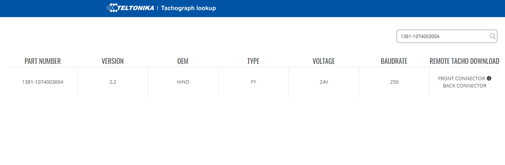

# Tachograph Lookup

Teltonika [Tachograph Lookup](https://tacholookup.teltonika.lt/) is an online tool that provides information about the [tachographs supported by Teltonika devices](https://wiki.teltonika-gps.com/view/Supported_Tachographs).

The following information is available (depends on tachograph model):

- Part number – tachograph part number.
- Version – tachograph version.
- OEM – vehicle make in which the tachograph is used.
- Type – vehicle model.
- Voltage – voltage system used in the vehicle (12/24V).
- Baudrate – recommended baudrate.
- Remote tacho download – location of connector on the tachograph for data download.

