# Tachograph files download with Wialon platform

# Introduction

This step by step instruction shows how with [Professional trackers](https://wiki.teltonika-gps.com/view/Professional_Trackers) via “Wialon” platform from VDO Digital – DTCO 1381 and Stoneridge download DDD files.
To download DDD files from tachograph to device need send GPRS command which initiate DDD files download, so Teltonika device should be connected to server.

# Preparing company card

Download “Tacho Card Authorizer” application from following link: [“Tacho Card Authorizer”](https://distro.gurtam.com/soft/tca/tca.zip)
Run tca.exe file. Press Edit -> Server Settings;

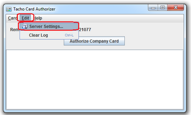In pop up window fill like shown. IP: 193.193.165.165, PORT: 21077. Please make note that IP address depends of server which you use. It automatically appear in Wialon when registering object;

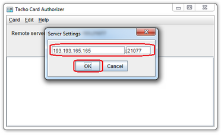Connect card reader with company card to PC and press “Authorize Company Card”;

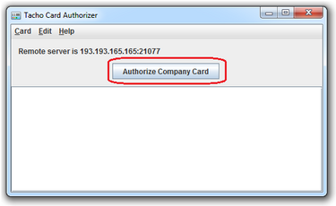Copy company card serial number;

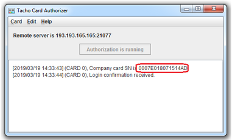

# Wialon server configuration

**Device registration**
Login to your “Wialon” account and go to “Units” tab. Press “New” to add new object;

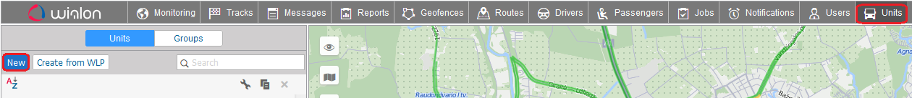In General tab fill device information. Enter device name, select device type and enter IMEI. Server address will appear automatically depending on the selected device type;

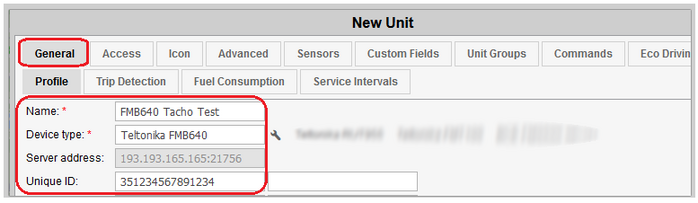**Company card registration**
In “Wialon” platform go to “Units” tab, select your FM6/FMB6 device and press “Unit properties”;

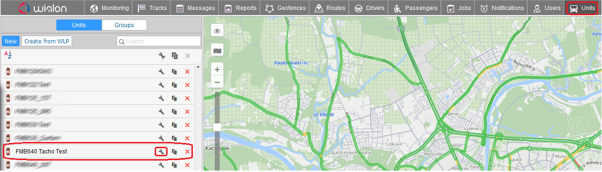In General tab, press “Configure device for the unit”;

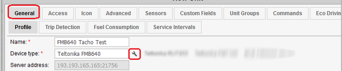Scroll down and in “Company card SN” field insert company card SN number which was copied in TCA application;

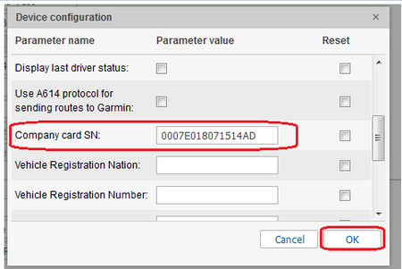**Creating GPRS command**
Go to “Command” tab to create command for DDD files download;

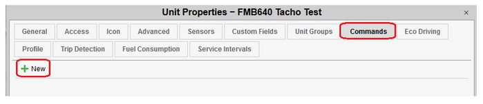Create GPRS command as shown. Enter your command name. Command type select “Query DDD (query_ddd)” – this is command to request all data from driver card or tachograph. Recommend to use Virtual channel for DDD files download – if device does not have GPRS session active or is not able to establish connection, GPRS command for DDD file download will be sent once GPRS connection recovers. TCP channel also can be used and the main difference from Virtual channel is that GPRS command will not be delivered if device will not have active GPRS session or connection.

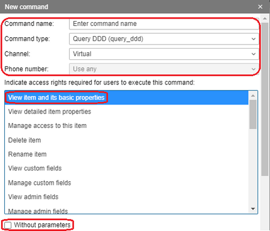Scroll down and enter remaining parameters and choose file type which you want to download. IP 193.193.165.165 and PORT: 21807. IP address and PORT automatically appear in Wialon when registering object depending on the selected device type;

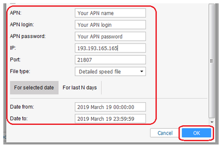

# Teltonika device configuration

Configure FMB640 device to send data to Domain: 193.193.165.165 and PORT: 21756. IP address and PORT automatically appear in Wialon when registering object depending on the selected device type;

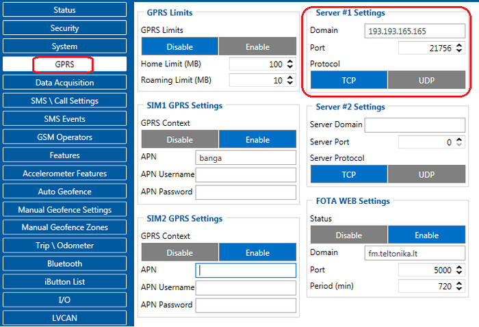To initiate tachograph files download, device should keep data link with wialon server. In order to keep constant link with server – recommended to increase “Open link timeout” parameter for 3600s or more;

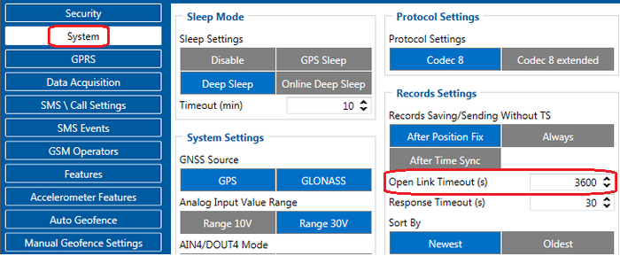

# Tachograph files download

**Sending GPRS command to device**
To send GPRS command, device should be connected to server. In Monitoring tab under “Connection state” you will see if device is connected. If you see green circle, it’s mean that device is online and you can start DDD files download.
Select device from which you want download DDD files, press “Open additional menu” and select “GPRS command”;

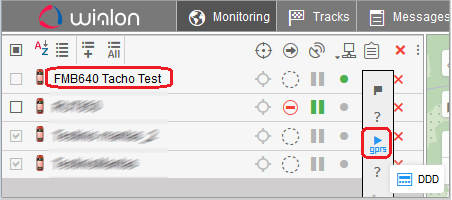Choose created earlier command and send it to device;

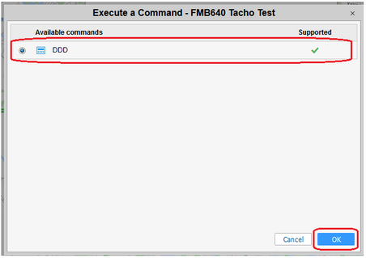When command will be successfully sent to device and when DDD file will be downloaded you will see it in notification window;

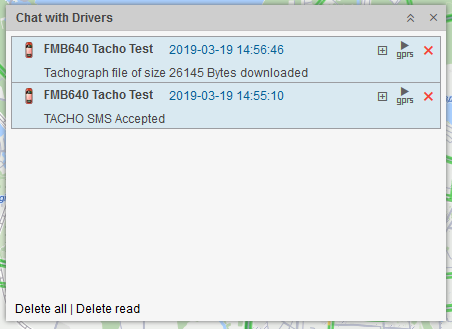**Configuring periodical Download**
In Wialon platform it is possible to create schedule for periodical tachographs files download. Once you will create action, server will automatically send GPRS command to device to initiate DDD files download.
Go to Jobs tab and press “Create a job to perform scheduled actions”;

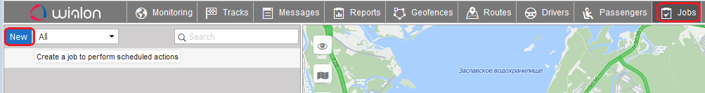In pop up window select “Execute a command over unit(s)” and press next;

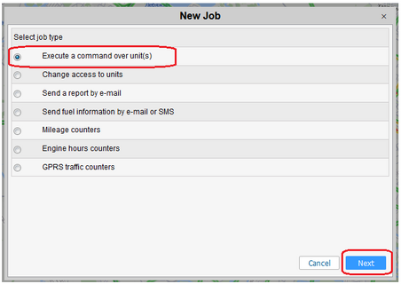Select devices for which you want to create schedule and press next;

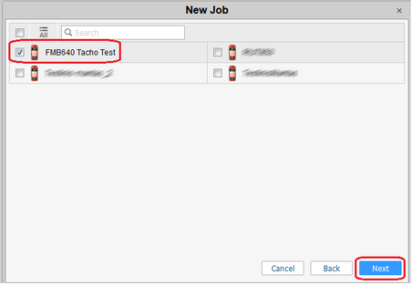Select command which should be executed and press next;

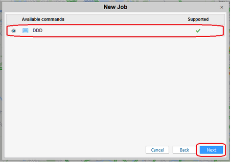Enter name of schedule, then set how often schedule should be executed and press ok.

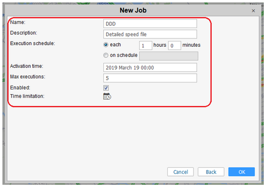

# Tachograph files storage

With your logins login to [Wialon Disketa](http://by.hosting.wialon.com/login.html?client_id=Disketta&response_type=hash&lang=en&css_url=http%3A%2F%2Fapps.wialon.com%2F%2Fwww%2Fcss%2Flogin.css&flags=1&access_type=256&redirect_uri=http%3A%2F%2Fapps.wialon.com%2Flogin%2Fdisketta%3Flang%3Den%26baseUrl%3Dhttps%253A%252F%252Fhst-api.wialon.com%26hostUrl%3Dhttp%253A%252F%252Fby.hosting.wialon.com), where all DDD files is stored.

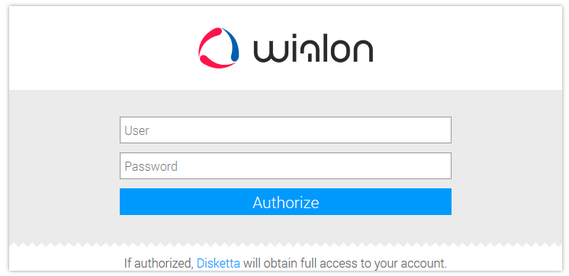Choose device;

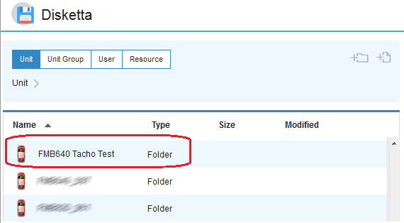Select “Protected”;

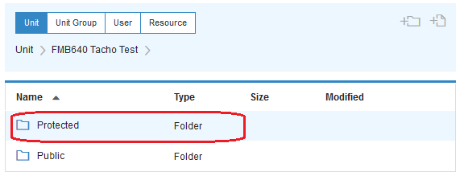Select “tachograph”;

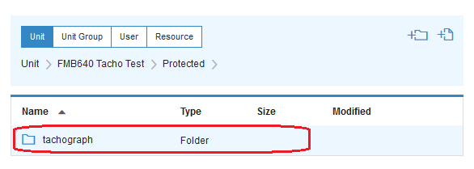There you will find all downloaded files;

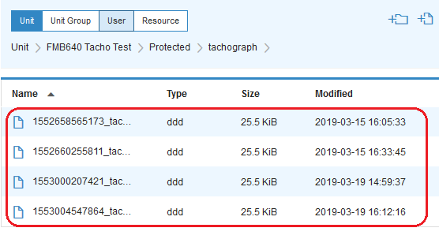In case if in Wialon is created driver with unique identification number from driver card, then tachograph files will be moved next to this driver.
