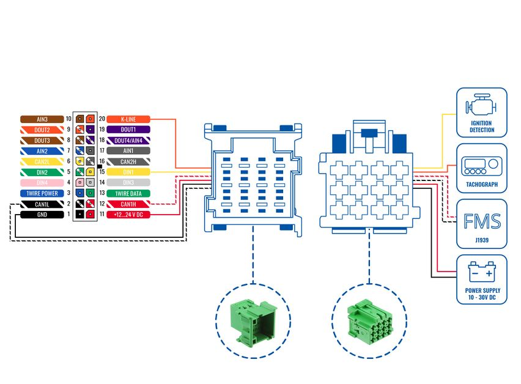

# How to connect FMC650 with FMS Cable

# Description

Cable is a **standardized** heavy duty vehicle **FMS 12-pin** connector, for connecting FMX640 with **one plug** and receiving **vehicle information** through CAN line and K-line, along with **powering the device** and getting **Ignition detection**. This ensures easier connection and does not violate the **factory warranty.**

| Supported devices | FMB640/FMC640/FMM640/FM6300 |
| --- | --- |
| Number of pins | 12 |
| Pinout | Pin12: VDC Pin1: GND Pin6: CAN H Pin9: CAN L Pin10: Ignition Pin7: K-line |
| Supported protocols | FMS/K-Line |
| Length | 0.9 meter |

# FMS Plug Location

Even though the FMS cable is standardized cable – its placement in the vehicle might differ depending on manufacturer and depending on vehicle trim level.

We were able to identify the most common places for the FMS plug – refer to the examples bellow:

### Behind the Fuse panel on passenger side – for Example SCANIA S/R/G/P Euro6 Series

### Near the Fuse panel on passenger side – for example DAF XF Euro6

### Behind the Radio on lower deck – for example Volvo FH Euro5 and Renault T Euro6

### Behind the Tachograph on upper deck – for example Mercedes Actros MP5 Euro6

# Remote Data Download (RDD) via FMS

When RDD (Remote Data Download) signal available on **FMS**.

Applies to:

- DAF CF - LF - XF
- IVECO Stralis I / II/ Hi-Way
- Renault D / Magnum DXI & E-TECH / Midlum DXI / Premium DXI / Renault T-K-C
- Volvo FH - FM - FL

For the following vehicles regarding the **RDD**, please contact the manufacturer:

- MAN TGX - TGA - TGL - TGM
- Mercedes Actros / Antos / Atego / Arocs / Axor II
- Scania R - P - G - S
