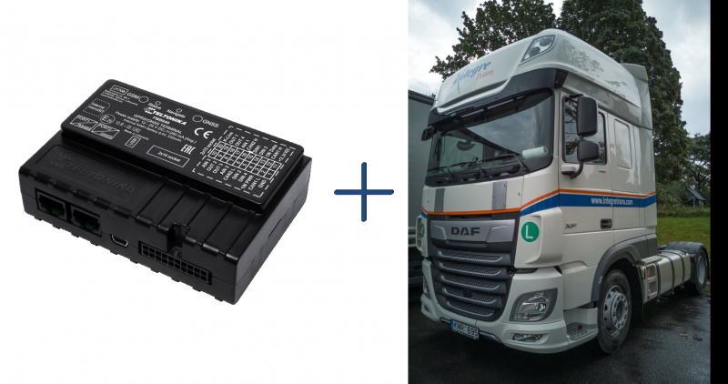
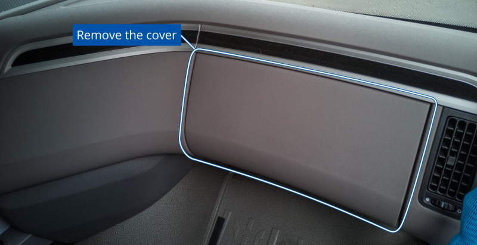
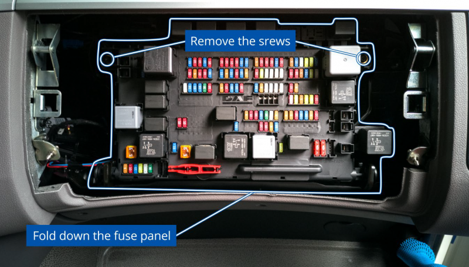
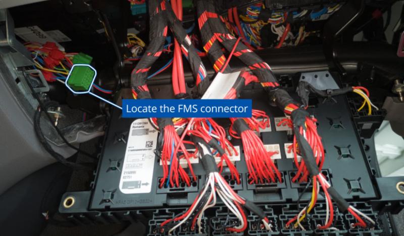
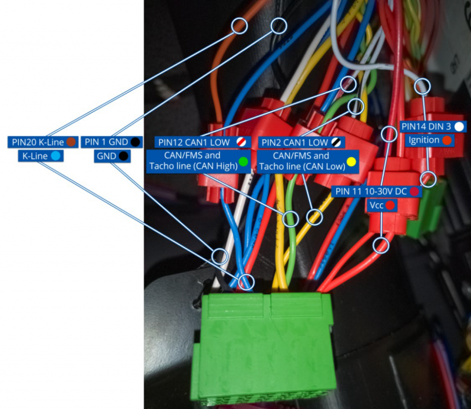

# How to Install FMC650 on DAF XF

# Installation proccess

- Below is shown main installation location:

Fuse panel cover- Carefully unscrew the fuse panel screws and fold the panel down.

Fuse panel and screws location- Where to find main connector?

Main FMS connector location- Connect the wires accordingly. It is recommended to use DIN 1 instead of DIN 3 for ignition detection.

FMB640 and DAF XF connection- After installation and device configuration of FMC650 (CAN1 should be selected – FMS/TACHO), you can check if installation is properly made. Turn on ignition of vehicle and send SMS command: “ tachocheck”. If response shows: “Can1:111,F2EF”, 111 -means tachograph properly connected, F2EF - or any other value which is not equal to 0000, means FMS data received also.
