# How to install FMC650 to MB Actros

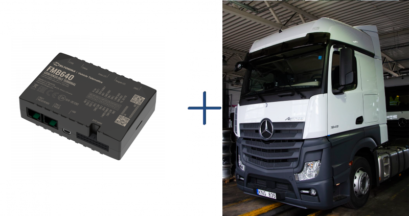

# Installation proccess

- Below is shown main installation location:

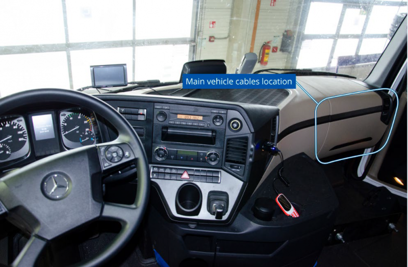Installation location- Main cables, which should be used – twisted pair of violet and white-brown for FMS/CAN and Tachograph connection. The same line is used to read FMS data and to download Tachograph files. Additionally, K-line wire for live vehicle data from the tachograph is located in the same place violet – white wire:

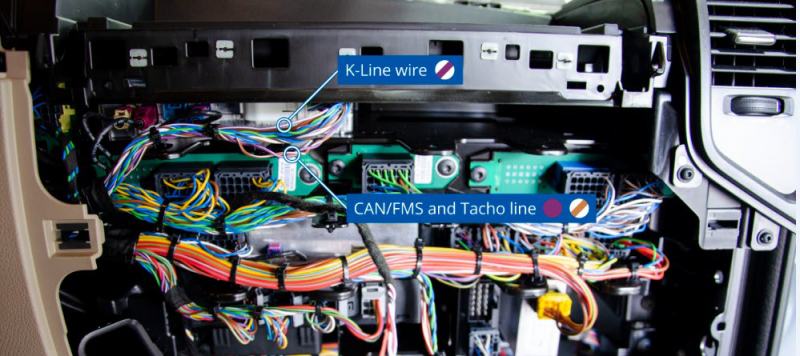Locating FMS and K-Line wires- Below shown the connection of CAN1 pair from FMB6 device to FMS/TACHO line on vehicle and K-line connection to FMB6:

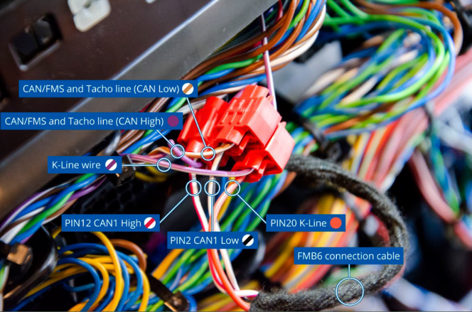3 FMS and K-Line connection to FMB6- To get proper resistance on the CAN circuit, needed to disconnect the resistance connector which is near the tachograph:

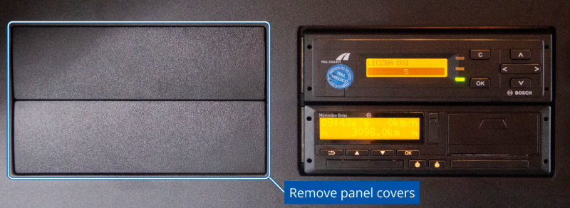Resistence connector location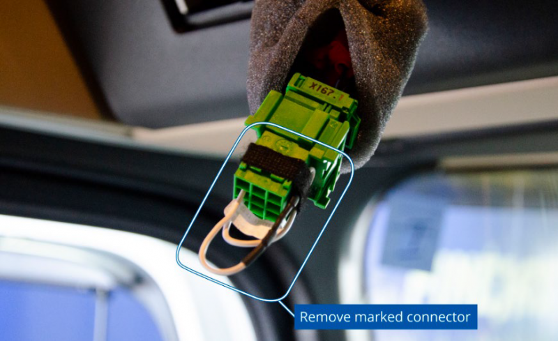Resistence connector with attachment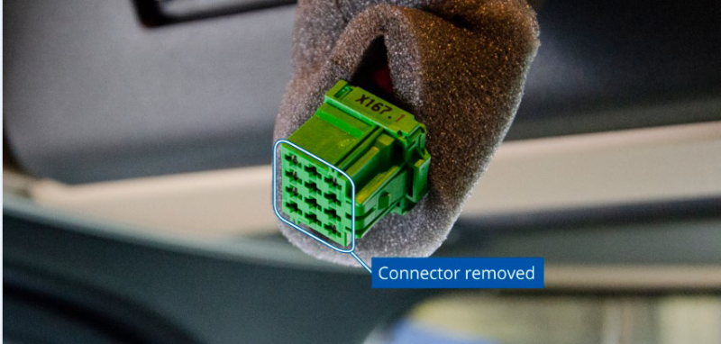Resistence connector- Recommended power source and ignition connection wires:

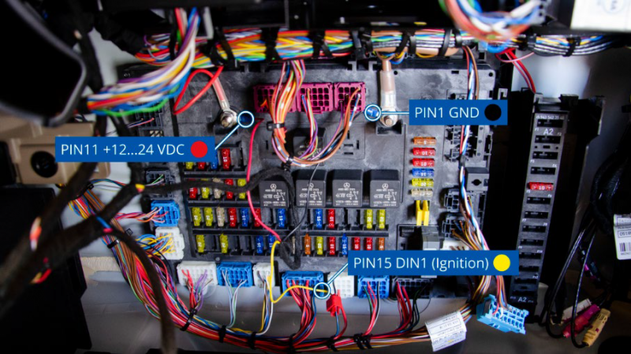Power source and ignition wiresMore detailed view of Ignition connection:

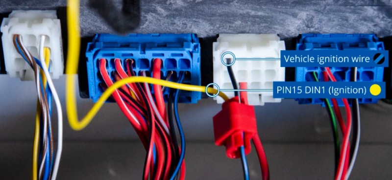Ignition detection wire- Recommended place for GNSS antenna:

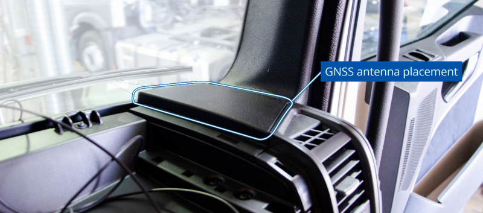antenna prefered installation location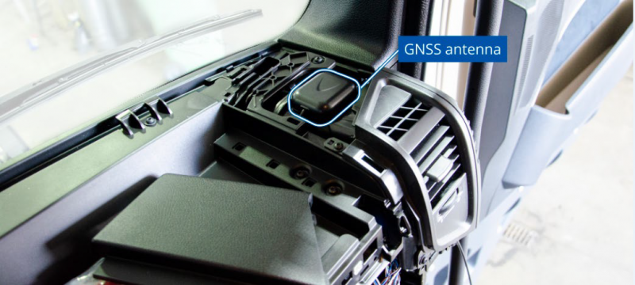Installed GNSS antennaAfter installation and device configuration of FMC6 (CAN1 should be selected – FMS/TACHO), you can check if the installation is properly made. Turn on the ignition of the vehicle and send SMS command: “tachocheck”. If the response shows: “Can1:111,F2EF”, 111 -means tachograph properly connected, F2EF - or any other value which is not equal to 0000, means FMS data received also.
