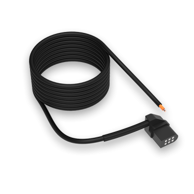
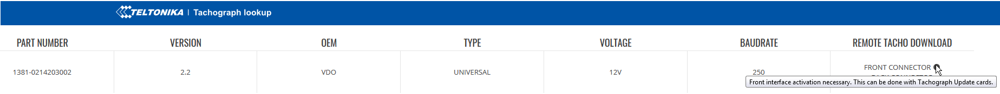
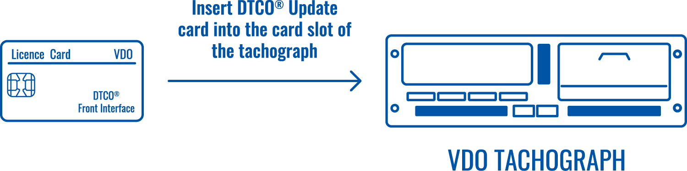
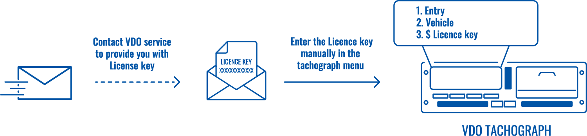
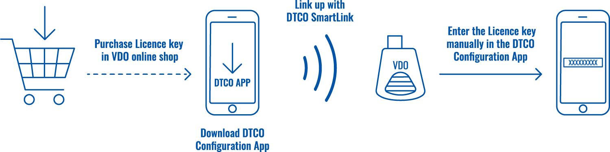
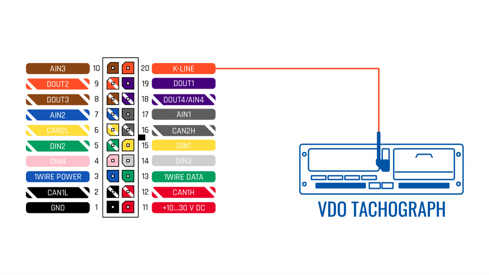
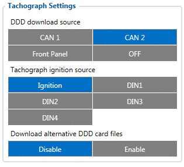
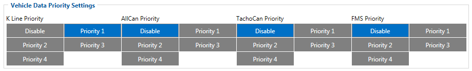

# How to download DDD files with Front Panel Cable

This functionality allows us to download DDD files and read live data from the tachograph front panel connection.

Only Siemens VDO Digital Tachographs – DTCO 1381 release 1.3a and higher are supported.
The cable is designed for easy installation and does not cover the buttons or the screen of the tachograph.

# Use Case

Compared to conventional tachograph connection to the back interface (C connector/D connector), the front connection has these benefits:

- Main advantage is the **possibility to download DDD files from the 12 Volt tachographs**that do not support remote DDD files transfer through the C connector.

This type of tachographs are widely used in such vehicles as:

**Fiat Ducato/Boxer/Jumper**
**Ford Transit**
**Iveco/Irisbus Daily**
**Mercedes Benz Sprinter/Vito/Viano**
**Volkswagen Crafter**
**And many other makes and models**

**NOTE:** Majority of 12V Tachographs only support download from Front Panel. To check which DDD download method is supported and which baudrate should be used, use [Teltonika Tachograph Lookup](https://tacholookup.teltonika.lt/)

- The installation is easier than connecting tachograph via C connector which may reduce the overall installation cost of FMB640 to the truck (note that tachograph **activation is required**).

- Our cable is compatible with **1.3a, 1.4, 2.0, 2.1, 2.2 and 3.0, 4.0**tachograph versions - the cable is designed in a way that **does not cover the buttons and the screen** of the tachographs - it does not interfere with every day driver operations.

- DDD files and live data via one cable. With Front Panel Interface you can get DDD files and live tachograph data. Note that during DDD files upload live data is not read.

This means that both FMB6 CAN-BUS can be used for a different purpose.

- The DDD files transfer to WEB Tacho or Wialon stays the same - you can have a fleet of mixed connections, but use the same platform.

# Tachograph Activation

To get data from the tachograph Front Interface - **tachograph has to be activated in order to support this feature**.

All Siemens VDO Digital Tachographs – DTCO 1381 (release 1.3a and higher) can be activated.

The process for activation is different for 1.3a-2.2 and 3.0-4.0 versions.

## For 1.3a-2.2 version

A **DTCO® Update card** is used. There are two different cards for activation:

•A2C59512046 - one activation.
•A2C59512047 - five activations.

To enable Front Interface - insert the DTCO® Update card into the card slot of the tachograph, the slot number is not important. The tachograph will update automatically.

**NOTE:** if you use a card with 5 activations - the tachograph will not show how many activations on the card are left, therefore you should note it manually.

## For 3.0-4.0 version

For these versions "DTCO® Update card" **is no longer used**. You can activate the tachograph in two ways:

- Contact VDO service to provide you with **License Key** for the tachograph Front Panel activation. After receiving a letter with license key, you can **enter it manually** in the tachograph menu:

1. entry
2. vehicle
3. $ licence code

- Download **[Download DTCO Configuration APP](https://www.fleet.vdo.com/products/dtco-configuration-app/)** on your smartphone, link up with **[DTCO SmartLink](https://www.fleet.vdo.com/products/dtco-smartlink-pro/)** and enter the **license key**, that you can purchase in VDO online shop.

To check if your tachograph is already enabled (**by default**, from the factory, remote DDD files from Front Interface is **disabled**) you can contact your VDO service or use "tachocheck" SMS command.

# Installation process

The cable connects to the Front Interface Connector that is used for manual DDD files download.

- Uncover the interface
- Connect Front Panel Cable to the tachograph
- Connect FMB640 K-line with Front Panel Cable

# Device configuration

In configurator go to *"CAN\ Tachograph"* tab and in *"Tachograph Settings"* select **"Front Panel"** as **"DDD Download Source"**:

This way DDD files will be downloaded from the tachograph Front Interface.

To read live data, in *"Tachograph Data"* tab of the configurator, change [**Vehicle Data Priority Settings**](https://wiki.teltonika-gps.com/view/FMB640_LVCAN_I/O,FMS_IO_and_Tachograph_data_elements) -> **"K Line Priority"** to **"Priority 1"**

# Final Steps

In order to check if the connection/activation/configuration is correct, send "tachocheck" SMS command. If everything is correct, the device will reply:

•**KLN:111,0000, K-Line:0**
The ones mean the same as in CAN_2:111,.... tachocheck response:
CAN_2:[TRC],[ABCD], K-Line:[K]

[T] – Tachograph presence on bus:
• 0 – Tachograph doesn’t respond on bus;
• 1 – Tachograph responds on bus.

[R] – Response to Open Remote Session validity check:
• 0 – Wrong or unknown response (failed to open Remote Session);
• 1 – Tachograph responds positively (Remote Session opened successfully).

[C] – Response to Close Last Authentication Session validity check:
• 0 – Wrong or unknown response (failed to close last authentication session);
• 1 – Last authentication session closed successfully, device is ready to open new authentication session.

The other values will always be zero because there is no FMS data and the K-line is used for front download.
