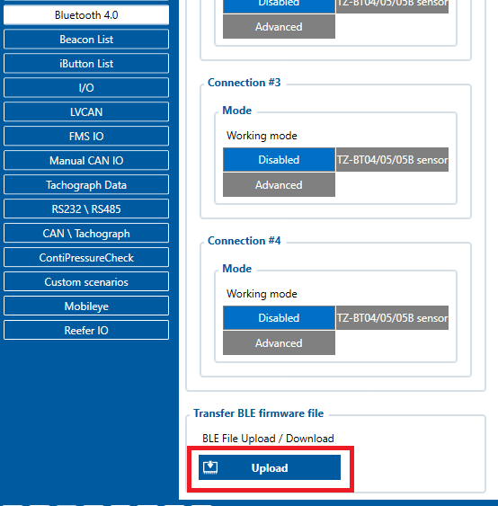
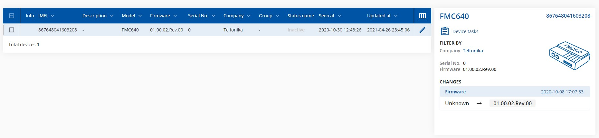
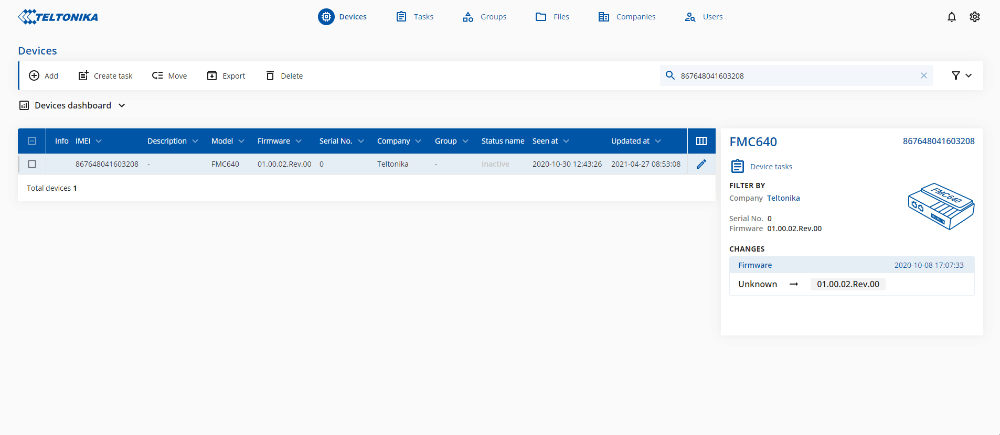

# FMC640 BLE module update

# Introduction

The Bluetooth Low Energy (BLE) firmware update can enhance the performance and stability of BLE devices. It is mandatory to update the device with at least 0.1.5 BLE firmware version to have the possibility to use FMC640 with BLE accessories or use the device as a beacon (to broadcast the ID).

The BLE firmware can be obtained by contacting the sales manager or creating a ticket for technical support via the Helpdesk platform.
**Note: The BLE firmware received from the sales manager or technical support can be used only with FMX640 devices. With 03.00.15.Rev.13 firmware update, the BLE firmware can be used with FMX650 devices.**

The update can be made in the following ways:

- Via Configurator
- Via Fota web

# Update via Configurator

Follow the procedure below to update BLE firmware via the configurator:
1) Connect the device to the PC and open the configurator.
2) Go to the "Bluetooth 4.0" tab. At the bottom, you will find the "Transfer BLE Firmware file" with the "Upload" button. Press it and choose the BLE FW file, click OK and the device will be updated shortly.

# Update via FOTA WEB

Check if the device is updated with at least the 01.00.02 firmware version before starting the BLE firmware update. It is the minimal device firmware version that supports BLE firmware updates over the air. If the current firmware version is older than 01.00.12, download the latest base firmware from [**here**](https://wiki.teltonika-gps.com/view/Firmware_versions#PROFESSIONAL_trackers) and update the device.

When the device is prepared, the BLE firmware update can be accomplished according to a quick and simple step-by-step guide below:

1) FMC640 device must be registered in FOTA Web – device‘s model, firmware version, serial number, and other information must be shown.

FMC640device must have a correct device firmware version uploaded (Minimal device firmware 01.00.02). Once the device with the correct device firmware version connects to FOTA Web on the next scheduled connection (or instant connection, initiated by an SMS command "web_connect"), the data about the device will be updated.

2) To update BLE a checkbox needs to be ticked, then the „Create task“ button pressed, and the „Update BLE firmware“ option selected:

Once the firmware update task has been assigned, it can be seen in the main window. Please note that uploading will start after the next scheduled connection to Fota Web. The instant connection to the FOTA WEB can be initiated by an SMS command "web_connect".
