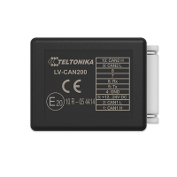
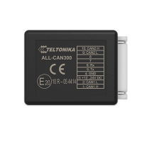
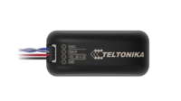
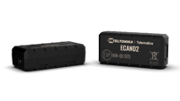
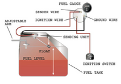
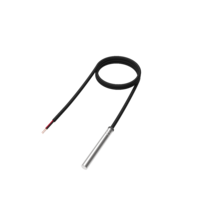
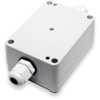
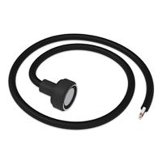
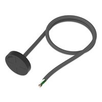

# FMC650 Accessories

# LV-CAN200

Access to CAN Bus data enables fleet operators to report on a wide range of information. LV-CAN200 adapter lets you read such essential CAN parameters like: fuel level, odometer, VIN number, fuel consumption, engine RPM, engine temperature and handbrake status. It helps to identify areas of improvement in the vehicle operation to drive down overheads and minimize environmental impact.

- [LV-CAN200](https://wiki.teltonika-gps.com/view/LV-CAN200)

# ALL-CAN300

Communication network can provide you with a wide range of data that can be used to reduce running costs, improve driver safety, streamline maintenance processes and support environmental responsibility.

- [ALL-CAN300](https://wiki.teltonika-gps.com/view/ALL-CAN300)

# ECAN01

Contactless connection to the CAN bus of the vehicle! It reads can bus data through the isolation of wires without damaging them and forwards signals to tracking device.

- [ECAN01](https://wiki.teltonika-gps.com/view/ECAN01)

# ECAN02

Contactless connection to the CAN bus of the vehicle! It reads can bus data through the isolation of wires without damaging them and forwards signals to tracking device.

- [ECAN02](https://wiki.teltonika-gps.com/view/ECAN02)

# Analog Fuel Sensor

Fuel tracking is one of the key challenges of fleet management. If the vehicle has a factory installed Analog Fuel Sensor, there is a solution that does not require any additional equipment - you can connect the device via AIN to read the fuel data straight from the sensor

- [Analog Fuel Sensor](https://wiki.teltonika-gps.com/view/Analog_Fuel_Sensor)

# 1-Wire Temperature Sensor

Digital temperature sensor probe is based on Dallas DS18B20 sensor. An 8 meter cable length will not require any additional wires for even the most demanding installation places. These sensors operate in wide temperature range from -55°C to 125°C.

- [1-Wire Temperature Sensors](https://wiki.teltonika-gps.com/view/1-Wire_Temperature_Sensors)

# 1-Wire TTJ Temperature Sensor

The TTJ communicates over a 1-Wire bus that by definition requires only one data line (and ground) for communication with a central microprocessor. It has an operating temperature range of –55°C to +125°C and is accurate to ±0,5°C over the range of –10°C to +85°C.

- [TTJ Temperature sensor](https://wiki.teltonika-gps.com/view/TTJ_Temperature_sensor)

# 1-Wire iButton Reader

One of the implemented features for fleet management devices is 1-Wire data protocol, which enables connection of iButton. The iButton device is perfect for any application where AVL data needs to travel along with a person or object identification.

- [1-Wire iButton reader](https://wiki.teltonika-gps.com/view/1-Wire_iButton_Reader)

# 1-Wire RFID Reader

The easy solution for implementing driver authentication using RFID based on DS1990A. Read is able to receive identification data wirelessly from passive transponders (cards, tags, etc.)

- [1-Wire RFID reader](https://wiki.teltonika-gps.com/view/1-Wire_RFID_Reader)
